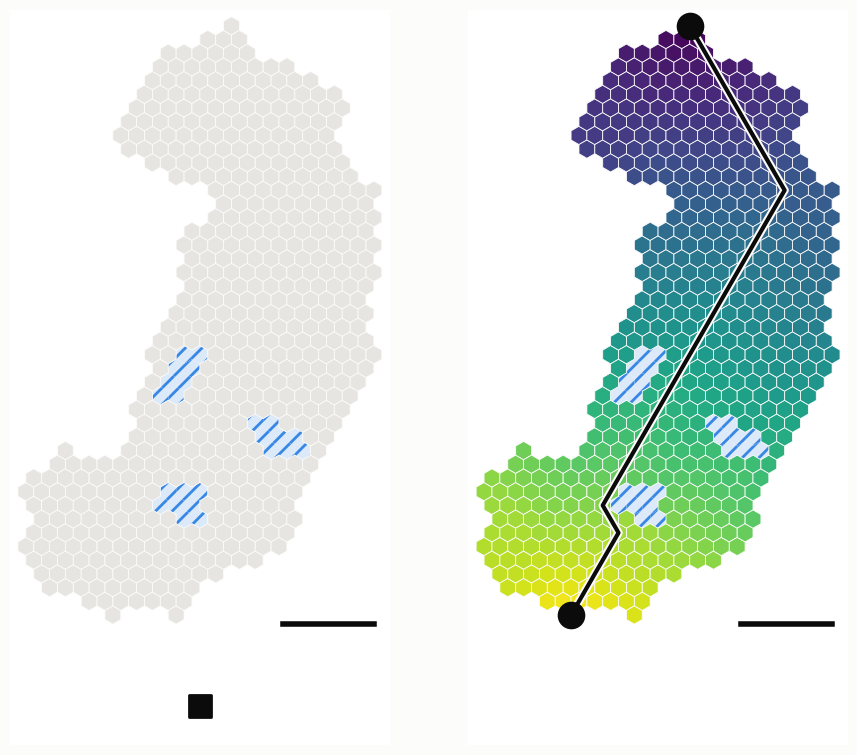
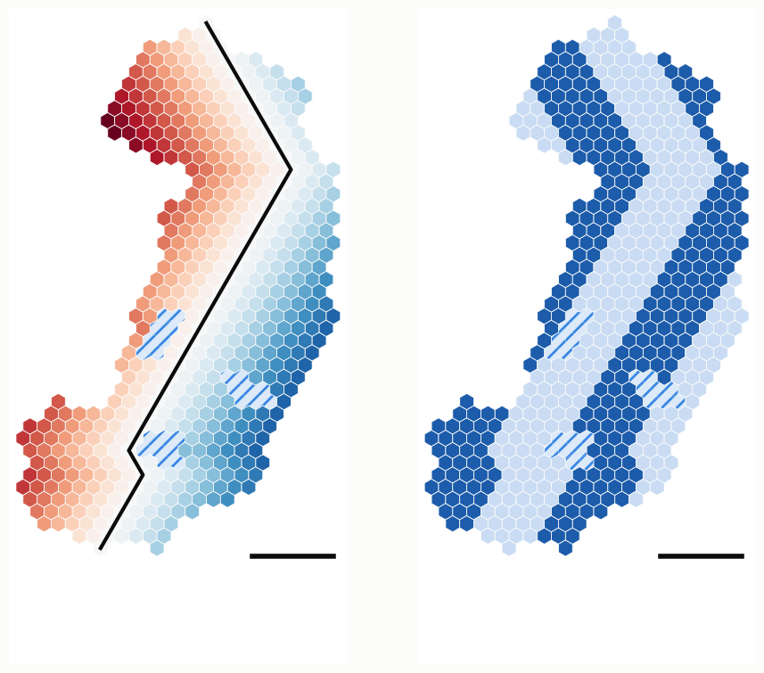
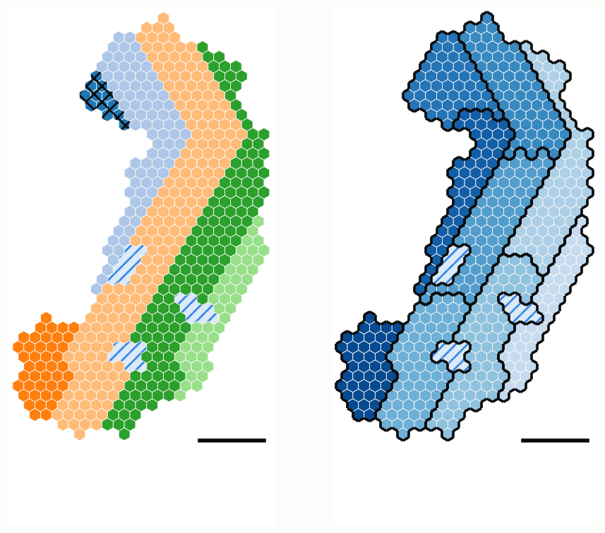
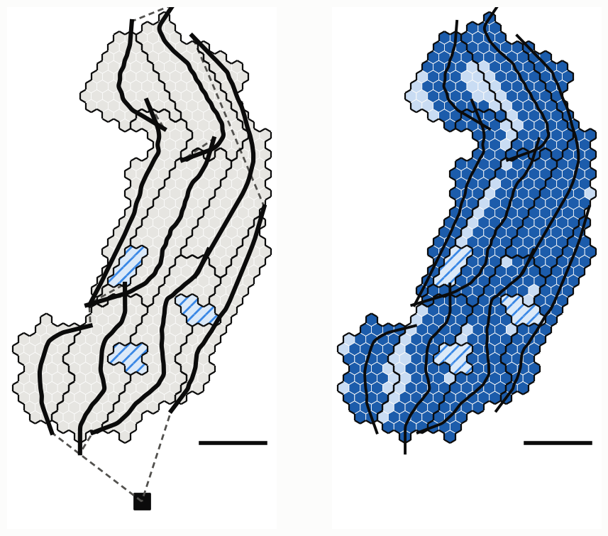
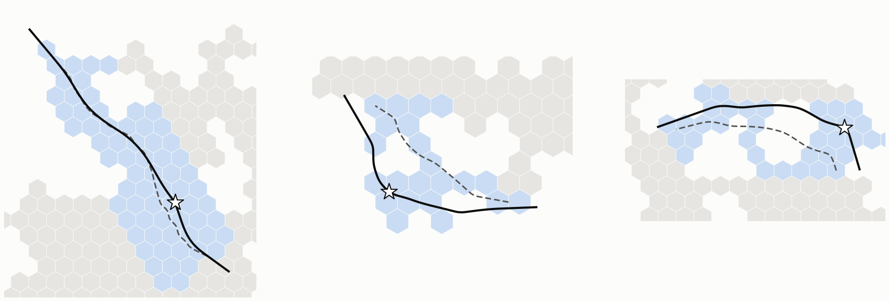
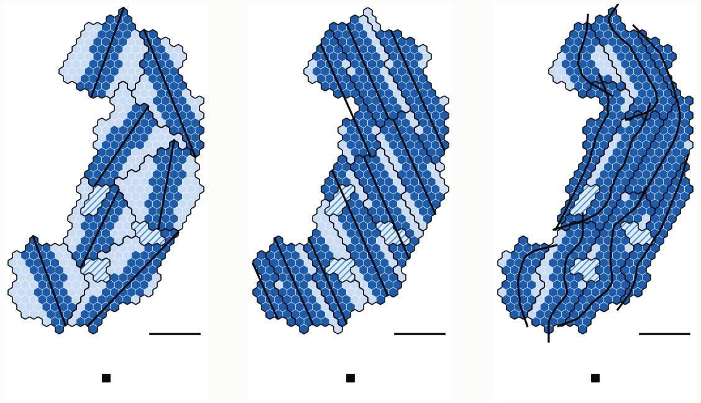

# Lớp 2: phân vùng MEANDER

**Chọn đường bay trước, chia cluster theo đường bay: luồng cong bám địa hình, từng bước với mã giả và hình**

- **Phiên bản:** 2026‑10‑22, bản rút gọn.
- **Bản trang web** (riêng tư cho tới khi được chia sẻ): https://claude.ai/artifact/4RMXn44sBxd4YLig4NBhqb.

> **Cách đọc**
> - Chỉ trình bày cơ chế phân vùng đề xuất của lớp 2. Mốc so sánh (cluster có sẵn: k‑medoids, đường thẳng qua CH) nằm trong `paper/OVERVIEW-vi.md` §6.
> - Mỗi bước có một đoạn ý tưởng, mã giả ngắn và mã giả đầy đủ. Hình không có chữ; mỗi hình gồm hai bước liền nhau.
> - **Tình trạng:** MEANDER phủ River tốt hơn hẳn, nhưng chưa thắng cluster có sẵn ở cấp nhiệm vụ; phép so sánh công bằng đang chờ (§4).

---

## 1. Bài toán và ý tưởng

**Lớp 2 phải ra:**
- các cluster, mỗi cluster liền một mảnh, ≤ Cap cell (Cap = 80);
- CH của mỗi cluster;
- đường bay của mỗi cluster: đi qua CH, độ cong ≤ 1/ρ (ρ = 255 m, UAV cánh bằng 50 m/s), có đoạn dẫn vào và dẫn ra;
- thứ tự bay các cluster.

**Ý tưởng:** chọn đường bay trước, rồi chia cluster theo đường bay.
- Cắt miền thành các **luồng** rộng cỡ River, rồi cắt dọc mỗi luồng thành cluster. Cluster dài và hẹp, đường bay đi dọc nó, nên gần như mọi cell nằm trong River.
- Luồng uốn theo địa hình: "dọc" và "ngang" đo bằng toạ độ trắc địa quanh **xương sống** của miền, không phải trục x, y.
- Đường bay là đường cong mượt qua CH; các cluster nối nhau theo kiểu quét luống.

```text
Algorithm MEANDER(Land, Cap, L, ρ)                      ▷ BS, phase 0
1: for each land piece: Spine ← its geodesic diameter;  s ← along, n ← across (geodesic, signed)
2: lanes ← n cut into strips L·w wide, at the offset with the fewest clusters + fragments
3: pieces ← connected parts of each lane; merge every fragment into the neighbour with the longest border
4: clusters ← every piece cut along s into ⌈|piece| / Cap⌉ equal chunks
5: flight line of a cluster ← its centre curve along s, smoothed to curvature ≤ 1/ρ, bent through its CH
6: order ← boustrophedon: lane by lane, along s within a lane, direction alternating
```

**Bản đồ ví dụ** cho mọi hình: miền cong 220°, rộng khoảng 1 km, cỡ 6 cluster (480 cell), ba hồ. Luồng L = 4,5 cell, gộp mảnh vụn nhỏ hơn 1/4 Cap. Thanh ngang trong hình dài 1 km.

---

## 2. Từng bước

### 2.1 Bước 1: xương sống và toạ độ dọc s

Tìm **đường kính trắc địa** của miền: từ một cell bất kỳ tới cell xa nhất A, rồi từ A tới cell xa nhất B. Mọi khoảng cách là đường ngắn nhất qua cell đất; hồ là lỗ. Xương sống là đường ngắn nhất A → B. Toạ độ dọc s(h) = (d(A, h) − d(B, h)) / 2 uốn theo miền và đi vòng quanh hồ.

```text
Algorithm M1  COORDS(Land)                              ▷ one connected land piece
1: Spine ← shortest land path between the two ends of the geodesic diameter
2: s(h) ← position along Spine;  n(h) ← signed geodesic distance to Spine
```

```text
Algorithm M1  COORDS(Land)
1: h0 ← any land cell;  A ← argmax_h d(h0, h);  B ← argmax_h d(A, h)    ▷ d: Dijkstra over land cells, lakes are holes
2: Spine ← shortest land path A → B
3: for each cell h: s(h) ← (d(A, h) − d(B, h)) / 2                       ▷ along: bends with the land, round lakes
4: for each neighbour h of Spine: side(h) ← +1 if h is left of Spine's local tangent (over ±2 cells), else −1
5: multi-source Dijkstra from those neighbours: every cell h inherits a side and a distance δ(h)
6: n(h) ← 0 on Spine, else side(h) · (δ(h) + w/2)                        ▷ across: signed distance to Spine
7: each land piece cut off by a river or a lake gets its own Spine, s and n
```



*Hình: trái là địa hình; phải là xương sống và toạ độ dọc s.*
- **Trái:** cell xám là đất có node, ô gạch chéo xanh là hồ, ô vuông đen là BS.
- **Phải:** nét đen viền trắng là xương sống, hai chấm đen là hai đầu A, B. Màu là s, từ tím (A) tới vàng (B). Các dải cùng màu cắt ngang miền theo đúng hình dạng của nó, kể cả ở khúc gãy.

### 2.2 Bước 2–3: toạ độ ngang n và luồng

**Toạ độ ngang** n là khoảng cách trắc địa có dấu tới xương sống (dòng 4–6 của M1). **Luồng** là các dải của n rộng L·w; thử ba độ lệch và chọn độ lệch cho ít cluster và ít mảnh vụn nhất.

```text
Algorithm M2  LANES(n, L)
1: lane(h) ← ⌊ n(h) / (L·w) + off ⌋, with the offset off ∈ {0, 1/3, 2/3} that gives the fewest clusters + fragments
```

```text
Algorithm M2  LANES(Land, n, L, Cap, frag)
1: for off ∈ {0, 1/3, 2/3} do
2:     lane_off(h) ← ⌊ n(h) / (L·w) + off ⌋
3:     Pieces_off ← connected parts of every lane                    ▷ lakes and bays split a lane
4:     cost(off) ← Σ_{P ∈ Pieces_off} ⌈|P| / Cap⌉ + #{P : |P| < frag·Cap}   ▷ clusters + fragments
5: keep the offset with the lowest cost
```



*Hình: trái là toạ độ ngang n; phải là các luồng.*
- **Trái:** đỏ là một phía xương sống, xanh là phía kia; càng đậm càng xa. Nét đen là xương sống. Đường đồng mức của n chạy song song với xương sống, kể cả ở khúc gãy, nơi luồng thẳng sẽ cắt chéo.
- **Phải:** các luồng, tô xen kẽ đậm và nhạt. Luồng uốn theo khúc gãy; hồ cắt ngang một số luồng.

### 2.3 Bước 4–5: gộp mảnh vụn, cắt cluster, thứ tự bay

Hồ và vịnh cắt một luồng thành nhiều mảnh. Mảnh nhỏ hơn frag·Cap được gộp vào mảnh kề có biên chung dài nhất. Mỗi mảnh được xếp theo s và cắt thành ⌈|mảnh| / Cap⌉ khúc liên tiếp bằng nhau: đó là các cluster. Thứ tự bay là quét luống.

```text
Algorithm M3  MERGE(Pieces, Cap, frag)
1: while some piece P with |P| < frag·Cap touches another piece: merge the smallest such P into its longest-border neighbour
Algorithm M4  CUT(Pieces, s, Cap)
1: for each piece: sort its cells by s; cut into ⌈|piece| / Cap⌉ consecutive chunks of equal size
```

```text
Algorithm M3  MERGE(Pieces, Cap, frag)
1: while some piece P with |P| < frag·Cap touches another piece do
2:     P ← the smallest such piece
3:     merge P into the touching piece with the longest shared border

Algorithm M4  CUT(Pieces, s, Cap, span)
1: for each piece P do
2:     sort the cells of P by s
3:     m ← ⌈|P| / Cap⌉;  if span > 0 then m ← max(m, ⌈(s_max − s_min) / (span·w)⌉)    ▷ optional length cap
4:     cut P into m consecutive chunks of equal size: the clusters
5:     a chunk in several parts keeps its largest part; every other part joins the touching chunk of P
       that still has room (≤ Cap), then with the longest shared border

Algorithm M5  ORDER(Clusters, BS)
1: lane(k) ← the lane most cells of cluster k lie in
2: for first lane ∈ {lowest, highest} × first direction ∈ {+s, −s} do
3:     tour ← lanes in turn; within a lane, clusters by mean s; direction alternates from lane to lane
4: keep the shortest tour BS → … → BS
```



*Hình: trái là các mảnh luồng trước khi gộp; phải là chín cluster MEANDER.*
- **Trái:** mỗi mảnh một màu; ô gạch chéo đen là mảnh vụn sẽ bị gộp.
- **Phải:** viền đen là biên cluster; màu càng đậm, cluster càng được bay sớm. Cluster dài theo s, hẹp theo n.

### 2.4 Bước 6: đường bay cong qua CH

Đường bay của cluster là đường tâm của nó theo s, làm mượt tới khi độ cong ≤ 1/ρ. Sau đó uốn qua CH bằng một bướu Gauss, vì CH phải nghe UAV trực tiếp. Cuối cùng thêm đoạn dẫn vào và dẫn ra thẳng dài ρ.

```text
Algorithm M6  FLIGHTCURVE(k)
1: P ← centre curve of cluster k along s, smoothed until its curvature ≤ 1/ρ
2: bend P through CH(k) with a Gaussian bump, smooth again with CH pinned; add straight leads of length ρ
```

```text
Algorithm M6  FLIGHTCURVE(k, s, ρ)
1: P ← mean cell centre of k in every bin of w/2 along s                ▷ the lane's centre curve
2: P ← moving average over 7 bins (about 600 m); resample every 10 m
3: repeat P_i ← P_i + ¼ (P_{i−1} + P_{i+1} − 2 P_i), ends fixed, until max curvature(P) ≤ 1/ρ
4: v ← CH − P(s*), where P(s*) is the point of P nearest CH
5: for σ_mult ∈ (1, 1.5, 2, 3, 4, 6) do                                ▷ widen the bump if smoothing fails
6:     σ ← σ_mult · √(2 |v| ρ)                                           ▷ the bump alone turns at most 1/(2ρ)
7:     Q(s) ← P(s) + v · exp(−(s − s*)² / (2σ²));  Q(s*) ← CH
8:     smooth Q as in line 3 with CH and both ends pinned (at most 2 000 rounds)
9:     if max curvature(Q) ≤ 1/ρ then break
10: return lead-in of length ρ ⊕ Q ⊕ lead-out of length ρ               ▷ straight, along the end tangents
```



*Hình: trái là đường bay và tour; phải là phủ River.*
- **Trái:** nét đen đậm là đường bay của từng cluster (trước khi uốn qua CH); nét đứt là tour đội 1, đi và về ô vuông BS.
- **Phải:** xanh đậm là cell cách đường bay của cluster mình ≤ ω = 1,75 cell (trong dải River), xanh nhạt là ngoài dải. MEANDER phủ 88,5 % cell trên bản đồ này.



*Hình: uốn đường bay qua CH trên ba cluster của bản đồ nhiệm vụ.*
- Từ trái sang: CH lệch ít; CH lệch 370 m (cluster chữ L); CH lệch 302 m (cluster chữ U quanh hồ).
- Nét đứt là đường gốc; nét liền là đường đã uốn qua CH (sao trắng), kể cả đoạn dẫn vào và dẫn ra.
- Trên 28 cluster của ba bản đồ nhiệm vụ, cả 28 đều uốn được; 1 cluster cần nới σ gấp 3.

**River trên đường cong:** Bank dựng theo pháp tuyến cục bộ (Thuật toán 2b trong `paper/RIVER-L3-vi.md`). Một cell bị đường cong cắt hai lần giữ lượt đi qua dài nhất làm Seg.

---

## 3. Tham số

| Tham số | Gốc | Đã chỉnh | Ghi chú |
|---|---|---|---|
| Bề rộng luồng L | 4,5 cell (780 m) | 7,5 cell | chiến dịch bão hoà gợi ý 8–10 cell |
| Ngưỡng mảnh vụn frag | 1/4 Cap | 1/2 Cap | gộp mạnh hơn, ít cluster hơn |
| Cap | 80 cell | 80 cell | nhỏ so với điểm tối ưu 110–190 cell |
| span (tuỳ chọn) | không | không | giới hạn chiều dài cluster theo s |
| ρ | 255 m | 255 m | 50 m/s, nghiêng 45° |

---

## 4. Kết quả và việc tiếp theo



*Hình: bản đồ ví dụ, từ trái sang: cluster có sẵn (k‑medoids, đường thẳng dài nhất qua CH), luồng thẳng (LANE), MEANDER. Xanh đậm là cell trong dải River, xanh nhạt là ngoài dải; nét đen là đường bay.*

- **Phủ River:** 57 % (cluster có sẵn), 80 % (luồng thẳng), 88 % (MEANDER) trên bản đồ này. Trên 57 miền cong: 55–57 %, 81–87 %, 83–90 %.
- **Cấp nhiệm vụ chưa thắng:** trên 40 bản đồ, T\* của MEANDER đã chỉnh là 479 / 634 / 770 / 921 s, so với 420 / 586 / 716 / 824 s của cluster có sẵn (2 / 4 / 6 / 8 cluster, nối Dubins).
- **Vì sao:** MEANDER tạo nhiều cluster hơn (1,2–1,45 K), nên thêm đường vào và ra, thêm chặng nối, thêm critical cell; tour đội 1 dài hơn. Dữ liệu thô vốn đã thấm gần hết ở mọi cách chia, nên phủ tốt hơn không đổi thành nhanh hơn.
- **Điểm tối ưu** (chiến dịch bão hoà, River cửa sổ theo từng critical cell): luồng 8–10 cell, cụm dài 2–3 km, khoảng 110–190 cell mỗi cụm.

**Việc tiếp theo (chờ duyệt):** các so sánh tới nay chưa công bằng về số và cỡ cluster. MEANDER‑K cho đúng K cluster cỡ đều.

```text
Algorithm MEANDER-K(Land, K, L)                         ▷ proposed, not implemented yet
1: lanes, s and n as in MEANDER
2: Chain ← the cells of all lanes in boustrophedon order (lane by lane, along s, alternating), flying over lakes
3: cut Chain into K consecutive runs of about |Land| / K cells
4: a part of a run cut off by a lake joins the touching run; rebalance the cell counts
5: flight line, CH, River (window per critical cell) and kinematics as in MEANDER
```

---

## 5. Ký hiệu

| Ký hiệu | Nghĩa | Giá trị |
|---|---|---|
| w | bề rộng cell (hai cạnh song song) | 173 m |
| Cap, K | số cell tối đa mỗi cluster; số cluster của bản đồ | 80; 2–8 |
| L, frag | bề rộng luồng; ngưỡng mảnh vụn (phần của Cap) | 4,5 hoặc 7,5 cell; 1/4 hoặc 1/2 |
| d(a, b) | khoảng cách trắc địa qua cell đất | |
| s(h), n(h) | toạ độ dọc, ngang của cell h | |
| ρ | bán kính quay tối thiểu của đội 1 | 255 m |
| ω | nửa bề rộng River | 303 m |

Mã: `uav-l2/tools/meander.py` (M1–M5, hình), `uav-l2/tools/meander_mission.py` (M6 uốn qua CH, chạy nhiệm vụ).
