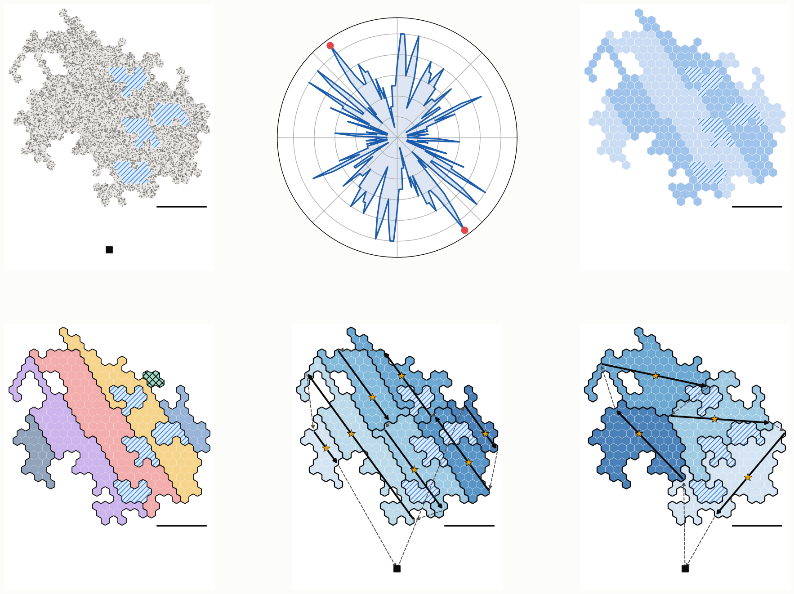
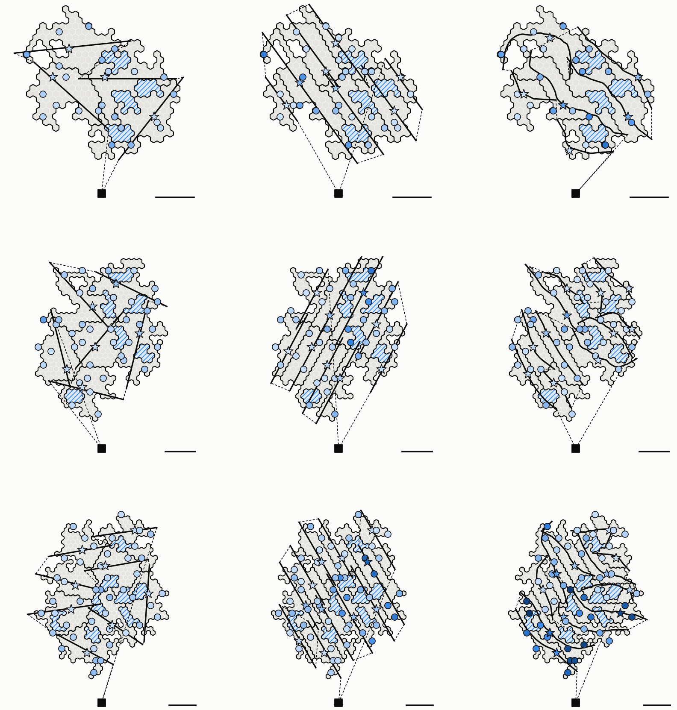
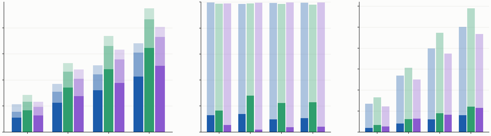
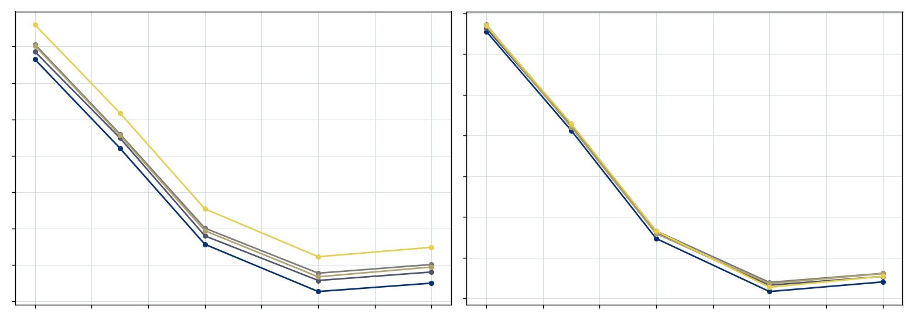

# Lớp 2: phân vùng theo đường bay (MEANDER)

**Mô tả nhanh cơ chế phân vùng đề xuất: chọn đường bay trước, chia cluster theo đường bay, với luồng cong bám địa hình**

- **Phiên bản:** 2026‑10‑22.
- **Lời gốc:** CLAUDE.md §8. Các mục liên quan:
  - 56–64: miền rộng có hồ, chia cluster, bay qua cluster;
  - 70, 82: đường bay thẳng qua CH (FlightLine);
  - 84: tái cấu trúc cluster theo đường bay (LANE);
  - 103–106: luồng cong theo địa hình (MEANDER), chạy ns‑3, ba hướng sửa;
  - 115–121: chẩn đoán, điều chỉnh, động học, so sánh công bằng, ngưỡng bão hoà;
  - 123: tài liệu này.
- **Phạm vi:** chỉ lớp 2 của Pha 1, ở mức mô tả nhanh. Lớp 3 (River) chi tiết: [RIVER-L3-vi.md](RIVER-L3-vi.md). Cả nghiên cứu: [OVERVIEW-vi.md](OVERVIEW-vi.md).
- **Bản trang web** (riêng tư cho tới khi được chia sẻ): https://claude.ai/artifact/4RMXn44sBxd4YLig4NBhqb. Dựng lại bằng `python3 paper/overview-page/build.py . <thư mục ra> --doc l2`.

> **Cách đọc**
> - Mỗi bước có ý tưởng bằng lời, **mã giả ngắn** và **mã giả đầy đủ**. Hình không có chữ; dưới mỗi hình có lời giải thích.
> - Ví dụ từng bước là một miền cong 220° có ba hồ, cỡ 6 cluster (§4).
> - **Tình trạng:** MEANDER phủ River tốt hơn hẳn, nhưng **chưa thắng** cluster có sẵn ở cấp nhiệm vụ, và các phép so sánh tới nay **chưa công bằng** về số và cỡ cluster (§5–§6). Mọi số là số thăm dò, N < 120.

---

## 1. Tóm tắt một trang

**Lớp 2 giải quyết việc gì.** Trước nhiệm vụ, BS chia miền thành các **[cluster](#g-cluster)**, chọn cho mỗi cluster một đường bay, và chọn thứ tự bay cho đội 1 (UAV **[cánh bằng](#g-canh-bang)**, 50 m/s, bán kính quay tối thiểu ρ = 255 m, không lơ lửng được).

**Cách đang dùng làm mốc: [cluster có sẵn](#g-cluster-co-san).**
- Chia bằng **[k‑medoids](#g-k-medoids)** có chặn trên 80 cell. Cluster ra tròn và gọn.
- Mỗi cluster bay **một đường thẳng qua CH** theo hướng có đoạn trong cluster dài nhất (**[FlightLine](#g-flightline)**).
- Tour đội 1 cực tiểu **[độ trễ có trọng số](#g-tour-do-tre)**.

**Ý tưởng đề xuất** (mục 84): **chọn đường bay trước, rồi chia cluster theo đường bay.**
- Cắt miền thành các **[luồng](#g-luong)** rộng cỡ River, rồi cắt dọc mỗi luồng thành cluster. Cluster dài và hẹp, đường bay đi dọc nó, nên gần như mọi cell nằm trong River.
- Các đường bay nối nhau thành một tour **[quét luống](#g-quet-luong)**, biết trước khi chia cluster.
- **[LANE](#g-lane)** làm điều này với luồng thẳng song song. **[MEANDER](#g-meander)** uốn luồng theo địa hình:
  - "dọc" và "ngang" đo bằng toạ độ trắc địa của chính miền, quanh một **[xương sống](#g-xuong-song)**;
  - đường bay là đường cong mượt có độ cong ≤ 1/ρ, đi qua CH.

**Kết quả** (thăm dò):

| | Cluster có sẵn | MEANDER |
|---|---|---|
| Cell nằm trong dải River (hình học) | 54–57 % | 76–90 % |
| Critical cell cách Axe (ns‑3, 3 bản đồ) | TB 2,0 cell, xa nhất 9 | TB 0,8 cell, xa nhất 4 |
| Số cluster trên bản đồ K cluster | đúng K | 1,5–1,65 K (gốc), 1,2–1,45 K (đã chỉnh) |
| **[T\*](#g-tstar)** (40 bản đồ, nối Dubins) | 420 / 586 / 716 / 824 s | 479 / 634 / 770 / 921 s (đã chỉnh) |

- **Vì sao chưa thắng:** nhiều cluster hơn (thêm đường vào và ra, thêm chặng nối, thêm critical cell), tour đội 1 dài hơn, và Axe dài làm River chậm khi critical cell phải gom cả D. Nhiệm vụ chỉ cần bộ manh mối ở critical cell, và River lấp phần thiếu trong vài chục giây; nên "phủ tốt hơn" không đổi thành "nhanh hơn".
- **Đang chờ duyệt:** **[MEANDER‑K](#g-meander-k)** (đúng K cluster cỡ đều) để so công bằng, với River cửa sổ theo từng critical cell, và luồng ở điểm tối ưu của chiến dịch bão hoà (8–10 cell, cụm 2–3 km).

---

## 2. Bài toán lớp 2

**Cho trước:**
- miền: các cell lục giác (R = 100 m, bề rộng w ≈ 173 m) có node, và hồ (vùng không có node, UAV bay qua được);
- vị trí BS; chặn trên Cap cell mỗi cluster (đang dùng 80);
- đội 1: tốc độ V_1 = 50 m/s, bán kính quay ρ = 255 m (nghiêng 45°);
- Q: số gói của bộ manh mối (4 036 gói, khoảng 2 km bay, một gói mỗi 0,5 m).

**Phải ra:**
- các cluster: mỗi cluster liền một mảnh, ≤ Cap cell;
- CH của mỗi cluster: node mạnh nhất cách biên ít nhất 300 m (hạ dần 200, 100, 0 m nếu cluster mảnh);
- đường bay của mỗi cluster: **đi qua CH** (CH luôn là critical cell và phải nghe UAV trực tiếp), thoả độ cong ≤ 1/ρ, có đoạn dẫn vào và dẫn ra nằm ngoài cluster;
- thứ tự bay các cluster (tour đội 1, từ BS về BS).

**Mục tiêu:** T\* nhỏ nhất (thời điểm đội 2 xác minh xong cell có điểm cao nhất). Lớp 2 tác động lên T\* qua bốn đại lượng, kéo về hai phía:

| Đại lượng | Muốn | Vì sao |
|---|---|---|
| Tổng quãng bay đội 1 | ngắn | báo cáo về BS sớm hơn |
| Số cluster | ít | ít đường vào, ra và chặng nối; ít critical cell để đội 2 chọn |
| Độ dài Axe mỗi cluster | ≥ khoảng 2 km | Axe ngắn hơn bộ manh mối thì không critical cell nào đủ 12 manh mối |
| Cell nằm gần đường bay | nhiều | critical cell tự nghe được nhiều hơn, River ngắn hơn |

---

## 3. Mốc so sánh: cluster có sẵn

Lời gốc: mục 61, 64, 70, 82. Chi tiết: `uav-l2/docs/FLIGHTLINE-vi.md`, `uav-l2/tools/partition.py`.

**Chia cluster: k‑medoids có sức chứa** trên đồ thị cell. Khoảng cách là số bước qua cell đất, nên hồ phải đi vòng.

```text
Algorithm B1  KMEDOIDS(Land, Cap)                       ▷ BS, phase 0
1: K ← ⌈|Land| / Cap⌉;  medoids ← farthest-point sampling over land cells
2: grow all clusters at once from their medoids; a cell joins the first cluster to reach it that still has room
3: leftovers join the smallest touching cluster; overfull clusters push border cells along a chain to one with room
4: medoid ← the cell with the least total distance in its cluster; repeat 2–4 until the medoids stay
```

**Đường bay: FlightLine.** Đường thẳng qua CH, theo hướng có đoạn nằm trong cluster dài nhất.

```text
Algorithm B2  FLIGHTLINE(Cluster, ρ)
1: CH ← strongest node at least Margin from the edge of Cluster        ▷ Margin 300, 200, 100, 0 m
2: for each bearing θ ∈ {0°, 2°, …, 178°}: Len(θ) ← length of the line through CH at θ inside Cluster
3: for θ in order of decreasing Len(θ):
4:     Entry, Exit ← farthest points of that line still in Cluster, one on each side of CH
5:     Path ← Dubins(Entry → CH → Exit, turn radius ρ)
6:     if Path crosses the edge cleanly and its leads stay outside Cluster: return Path
```

**Tour: độ trễ có trọng số.** Thứ tự cluster và chiều bay cực tiểu Σ_k n_k · t_k^rời, với n_k là số critical cell của cluster k và t_k^rời là lúc đội 1 rời cluster k. Giải chính xác bằng **[Held–Karp](#g-held-karp)** tới 12 cluster; nhiều hơn thì dùng tham lam + 2‑opt. Bản động học (mục 117) thay các chặng nối thẳng bằng đường **[Dubins](#g-dubins)**.

Đây là một mốc mạnh: đường bay qua mỗi cluster đã được chọn cho dài nhất trong cluster, và tour được tối ưu.

---

## 4. MEANDER từng bước

Lời gốc: mục 84 (ý tưởng), 103 (đường cong bám địa hình), 116 (điều chỉnh). Chi tiết: `uav-l2/docs/RESTRUCTURE-vi.md` (LANE), `uav-l2/docs/CURVE-vi.md` Phần 2–4 (MEANDER). Mã: `uav-l2/tools/meander.py`, `meander_mission.py`.

**Toàn bộ cơ chế trong một khung:**

```text
Algorithm MEANDER(Land, Cap, L, ρ)                      ▷ BS, phase 0
1: for each land piece: Spine ← its geodesic diameter;  s ← along, n ← across (geodesic, signed)
2: lanes ← n cut into strips L·w wide, at the offset with the fewest clusters + fragments
3: pieces ← connected parts of each lane; merge every fragment into the neighbour with the longest border
4: clusters ← every piece cut along s into ⌈|piece| / Cap⌉ equal chunks
5: flight line of a cluster ← its centre curve along s, smoothed to curvature ≤ 1/ρ, bent through its CH
6: order ← boustrophedon: lane by lane, along s within a lane, direction alternating
```

**Bản đồ ví dụ** cho mọi hình ở mục này: miền cong 220°, rộng khoảng 1 km, cỡ 6 cluster (480 cell), ba hồ. Luồng rộng L = 4,5 cell, gộp mảnh vụn nhỏ hơn 1/4 Cap (tham số gốc). Bản đã chỉnh dùng L = 7,5 cell và gộp mảnh nhỏ hơn 1/2 Cap (§4.5). Mỗi hình dưới đây gồm hai bước liền nhau; thanh ngang dài 1 km.

### 4.1 Bước 1: xương sống và toạ độ dọc s

**Làm gì.** Tìm **đường kính trắc địa** của miền: đi từ một cell bất kỳ tới cell xa nhất A, rồi từ A tới cell xa nhất B, mọi khoảng cách đo bằng đường ngắn nhất qua cell đất (hồ là lỗ). Xương sống là đường ngắn nhất A → B. **[Toạ độ dọc](#g-toa-do)** của mỗi cell là s(h) = (d(A, h) − d(B, h)) / 2: nó uốn theo miền và đi vòng quanh hồ.

```text
Algorithm M1  COORDS(Land)                              ▷ one connected land piece
1: Spine ← shortest land path between the two ends of the geodesic diameter
2: s(h) ← position along Spine;  n(h) ← signed geodesic distance to Spine
```

```text
Algorithm M1  COORDS(Land)
1: h0 ← any land cell;  A ← argmax_h d(h0, h);  B ← argmax_h d(A, h)    ▷ d: Dijkstra over land cells, lakes are holes
2: Spine ← shortest land path A → B
3: for each cell h: s(h) ← (d(A, h) − d(B, h)) / 2                       ▷ along: bends with the land, round lakes
4: for each neighbour h of Spine: side(h) ← +1 if h is left of Spine's local tangent (over ±2 cells), else −1
5: multi-source Dijkstra from those neighbours: every cell h inherits a side and a distance δ(h)
6: n(h) ← 0 on Spine, else side(h) · (δ(h) + w/2)                        ▷ across: signed distance to Spine
7: each land piece cut off by a river or a lake gets its own Spine, s and n
```


*Hình: trái là địa hình; phải là xương sống và toạ độ dọc s.*
- **Trái:** cell xám là đất có node, ô gạch chéo xanh là hồ, ô vuông đen là BS.
- **Phải:** nét đen viền trắng là xương sống, hai chấm đen là hai đầu A, B. Màu là s, từ tím (đầu A) tới vàng (đầu B). Các dải cùng màu cắt ngang miền theo hình dạng của miền, kể cả ở khúc gãy giữa bản đồ.

### 4.2 Bước 2–3: toạ độ ngang n và luồng

**Toạ độ ngang** n là khoảng cách trắc địa có dấu tới xương sống. Dấu (trái hay phải) được gán khi mặt sóng của Dijkstra rời xương sống, theo tiếp tuyến cục bộ của xương sống (dòng 4–6 của Thuật toán M1).

**Luồng.** Cắt n thành các dải rộng L·w. Thử ba độ lệch (0, 1/3, 2/3 luồng), chọn độ lệch cho ít cluster và ít mảnh vụn nhất.

```text
Algorithm M2  LANES(n, L)
1: lane(h) ← ⌊ n(h) / (L·w) + off ⌋, with the offset off ∈ {0, 1/3, 2/3} that gives the fewest clusters + fragments
```

```text
Algorithm M2  LANES(Land, n, L, Cap, frag)
1: for off ∈ {0, 1/3, 2/3} do
2:     lane_off(h) ← ⌊ n(h) / (L·w) + off ⌋
3:     Pieces_off ← connected parts of every lane                    ▷ lakes and bays split a lane
4:     cost(off) ← Σ_{P ∈ Pieces_off} ⌈|P| / Cap⌉ + #{P : |P| < frag·Cap}   ▷ clusters + fragments
5: keep the offset with the lowest cost
```


*Hình: trái là toạ độ ngang n; phải là các luồng.*
- **Trái:** đỏ là một phía xương sống, xanh là phía kia; càng đậm càng xa xương sống. Nét đen là xương sống. Các đường đồng mức của n chạy song song với xương sống, kể cả ở khúc gãy. Đây là thứ LANE không có: luồng thẳng của LANE cắt chéo qua khúc gãy.
- **Phải:** các luồng, tô xen kẽ đậm và nhạt. Luồng uốn theo khúc gãy của miền; hồ cắt ngang một số luồng.

### 4.3 Bước 4–5: gộp mảnh vụn, cắt cluster, thứ tự bay

**Mảnh vụn.** Hồ và vịnh cắt một luồng thành nhiều mảnh liền. Mảnh quá nhỏ (dưới frag·Cap cell) sẽ thành cluster nhỏ, nên được gộp vào mảnh kề có biên chung dài nhất.

**Cắt cluster.** Mỗi mảnh được xếp theo s và cắt thành ⌈|mảnh| / Cap⌉ khúc liên tiếp bằng nhau: đó là các cluster.

**Thứ tự bay** là quét luống: hết luồng này tới luồng kia, trong mỗi luồng đi theo s, đổi chiều ở mỗi luồng.

```text
Algorithm M3  MERGE(Pieces, Cap, frag)
1: while some piece P with |P| < frag·Cap touches another piece: merge the smallest such P into its longest-border neighbour
Algorithm M4  CUT(Pieces, s, Cap)
1: for each piece: sort its cells by s; cut into ⌈|piece| / Cap⌉ consecutive chunks of equal size
```

```text
Algorithm M3  MERGE(Pieces, Cap, frag)
1: while some piece P with |P| < frag·Cap touches another piece do
2:     P ← the smallest such piece
3:     merge P into the touching piece with the longest shared border

Algorithm M4  CUT(Pieces, s, Cap, span)
1: for each piece P do
2:     sort the cells of P by s
3:     m ← ⌈|P| / Cap⌉;  if span > 0 then m ← max(m, ⌈(s_max − s_min) / (span·w)⌉)    ▷ span: item 106
4:     cut P into m consecutive chunks of equal size: the clusters
5:     a chunk in several parts keeps its largest part; every other part joins the touching chunk of P
       that still has room (≤ Cap), then with the longest shared border

Algorithm M5  ORDER(Clusters, BS)
1: lane(k) ← the lane most cells of cluster k lie in
2: for first lane ∈ {lowest, highest} × first direction ∈ {+s, −s} do
3:     tour ← lanes in turn; within a lane, clusters by mean s; direction alternates from lane to lane
4: keep the shortest tour BS → … → BS
```

- Thứ tự quét luống dùng để dựng và đánh giá hình học. Trong giả lập nhiệm vụ, mọi cách chia đều bay theo cùng tour độ trễ có trọng số (§3), để chỉ cách chia thay đổi.


*Hình: trái là các mảnh luồng trước khi gộp; phải là chín cluster MEANDER.*
- **Trái:** mỗi mảnh một màu. Ô gạch chéo đen là mảnh vụn sẽ bị gộp (ở góc trên bên trái).
- **Phải:** viền đen là biên cluster; màu càng đậm, cluster càng được bay sớm. Cluster nằm dọc luồng: dài theo s, hẹp theo n.

### 4.4 Bước 6: đường bay cong qua CH

**Làm gì.** Đường bay của một cluster là đường tâm của nó theo s, làm mượt cho tới khi độ cong ≤ 1/ρ. Sau đó uốn đường qua CH, vì CH phải nghe UAV trực tiếp. Cuối cùng thêm đoạn dẫn vào và dẫn ra thẳng dài ρ.

```text
Algorithm M6  FLIGHTCURVE(k)
1: P ← centre curve of cluster k along s, smoothed until its curvature ≤ 1/ρ
2: bend P through CH(k) with a Gaussian bump, smooth again with CH pinned; add straight leads of length ρ
```

```text
Algorithm M6  FLIGHTCURVE(k, s, ρ)
1: P ← mean cell centre of k in every bin of w/2 along s                ▷ the lane's centre curve
2: P ← moving average over 7 bins (about 600 m); resample every 10 m
3: repeat P_i ← P_i + ¼ (P_{i−1} + P_{i+1} − 2 P_i), ends fixed, until max curvature(P) ≤ 1/ρ
4: v ← CH − P(s*), where P(s*) is the point of P nearest CH
5: for σ_mult ∈ (1, 1.5, 2, 3, 4, 6) do                                ▷ widen the bump if smoothing fails
6:     σ ← σ_mult · √(2 |v| ρ)                                           ▷ the bump alone turns at most 1/(2ρ)
7:     Q(s) ← P(s) + v · exp(−(s − s*)² / (2σ²));  Q(s*) ← CH
8:     smooth Q as in line 3 with CH and both ends pinned (at most 2 000 rounds)
9:     if max curvature(Q) ≤ 1/ρ then break
10: return lead-in of length ρ ⊕ Q ⊕ lead-out of length ρ               ▷ straight, along the end tangents
```

- Trên 28 cluster của ba bản đồ nhiệm vụ: 28/28 khả thi; 27 đạt ngay với σ gốc, 1 cần σ × 3 (CH lệch 302 m).
- Đường MEANDER gốc lệch CH 5–370 m (trung vị khoảng 70 m).


*Hình: trái là đường bay và tour; phải là phủ River.*
- **Trái:** nét đen đậm là đường bay của từng cluster, mỗi đường cong mượt theo luồng của nó với độ cong ≤ 1/ρ. Nét đứt là tour đội 1, xuất phát và về ô vuông BS. Đây là đường trước khi uốn qua CH; hình dưới cho thấy bước uốn.
- **Phải:** cell nằm trong dải River của cluster mình (cách đường bay ≤ ω = 1,75 cell) tô xanh đậm, ngoài dải tô xanh nhạt. MEANDER phủ 88,5 % cell trên bản đồ này, so với 79,6 % của LANE và 57,4 % của k‑medoids.


*Hình: uốn đường bay qua CH trên ba cluster của bản đồ nhiệm vụ.*
- Từ trái sang: CH lệch ít; CH lệch 370 m ở cluster hình chữ L; CH lệch 302 m ở cluster chữ U quanh hồ.
- Nét đứt là đường MEANDER gốc, nét liền là đường đã uốn qua CH (sao trắng), kể cả đoạn dẫn vào và dẫn ra.
- Ở hai ca sau, ràng buộc qua CH kéo đường lệch hẳn khỏi trục luồng.

### 4.5 River trên đường cong, và tham số

**River.** Đường bay cong, nên Bank được dựng theo **pháp tuyến cục bộ** tại chỗ đường bay cắt qua mỗi cell Axe (Thuật toán 2b trong [RIVER-L3-vi.md](RIVER-L3-vi.md) §5.2). Một cell bị đường cong cắt hai lần giữ lượt đi qua dài nhất làm Seg; trên 28 cluster chỉ 1 gói bị bỏ vì việc này.

**Tham số:**

| Tham số | Gốc | Đã chỉnh (mục 116) | Ghi chú |
|---|---|---|---|
| Bề rộng luồng L | 4,5 cell (780 m) | 7,5 cell | chiến dịch bão hoà gợi ý 8–10 cell (§5.4) |
| Ngưỡng mảnh vụn frag | 1/4 Cap | 1/2 Cap | gộp mạnh hơn, ít cluster hơn |
| Cap | 80 cell | 80 cell | quá nhỏ cho cụm dạng luồng (§5.4) |
| span (tuỳ chọn) | không | không | 12 cell đã thử: River nhanh hơn nhưng nhiều cluster hơn |
| ρ | 255 m | 255 m | 50 m/s, nghiêng 45° |
| Làm mượt | trung bình trượt 7 bậc, lấy mẫu 10 m | | |

### 4.6 LANE: trường hợp luồng thẳng

LANE (mục 84) là tiền thân của MEANDER: cùng ý tưởng, nhưng luồng thẳng song song, và hướng luồng θ được chọn theo địa hình.

```text
Algorithm LANE(Land, Cap, L)
1: θ, off ← direction and offset whose parallel lanes (L·w wide) cut Land into the fewest clusters + fragments
2: pieces ← connected parts of each lane; merge every fragment (< Cap/4) into the piece it touches most
3: clusters ← each piece cut along θ into ⌈|piece| / Cap⌉ equal chunks
4: order ← boustrophedon over lanes; each cluster flies straight along θ through its CH
```



*Hình: LANE trên bản đồ nhiệm vụ 4 cluster, sáu ô, đọc trái sang phải, trên xuống dưới.*
- (1) Miền, hồ (gạch chéo), node, BS (ô vuông).
- (2) Quét hướng: bán kính càng dài, cách cắt càng ít mảnh; chấm đỏ là hướng được chọn.
- (3) Các luồng ở hướng đã chọn, tô xen kẽ hai sắc.
- (4) Các mảnh luồng trước khi gộp; mảnh vụn có gạch chéo đen.
- (5) Cluster LANE: màu đậm là bay trước; mũi tên đậm là bay trong cluster, mũi tên đứt là bay chuyển tiếp; sao là CH.
- (6) Cluster k‑medoids với đường bay dài nhất và tour Held–Karp, cùng cách tô, để so sánh.

---

## 5. Kết quả

### 5.1 Hình học: phủ River


*Hình: bản đồ ví dụ, từ trái sang: k‑medoids (đường thẳng dài nhất qua CH), LANE 4,5, MEANDER.*
- Xanh đậm là cell trong dải River của cluster mình, xanh nhạt là ngoài dải. Viền đen là biên cluster, nét đen là đường bay, ô vuông là BS.

| Bản đồ ví dụ | Cluster | Nhỏ nhất (cell) | Phủ River | Cell xa đường bay nhất (TB, cell) | Bay trong cluster | Bay chuyển tiếp |
|---|---|---|---|---|---|---|
| k‑medoids | 7 | 55 | 57,4 % | 4,7 | 14,9 km | 6,9 km |
| LANE 4,5 | 9 | 22 | 79,6 % | 2,5 | 17,9 km | 15,0 km |
| MEANDER | 9 | 42 | 88,5 % | 2,4 | 24,5 km | 9,7 km |

**Chiến dịch hình học** (57 miền cong: rộng 1,0 / 0,6 km × 4, 6 cluster × cong 90 / 180 / 270° × 5 seed; `CURVE-vi.md` §2.3):
- Phủ River: k‑medoids 55–57 %, LANE 81–87 %, MEANDER 83–90 %.
- MEANDER thắng LANE rõ nhất ở **dải hẹp có khúc gãy** (rộng 0,6 km, cong 90°): +8 điểm phủ, 10/10 bản đồ. Ở miền rộng, LANE đã phủ 81–84 %, MEANDER chỉ thêm 0–3 điểm.
- Cái giá: bay trong cluster nhiều hơn 20–40 % so với LANE; tổng góc rẽ gấp khoảng 3 lần. Mọi đường đều thoả ρ = 255 m.

### 5.2 Cả nhiệm vụ trên ns‑3: ba bản đồ

Chi tiết: `CURVE-vi.md` §3.3. Mỗi cluster một lượt bay và một lượt River; 100 lần bốc nghi vấn mỗi bản đồ.



*Hình: hàng là bản đồ 4, 6, 8 cluster; cột là k‑medoids, LANE, MEANDER.*
- Viền đen là biên cluster, ô gạch chéo xanh là hồ. Nét đen liền là đường bay trong cluster, nét đứt là chặng nối, ô vuông là BS.
- Sao là CH, vòng tròn là critical cell khác. Màu critical cell là thời điểm River xong: càng đậm càng muộn.

| Bản đồ | Cách | Cluster | Đường bay qua cluster | Tour đội 1 | River xong, TB / chậm nhất | Kết thúc nhiệm vụ |
|---|---|---|---|---|---|---|
| k4 | k‑medoids | 4 | 11,2 km | **327 s** | 24 / 60 s | **734 s** |
| | LANE | 7 | 17,6 km | 564 s | 22 / 105 s | 764 s |
| | MEANDER | 6 | 17,0 km | 483 s | 41 / 115 s | 867 s |
| k6 | k‑medoids | 6 | 16,2 km | **560 s** | 18 / 71 s | **866 s** |
| | LANE | 9 | 25,6 km | 786 s | 28 / 113 s | 1 078 s |
| | MEANDER | 11 | 25,4 km | 770 s | 18 / 67 s | 999 s |
| k8 | k‑medoids | 8 | 20,9 km | **680 s** | 16 / 46 s | **906 s** |
| | LANE | 11 | 31,7 km | 934 s | 34 / 139 s | 1 044 s |
| | MEANDER | 11 | 32,2 km | 929 s | 66 / 192 s | 1 106 s |

- **Cái MEANDER làm đúng:** critical cell nằm sát Axe (TB 0,8 cell, 94 % trong vòng 2 cell, xa nhất 4), so với k‑medoids (TB 2,0 cell, 63 %, xa nhất 9).
- **Cái làm nó chậm:** tour dài hơn 155–255 s, và River chậm ở cluster có Axe dài. Thời gian của critical cell chậm nhất tương quan với chiều dài Axe (Spearman 0,73) và mạnh hơn với D (0,84), vì mỗi critical cell phải gom cả D.
- **Cửa sổ 400 kB** (chỉ chuyển bộ manh mối quanh CH) sửa phần River: critical cell chậm nhất của MEANDER từ TB 54 s xuống 32 s, nhưng kết thúc nhiệm vụ chỉ sớm hơn 13–44 s, và k‑medoids vẫn sớm nhất.

### 5.3 Cả nhiệm vụ trên 40 bản đồ: chẩn đoán và điều chỉnh

Chi tiết: `uav-l2/docs/L2-DIAG-vi.md`. 40 bản đồ (2, 4, 6, 8 cluster; 10 bản đồ mỗi cỡ) × 100 lần bốc, ghép cặp theo bản đồ.



*Hình: ba ô, mỗi ô bốn nhóm k2–k8; trong nhóm: k‑medoids (xanh dương), MEANDER (xanh lá), subCH (tím).*
- (1) Tour đội 1 xếp chồng: bay trong cluster (đậm), bay nối (vừa), bay về (nhạt).
- (2) Độ thấm: cột nhạt là tỉ lệ cell nghe ≥ 50 % D, phần đậm là tỉ lệ cell tự giữ đủ 12 manh mối.
- (3) Cột nhạt là số critical cell, phần đậm là số cluster.

**T\* (s), k2 / k4 / k6 / k8:**

| Cách chia | Nối thẳng | Nối Dubins | Số bản đồ thắng k‑medoids |
|---|---|---|---|
| k‑medoids | 408 / 566 / 675 / 769 | 420 / 586 / 716 / 824 | — |
| MEANDER gốc (L 4,5, gộp < 1/4) | 470 / 642 / 792 / 919 | 487 / 679 / 845 / 987 | 0/40 (nối thẳng) |
| MEANDER đã chỉnh (L 7,5, gộp < 1/2) | 464 / 608 / 722 / 860 | 479 / 634 / 770 / 921 | 4/40 (nối thẳng) |

**Chẩn đoán:**
1. **Nhiều cluster hơn:** 3,3 / 6,2 / 9,0 / 12,1 so với 2 / 4 / 6 / 8. Hồ cắt luồng thành mảnh, mỗi mảnh lại bị chặn ở 80 cell. Mỗi cluster thêm một CH, thêm đường vào và ra (2 × 255 m), thêm critical cell cho đội 2 chọn.
2. **Tour dài hơn:** bay trong cluster nhiều hơn khoảng 50 %. MEANDER phủ kín miền bằng luống, còn k‑medoids chỉ bay một đường qua mỗi cluster; phần thiếu của k‑medoids vốn đã do River lo.
3. **Dữ liệu thô thấm gần hết ở mọi cách chia:** 98–100 % cell nghe được ít nhất nửa D của cluster mình, vì sóng A2G với tới khoảng 1 km. MEANDER cho gấp đôi số cell tự giữ đủ 12 manh mối (17–28 % so với 10–14 %), nhưng trọng số manh mối trung bình mỗi cell như nhau (khoảng 77 %).
4. **Động học** (chặng nối Dubins) làm mọi cách chia chậm đi, và MEANDER chậm thêm nhiều nhất, vì có nhiều chỗ nối hơn.

**Điều chỉnh** (mục 116): luồng 7,5 cell và gộp mảnh vụn < 1/2 Cap rút khoảng cách tới k‑medoids khoảng một nửa (nối Dubins: từ +67…+163 s xuống +48…+97 s), nhưng k‑medoids vẫn thắng ở mọi cỡ.

### 5.4 Ngưỡng bão hoà: luồng nên rộng bao nhiêu

Chi tiết: `uav-l2/docs/SAT-vi.md`. Một cluster dạng dải rộng W cell, dài L km, bay dọc trục qua CH; 75 dải qua ns‑3, River cửa sổ theo từng critical cell. Rồi một mô hình miền chữ nhật 6 km × DY km bay theo luồng.



*Hình: miền 6 × 4 km.*
- Trục ngang là bề rộng luồng (3 tới 10 cell). Trái: thời điểm trung bình critical cell có đủ dữ liệu; phải: thời điểm muộn nhất.
- Mỗi đường là một chiều dài cụm, từ xanh đậm (1,5 km) tới vàng (6 km). Đáy ở 8 cell.

- **Tour đội 1 chi phối:** bớt một luồng là bớt 4–6 km bay và một lần quay đầu, tức 100–150 s. Thời gian River của cụm rộng 10 cell chỉ hơn cụm rộng 6 cell 4–7 s.
- **Nhưng tải mạng bão hoà ở khoảng 8–10 cell:** khung trên mỗi cell tăng chậm tới 8 cell (227 → 385), rồi tăng 1,6 lần ở 10 cell và thêm 2,1 lần ở 14 cell.
- **Chiều dài:** ít nhất khoảng 2 km để chứa trọn một bản bộ manh mối; dài hơn không làm River chậm khi dùng cửa sổ theo từng critical cell.
- **Điểm tối ưu đề xuất:** luồng **8–10 cell** (1,4–1,7 km), cụm **2–3 km**, khoảng **110–190 cell** mỗi cụm. Chặn trên 80 cell hiện nay là quá nhỏ cho cụm dạng luồng. Bề ngang chọn trong khoảng đó sao cho miền chia thành ít luồng nhất.

---

## 6. So sánh công bằng: MEANDER‑K (đề xuất, chưa cài)

Lời gốc: mục 117–118. Chi tiết: `L2-DIAG-vi.md` §7.

Mục 118 đòi các cách chia phải giống nhau về miền, số cluster và cỡ mỗi cluster. Tới nay chỉ miền là giống:

| Cách chia | Cluster (k2 / k4 / k6 / k8) | Cell mỗi cluster (TB) | Hệ số biến thiên cỡ cluster |
|---|---|---|---|
| k‑medoids | 2 / 4 / 6 / 8 | 75–77 | 0,06–0,11 |
| MEANDER gốc | 3,3 / 6,2 / 9,0 / 12,1 | 46–50 | 0,31–0,34 |
| MEANDER đã chỉnh | 2,9 / 5,1 / 7,2 / 9,7 | 52–63 | 0,16–0,21 |

Vì vậy các so sánh ở §5 chỉ dùng để chẩn đoán. Ý của người dùng (mục 117): khi đã cân bằng bề rộng cluster và số file mỗi cluster, phương án luống không tệ hơn cluster có sẵn. MEANDER‑K là để kiểm chứng điều này.

```text
Algorithm MEANDER-K(Land, K, L)                         ▷ proposed (item 118), not implemented yet
1: lanes, s and n as in MEANDER
2: Chain ← the cells of all lanes in boustrophedon order (lane by lane, along s, alternating), flying over lakes
3: cut Chain into K consecutive runs of about |Land| / K cells
4: a part of a run cut off by a lake joins the touching run; rebalance the cell counts
5: flight line, CH, River (window per critical cell) and kinematics as in MEANDER
```

- Kiểm tra trước bằng hình học (vài phút): số cluster đúng K, hệ số biến thiên cỡ cluster ≤ 0,11 như k‑medoids. Sau đó mới chạy ns‑3 (khoảng 1,5–2 giờ cho 40 bản đồ mỗi cách chia).
- Cùng lúc chạy lại k‑medoids với cửa sổ theo từng critical cell, để hai bên dùng cùng River.

---

## 7. Giới hạn

- Mọi số là thăm dò: 3 bản đồ cho phép so ba cách chia, 40 bản đồ cho chẩn đoán, mỗi cluster một lượt bay. Quy tắc N ≥ 120 chưa đạt.
- So sánh chưa công bằng về số và cỡ cluster (§6).
- Chặng nối giữa các cluster MEANDER là đường Dubins riêng cho từng cặp. Chưa có một đường luống liền từ đầu tới cuối miền, nên phần lợi động học của đường luống (chỉ quay ở cuối luồng) chưa được thể hiện.
- Cluster ghép ngang luồng (từ mảnh vụn) có đường bay ngắn, cắt ngang luồng.
- Xương sống là đường trắc địa trên lưới lục giác, gồm các đoạn thẳng gãy; một xương sống mượt hơn có thể cho n đẹp hơn.
- k‑medoids (`partition.py`) lỗi khi đất bị chia thành nhiều mảnh; 3/60 miền cong bị bỏ vì vậy.

---

## 8. Mã nguồn và cách chạy lại

| Phần | File |
|---|---|
| k‑medoids có sức chứa | `uav-l2/tools/partition.py` |
| FlightLine, tour, nhiệm vụ | `uav-l2/tools/mission.py`, `mission_policy.py`; `uav-coop/examples/coop-deploy.cc` |
| LANE | `uav-l2/tools/restructure.py` |
| MEANDER (Thuật toán M1–M6) | `uav-l2/tools/meander.py` (`coords`, `partition_meander`, `flight_curve`, `curve_eval`) |
| MEANDER trong nhiệm vụ, uốn qua CH | `uav-l2/tools/meander_mission.py` (`through`, `stage_curve`) |
| So sánh, chẩn đoán | `uav-l2/tools/meander_compare.py`, `l2_diag.py`, `l2_lanes.py` |
| Bão hoà | `uav-l2/tools/sat_strip.py`, `sat_report.py` |

```bash
# hình từng bước của bản đồ ví dụ (từ uav-l2/): meander-k6-s3-b220-w1-steps.png, -compare.png, các cặp -step-12 … -step-78.png
python3 tools/meander.py --clusters 6 --seed 3 --bend 220 --figs docs/figures --split
# một nhiệm vụ MEANDER đã chỉnh trên bản đồ 4 cluster, seed 2 (ns-3)
python3 tools/meander_mission.py --clusters 4 --seed 2 --lane 7.5 --frag 0.5 --work WORK --bin BIN --jobs 3
```

**Log của tài liệu này:** `logs/2026-10-22_0518-l2-doc/`.

**Bản trang web:** https://claude.ai/artifact/4RMXn44sBxd4YLig4NBhqb

---

## 9. Thuật ngữ và ký hiệu

| Thuật ngữ | Tiếng Anh | Giải thích |
|---|---|---|
| <a id="g-cluster"></a>**Cluster** | cluster | Cụm cell liền nhau, tối đa Cap cell, do một CH quản lý. UAV bay qua mỗi cluster một lần |
| <a id="g-canh-bang"></a>**UAV cánh bằng** | fixed-wing UAV | Đội 1. Bay nhanh (50 m/s), không lơ lửng được, chỉ quay được với bán kính ≥ ρ = 255 m |
| <a id="g-cluster-co-san"></a>**Cluster có sẵn** | pre-existing clusters | Cluster chia bằng k‑medoids, không xét đường bay. Là cấu hình của P\* và là mốc so sánh của lớp 2 |
| <a id="g-k-medoids"></a>**k‑medoids có sức chứa** | capacitated k-medoids | Chia cell thành K cụm quanh K tâm, mỗi cụm ≤ Cap cell; khoảng cách là số bước qua cell đất |
| <a id="g-flightline"></a>**FlightLine** | FlightLine | Chọn đường bay thẳng qua CH theo hướng có đoạn nằm trong cluster dài nhất, kèm đường Dubins vào và ra |
| <a id="g-tour-do-tre"></a>**Tour độ trễ** | latency tour | Thứ tự bay cực tiểu Σ_k n_k · t_k^rời: thời điểm trung bình các critical cell được đội 1 bỏ lại |
| <a id="g-held-karp"></a>**Held–Karp** | Held–Karp | Thuật toán quy hoạch động giải chính xác bài toán người du lịch; dùng được tới khoảng 12 cluster |
| <a id="g-dubins"></a>**Đường Dubins** | Dubins path | Đường ngắn nhất giữa hai điểm có hướng, cho xe chỉ đi tới với bán kính quay tối thiểu |
| <a id="g-luong"></a>**Luồng** | lane | Dải rộng L cell chạy dọc miền. Cluster được cắt dọc theo luồng |
| <a id="g-quet-luong"></a>**Quét luống** | boustrophedon | Bay hết luồng này sang luồng kia, đổi chiều ở mỗi luồng, như cày ruộng |
| <a id="g-lane"></a>**LANE** | LANE | Phân vùng theo luồng thẳng song song; hướng luồng chọn theo địa hình. Tiền thân của MEANDER |
| <a id="g-meander"></a>**MEANDER** | MEANDER | Phân vùng theo luồng cong bám địa hình, đo bằng toạ độ trắc địa quanh xương sống; đường bay cong mượt qua CH |
| <a id="g-xuong-song"></a>**Xương sống** | spine | Đường kính trắc địa của miền: đường ngắn nhất qua cell đất nối hai cell xa nhau nhất |
| <a id="g-toa-do"></a>**Toạ độ dọc, ngang** | along, across coordinates | s: vị trí dọc xương sống; n: khoảng cách trắc địa có dấu tới xương sống. Thay cho trục x, y của LANE |
| <a id="g-meander-k"></a>**MEANDER‑K** | MEANDER-K | Đề xuất: nối mọi luồng thành một chuỗi luống liền, cắt thành đúng K đoạn bằng nhau, để so công bằng với k‑medoids |
| <a id="g-tstar"></a>**T\*** | T\* | Thời điểm đội 2 xác minh xong cell có điểm cao nhất. Chỉ số chính của cả nhiệm vụ |

| Ký hiệu | Nghĩa | Giá trị đang dùng |
|---|---|---|
| R, w | bán kính cell; khoảng cách hai cạnh song song | 100 m; 173 m |
| Cap | số cell tối đa mỗi cluster | 80 |
| K | số cluster của bản đồ | 2, 4, 6, 8 |
| L | bề rộng luồng | 4,5 cell (gốc), 7,5 (đã chỉnh), 8–10 (đề xuất) |
| frag | ngưỡng mảnh vụn, phần của Cap | 1/4 (gốc), 1/2 (đã chỉnh) |
| s(h), n(h) | toạ độ dọc, ngang của cell h | |
| d(a, b) | khoảng cách trắc địa qua cell đất | |
| ρ | bán kính quay tối thiểu của đội 1 | 255 m |
| ω | nửa bề rộng River | 1,75 cell (303 m) |
| V_1 | tốc độ đội 1 | 50 m/s |
| Q | số gói của bộ manh mối | 4 036 (khoảng 2 km bay) |
| n_k, t_k^rời | số critical cell của cluster k; lúc đội 1 rời cluster k | |
