# River: hợp tác mặt đất có lập kế hoạch sau một lượt bay UAV

**Lớp 3 của Pha 1: cơ chế, thuật toán, hình từng bước và đánh giá trên ns‑3**

- Loại: Báo cáo kỹ thuật, lớp 3 (định tuyến mặt đất)
- Phiên bản: 22‑10‑2026
- Phạm vi: nhánh đô thị; một cluster, một lượt bay; MAC 802.15.4 đầy đủ trên ns‑3
- Số liệu: thăm dò, N < 120 lượt; chưa dùng làm kết quả chính thức
- Lời gốc: CLAUDE.md §8, mục 1–8 (kênh), 14–15 (định tuyến), 40–54 (River), 66–67 (Circle động), 125–126

## Tóm tắt

Một UAV cánh bằng bay qua cluster camera IoT **một lần** và phát bộ manh mối của một truy vấn tìm kiếm, mỗi gói 99 B, một gói mỗi 10 ms. Một file chỉ dùng được khi có đủ mọi gói. Cell nằm ngay dưới đường bay nhận được những đoạn dài, liền; cell ở xa chỉ nhận được mảnh rời. Còn các critical cell, nơi có camera đủ mạnh để đối sánh, thì nằm rải khắp cluster. Báo cáo này trình bày **River**, cơ chế lớp 3 chuyển phần còn thiếu tới các critical cell sau lượt bay.

Ý tưởng chính: đường bay, vị trí phát của từng gói và tỉ lệ mất gói theo khoảng cách đều biết trước. Vì vậy BS **lập kế hoạch trước giờ bay**: cell nào giữ đoạn dữ liệu nào (Axe), ai giữ bản sao ở mép dải nhận tốt (Bank), ai phục vụ mỗi critical cell và theo cell path nào (Circle). Sau lượt bay, dữ liệu chỉ chảy theo các đường đã định: gom về CL → Axe bù Bank → Bank lấp Circle → critical cell kéo về.

Trên ns‑3 (MAC 802.15.4 đầy đủ, kênh G2G có che khuất), với cluster C3 có 4 critical cell, River xong sau 37,2 s và dùng 89,7 nghìn khung. Kéo thẳng từ Axe, phương án so sánh, cần 50,3 s và 102,2 nghìn khung. Ở các phép thử 20 lượt, khi có từ 4 critical cell trở lên, River dùng ít hơn 20–22 % khung và nhanh hơn ở 19–20/20 lượt.

## 1. Giới thiệu

### 1.1 Nhiệm vụ và ba lớp của Pha 1

Một khu đô thị có hàng nghìn camera IoT; mỗi camera ghi hình liên tục cho mục đích riêng. Khi cần tìm một người (trẻ đi lạc, đối tượng sau một vụ việc), bằng chứng có thể đã nằm sẵn trong bộ nhớ của chúng, nhưng không thiết bị nào biết cần tìm ai. Dữ liệu thô không tải về được: về pháp lý ở đô thị, về băng thông ở vùng hoang dã. Cái thiếu là **truy vấn**: một mô tả cô đọng về đối tượng, đặt được vào từng nút biên trước khi bằng chứng bị ghi đè.

Nhiệm vụ có ba pha:
- **Pha 0:** BS chia mạng thành cluster, bầu CH và CL, chọn critical cell, lập đường bay và kế hoạch River.
- **Pha 1:** đội 1 (UAV cánh bằng) bay qua mỗi cluster một lần và phát bộ manh mối. Các critical cell đối sánh rồi báo điểm về BS qua LoRa.
- **Pha 2:** đội 2 (UAV cánh quay) tới các cell nghi vấn để xác minh.

Pha 1 chia thành ba lớp:

: tab:layers Ba lớp của Pha 1 và vị trí của báo cáo này.

| Lớp | Câu hỏi | Trong báo cáo này |
|---|---|---|
| 1. Nhận dạng | Camera cần bao nhiêu dữ liệu, tổ chức thế nào, để chấm điểm đáng tin? | Cho biết **cần giao gì**: bộ manh mối Q gói |
| 2. Phân phát bằng UAV | Bay đường nào, chia cluster thế nào, để phủ một miền không lồi? | Cho biết **ai đã nhận gì**: đường bay γ qua CH |
| **3. Định tuyến mặt đất** | Sau lượt bay, chuyển dữ liệu thế nào để mọi critical cell có đủ, nhanh và ít khung? | **River, đóng góp chính** |

### 1.2 Lớp 1 trong một đoạn: critical cell cần gì

Mỗi camera đã cắt sẵn mỗi người đi qua thành một ảnh crop, và tính sẵn vector đặc trưng (embedding) của crop. Khi truy vấn tới, đối sánh chỉ là tính độ giống cosine giữa crop và các ảnh tham chiếu, mất khoảng 0,1 s trên một thiết bị cỡ Raspberry Pi. BS trích từ bộ tham chiếu đầy đủ (khoảng 1 MB) ra **L = 12 manh mối**:
- 2 ảnh mặt, mỗi ảnh 24,9 kB;
- 4 ảnh dáng toàn thân, mỗi ảnh 49,9 kB;
- 6 ảnh bộ phận (quần áo, túi, tóc), mỗi ảnh 24,9 kB.

Tổng cộng **Q = 4 036 gói**, khoảng 400 kB, ứng với khoảng 2 km bay. Ảnh nén không giải mã được khi thiếu gói, và báo cáo không dùng mã sửa xoá. Vì vậy với lớp 3, yêu cầu của lớp 1 quy về một câu: **mỗi critical cell phải có đủ tập gói D_k của mình**. Bộ manh mối được phát lặp suốt đường bay; critical cell chỉ cần một bản đủ.

### 1.3 Nền tảng truyền dẫn: ba thí nghiệm kênh

Ba thí nghiệm ns‑3 ở nhánh đô thị đặt nền cho thiết kế River. Kênh và tham số vô tuyến dùng trong cả báo cáo nằm ở {tab:radio}.

: tab:radio Kênh và vô tuyến.

| Liên kết | Mô hình | Nguồn |
|---|---|---|
| A2G (UAV xuống đất) | Không gian tự do tới 100 m (−80,05 dB), sau đó (d/100)^−α, α = 3,0. Fading Rician K = 2, bốc lại mỗi gói | α theo đo A2G của Qiu 2017; K = 2 là giả định |
| G2G (đất với đất) | Số mũ n = 3,5 từ 1 m; che khuất σ = 7,8 dB cố định cho mỗi cặp node; fading Rayleigh theo khối 100 ms | 3GPP TR 38.901, UMi NLoS |
| Vô tuyến | 2,4 GHz, 250 kb/s; PSDU 127 B, tải 99 B; chiếm sóng 4,256 ms; phát +10 dBm; độ nhạy −100 dBm | IEEE 802.15.4 |
| UAV đội 1 | Cao 100 m, 50 m/s; một gói mỗi 10 ms, tức mỗi 0,5 m đường bay | |

**A2G‑RUN: một node nhận được chuỗi liền dài bao nhiêu.** Bảy node thẳng hàng cách nhau 300 m; UAV bay vuông góc, qua đúng node giữa; 200 lượt. Node ngay dưới đường bay có chuỗi liền dài nhất 850 ± 226 gói. Node lệch 300, 600, 900 m chỉ còn 245, 50, 14 gói, dù vẫn nhận được 3 789, 3 077, 1 828 trên 8 001 gói. Gói của node xa nằm rải rác nên không ghép được thành file.

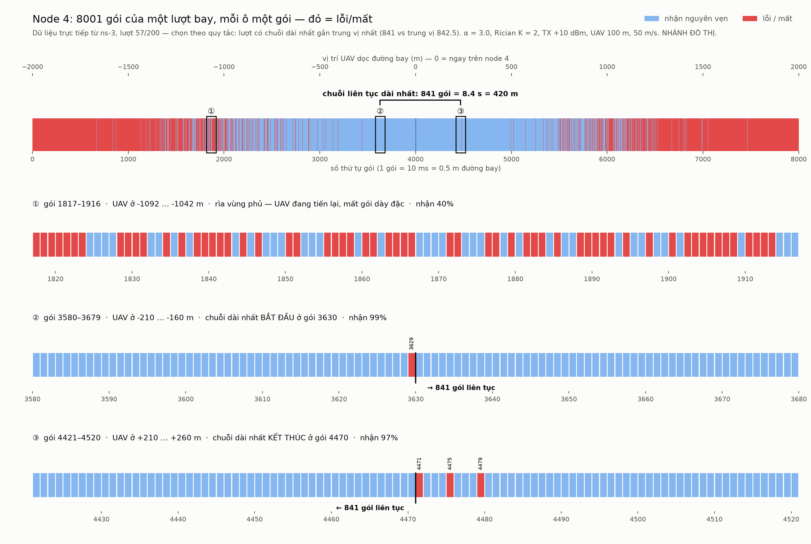

*Dải gói của node giữa trong một lượt bay, lấy trực tiếp từ ns‑3. Mỗi ô là một gói theo số thứ tự (8 001 gói), ô đỏ là gói lỗi. Lượt được chọn theo quy tắc: chuỗi dài nhất gần trung vị nhất (841 gói, trung vị 842,5). Chuỗi bị bẻ bởi những gói lỗi lẻ (3 629, rồi 4 471) do fade sâu khi UAV còn cách khoảng 200 m, nơi tỉ lệ nhận vẫn 97–99 %.*

**A2G‑SWEEP: các lượt khác có bù được không.** 1 271 node cách nhau 100 m trên vùng 4 × 3 km; UAV quét luống cách nhau L = 700, 850, 1 000 m và phát vòng một file K gói. Với K = 2 000, một lượt gần như không bao giờ cho đủ file: chỉ 1,1–1,6 % node trên toàn vùng. Sau cả chuyến bay, con số này lên 83,9 / 67,2 / 37,6 %. Phần bù đến từ các luống khác và các vòng quay đầu, tức là từ những lần UAV **quay lại**. Pha 1 chỉ bay qua mỗi cluster một lần, nên phần bù đó phải do mạng mặt đất tự làm.

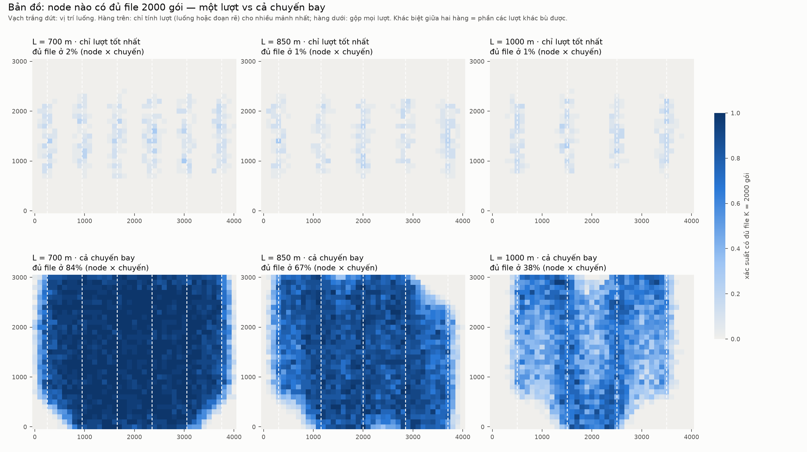

*Node có đủ file 2 000 gói. Hàng trên: chỉ từ lượt bay tốt nhất của node đó. Hàng dưới: từ cả chuyến bay. Cột: L = 700, 850, 1 000 m.*

**G2G‑CHAIN: chuyển file qua nhiều hop mặt đất.** Node đầu một dải giữ 100 gói cần tới node cuối. Gói đi unicast lần lượt qua từng node, có ACK và phát lại, theo TDMA chặt (khe 10 ms, 3 khe). Ở khoảng cách 50 / 75 / 100 m, chỉ 72,5 / 43,5 / 15,5 % số chuỗi xong trong 300 s, với trung vị 22,7 / 43,1 / 126 s. Mức lý tưởng là 3,1 s. Thời gian bị quyết định bởi **hop yếu nhất**: T ≈ 3,1 s / p, với p là tỉ lệ thành công của hop nghẽn. Hop yếu chủ yếu do che khuất tĩnh: một cặp node bị che thì bị che suốt.

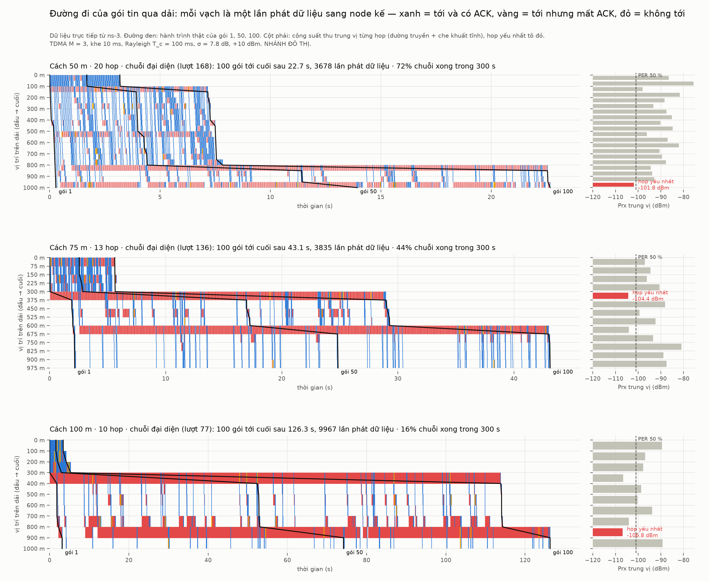

*Đường đi của 100 gói qua dải, theo không gian (trục ngang, từng hop) và thời gian (trục dọc), ở 50, 75, 100 m. Mỗi panel là chuỗi đã xong có thời gian gần trung vị nhất. Gói đi qua phần đầu dải gần như tức thì, rồi kẹt ở hop yếu nhất, nơi dải đỏ (lần phát hỏng) dày đặc; mọi gói phía sau dồn lại chờ ở đó.*

Ba bài học cho lớp 3:
1. **Cần hợp tác mặt đất:** một lượt bay chỉ cho cell xa đường bay những mảnh rời.
2. **Đường mặt đất phải ngắn và chọn trước:** thời gian đa hop tăng theo hàm mũ khi có một hop yếu. Vì vậy gateway phải được chọn theo chất lượng liên kết, và không nên dồn mọi luồng qua một đường dài.
3. **Dữ liệu dọc đường bay là nguồn tốt nhất:** dải ngay dưới đường bay nhận được những đoạn dài, liền. Đó là "dòng sông" mà River dựa vào.

### 1.4 Mạng mặt đất

**Miền và cell.** Miền là vùng đất có node, chia thành cell lục giác đều bán kính R = 100 m. Hai cạnh song song cách nhau w = 173 m. Mỗi cell có khoảng 21 node (một node trên 35 m × 35 m). Mỗi node có ba năng lực ngẫu nhiên: quan sát, tính toán, giao tiếp. Điểm năng lực là tích của ba năng lực đó.

**Vai trò.**
- **CL (cell leader):** node mạnh nhất của mỗi cell; giữ và phục vụ dữ liệu của cell.
- **CH (cluster head):** node mạnh nhất cluster, cách biên ít nhất 300 m.
- **Critical cell:** cell có camera đủ mạnh để đối sánh (Thuật toán 3).
- **Gateway:** giữa hai cell kề có đúng một cặp gateway; mọi dữ liệu liên cell đi qua cặp này.

**Định tuyến nền (PECEE elastic clustering).** BS tính trước giờ bay; không node nào bị cô lập. Mỗi node lưu ba loại next hop:
- về CL của cell mình;
- tới từng cell kề, qua đúng gateway của cặp cell đó;
- đường chính về CH.

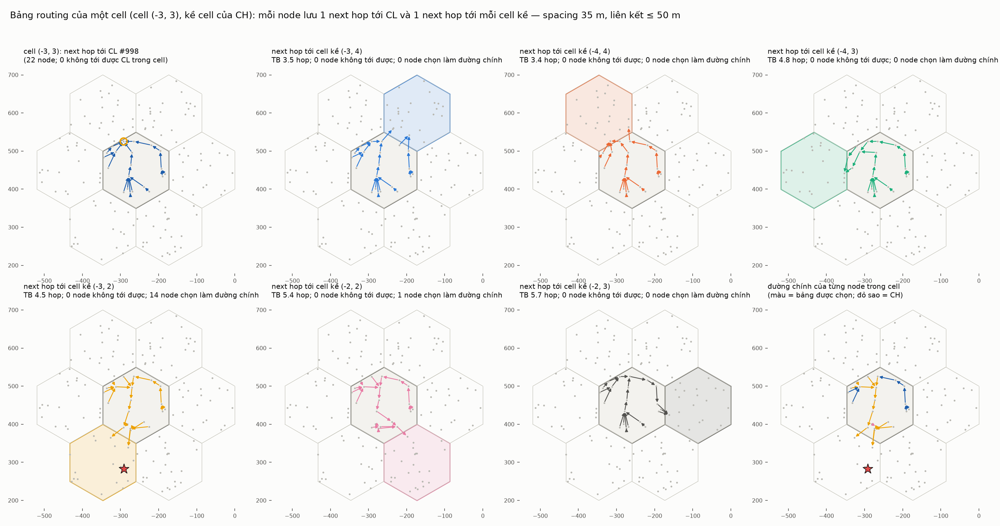

*Bảng định tuyến của cell (−3, 3), kề cell của CH (22 node, liên kết ≤ 50 m). Ô đầu: next hop của từng node về CL. Sáu ô tiếp: next hop tới từng cell kề (tô màu), luôn qua gateway duy nhất (♦) của cặp cell đó. Ô cuối: đường chính của từng node về CH (sao đỏ), màu là bảng được chọn. Gateway thường nằm gần CL, vì luật chọn ưu tiên ít hop tới CL.*

**Kênh và lịch.** Mỗi cell dùng một kênh theo lưới 7 màu, 11 + (q + 3r) mod 7, nên cùng kênh chỉ lặp lại ở cell cách 3 ô. Mỗi cặp gateway có radio và kênh riêng (18–26). Mỗi cell và mỗi cặp gateway là một môi trường truyền với **một máy phát tại một thời điểm**. MAC là 802.15.4 đầy đủ: CSMA/CA, ACK, gửi lại.


*Mạng mô phỏng trên ns‑3 (cluster thử nghiệm đầu tiên, bay thẳng). Trái: số trong cell là kênh 802.15.4 của cell (11–17); đoạn đen là cặp gateway với kênh riêng 18–26, đoạn đỏ là cặp yếu (q < 0,5) do che khuất cố định của chính cặp đó; cell xám không được mô phỏng. Phải: phóng to quanh cell của CH; chấm là node, chấm lớn là CL, đường xám là next hop về CL theo ETX nhỏ nhất.*
- 91 cell có vai trò trong kế hoạch được mô phỏng, với 1 945 node và 235 cặp gateway; 20 cặp yếu.
- Đường ETX nhỏ nhất về CL có dạng ngôi sao: 57 % node gửi thẳng tới CL.

### 1.5 Đóng góp của báo cáo

- Phát biểu bài toán lớp 3 và cận dưới thời gian (Mục 2).
- Cơ chế River gồm 7 thuật toán lập kế hoạch và 6 thuật toán thực thi, mỗi thuật toán có mã giả đầy đủ (Mục 3–5). Bản ngắn cho bài hội nghị nằm ở Phụ lục A.
- Hình từng bước của **mỗi** thuật toán trên một cluster thật (C3), vẽ từ trace ns‑3, cùng ngôn ngữ hình với trình phát visualize (Mục 4–6).
- Đánh giá trên ns‑3 với MAC 802.15.4 đầy đủ: so với kéo thẳng; các biến thể Circle; bề rộng River; cửa sổ manh mối (Mục 7).

## 2. Bài toán

**Đầu vào.** Một cluster gồm tập cell Cells, mỗi cell có CL. Đường bay γ biết trước; gói s được phát tại γ(d_s), với d_s = d_0 + sΔ và Δ = 0,5 m. D là tập gói phát khi UAV ở trên cluster. Sau lượt bay, node v giữ tập rx(v) ⊆ D. Tập này ngẫu nhiên, nhưng phân bố của nó biết trước theo khoảng cách tới γ.

**Mục tiêu.** Với mỗi critical cell k, CL của k phải giữ đủ D_k ⊆ D. D_k là cửa sổ Q gói của bộ manh mối, hoặc toàn bộ D. Cần tối thiểu hoá:
- thời điểm xong T = max_k T_k, với T_k là lúc CL của k có đủ D_k;
- tổng số khung truyền.

**Ràng buộc.**
- Radio bán song công; mỗi môi trường truyền (cell, cặp gateway) chỉ có một máy phát tại một thời điểm.
- Giữa hai cell kề chỉ có một cặp gateway; dữ liệu liên cell đi theo cell path định trước.
- Mỗi chặng có ACK và gửi lại; kênh G2G có che khuất tĩnh.

**Nhận xét then chốt.** γ, d_s và tỉ lệ mất gói theo khoảng cách đều biết trước. Vì vậy BS biết trước **cell nào giữ đoạn dữ liệu nào**, và lập được kế hoạch trước giờ bay. Sau lượt bay, mạng chỉ cần thực thi kế hoạch; không phải tìm đường hay dò xem ai có gì.

**Cận dưới.** CL của k chỉ có một radio, nên T_k ≥ |Lack(k)| · τ_frame. Lack(k) là phần D_k mà CL của k còn thiếu; τ_frame khoảng 5–6 ms cho một khung 100 B có ACK qua một chặng.


*Cluster C3 ngay sau lượt bay (80 cell, bay thẳng 2,3 km qua CH, |D| = 4 685 gói). Trái: cả cell (hợp các node trong cell). Phải: riêng CL. Màu càng đậm, cell càng có nhiều phần của D. Cả cell có trung vị 92 % D; riêng CL chỉ có trung vị 63 %, thấp nhất 18 %. Vì vậy bước đầu tiên luôn là gom về CL, và phần còn thiếu phải đi qua River.*

## 3. Tổng quan River

### 3.1 Khái niệm

: tab:concepts Các khái niệm của River.

| Khái niệm | Định nghĩa | Ai tính |
|---|---|---|
| Axe = (a_1, …, a_n) | các cell mà γ cắt qua, theo thứ tự bay | BS |
| Seg(a) | các gói phát khi UAV ở trên cell Axe a | BS |
| u, ω | hướng của Axe (vector tổng); nửa bề rộng River, 1,75 cell ≈ 303 m | BS |
| Bank_±(a), Path_±(a) | hai cell ở mép River mà a phục vụ; cell path a → Bank | mỗi cell Axe |
| River | hợp của mọi Path_±(a) | mỗi cell Axe |
| Crit | critical cell: cell của CH và các cell có CL vượt trội | CH |
| Circ(k), G_j | các hàng xóm phục vụ k; nhóm Seg mà hàng xóm m_j giữ | CH |
| D_k, Lack(k) | tập k phải có; phần D_k mà CL của k còn thiếu | CL của k |

Tên gọi theo hình ảnh một dòng sông. **Axe** là trục sông, nơi UAV bay ngay trên đầu nên dữ liệu đầy nhất. **River** là lòng sông, nơi các cell nhận đủ phần lớn dữ liệu; bề rộng của nó được chọn theo ngưỡng tỉ lệ mất gói. **Bank** là hai bờ, nơi nhận gần đủ và chỉ thiếu một chút so với Axe. **Circle** là vòng hàng xóm bao quanh một critical cell để phục vụ nó.

 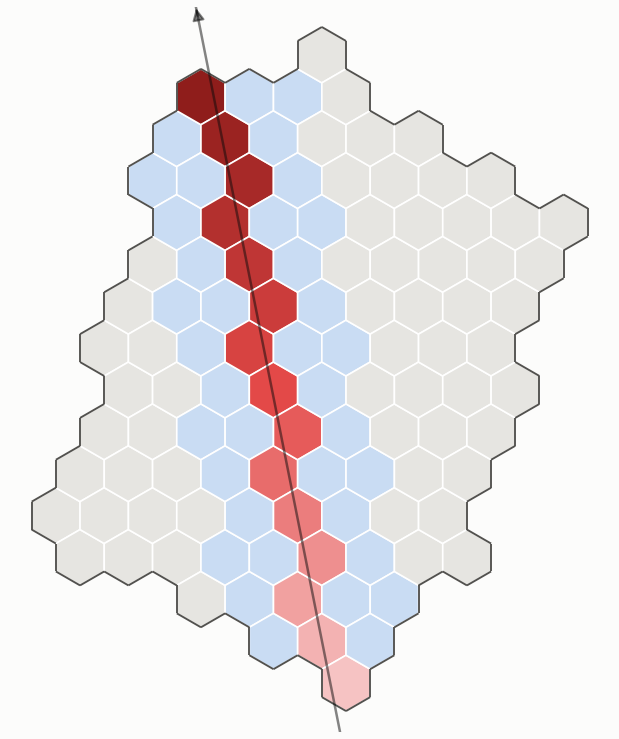

*Hình ý niệm trên một cluster minh hoạ, đường bay thẳng (mũi tên). Trái: màu là lượng dữ liệu cell nhận được, đậm dọc đường bay và nhạt dần ra hai bên; dải tô màu là River, xám là ngoài River. Phải: Axe (đỏ) là các cell mà đường bay cắt qua, càng đậm càng về sau theo hướng bay; xanh nhạt là River. Ở các hình ý niệm Axe tô đỏ; ở các hình trên C3 và trong trình phát, Axe tô xanh đậm.*

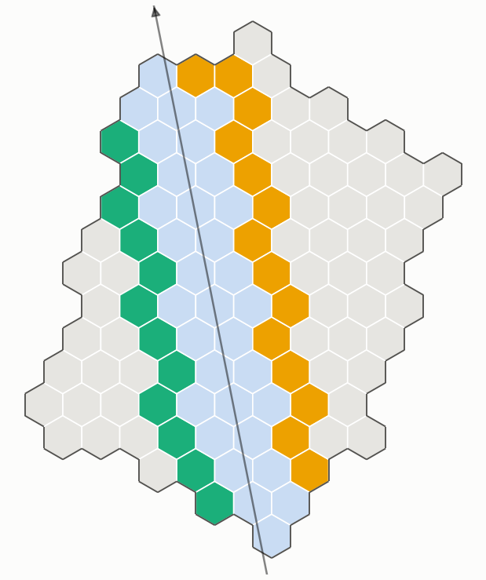 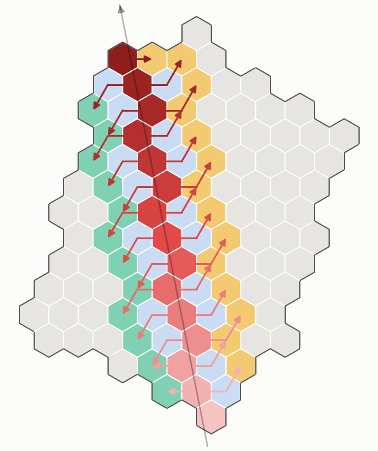

*Trái: hai dải Bank (xanh lá và vàng) ở hai mép River. Phải: mỗi cell Axe (đỏ, đậm dần theo hướng bay) phục vụ một cặp Bank, một ở mỗi bờ; mũi tên cùng màu với cell Axe là cell path từ nó tới hai Bank.*

### 3.2 Dòng chảy và quy ước

Dữ liệu chảy theo một chiều: **Axe → Bank → Circle → critical cell**. Mỗi Seg đi đúng một đường đã định. Có ba quy ước thực thi:
1. Dữ liệu của cell c nằm ở Holder(c) = CL(c).
2. Một cell path (c_0, …, c_h) chạy thành đường node: CL(c_0) → gateway → … → CL(c_h).
3. Yêu cầu là một manifest **"có"**: tập gói bên hỏi đang có, trong các khung ≤ 100 B. Bên được hỏi gửi lại phần còn thiếu.

Dữ liệu đi qua một cell thì CL của cell đó giữ một bản sao, nhưng không chủ động xin thêm.

: tab:phases Các bước của River theo thời gian.

| Giai đoạn | Thuật toán | Ai | Khi nào |
|---|---|---|---|
| Lập kế hoạch | 1 bảng Axe, 2/2b River và Bank, 3 critical cell, 3b cửa sổ, 4/4b Circle | BS, CH, mỗi cell Axe | trước giờ bay |
| Gom | G | node → CL của mọi cell có vai trò | từ lúc UAV rời cluster |
| Lấp | 5 BANKFILL, 6 CIRCLEFILL | Axe → Bank, Bank → Circle | khi bên nhận gom xong |
| Kéo | 7 CRITPULL | Circle → critical cell | khi critical cell gom xong |
| Lớp truyền | S | mọi node | suốt thời gian |

{fig:river-plan} cho thấy toàn bộ kế hoạch trên cluster thử nghiệm đầu tiên.


*Kế hoạch trước giờ bay trên cluster thử nghiệm đầu tiên (bay thẳng). Axe 15 cell (đỏ, đậm dần theo thứ tự phát), River 58 cell (xanh nhạt), Bank xanh lá. Vòng tròn là critical cell, sao là CH; lục giác viền cùng màu là Circle của nó, 3–6 hàng xóm. Critical cell ở đỉnh bắc nằm trên Axe và sát biên, nên Circle của nó chỉ có 3 cell.*

## 4. Lập kế hoạch trước giờ bay

Tham số: bề rộng River W = 3,5 cell (ω = 303 m); κ_g = 2, κ_l = 1, r = 2 (Thuật toán 3). Mọi hình từng bước trong mục này vẽ trên cluster C3, cùng màu với trình phát visualize: xanh đậm là Axe, xanh lá là Bank, xanh nhạt là River.

### 4.1 Thuật toán 1: bảng Axe (BS)

BS lấy mẫu đường bay theo từng gói. Cell chứa vị trí phát của gói s là **chủ** của gói đó. Gói phát ngoài cluster không có chủ, nhưng cell nào nghe được vẫn lưu lại và gửi khi được hỏi. BS gửi bảng (a, Seg(a)) cho CH; CH chuyển mỗi dòng xuống đúng cell Axe. Với đường bay thẳng, Seg(a) là một khoảng [first, last], nên mỗi dòng chỉ cần vài byte.

```algo
Algorithm 1  AXETABLE(γ, d0, Δ, N)                       ▷ BS, before the flight
1: Axe ← ()                                         ▷ ordered list
2: for s ← 0 to N−1 do
3:     c ← cell containing γ(d0 + sΔ)
4:     if c ∉ Cells then continue                   ▷ sent outside the cluster: no owner
5:     if c ∉ Axe then append c to Axe; Seg(c) ← ∅
6:     Seg(c) ← Seg(c) ∪ {s}                        ▷ straight path: an interval [first, last]
7: u ← unit( z(a_n) − z(a_1) )                      ▷ the Axe's sum vector
8: send header (d0, Δ, N, u, ω) and rows { (a_i, first(Seg(a_i)), last(Seg(a_i))) } to CH
9: CH forwards row i to Axe cell a_i
```

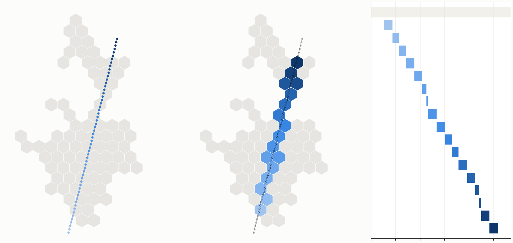

*Thuật toán 1 trên C3, ba bước. Trái: vị trí phát dọc đường bay, mỗi chấm một gói (vẽ 1/100 gói), nhạt → đậm theo số thứ tự. Giữa: mỗi gói thuộc về cell chứa vị trí phát của nó; cell tô theo thứ tự bay, gói ngoài cluster (xám) không có chủ. Phải: bảng Axe, mỗi hàng một cell Axe theo thứ tự bay, mỗi thanh là khoảng Seg(a) trên trục số thứ tự gói; dải xám trên cùng là cả lượt phát.*
- Lượt phát có 5 703 gói; 4 685 gói (số 510–5 194) rơi vào 17 cell Axe.
- Seg trung bình 276 gói, tức 2,8 s phát mỗi cell. Các Seg nhỏ (71–170 gói) là chỗ đường bay chỉ cắt góc cell.

### 4.2 Thuật toán 2: River và Bank (mỗi cell Axe)

Từ tâm mỗi cell Axe, đi theo hướng vuông góc với u về mỗi phía một khoảng ω. Cell cuối cùng còn trong cluster là **Bank**; các cell đi qua là **Path**. Mọi đường vuông góc song song với nhau. River chạm biên thì biên chính là Bank. Mỗi cell Axe tự tính được phần của mình từ dòng bảng Axe và u.

```algo
Algorithm 2  RIVERSETUP(a, u, ω)                         ▷ each Axe cell a, before the flight
1: n ← (−u_y, u_x)                                  ▷ the same normal for every a: parallel lines
2: for σ ∈ {+1, −1} do
3:     Path_σ(a) ← (a)
4:     for t ← 0 to ω step w/20 do                  ▷ w: cell width
5:         c ← cell containing z(a) + σ·t·n
6:         if c ∉ Cells then break                  ▷ River reaching the edge: the edge is the Bank
7:         if c ≠ last(Path_σ(a)) then append c to Path_σ(a)
8:     Bank_σ(a) ← last(Path_σ(a))
9:     tell Bank_σ(a): "you are a's Bank, for Seg(a), via Path_σ(a)"
10: River ← ⋃_{a ∈ Axe, σ} Path_σ(a)
```


*Ý niệm dựng Bank. Mũi tên đỏ sẫm là u; chấm trắng là một cell Axe. Đường liền là đường vuông góc qua cell đó, hai chấm đen cách nó ω; hai cell xanh lá đậm và cam đậm là hai Bank của nó. Đường đứt là các đường song song qua những cell Axe khác; xanh lá nhạt và vàng là các Bank còn lại.*

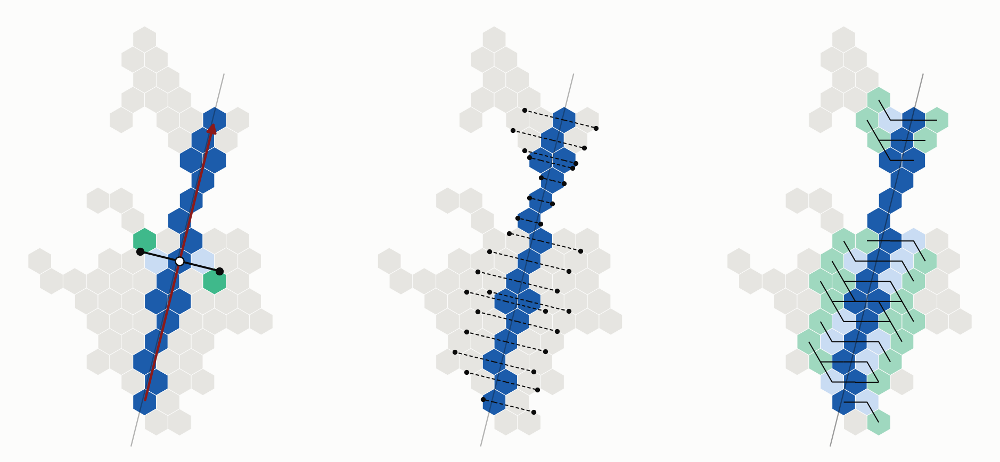

*Thuật toán 2 trên C3, ba bước. Trái: vector tổng u của Axe (mũi tên đỏ sẫm, từ cell Axe đầu tới cell Axe cuối) và pháp tuyến ±ω qua cell Axe ở giữa (chấm trắng); hai cell xanh lá ở hai đầu là hai Bank của nó. Giữa: mọi cell Axe đi pháp tuyến song song tới khi hết ω hoặc ra khỏi cluster (nét đứt, chấm đen là điểm dừng). Phải: River (xanh nhạt), Bank (xanh lá) và các Path (nét đen).*
- River gồm 51/80 cell, với 24 cell Bank khác nhau.
- 14/34 Bank bị biên cắt ngắn, vì C3 hẹp.

**Thuật toán 2b: Bank theo pháp tuyến cục bộ.** Khi đường bay cong, các đường song song lệch khỏi pháp tuyến thật. Mỗi cell Axe dùng pháp tuyến của đường bay tại chỗ nó cắt qua cell. Phía trong khúc cong, quãng đi bị cắt ở bán kính cong, để hai Path của hai cell Axe kề nhau không cắt chéo nhau.

```algo
Algorithm 2b  LOCALBANKS(a, γ, ω)                         ▷ curved flight, each Axe cell a
1: m ← middle packet of Seg(a)
2: t ← unit tangent of γ at d_m, measured over ±10 m;  n ← (−t_y, t_x)
3: θ ← heading change of γ between d_m − 100 m and d_m + 100 m          ▷ signed
4: ρ_c ← 200 m / |θ|  (∞ if θ = 0)                                      ▷ local radius of curvature
5: reach ← ω on both sides; on the side γ turns towards: reach ← min(ω, ρ_c)
6: for σ ∈ {+1, −1}: walk from γ(d_m) along σ·n for reach_σ as in Alg. 2 → Path_σ(a), Bank_σ(a)
7: for every 20th packet s of Seg(a), on both normals of γ at d_s:       ▷ the fan outside a bend
8:     add the cells within ω to River
```


*Bank song song (hàng trên) và Bank cục bộ (hàng dưới) trên một cluster với bốn đường bay; cột là góc thoát 180°, 135°, 100°, 70° (càng nhỏ càng cong). Xanh đậm là Axe, xanh lá là Bank, xanh nhạt là River đúng chỗ, vàng là River thừa, đỏ là cell lẽ ra thuộc River mà thiếu. Ở 70°, hàng trên có nhiều ô đỏ phía ngoài khúc cong; hàng dưới gần như không còn.*

### 4.3 Thuật toán 3: critical cell (CH)

Gọi μ, σ là trung bình và độ lệch chuẩn điểm năng lực của các CL trong cluster. Critical cell gồm ba loại:
- cell của CH, luôn là critical cell;
- cell **vượt trội toàn cluster**: điểm > μ + κ_g·σ;
- cell **vượt trội cục bộ**: điểm > μ + κ_l·σ, và cao nhất trong r vòng cell quanh nó.

Loại thứ ba đảm bảo một vùng xa CH vẫn có điểm xử lý, kể cả khi không cell nào ở đó vượt trội toàn cluster.

```algo
Algorithm 3  CRITICAL(Cells, score, κ_g, κ_l, r)         ▷ CH, before the flight
1: μ ← mean_{c ∈ Cells} score(c);  σ ← std_{c ∈ Cells} score(c)
2: Crit ← { cell of CH }                            ▷ always critical
3: for each c ∈ Cells do
4:     if score(c) > μ + κ_g·σ then                 ▷ far above the whole cluster
5:         Crit ← Crit ∪ {c}
6:     else if score(c) > μ + κ_l·σ and
7:             score(c) ≥ max { score(c') : c' ∈ Ring_1(c) ∪ … ∪ Ring_r(c) } then
8:         Crit ← Crit ∪ {c}                        ▷ the best of its area, and well above average
9: return Crit
```

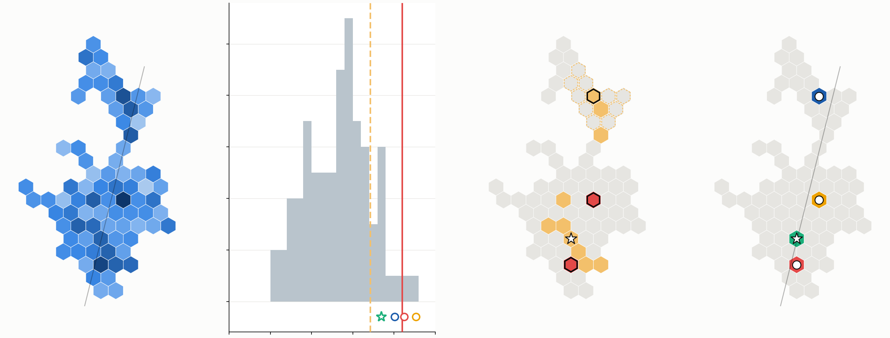

*Thuật toán 3 trên C3, bốn bước. (1) Điểm năng lực của CL mỗi cell, nhạt → đậm. (2) Phân bố điểm: vạch cam đứt là μ + σ, vạch đỏ là μ + 2σ; chấm đánh dấu các critical cell. (3) Đỏ: hai cell vượt μ + 2σ. Cam: mười cell nằm giữa μ + σ và μ + 2σ; viền là vùng 2 vòng quanh cell thắng cục bộ duy nhất. (4) Bốn critical cell, mỗi cell một màu, sao là cell của CH.*
- μ = 0,531, σ = 0,154. Vượt toàn cluster (> 0,840): (8, −2) và (9, −7).
- Trong 10 cell nằm giữa 0,685 và 0,840, chỉ (4, 6) cao nhất trong 2 vòng quanh nó.
- Thêm cell của CH (8, −5): tổng cộng 4 critical cell.

### 4.4 Thuật toán 3b: cửa sổ manh mối (BS/CH)

UAV phát lặp bộ manh mối suốt đường bay, nhưng critical cell chỉ cần **một bản đủ**: Q gói Axe liền nhau. Có hai cách đặt cửa sổ:
- **quanh CH:** một cửa sổ chung cho cả cluster;
- **quanh từng critical cell:** lấy bản sao gần critical cell nhất. Cách này giả định rằng gói cùng vị trí ở hai bản phát liền nhau mang cùng nội dung.

Cửa sổ thu hẹp Axe về những cell có gói trong cửa sổ, và bỏ Bank, Path của những cell bị loại.

```algo
Algorithm 3b  WINDOW(Crit, Q, mode)                      ▷ BS/CH, before the flight
1: P ← ⋃_{a ∈ Axe} Seg(a), in order                ▷ all Axe packets
2: function AROUND(z)
3:     s* ← argmin_s ‖γ(d0 + sΔ) − z‖              ▷ where the UAV passes closest to z
4:     i ← clamp( rank of s* in P − ⌊Q/2⌋, 0, |P| − Q )
5:     return [P_i, P_{i+Q−1}]
6: if mode = ch then for every k ∈ Crit: Need(k) ← AROUND(z(CH))     ▷ one window for the cluster
7: else for every k ∈ Crit: Need(k) ← AROUND(z(k))                   ▷ the copy nearest to k
8: for each a ∈ Axe: Seg(a) ← Seg(a) ∩ ⋃_k Need(k)
9: Axe ← (a ∈ Axe : Seg(a) ≠ ∅);  drop the Banks and Paths of removed cells
10: for each k ∈ Crit: D_k ← Need(k) ∩ D         ▷ what k must hold at the end
```


*Cửa sổ quanh CH và cửa sổ theo từng critical cell, trên một dải 6 cell × 4 km có 10 critical cell; ba hàng chung trục ngang (vị trí dọc đường bay).*
- Trên: bản đồ. Xanh đậm là Axe, sao là CH, chấm là critical cell khác. Nét đứt nối mỗi critical cell với điểm UAV bay gần nó nhất.
- Giữa: dòng gói của Axe. Xám là mọi gói, đen là cửa sổ quanh CH, mỗi vạch màu là cửa sổ riêng của một critical cell.
- Dưới: thời điểm xong, vạch lưới mỗi 20 s. Chấm rỗng: cửa sổ quanh CH (3–88 s). Chấm đặc: cửa sổ riêng (3–25 s).

### 4.5 Thuật toán 4: Circle (CH, cho mỗi critical cell)

Circle của k là các cell kề k: 6 cell, ít hơn nếu k nằm ở biên. Các thành viên được xếp theo vị trí dọc hướng bay u. Axe được chia thành các nhóm Seg liên tiếp, mỗi thành viên một nhóm, theo cùng thứ tự: thành viên nằm xa hơn theo hướng bay nhận dữ liệu phát muộn hơn. Thành viên lấy mỗi Seg từ **đúng Bank của Seg đó**, ở phía gần mình hơn, theo cell path. Như vậy mỗi thành viên chỉ chạm vào một đoạn ngắn của River, và các luồng tới k đến từ nhiều hướng thay vì dồn vào một đường.

```algo
Algorithm 4  CIRCLE(k, Axe, Seg, Bank)                   ▷ CH, before the flight, every k ∈ Crit
1: Circ(k) ← Neig(k)                                ▷ 6 cells; fewer at the cluster edge
2: order Circ(k) = (m_1..m_q) by ⟨z(m_j), u⟩         ▷ further along the flight → later data
3: Axe_k ← (a ∈ Axe : Seg(a) ∩ Need(k) ≠ ∅)         ▷ all of Axe without a window
4: split Axe_k into q consecutive groups G_1..G_q of near-equal size
5: for j ← 1 to q do
6:     for each a ∈ G_j do
7:         σ ← side whose Bank_σ(a) is fewer cells from m_j (then fewer metres)
8:         src_j(a) ← Bank_σ(a);  P_j(a) ← shortest cell path src_j(a) → m_j avoiding k
9:     send m_j its task { (a, src_j(a), P_j(a)) : a ∈ G_j };  send k the list (m_j, G_j)
```


*Ý niệm Circle quanh một critical cell (chấm đỏ bên trái). Sáu ô màu quanh nó là sáu thành viên; mỗi màu là một nhóm Seg liên tiếp. Nét đứt ngắn: Axe bù Bank (Thuật toán 5). Nét liền: thành viên kéo các Seg của mình từ Bank của chúng (Thuật toán 6). Mũi tên đen ngắn: thành viên giao cho critical cell (Thuật toán 7).*

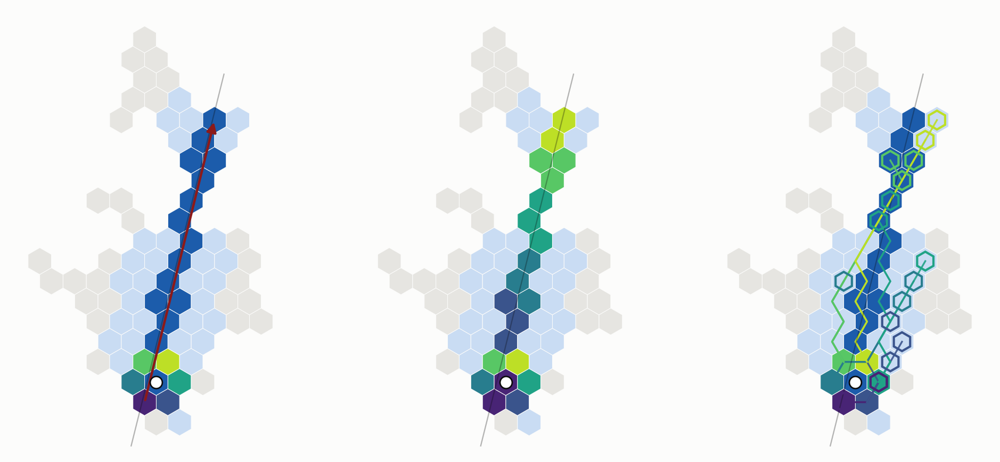

*Thuật toán 4 cho critical cell (9, −7) ở đầu nam C3, ba bước. Trái: sáu thành viên xếp theo vị trí dọc hướng bay u (mũi tên), tím → vàng. Giữa: Axe chia thành sáu nhóm liên tiếp, mỗi cell Axe tô màu thành viên giữ nhóm đó. Phải: viền màu là các Bank mà mỗi thành viên lấy dữ liệu; đường cùng màu là cell path từ Bank tới thành viên.*
- Thành viên 1 (9, −8) giữ 3 Seg đầu; Bank của chúng ở sát nó (0–2 cell).
- Thành viên 6 (9, −6) giữ 2 Seg cuối, ở đầu bắc; cell path dài 11–12 cell.
- Critical cell nằm ở một đầu Axe phải trả giá bằng những đường dài nhất; critical cell ở giữa Axe có đường ngắn về cả hai phía.


*Circle của cả bốn critical cell trên C3. Mỗi critical cell một màu viền: (4, 6) xanh dương, CH xanh lá, (8, −2) vàng, (9, −7) đỏ. Đường màu là đường Bank → thành viên, dài trung bình 3,5–6,1 cell. Hai critical cell ở hai đầu cluster có đường dài nhất (12–13 cell).*

### 4.6 Thuật toán 4b: Circle động

Circle cố định 6 thành viên không tính đến lượng thiếu thực tế. Ở Circle động, sau lượt bay, CL của k đếm phần còn thiếu và gọi số thành viên tương ứng trong vòng 1–2: thiếu nhiều thì tới 12, thiếu ít thì 2. Ngay cả critical cell nằm trên Axe cũng cần 1–2 thành viên để lấy các đoạn khác của River. Mọi cỡ Circle có thể chọn đều được CH tính sẵn trước giờ bay, nên sau lượt bay CL chỉ cần tra bảng.

```algo
Algorithm 4b  ADAPTIVECIRCLE(k, share, n_min, n_max)
   ▷ before the flight, at CH: every size n the CL may pick
1: for n ← 1 to |Ring_1(k) ∪ Ring_2(k)| do
2:     Mem_n ← n cells spread evenly round k over Ring_1(k), then over Ring_2(k); order them along γ
3:     G_{n,j} ← j-th of n consecutive groups of Axe
4: for every candidate m and every a ∈ Axe: src(m, a) ← Bank of a nearer m;  P(m, a) ← its cell path to m
   ▷ after the pass, at the CL of k
5: every node of k sends the CL one summary frame of what it holds
6: lack ← { s ∈ D_k : no node of k holds s };  if lack = ∅ then return
7: n ← clamp(⌈|lack| / share⌉, n_min, n_max)
8: for j ← 1 to n: send m_j = Mem_n[j] the request X_j ← lack ∩ ⋃_{a ∈ G_{n,j}} Seg(a)
   ▷ at member m_j, on request X_j
9: send X_j ∩ have(m_j) to k now
10: gather the packets of X_j that nodes of m_j hold (Alg. G)
11: for the rest, s ∈ Seg(a): ask src(m_j, a) along P(m_j, a); pass each packet on to k as it arrives
```

## 5. Thực thi sau lượt bay

Mọi bước bắt đầu khi UAV rời cluster và chạy chồng lên nhau theo từng gói: bên gửi có gói nào thì chuyển ngay gói đó, không chờ đủ cả Seg.

: tab:runtime Điều kiện bắt đầu và kết thúc của các bước thực thi.

| Bước | Ai | Bắt đầu khi | Xong khi |
|---|---|---|---|
| G. Gom về CL | node → CL của mọi cell có vai trò | UAV rời cluster | CL có mọi gói cần mà node trong cell có |
| 5. BANKFILL | Bank ↔ Axe | Bank gom xong | Bank có đủ Seg(a) |
| 6. CIRCLEFILL | thành viên ↔ Bank | thành viên gom xong, hoặc khi được hỏi | thành viên có đủ nhóm của mình |
| 7. CRITPULL | critical cell ↔ Circle | critical cell gom xong | Lack(k) = ∅ |

### 5.1 Thuật toán G: gom về CL

Chỉ cell có vai trò mới gom, và chỉ gom phần nó cần:
- Axe gom Seg của mình;
- Bank gom Seg của cell Axe mà nó phục vụ;
- thành viên Circle gom nhóm của mình;
- critical cell gom D_k.

Mỗi gói cần do node giữ nó có ETX tới CL nhỏ nhất gửi về.

```algo
Algorithm G  GATHER(c, Need(c))                          ▷ after the pass, every cell with a role
1: (summary) every node reports what it holds; up the toCL tree each node sends
       missing(branch) = missing(self) ∩ missing(child_1) ∩ …
2: for each s ∈ Need(c) \ have(CL(c)) do
3:     v ← argmin { ETX(v → CL(c)) : v ∈ c, s ∈ rx(v) }
4:     if v exists then send s from v to CL(c) along the least-ETX route
5: gathered(c) ← true once every such s has arrived         ▷ Alg. 5, 6, 7 wait on this
```

Trong ns‑3, dòng 1 chưa được mô phỏng: CL được coi là đã biết node nào giữ gói nào.

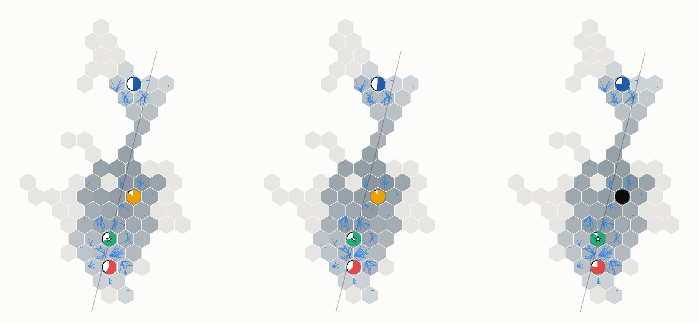

*Thuật toán G trên C3 tại t = 1, 3, 10 s sau khi UAV rời cluster. Nét xanh là các liên kết đã dùng để gom tới thời điểm đó. Màu cell là phần D mà CL đang giữ, xám nhạt → xám đậm. Hình tròn ở mỗi critical cell là phần D của nó, đổi sang đen khi đủ.*
- Khung gom: 2 850 tại 1 s, 6 260 tại 3 s, và đủ 9 105 khung tại 10 s.
- Phần D của bốn critical cell: (4, 6) 0,50 → 0,74; CH 0,68 → 0,89; (8, −2) 0,84 → 1,00; (9, −7) 0,58 → 0,76.
- Riêng (8, −2) đã đủ chỉ nhờ gom: nó nằm sát Axe.


*Bước gom trên cluster thử nghiệm đầu tiên. Trái: các liên kết dùng để gom, nét càng đậm càng nhiều khung (18 134 khung). Phải: thời điểm mỗi cell gom xong, tính từ lúc UAV rời cluster (0–17 s, nhạt → đậm); xanh nhạt là cell không cần gom. Chỉ những cell có vai trò mới gom, và mỗi cell gom đúng phần nó cần. Lâu nhất là các critical cell (vòng trắng), vì chúng gom toàn bộ D.*

### 5.2 Thuật toán 5: Axe bù cho Bank

```algo
Algorithm 5  BANKFILL(b, a)                              ▷ b = Bank_σ(a); starts when the UAV leaves
1: wait until Holder(b) has gathered its cell's packets (Alg. G)
2: H ← Seg(a) ∩ have(b)
3: send manifest(H) to a along Path_σ(a)
4: at a: send each s ∈ Seg(a) \ H to b along Path_σ(a) reversed, as soon as Holder(a) has s
5: at b: store; Seg(a) ⊆ have(b) now, apart from packets no Axe node received
```

Ở bề rộng 3,5 cell, bước này tốn **0 khung** ở mọi lần chạy: Bank đã đủ ngay sau khi gom. Đây là điều thiết kế nhắm tới: bề rộng River được chọn sao cho Bank chỉ thiếu một chút so với Axe.

### 5.3 Thuật toán 6: Circle chuẩn bị và giao

Có hai biến thể:
- **Chuẩn bị sẵn:** thành viên lấy cả nhóm của mình từ Bank ngay khi gom xong, trước khi critical cell hỏi.
- **Khi được hỏi:** thành viên chỉ đi lấy những gói critical cell hỏi, sau khi nó hỏi.

```algo
Algorithm 6  CIRCLEFILL(m_j, task_j, k, prep)            ▷ after the pass, each Circle cell m_j of k
1: if prep = full then
2:     wait until Holder(m_j) has gathered its group (Alg. G)
3:     for each (a, src, P) ∈ task_j do                 ▷ in parallel over the sources
4:         send manifest(Seg(a) ∩ Need(k) ∩ have(m_j)) to src along P
5:         src sends the rest of Seg(a) ∩ Need(k) to m_j along P reversed, each packet once src has it
6: on request X from k:                               ▷ may arrive before line 5 finishes
7:     send X ∩ have(m_j) to k now; send the rest of X as it arrives
8:     if prep = ondemand then
9:         gather the packets of X that nodes of m_j hold (Alg. G)
10:        for the others, s ∈ Seg(a): ask src(a) along P(a) for them
```

### 5.4 Thuật toán 7: critical cell kéo về

```algo
Algorithm 7  CRITPULL(k)                                 ▷ after the pass, each k ∈ Crit
1: wait until Holder(k) has gathered its cell's packets (Alg. G)
2: Lack(k) ← D_k \ have(k)
3: for each (m_j, G_j) ∈ Circ(k) do
4:     send manifest(have(k) ∩ ⋃_{a ∈ G_j} Seg(a)) to m_j     ▷ "I have these, send the rest"
5: on receipt of packets: store; Lack(k) ← Lack(k) \ received
6: done when Lack(k) = ∅                                 ▷ or only packets no node received remain
```

**Phương án so sánh (kéo thẳng).** Critical cell hỏi thẳng từng cell Axe phần nó thiếu, không qua Bank và Circle.

```algo
Algorithm D  DIRECTPULL(k)                               ▷ ablation
1: after GATHER(k), ask every a ∈ Axe for Seg(a) ∩ Lack(k) along the shortest cell path; a returns it
```

### 5.5 Thuật toán S: lớp truyền

Mỗi cell và mỗi cặp gateway là một môi trường truyền, chỉ có một máy phát tại một thời điểm. Lượt phát xoay vòng giữa các radio có gói chờ. Bên dưới là MAC 802.15.4 đầy đủ.

```algo
Algorithm S  TRANSPORT                                   ▷ every node; one medium per cell and per gateway pair
1: a frame enters the queue of the radio facing its next hop; the radio joins its medium's wait list
2: a free medium hands its turn to the first radio waiting: that radio gives its head frame to the 802.15.4 MAC
3: on the MAC's confirm: free the medium; success → drop the frame, failure → keep it for the radio's next turn
```

- Trong cell, gói đi theo ETX nhỏ nhất trên kênh của lượt đó.
- Giữa hai cell, gói đi qua đúng một cặp gateway, chọn theo chất lượng liên kết.
- Một mô hình suy hao dùng chung cho mọi kênh, nên che khuất thuộc về cặp node chứ không phụ thuộc kênh: đổi kế hoạch kênh không làm đổi liên kết nào yếu.

## 6. River chạy từng bước

### 6.1 Trên cluster C3 (ns‑3, Circle chuẩn bị sẵn)

{fig:run} cho thấy sáu khoảnh khắc của lần chạy ns‑3 trên C3. Mỗi khung chỉ vẽ các chặng truyền trong 2 s gần nhất, nên hình cho thấy dữ liệu **đang** chảy ở đâu.

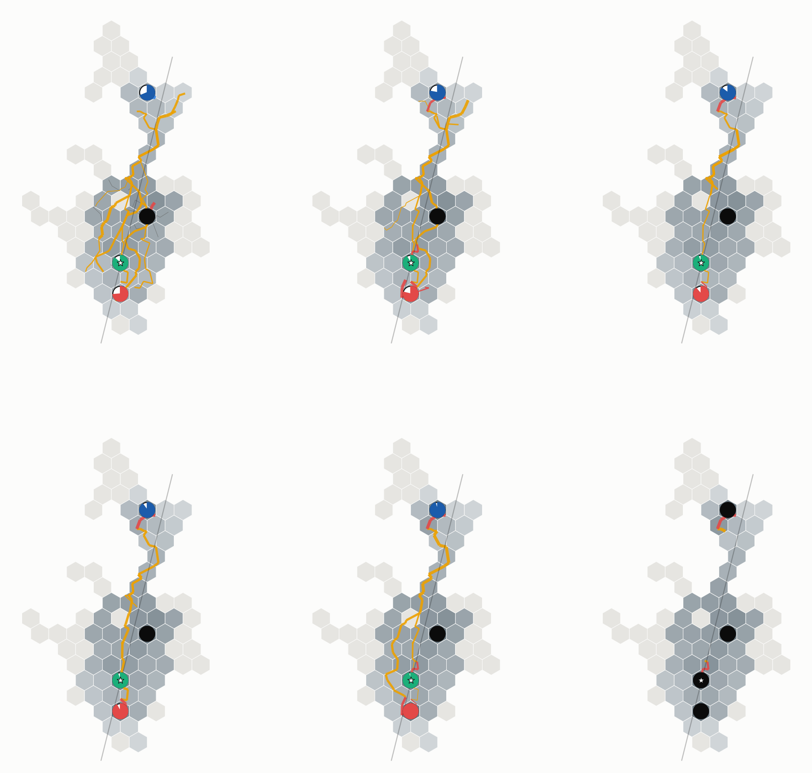

*River trên C3 tại t = 8, 12, 18, 25, 32 và 37,2 s (trái → phải, trên → dưới). Màu của đường nối giữa hai cell là pha truyền: xanh dương là gom, xanh lá là Axe → Bank, vàng là Bank → Circle, đỏ là Circle → critical cell, xám là điều khiển. Nét càng đậm, càng nhiều khung. Màu cell là phần D mà CL giữ; hình tròn ở critical cell là phần D của nó, đen khi đủ.*

: tab:run Số khung trong 2 s trước mỗi khung hình, và phần D của các critical cell.

| t (s) | Khung trong 2 s | (4, 6) | CH (8, −5) | (8, −2) | (9, −7) |
|---|---|---|---|---|---|
| 8 | 8 077 vàng, 843 gom, 75 điều khiển, 3 đỏ | 0,69 | 0,86 | 1,00 | 0,74 |
| 12 | 4 610 vàng, 1 879 đỏ | 0,78 | 0,91 | 1,00 | 0,79 |
| 18 | 1 869 vàng, 620 đỏ | 0,85 | 0,94 | 1,00 | 0,89 |
| 25 | 2 955 vàng, 627 đỏ | 0,90 | 0,94 | 1,00 | 0,92 |
| 32 | 3 858 vàng, 658 đỏ | 0,95 | 0,96 | 1,00 | 0,99 |
| 37,2 | 206 vàng, 587 đỏ | 1,00 | 1,00 | 1,00 | 1,00 |

Đọc theo thời gian:
- **t = 8 s:** gom gần xong. Các thành viên Circle đã bắt đầu lấy nhóm của mình từ Bank (vàng, dọc River). Chặng Axe → Bank không có khung nào.
- **t = 12–25 s:** critical cell gom xong và bắt đầu kéo (đỏ, chặng ngắn từ Circle vào critical cell). Luồng vàng tiếp tục chảy dọc River tới các thành viên ở xa.
- **t = 32–37,2 s:** các critical cell lần lượt đủ; luồng cuối cùng là tới (4, 6) ở đầu bắc, nơi cell path dài nhất. Bốn critical cell xong lúc 7,5 / 32,9 / 35,8 / 37,2 s.


*Tổng dòng dữ liệu sau khi gom, trên cả lần chạy. Từ trái sang: River chuẩn bị sẵn, River khi được hỏi, kéo thẳng. Vàng là Bank → Circle, đỏ là → critical cell, xám mảnh là yêu cầu; nét càng đậm càng nhiều khung. Với River, dữ liệu chảy dọc River tới các thành viên, rồi chặng cuối ngắn vào critical cell. Với kéo thẳng, các đường đỏ dài chồng lên nhau dọc Axe.*


*Phần D mà CL của từng critical cell có, theo thời gian (0–50 s, vạch lưới 10 s). Ba ô theo thứ tự như {fig:c3-flows}. Vạch đứng trên mỗi đường là lúc cell đó gom xong.*

: tab:c3 Thời điểm xong của từng critical cell trên C3 (một lượt ns‑3).

| Critical cell | Cả cell thiếu (gói) | Chuẩn bị sẵn | Khi được hỏi | Kéo thẳng |
|---|---|---|---|---|
| (8, −2) | 1 | 7,5 s | 5,6 s | 6,0 s |
| (9, −7) | 1 127 | 32,9 s | 38,1 s | 39,8 s |
| CH (8, −5) | 636 | 35,8 s | 41,4 s | 48,0 s |
| (4, 6) | 1 313 | 37,2 s | 44,2 s | 50,3 s |
| **Tổng khung** | | **89,7 k** | **80,4 k** | **102,2 k** |

### 6.2 Trong giả lập trọn nhiệm vụ (ảnh chụp visualize)

Hai trình phát visualize dựng lại cả nhiệm vụ trên bản đồ 4 cluster k4‑s2: lượt phát, River trên ns‑3, đối sánh, LoRa và đội 2. Trình phát thứ nhất dùng cluster có sẵn với đường bay thẳng qua CH. Trình phát thứ hai dùng cách chia MEANDER của lớp 2, với đường bay cong bám địa hình và Bank theo pháp tuyến cục bộ (Thuật toán 2b). Các hình dưới đây là khung tĩnh chụp từ hai trình phát.

Quy ước hình trong trình phát:
- ô vuông đen là BS; tam giác đen là UAV đội 1, vòng sóng xanh quanh nó là vùng đang phát;
- sao là CH, vòng trắng là critical cell; vòng quanh critical cell là phần D nó đang giữ, đen khi đủ;
- màu đường nối giữa hai cell theo pha, như {fig:run}; thanh ngang dài 1 km.

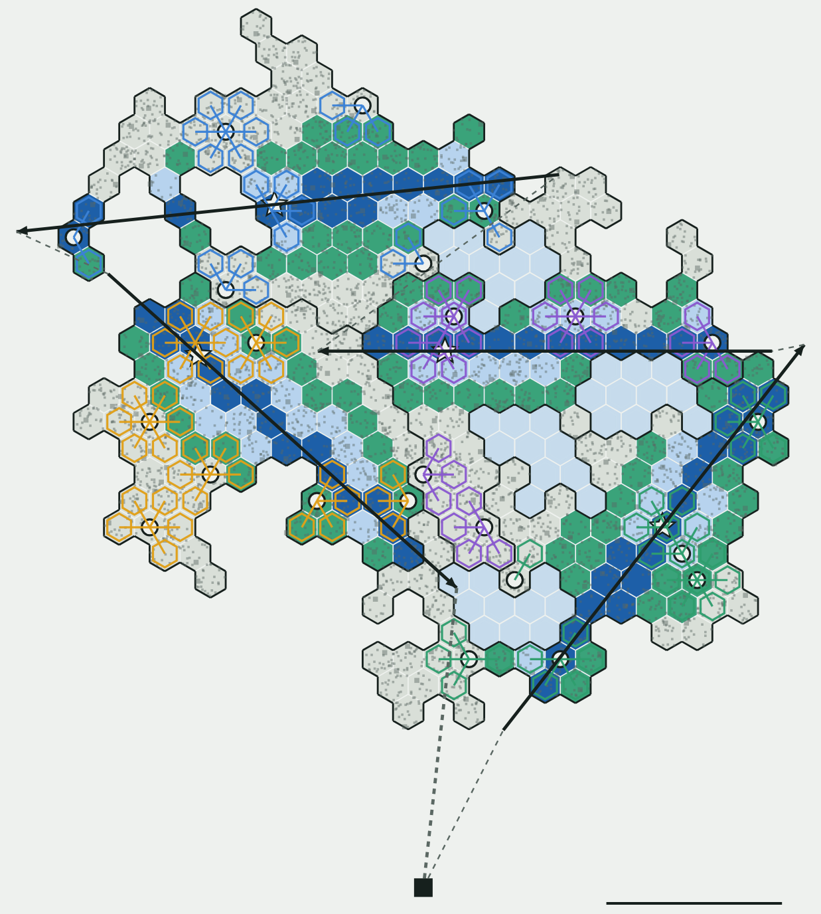 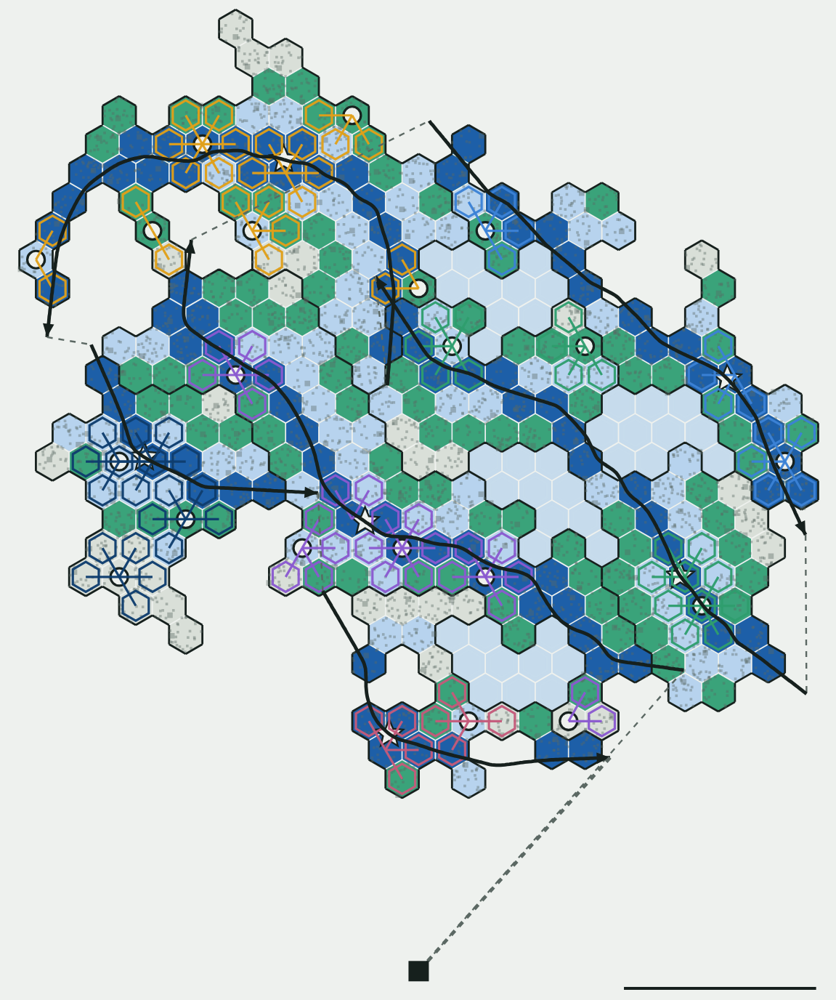

*Kế hoạch River của cả bản đồ, bước cuối của phần dựng trong mỗi trình phát. Trái: cluster có sẵn, mỗi cluster một đoạn bay thẳng qua CH. Phải: MEANDER, mỗi cluster một đường cong uốn qua CH. Xanh đậm là Axe, xanh lá là Bank, xanh nhạt là River; lục giác viền màu nối về critical cell là thành viên Circle. Mũi tên đen là đường bay theo chiều bay, nét đứt là chặng nối và đường từ BS.*

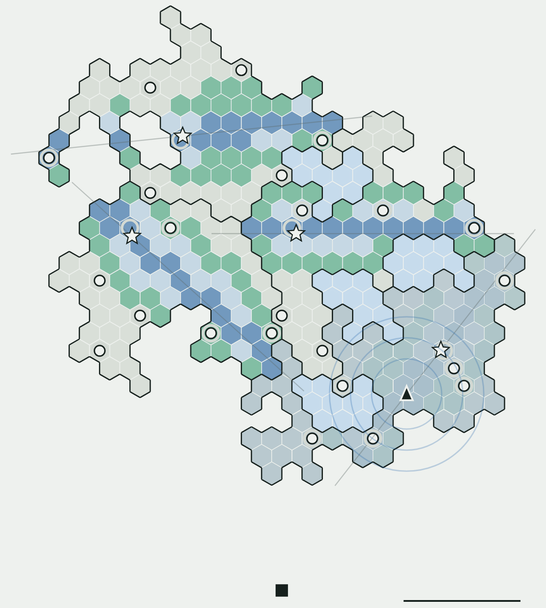 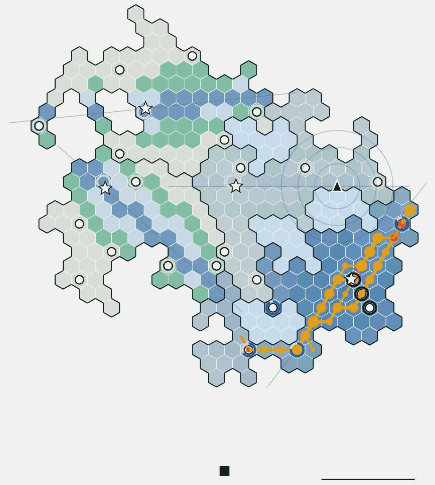

*Cluster có sẵn, cluster bay đầu tiên (đông nam). Trái: t = 40 s, UAV đang bay qua, mỗi cell đậm dần theo phần D mà node trong cell đã nhận. Phải: t = 95 s, khoảng 19 s sau khi UAV rời cluster: Bank đang lấp Circle (vàng) dọc River, và critical cell kéo những gói cuối (đỏ). UAV đã sang cluster thứ hai.*

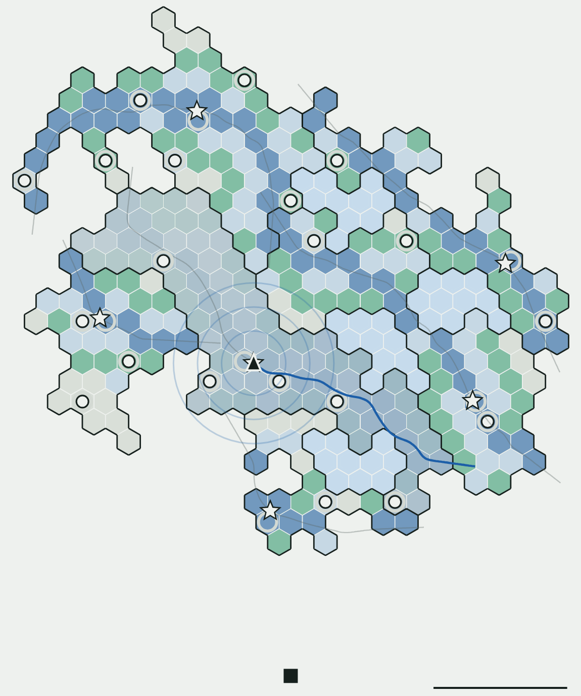 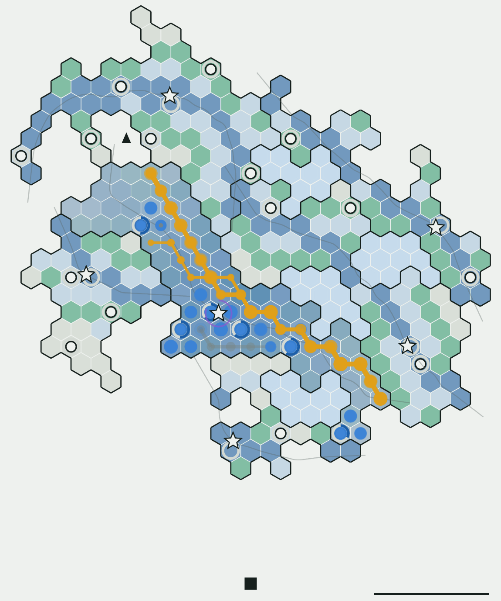 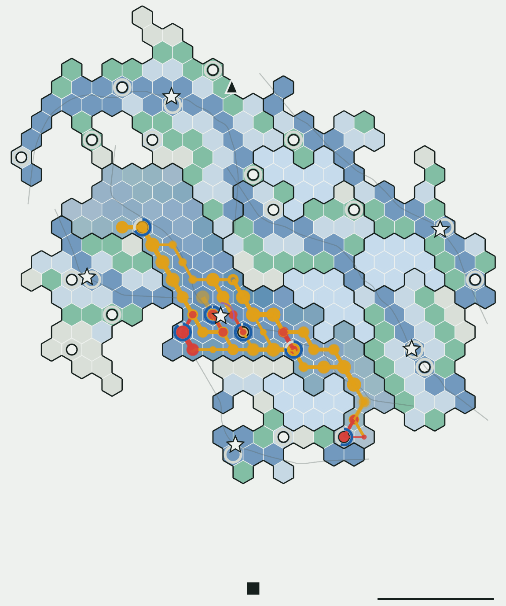

*MEANDER, cluster bay đầu tiên (tây, 24 cell Axe, D = 6 836 gói). Trái: t = 80 s, UAV bay theo đường cong qua cluster. Giữa: t = 120 s, ngay sau khi UAV rời: các cell gom về CL (xanh dương) và luồng vàng đã chạy dọc Axe cong. Phải: t = 140 s, critical cell kéo về (đỏ) trong khi Circle tiếp tục được lấp. Đây là cluster chậm nhất của bản đồ (River mất 115 s), nên lớp 2 cho nó bay trước.*

## 7. Đánh giá

Mọi số trong mục này là số thăm dò trên ns‑3 với MAC 802.15.4 đầy đủ; chưa đạt quy tắc N ≥ 120 lượt của dự án.

: tab:results Kết quả chính.

| Câu hỏi | Kết quả | Thiết kế |
|---|---|---|
| River hay kéo thẳng? | Từ 4 critical cell trở lên, River dùng ít hơn 20–22 % khung ở 20/20 lượt, và nhanh hơn ở 19–20/20 lượt. Với 1 critical cell nằm trên Axe, kéo thẳng rẻ hơn | một cluster, 20 lượt, ghép cặp |
| Chi phí nằm ở đâu? | Chặng Bank → Circle chiếm 74 % số khung trên C3; Axe → Bank tốn 0 khung | C3, một lượt |
| Bao nhiêu màu kênh? | Lưới 7 màu là đủ | 20 lượt mỗi cấu hình |
| River rộng bao nhiêu? | Bề rộng 2,5–6,5 cell gần như không đổi kết quả trên đường bay thẳng | 20 lượt mỗi cấu hình |
| Circle cố định hay động? | Circle động với n = 12 nhanh hơn 11 % và tốn ít hơn 27 % khung; các Circle khi đó chồng lên nhau | C3, một lượt |
| Cửa sổ nào? | Cửa sổ theo từng critical cell gỡ được giới hạn chiều dài cluster: trên dải 6 × 4 km, critical cell cuối xong sau 25 s thay vì 88 s, số khung còn khoảng 1/10. Bề ngang bão hoà ở khoảng 8–10 cell | quét hình dạng cụm, 3 seed |
| Cấp nhiệm vụ? | Hợp tác rút thời điểm xác minh xong T\* 26–68 s so với không hợp tác, trên 39/40 bản đồ | 40 bản đồ, 2–8 cluster |

**Chuẩn bị sẵn hay khi được hỏi.** Trên C3, chuẩn bị sẵn xong sớm hơn 5–7 s ở ba critical cell thiếu nhiều, đổi lại tốn thêm khoảng 9 nghìn khung. Lý do: thành viên đã lấy dữ liệu từ Bank trước khi critical cell hỏi, nên thời gian lấy từ Bank chồng lên thời gian gom. Khi được hỏi chỉ lấy đúng phần thiếu, nên ít khung hơn.

**Vì sao River rẻ hơn kéo thẳng.** Kéo thẳng gửi mỗi gói thiếu suốt từ Axe tới critical cell, và các đường dài của mọi critical cell chồng lên nhau dọc Axe (xem {fig:c3-flows}). River tách đường đi thành hai phần. Phần dài (Bank → thành viên Circle) chạy song song trên nhiều đường ngắn, mỗi đường chỉ mang một đoạn dữ liệu. Phần cuối vào critical cell chỉ dài một chặng liên cell. Khi chỉ có một critical cell nằm ngay trên Axe, đường thẳng đã ngắn sẵn, nên tầng trung gian của River chỉ làm tốn thêm khung.

## 8. Thảo luận và giới hạn

- **Bước tóm tắt của Thuật toán G chưa được mô phỏng.** CL được coi là biết sẵn node nào giữ gói nào. Chi phí thật là một khung tóm tắt mỗi node, nhỏ so với hàng chục nghìn khung dữ liệu, nhưng cần đưa vào.
- **Một lượt, một bản đồ.** Phần lớn số ở mục 7 là một lượt hoặc 20 lượt. Theo quy tắc của dự án, cần chạy lại với N ≥ 120 trước khi đưa vào bài.
- **Kênh đô thị.** A2G và G2G đều là nhánh đô thị, không dùng được cho kịch bản rừng.
- **Circle chồng nhau.** Khi hai critical cell kề nhau, Circle của chúng dùng chung thành viên. Ghép Circle là một câu hỏi nghiên cứu phụ, chưa cài.
- **Bề rộng River tối ưu** và **Bank cho đường bay phức tạp** là hai câu hỏi phụ. Bản này dùng 3,5 cell, và pháp tuyến cục bộ cho đường cong.
- **Cửa sổ theo từng critical cell** giả định rằng gói cùng vị trí ở hai bản phát liền nhau mang cùng nội dung. Điều này đúng khi UAV phát vòng bộ manh mối với chu kỳ đều.

## 9. Kết luận

Sau một lượt bay, dữ liệu trong cluster không thiếu: cả cell có trung vị 92 % D. Nó chỉ nằm sai chỗ: dồn ở dải dưới đường bay, rời rạc ở xa, trong khi các critical cell nằm rải khắp cluster. River dùng một điều mà mạng thường không có: **biết trước** ai sẽ nhận gì. Nhờ đó toàn bộ việc tìm đường và phân công làm xong trước giờ bay. Sau lượt bay chỉ còn các luồng ngắn, đã định, chạy song song: Axe → Bank → Circle → critical cell. Trên ns‑3 với MAC 802.15.4 đầy đủ, khi có nhiều critical cell, cách này ít khung hơn và nhanh hơn việc kéo thẳng từ Axe. Việc còn lại là chạy chiến dịch đủ lượt, và mở rộng cho Circle chồng nhau và đường bay phức tạp.

## Phụ lục A. Mã giả ngắn (bản hội nghị)

```algo
Algorithm 1  AXETABLE                                   ▷ BS, before the flight
1: Axe ← cells crossed by γ, in flight order
2: for each a ∈ Axe do  Seg(a) ← { s : γ(d0 + sΔ) ∈ a }
3: send { (a, Seg(a)) } and u to CH; CH gives every Axe cell its row
```

```algo
Algorithm 2  RIVERSETUP(a)                              ▷ each Axe cell a, before the flight
1: n ← u rotated by 90°
2: for σ ∈ {+1, −1} do
3:     Path_σ(a) ← cells on the segment z(a) → z(a) + σ·ω·n, cut at the cluster edge
4:     Bank_σ(a) ← last cell of Path_σ(a)
```

```algo
Algorithm 2b  LOCALBANKS(a)                             ▷ curved flight, each Axe cell a
1: n ← normal of γ where it crosses a
2: Path_±(a), Bank_±(a) ← as in Alg. 2, along ±n; on the inner side of a bend stop at the radius of curvature
```

```algo
Algorithm 3  CRITICAL                                   ▷ CH, before the flight
1: μ, σ ← mean, std of score(c) over Cells
2: Crit ← {cell of CH}
3:     ∪ { c : score(c) > μ + κ_g·σ }                           ▷ outstanding in the cluster
4:     ∪ { c : score(c) > μ + κ_l·σ and score(c) = max over c and its r-ring }   ▷ … in its area
```

```algo
Algorithm 3b  WINDOW                                    ▷ BS/CH, before the flight; Q packets per clue set
1: for each k ∈ Crit: Need(k) ← the Q consecutive Axe packets around where γ passes closest to k
2: keep in Seg only packets of ⋃_k Need(k); drop Axe cells left empty
```

```algo
Algorithm 4  CIRCLE(k)                                  ▷ CH, before the flight, every k ∈ Crit
1: Circ(k) ← Neig(k), ordered along u
2: split Axe into |Circ(k)| consecutive groups; neighbour m_j takes group G_j
3: for each a ∈ G_j: m_j will fetch Seg(a) from a's Bank on the side nearer m_j
```

```algo
Algorithm 4b  ADAPTIVECIRCLE(k)                         ▷ after the pass, at the CL of k
1: lack ← packets of D_k that no node of k holds      ▷ one summary frame per node
2: n ← clamp(⌈|lack| / share⌉, n_min, n_max);  members ← n cells of rings 1–2 (ring 1 first)
3: split Axe into n consecutive groups; ask member j for lack ∩ its group
```

```algo
Algorithm G  GATHER(c)                                  ▷ after the pass, every cell with a role
1: Need(c) ← own Seg (Axe) ∪ its Axe cell's Seg (Bank) ∪ its group (Circle) ∪ D_k (critical)
2: for each s ∈ Need(c) that CL(c) lacks: the node of c holding s nearest CL(c) by ETX sends it
```

```algo
Algorithm 5  BANKFILL                                   ▷ after the pass, each Bank b of Axe a
1: b sends a "have" manifest of Seg(a) to a along Path(a → b)
2: a returns what b lacks of Seg(a)
```

```algo
Algorithm 6  CIRCLEFILL                                 ▷ after the pass, each Circle cell m_j of k
1: for each a ∈ G_j: ask Bank(a) for Seg(a) \ have(m_j); keep what comes back
2: on a request X from k: send X ∩ have(m_j), the rest as it arrives
```

```algo
Algorithm 7  CRITPULL                                   ▷ after the pass, each k ∈ Crit
1: for each m_j ∈ Circ(k): send m_j the part of Lack(k) in ⋃_{a ∈ G_j} Seg(a)
2: done when Lack(k) = ∅
```

## Phụ lục B. Ký hiệu, mã nguồn và tái lập

: tab:symbols Ký hiệu và giá trị.

| Ký hiệu | Nghĩa | Giá trị |
|---|---|---|
| γ, d_s, Δ | đường bay; vị trí phát của gói s; quãng bay giữa hai gói | Δ = 0,5 m |
| R, w | bán kính cell; bề rộng cell (hai cạnh song song) | 100 m; 173 m |
| D, rx(v) | gói phát trên cluster; gói node v nhận được | |
| Q | số gói của bộ manh mối | 4 036 (cửa sổ 4 041) |
| ω, W | nửa bề rộng River; bề rộng River | 303 m; 3,5 cell |
| κ_g, κ_l, r | ngưỡng vượt trội toàn cục, cục bộ; bán kính vòng | 2; 1; 2 |
| Need(k), D_k | cửa sổ của k; phần k phải có | |
| have(c), Lack(k) | gói CL của c đang có; phần D_k CL của k còn thiếu | |
| share, n_min, n_max | gói mỗi thành viên; số thành viên ít nhất, nhiều nhất | 200–400; 2; 12 |
| τ_frame | thời gian một khung có ACK qua một chặng | khoảng 5–6 ms |

**Mã nguồn.**
- Lập kế hoạch: `uav-coop2/tools/river_plan.py` (Thuật toán 1–4, 2b, 3b, 4b).
- Thực thi trên ns‑3: `uav-coop2/examples/coop2-river.cc` (G, 5–7, D, S).
- Kênh: `uav-sar/examples/a2g-common.h`; định tuyến nền: `uav-coop/models/common/routing.{h,cc}`.
- Hình từng bước của báo cáo: `uav-l2/tools/l3_report_figs.py`; ảnh chụp trình phát: `uav-l2/tools/anim_shots.py`; trình phát: `uav-l2/docs/anim/{mission,meander}-replay.html`.
- Dựng báo cáo này: `python3 paper/techreport/build.py paper/L3-TECHREPORT-vi.md <thư mục ra>`.
- Nhật ký các lần chạy: `logs/2026-10-22_0928-l3-techreport/`.

**Tài liệu tham khảo.**
1. IEEE Std 802.15.4‑2020, *Low‑Rate Wireless Networks*. IEEE, 2020.
2. 3GPP TR 38.901 V17.0.0, *Study on channel model for frequencies from 0.5 to 100 GHz*, 2022 (UMi NLoS).
3. Qiu và cộng sự, đo kênh không–đất ở độ cao thấp, 2017 (số mũ suy hao 2,6–3,35; cần trích đầy đủ).
4. ns‑3 Network Simulator, phiên bản 3.46, mô-đun lr‑wpan.
