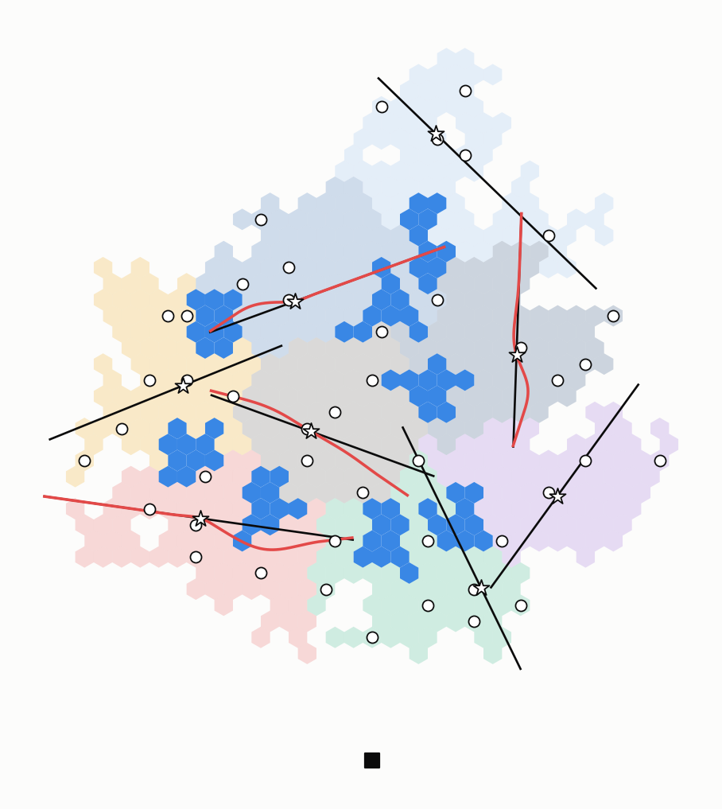
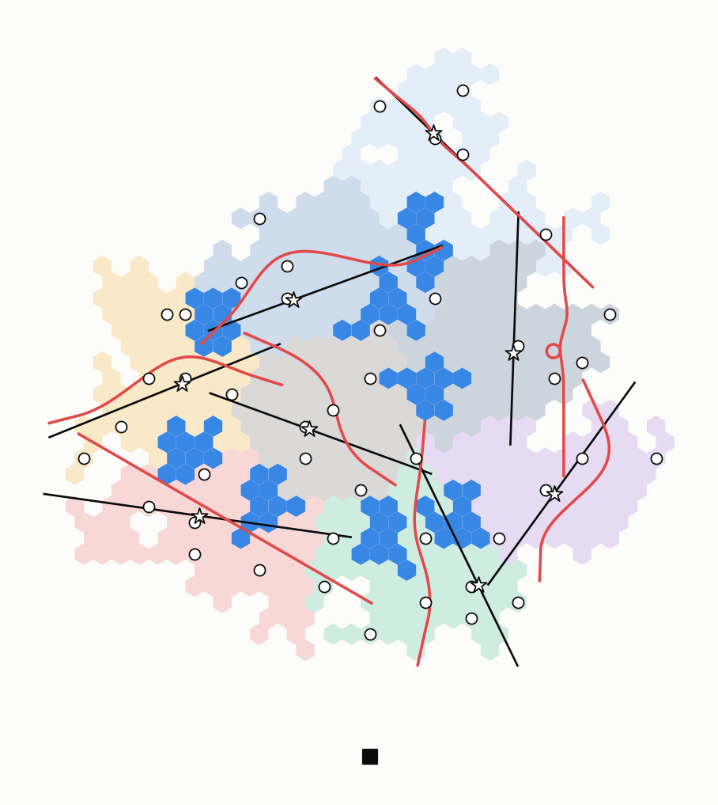

# LM-Tour: ý tưởng, thuật toán và phân tích kết quả

- **Phiên bản:** 2026-10-26. Lời gốc: CLAUDE.md §8 mục 170–180, 183.
- **Nguồn ý tưởng:** bản draft `SigDrop_ICC_draft_v3.pdf`, mục V "Flight design: LM-Tour" và đóng góp 3.
- **Mã:** `uav-l2/tools/river_surrogate.py` (bước A), `uav-l2/tools/lm_tour.py` (bước C).
- **Log:** `logs/2026-10-25_1500-lm-tour/`. Dữ liệu: `uav-l2/docs/data/results/river-surrogate*`, `uav-l2/docs/data/results/lm-tour/`.
- **Tài liệu đi kèm:** `paper/SUMMARY-vi.md` (tổng hợp), `paper/EXPERIMENTS-vi.md` (thực nghiệm và baseline).

---

## 0. Kết luận trong một đoạn

LM-Tour chọn đường bay của đội 1 bằng một mô hình học dự đoán thời gian River.
- **Bộ dự đoán (bước A) dùng được.** Một công thức 3 biến dự đoán thời gian River của từng critical cell với sai số tuyệt đối trung bình 22,8 s (R² 0,60) trên bản đồ chưa thấy. Mô hình cây tăng cường không hơn công thức. Biến quyết định là tổng lượng dữ liệu River phải chuyển trong cả cụm, không phải khoảng cách từ cell tới đường bay.
- **LM-Tour (bước C) không hơn CHORD** trên cluster có sẵn:
  - bản uốn dây cung qua CH: hơn nhiều nhất 10,7 ± 7,4 s (khoảng 1 %), phần lớn nằm trong nhiễu;
  - bản tự do, không bắt buộc qua CH (mục 179): chậm hơn tới 63 s, tour đội 1 dài thêm 53–112 s.
- **Lý do:** uốn đường bay không đổi được tổng lượng River phải chuyển, mà chỉ làm tour dài thêm. Pha 2 chiếm khoảng nửa T\*.
- **Đề xuất cho paper:** giữ công thức dự đoán River làm công cụ lập kế hoạch. Không trình bày LM-Tour như một cải tiến đã được chứng minh (mục 8).

---

## 1. Ý tưởng gốc (draft, mục V)

### 1.1 Nhận xét then chốt
- Trong phát quảng bá một lượt, **hình học đường bay chính là lịch phát**. Gói s được phát tại γ(d₀ + sΔ), nên BS biết trước đoạn dữ liệu nào rơi xuống cell nào.
- Vì vậy đường bay nên được thiết kế cho River, không phải cho độ phủ.
- **Ý tưởng LM-Tour:** bay qua một tập *landmark* (các node AI giá trị nhất, trải đều). River phục vụ mọi node AI trong bán kính R quanh chúng.

### 1.2 Giá trị của node
Mỗi node AI u có trọng số w(u), tổng hợp lý do nên bay sát nó:
- năng lực tính toán;
- cỡ cây camera legacy gắn vào nó;
- tiên nghiệm π_u rằng mục tiêu đã đi qua;
- **thời gian River tiết kiệm được** khi đường bay đi sát u. Phần này do một **bộ dự đoán học có giám sát** trên các lượt ns-3 cung cấp. Đầu vào: số hop tới đường bay, lượng thiếu dự đoán, số luồng dùng chung, bán kính A2G r.

A\* là danh sách node AI xếp theo w giảm dần.

### 1.3 Ba bước
1. **R-net có trọng số.** Duyệt A\*, giữ một node nếu nó cách mọi node đã giữ ít nhất R (khoảng cách đồ thị trên đất). Tập giữ lại K₁ phủ mọi node AI trong bán kính R. Cluster là vùng Voronoi đồ thị của K₁, mọc bằng Dijkstra đa nguồn có giới hạn tải (GROW), với tải là tải River (cỡ cây + lượng thiếu).
2. **Tour cơ sở.** Tour Dubins (bán kính ρ) từ BS qua đĩa B(u, R/2) của mọi u ∈ K₁ (DTSP-N): thứ tự TSP + 2-opt, lấy mẫu hướng vào ở mỗi đĩa.
3. **Chèn theo giá trị.** Node v ∈ A\* cách mọi node đã thăm hơn R/2 là ứng viên. Chèn v nghĩa là uốn tour cục bộ vào đĩa của v, tốn thêm ΔL(v). Chèn tham lam theo w(v)/ΔL(v), khi điểm còn vượt ngưỡng θ và tour còn trong sức bền L_max.

**Thay đổi ở draft v5 (mục 184): bán kính đĩa ξ.** Bước 2 và dòng 8 của Thuật toán 3 dùng đĩa B(·, ξ) thay cho B(·, R/2); ngưỡng ứng viên (dòng 6, 11) vẫn là R/2. Theo (5):

$$\xi = \min\bigl(\omega,\ \rho,\ \sqrt{r^2 - h^2}\bigr)$$

- trong ω node nằm trong dải River; ξ ≤ ρ cho phép đường quay tới khoảng 120° tại landmark; trong √(r² − h²) node nghe UAV trực tiếp.
- Giá trị dùng (ω = 303 m, ρ = 255 m, √(r² − h²) = R50 ngang đã hiệu chỉnh): **255 / 255 / 199 / 99 m** cho r = 1000 / 500 / 200 / 150 m. Quét thêm ξ ∈ {100, 175, 250} m (TODO của draft).
- Mã: `lm_tour.py plan --xi auto` (hoặc `--xi 175`); mặc định vẫn R/2, nên các kết quả §6 không đổi. Chưa chạy.
- Bộ khung mục Evaluation cho v5, kèm số LM-Tour **ước lượng**: `paper/icc-v5/`.

**Kiểm tra cửa sổ:** mọi node được thăm phải được phát một bản đủ của truy vấn gần nó, tức đoạn QΔ ≈ 2 km quanh điểm gần nhất phải nằm trong tầm River R_Q (≈ 1 km).

**Chọn R:** các node giữ lại cách nhau ít nhất R, nên |K₁| ≤ 4A/(πR²). Tour qua n điểm trong diện tích A dài nhiều nhất √(2nA) + O(√A) (Few 1955), cộng O(nρ) cho các vòng Dubins. Vậy tour giảm theo 1/R, còn quãng River tăng theo R; R chọn ở điểm cân bằng.

```text
Algorithm 3  LM-TOUR  (draft)
Input: AI nodes with weights w, land graph G, R, ρ, θ, L_max
 1: A* ← AI nodes sorted by w (descending); K1 ← ∅
 2: for all u ∈ A* do
 3:     if d_G(u, K1) ≥ R then K1 ← K1 ∪ {u}
 4: clusters ← GROW(G, K1)                                   ▷ balanced Voronoi regions
 5: γ ← Dubins TSP-N through discs B(u, R/2), u ∈ K1
 6: C ← {v ∈ A* \ K1 : d(v, visited) > R/2}
 7: repeat
 8:     for all v ∈ C do ΔL(v) ← cheapest local re-route of γ into B(v, R/2) passing the window check
 9:     v* ← argmax_v w(v)/ΔL(v)
10:     if w(v*)/ΔL(v*) < θ or |γ| + ΔL(v*) > L_max then break
11:     insert v*; remove from C all nodes within R/2 of v*
12: until C = ∅
13: return γ, clusters, visited nodes
```

---

## 2. Đặt ý tưởng vào giả lập hiện có

### 2.1 Cái gì cố định, cái gì LM-Tour được đổi
Cài đặt hiện tại (mục 175, 179) chạy trên đúng các nhiệm vụ CHORD đã có (`scratchpad/FIX/<kênh>/k8-s1`, mục 169). Giữ nguyên:
- cluster k-medoids có sẵn (≤ 80 cell), CH, critical cell;
- River (`--repair 20`), mã fountain dạng hệ thống, lớp 1, LoRa, chính sách đội 2;
- thứ tự tour đội 1 tính như CHORD (độ trễ có trọng số, nối Dubins).

LM-Tour chỉ đổi **pass của mỗi cụm**: đoạn bay qua cụm, nên đổi luôn kế hoạch River, phần tự giải mã và các đoạn nối.

Lý do không cài GROW (bước 1, chia cluster): người dùng đã chốt dùng cluster có sẵn làm phương án tổng quát nhất (mục 159). Lớp 2 tái cấu trúc cluster (LANE, MEANDER, SWATH) đã được thử và không thắng (xem `paper/SUMMARY-vi.md` §6).

### 2.2 Hai chế độ
- **Uốn (mặc định, mục 175).** Trên cluster có sẵn, bước 1–2 rút về chính dây cung CHORD:
  - CH là node mạnh nhất cụm, nên là node đầu tiên được giữ;
  - dây cung CHORD là đường qua đĩa của nó.

  Phần riêng của LM-Tour là bước 3: uốn dây cung vào đĩa B(c, R/2) của các critical cell khác, CH vẫn được ghim.
- **Tự do (`--free`, mục 177–179).** Người dùng chỉ ra rằng draft không bắt buộc đi qua CH, chỉ cần một đường DTSP-N. Ràng buộc thêm: mỗi cụm chỉ một River, tức pass cắt cụm đúng một lần.
  - R-net trên các critical cell của cụm, xếp theo thời gian River dự đoán trên pass CHORD (lâu nhất trước);
  - các đường thẳng qua trọng tâm các cell giữ lại, mỗi 30°, uốn vào đĩa của chúng, không ghim gì;
  - bỏ đường cắt cụm quá một lần (khe hở > 300 m), lấy đường tốt nhất theo J_k;
  - rồi chèn như chế độ uốn.

### 2.3 Trọng số
Mọi critical cell có cùng tiên nghiệm và cùng năng lực trong giả lập, và chưa có cây camera legacy. Vì vậy w(v) chỉ còn là **số giây critical cell tiết kiệm được**, đo bằng hàm mục tiêu J_k ở §4. Quy tắc w(v)/ΔL(v) ≥ θ của draft trở thành "chèn nếu J_k giảm" (§4.3).

---

## 3. Bước A: bộ dự đoán thời gian River

### 3.1 Dữ liệu
- **Nhãn:** doneS của từng critical cell, số giây từ lúc đội 1 rời cụm tới lúc CL giữ đủ cửa sổ dữ liệu của nó (bản sao bộ manh mối gần nó nhất, 4 041 gói).
- **Nguồn:** 12 thư mục FIX (3 bản đồ k8, k12, k16 × 4 kênh open, r500, r200, r100), River ns-3 `--repair 20`, binary CAMP-BIN4. Tổng 812 critical cell, 0 cell kẹt. doneS trung bình 67,3 s, độ lệch 54,8 s, từ 1,7 tới 311,3 s.
- **Kế hoạch River tính lại** bằng `river_plan.plan` khớp với `plan{k}.txt` ns-3 đã chạy (lệch tối đa 2 gói ở biên cell).

### 3.2 Đặc trưng (BS biết hết trước khi cất cánh)

| Đặc trưng | Nghĩa |
|---|---|
| hops | số cell từ critical cell tới cell Axe gần nhất trong cửa sổ của nó |
| dpath | khoảng cách (m) từ tâm cell tới đường bay trong cửa sổ |
| lackCell | số gói của cửa sổ mà mọi node của cell cộng lại được dự đoán là thiếu (mô hình nghe của kênh, hợp theo cell) |
| lackCL | như trên, riêng CL |
| naxe | số cell Axe cửa sổ trải qua |
| ring1, ring2 | số cell của cụm trong vòng 1, vòng 2 quanh nó (ứng viên Circle) |
| ncrit | số critical cell của cụm |
| share | số critical cell khác có cửa sổ chồng lên cửa sổ của nó (dùng chung Bank) |
| shareLack | tổng lackCell của các cell đó |
| **cluLack** | **tổng lackCell của mọi critical cell trong cụm: toàn bộ lượng River phải chuyển** |
| loss | suy hao thêm của kênh (dB) |

Lượng thiếu dự đoán khớp ns-3: tương quan r = 1,000 cho cả cell và CL (trung bình 2 200 so với 2 183 gói).

### 3.3 Mô hình và kiểm tra chéo

| Mô hình | Bỏ một bản đồ: MAE (s) / R² | Bỏ một kênh: MAE (s) / R² |
|---|---|---|
| trung bình | 42,4 / −0,02 | 51,9 / −0,40 |
| **công thức 3 biến** | **22,8 / 0,60** | **22,3 / 0,63** |
| tuyến tính, đủ 12 đặc trưng | 23,0 / 0,60 | 24,1 / 0,61 |
| cây tăng cường (sâu 2, 200 cây, lr 0,05, lá ≥ 20) | 26,1 / 0,40 | 28,6 / 0,55 |

Công thức khớp trên toàn bộ dữ liệu:

$$\widehat{T}_{\text{River}}(c) = 0{,}71 + 2{,}29\,\text{hops}_c + 1{,}97\,\frac{\text{lackCell}_c}{1000} + 4{,}26\,\frac{\text{cluLack}_{k(c)}}{1000}\quad\text{(giây)}$$


*Hình 1: mỗi chấm một critical cell. Trục ngang: doneS ns-3; trục dọc: dự đoán của công thức khi bỏ bản đồ của nó ra khỏi tập học. Màu theo kênh: xanh lá open, xanh dương r500, cam r200, đỏ r100. Đường chéo là dự đoán đúng.*

**Đọc kết quả:**
- **89 % phương sai của doneS nằm giữa các cụm.** cluLack là biến quan trọng nhất (độ quan trọng trong cây 0,54, tiếp theo lackCell 0,24).
- Nghĩa là thời gian River của một critical cell chủ yếu do **lượng dữ liệu cả cụm phải chuyển** (River dùng chung Bank, gateway và kênh), còn khoảng cách riêng của cell tới đường bay chỉ ảnh hưởng ít (2,3 s mỗi hop).
- Cây không hơn công thức vì dữ liệu chỉ có 3 bản đồ; cây sâu hơn học thuộc hai bản đồ và kém trên bản thứ ba.
- **Phần đuôi bị dự đoán thấp:** các cell River 150–310 s đều được dự đoán thấp hơn thực tế.

---

## 4. Hàm mục tiêu của một pass

### 4.1 Định nghĩa
Với cụm k, n_k critical cell, một pass được chấm bằng

$$J_k = \sum_{c \in \text{Crit}_k} \text{ready}_c \;+\; n_k\, t^{\text{in}}_k \;+\; \theta\, N^{\text{after}}_k \left(t^{\text{in}}_k + \text{dur}_k + t^{\text{out}}_k\right)$$

- **ready_c** (giây, từ đầu pass) = min(own_c, dur_k + T̂_River(c)):
  - **own_c:** lúc cell tự giải mã đủ bộ manh mối mã fountain. BS tính theo kỳ vọng: hợp theo cell của xác suất nghe từng gói dọc pass, tới khi đạt mục tiêu FC (1,05·K_j + 3√(1,05·K_j) mỗi file), cộng thời gian gom trong cell 0,07 + 0,00789 × số gói phải chuyển về CL.
  - **T̂_River(c):** công thức bước A trên kế hoạch River của *chính pass này*.
- **dur_k:** thời lượng pass khi bay theo hồ sơ vận tốc (`pass_speed.fit`): giảm tốc, hoặc lượn, sao cho một bản bộ manh mối (4 041 gói) được phát trên cell của cụm.
- **t_in, t_out:** đoạn nối Dubins (ρ = 255 m) từ pass của cụm trước và tới pass của cụm sau, hoặc từ/về BS với hướng tự do. Uốn pass đổi tư thế đầu/cuối nên đổi luôn các đoạn này.
- **N_after:** số critical cell của các cụm bay sau cụm k. Mỗi giây thêm vào pass hoặc đoạn nối làm trễ tất cả chúng.
- **θ:** trọng số của độ trễ lan sang cụm sau; dùng θ = 1.

### 4.2 Vì sao hàm này
- Số hạng thứ nhất và thứ hai là tổng thời điểm các critical cell của cụm sẵn sàng, tính từ lúc đội 1 rời cụm trước.
- Số hạng thứ ba là cái giá áp lên các cụm sau.
- Cực tiểu tổng thời điểm sẵn sàng là mục tiêu đúng vì c\* có thể là critical cell bất kỳ, như tour độ trễ của CHORD.

### 4.3 Liên hệ với quy tắc của draft
Chèn v giảm J_k khi số giây critical cell tiết kiệm được (w(v)) lớn hơn số giây critical cell bị trễ thêm (θ·ΔL(v) quy ra thời gian, nhân số cell bị ảnh hưởng). Đây chính là w(v)/ΔL(v) ≥ θ khi tiên nghiệm đều.

---

## 5. Thuật toán đã cài

```text
Algorithm LM-PASS(k, R, θ, N_after, nb, free)         ▷ BS, per cluster, before take-off
Input: CHORD's pass γ0 of cluster k, its critical cells Crit_k, neighbours nb = (prev end pose, next start pose)
 1: base ← EVAL(γ0); cur ← base; pulls ← ∅; line ← none
 2: if free then                                       ▷ draft Steps 1–2, the CH not required
 3:     kept ← R-net of Crit_k ordered by base.T_River (longest first), pairwise ≥ R apart
 4:     for each bearing b ∈ {0°, 30°, …, 150°}:
 5:         ℓ_b ← straight line at bearing b through the centroid of kept
 6:         γ_b ← BEND(ℓ_b, kept, R/2, pinned = ∅)
 7:     cur ← argmin_{γ_b crossing cluster k once} J(EVAL(γ_b)); pulls ← kept; line ← its ℓ_b
 8: repeat                                             ▷ draft Step 3: greedy insertions
 9:     Cand ← {c ∈ Crit_k \ pulls : d(c, cur) > R/2}
10:     for each c ∈ Cand:  γ_c ← BEND(line or γ0, pulls ∪ {c}, R/2, pinned = (free ? ∅ : {CH}))
11:     c* ← argmin_c J(EVAL(γ_c))   (free: only γ_c crossing once)
12:     if J(EVAL(γ_c*)) ≥ J(cur) then break
13:     pulls ← pulls ∪ {c*}; cur ← EVAL(γ_c*)
14: return cur

Function EVAL(γ)
 1: fly γ with the speed profile (slow down or loop until one clue-set copy is sent over the cluster) → dur, packets
 2: River plan of γ (Axe, Seg, Banks, per-critical-cell windows) → features → T̂_River(c) for every c ∈ Crit_k
 3: own(c) ← expected fountain decode along γ + in-cell gather;  ready(c) ← min(own(c), dur + T̂_River(c))

Function J(e) = Σ_c ready(c) + n_k t_in + θ N_after (t_in + dur + t_out)   ▷ t_in, t_out: Dubins links to nb

Algorithm LM-TOUR(map, R, θ, rounds)
 1: order ← CHORD's tour (latency objective, Dubins links); N_after, nb from order
 2: for round = 1 … rounds:
 3:     for each cluster k: γ_k ← LM-PASS(k, R, θ, N_after_k, nb_k, free)
 4:     fly the new passes (ns-3 pass input), recompute order, N_after, nb
```

**BEND** là `meander_lane.bend_lane`: cộng các "bướu" Gauss kéo đường về tâm cell, sao cho đường đi vào đĩa B(c, R/2); trong chế độ uốn thì CH được ghim; không giới hạn biên độ.

**Chấm cả nhiệm vụ** (`lm_tour.py score`) chạy đúng đường mã của `l1_rank` cho CHORD (`P+prog-kin-puq-stage-zero-redir-kt-fcd`), 100 lượt bốc lớp 1, với doneS lấy:
- từ ns-3 (`--mode ns3`): trùng tuyệt đối với `l1_rank` (sai khác 0,0 s trên từng lượt bốc, `c-validate-ns3.md`);
- hoặc dự đoán bằng công thức (`--mode pred`): dùng cho các pass LM-Tour chưa chạy ns-3.

**Kiểm chứng chế độ dự đoán** (CHORD, k8-s1): T\* dự đoán 647 / 783 / 870 / 881 s so với ns-3 647 / 784 / 876 / 872 s (open / r500 / r200 / r100). Sai khác ≤ 9 s, đủ để so các pass với nhau.

---

## 6. Thực nghiệm

### 6.1 Thiết lập
- Bản đồ k8-s1 (8 cụm, 45 critical cell), 4 kênh, 100 lượt bốc lớp 1 ghép cặp.
- So sánh: chênh T\* ghép cặp LM-Tour − CHORD, cả hai chấm bằng River dự đoán, khoảng tin cậy 95 % theo lượt bốc.
- θ = 1, một vòng (rounds = 1).
- Ba lượt quét:
  - **Sweep 1:** chế độ uốn, J_k chưa có đoạn nối (t_in = t_out = 0); R ∈ {200, 450, 800} m.
  - **Sweep 2:** chế độ uốn, J_k đủ như §4; R ∈ {200, 450, 800} m.
  - **Sweep 3:** chế độ tự do; R ∈ {450, 800} m. Hai cấu hình (R450 open, R450 r200) chưa chạy xong vì giới hạn 2 giờ của tác vụ nền.

### 6.2 Kết quả

Chênh T\* (LM-Tour − CHORD, s; âm là LM-Tour nhanh hơn) và chênh tour đội 1:

| Cấu hình | open | r500 | r200 | r100 | Δ tour đội 1 (s) |
|---|---|---|---|---|---|
| Sweep 1, R = 200 | +2,8 ± 3,3 | +18,0 ± 29,3 | −4,7 ± 15,0 | +9,8 ± 7,9 | +10 … +18 |
| Sweep 2, R = 200 | −0,8 ± 3,5 | +1,4 ± 5,9 | −7,3 ± 14,5 | −5,3 ± 4,6 | −4 |
| Sweep 2, R = 450 | −1,2 ± 3,3 | +8,0 ± 27,5 | −1,5 ± 8,1 | **−10,7 ± 7,4** | −12 |
| Sweep 2, R = 800 | −3,1 ± 3,0 | +14,9 ± 25,0 | +0,6 ± 6,3 | −3,7 ± 4,4 | −7 |
| Sweep 3, R = 450 | – | +25,1 ± 27,7 | – | **+63,4 ± 33,4** | +99 … +112 |
| Sweep 3, R = 800 | +10,7 ± 13,8 | +20,7 ± 29,4 | +3,4 ± 24,6 | −0,8 ± 23,7 | +53 … +54 |

T\* tuyệt đối của CHORD (dự đoán): 647 / 783 / 870 / 881 s. Tour đội 1 của CHORD: 782 s.

**Số lần chèn** (tổng trên 8 cụm): sweep 1 5–13, sweep 2 5–7; sweep 3 23–38 (gồm cả các cell giữ lại của R-net).

Ví dụ một cấu hình sweep 2 (r100, R = 450), theo cụm: 0–2 lần chèn mỗi cụm; pass đổi −3 … 0 s; thời điểm sẵn sàng trung bình đổi 0 … −3 s; thời gian River dự đoán đổi 0 … −2 s; 0/45 critical cell tự giải mã được từ pass.



*Hình 2: bản đồ k8-s1, kênh r100, sweep 2 R = 450. Đường đen: pass CHORD qua CH (sao trắng); đường đỏ: pass LM-Tour ở những cụm có chèn. Vòng trắng: critical cell. Ô xanh đậm: hồ; ô vuông đen: BS.*



*Hình 3: như Hình 2, sweep 3 (tự do, R = 800, kênh r100). Pass đỏ không còn đi qua CH, uốn qua nhiều critical cell hơn.*

Thêm: `lm-free-k8-s1-r200-R800-chord-vs-lm.png` (kênh r200).

---

## 7. Phân tích: vì sao LM-Tour không hơn CHORD

1. **Uốn đường không đổi được lượng River phải chuyển.**
   - Thời gian River do cluLack quyết định (§3.3), tức tổng lượng dữ liệu các critical cell thiếu.
   - Uốn pass về gần một critical cell chỉ đổi hops của cell đó (2,3 s mỗi hop) và một phần lackCell của nó. Các cell khác của cụm vẫn thiếu gần như cũ, nên cluLack gần như không đổi.
   - Kết quả: mỗi lần chèn rút River của cụm 0–5 s.
2. **Không critical cell nào tự giải mã được nhờ uốn.**
   - CHORD đã làm chậm mỗi cụm để phát đúng một bản bộ manh mối trên cell của cụm (hồ sơ vận tốc).
   - Ở r200, r100, một cell nghe được rất ít trong bản đó, nên own_c = ∞ với mọi cell, trước và sau khi uốn.
   - Ở open, mọi cell đã tự giải mã được trên pass CHORD; River không còn trên đường găng, nên uốn không thêm gì.
3. **Mọi thay đổi pass đều làm trễ các cụm sau.**
   - Sweep 1 không tính đoạn nối: uốn làm tour dài thêm 10–18 s và T\* xấu đi ở r100 (+9,8 s). Khi tính đủ đoạn nối (sweep 2), thuật toán gần như chỉ chèn những chỗ rút ngắn được đoạn nối, nên tour giảm 4–12 s, và đó là phần lớn lợi ích nhỏ còn lại.
   - Chế độ tự do bỏ hướng dây cung CHORD vốn đã được chọn chung với thứ tự tour (CHORD-T), nên tour dài thêm 53–112 s. Với R = 450, R-net giữ nhiều cell hơn, đường uốn nhiều hơn, và T\* ở r100 chậm hơn 63 s.
4. **Pha 2 chiếm khoảng nửa T\*.** Sau khi báo cáo của c\* về BS, đội 2 còn bay và xác minh khoảng 78 s mỗi cell. Thay đổi thời điểm sẵn sàng vài giây chỉ dịch T\* một phần nhỏ.
5. **Bằng chứng độc lập từ mục 182:** thay River bằng kéo trực tiếp làm thời gian sẵn sàng của từng cell đổi hàng chục giây (cả hai chiều), nhưng T\* chỉ đổi ≤ 3 % ở 11/12 tổ hợp (`paper/EXPERIMENTS-vi.md` §5.3). Lớp 3 nhanh hơn vài chục giây không chuyển thành T\* nhanh hơn tương ứng.

**Tóm lại:** trên cluster có sẵn, CHORD-T đã gần tối ưu theo T\*, đúng như mục 159 đã thấy (cắt vừa đủ, uốn, ưu tiên River: T\* 758 / 761 / 761 s, không khác nhau).

---

## 8. Đề xuất cho paper

### 8.1 Phương án viết
- **Phương án A (khuyến nghị):** mục V của draft trở thành "Flight design" với CHORD-T (đường thẳng qua CH, hướng chọn chung với tour độ trễ, giảm tốc hoặc lượn để giao đủ). Công thức River dùng làm mô hình hoàn tất River của BS: dự đoán thời gian sẵn sàng của từng critical cell trước giờ bay (MAE 22,8 s trên bản đồ chưa thấy). LM-Tour đưa vào thảo luận như một hướng đã thử và không mang lại lợi ích trên cluster có sẵn, kèm lý do ở §7.
- **Phương án B:** giữ LM-Tour làm khung tổng quát. Trên cluster có sẵn với tiên nghiệm đều, bước 1–2 của nó rút về CHORD, và bước 3 không tìm được chèn có lợi. Phải nói rõ là kết quả trung tính, không phải cải tiến.
- **Không được viết:** "LM-Tour rút ngắn nhiệm vụ", "mô hình học cải thiện đường bay", hay bất kỳ con số nào như trong TODO của draft (quét R ∈ {300, 450, 600, 800} cho thấy đánh đổi 1/R và R). Số liệu hiện có không cho thấy đánh đổi đó trên T\*.

### 8.2 Khi nào LM-Tour có thể có ích (chưa thử)
- **Cluster chưa có sẵn** (bước 1 với GROW): khi đường bay quyết định luôn cách chia cụm. Đây là phần khác biệt thật của draft, nhưng hướng tái cấu trúc cluster (LANE, MEANDER, SWATH) đã thua CHORD-T trên cluster có sẵn.
- **Trọng số không đều:** tiên nghiệm π theo điểm thấy mục tiêu lần cuối, hoặc cây camera legacy lớn. Khi đó bay sát một cell có π cao có thể đáng giá vì nó là ứng viên c\* chính.
- **Cụm lớn với River dài** (phần đuôi 150–310 s), nơi đổi cluLack bằng cách phát hai bản sao thay vì uốn.

### 8.3 Đối chiếu với các TODO trong draft

| TODO trong draft | Trạng thái |
|---|---|
| (1) cài LM-Tour: khoảng cách đồ thị, GROW, Dubins TSP-N có lấy mẫu hướng, chèn | Đã cài R-net, đường qua đĩa, chèn theo J_k, đoạn nối Dubins. Chưa cài GROW (cluster có sẵn) |
| (2) trọng số: công thức (năng lực, cỡ cây, π) rồi bộ dự đoán | Bộ dự đoán xong (bước A). Năng lực, cây, π đều như nhau trong giả lập nên chưa dùng |
| (3) quét R ∈ {300, 450, 600, 800} m ở r ∈ {200, 1000} m | Đã quét R ∈ {200, 450, 800} ở 4 kênh. Không thấy đánh đổi trên T\* |
| (4) so với CHORD-fixed và tour ngắn nhất | Đã so với CHORD (= CHORD-fixed). Tour ngắn nhất: ablation 20–21/10 (`paper/OVERVIEW-vi.md` §10.2) cho thấy chậm hơn tour độ trễ 22–26 s |
| (5) hình: R-net, đĩa, tour cơ sở, một lần chèn | Có hình pass (Hình 2, 3). Chưa có hình từng bước R-net và đĩa |
| Bước D: chạy ns-3 trên pass LM-Tour | Chưa làm, vì mức mô hình không cho thấy lợi ích |

---

## 9. Tái lập

```text
# bước A (từ uav-l2/)
python3 tools/river_surrogate.py --works FIX/open/k8-s1,...,FIX/r100/k16-s1 --out docs/data/results/river-surrogate
# bước C: một cấu hình (chế độ uốn; thêm --free cho chế độ tự do)
python3 tools/lm_tour.py plan FIX/r100/k8-s1 --out LM2/R450/r100/k8-s1 --R 450 --rounds 1
python3 tools/lm_tour.py score LM2/R450/r100/k8-s1 --mode pred --out LM2/R450-r100-k8
# CHORD chấm cùng cách
python3 tools/lm_tour.py score FIX/open/k8-s1,FIX/r500/k8-s1,FIX/r200/k8-s1,FIX/r100/k8-s1 --mode pred --out LM/chord-pred-k8
```

- Ba lượt quét: `logs/2026-10-25_1500-lm-tour/c-sweep.sh`, `c-sweep2.sh`, `c-sweep3.sh`.
- Thư mục FIX dựng lại từ `uav-l2/docs/data/results/raw/` (xem `uav-l2/docs/RESULTS-vi.md` §4).
- Hình: `logs/2026-10-25_1500-lm-tour/lm_fig.py`.
