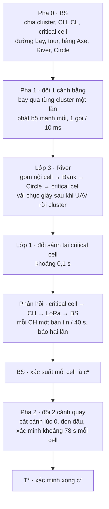
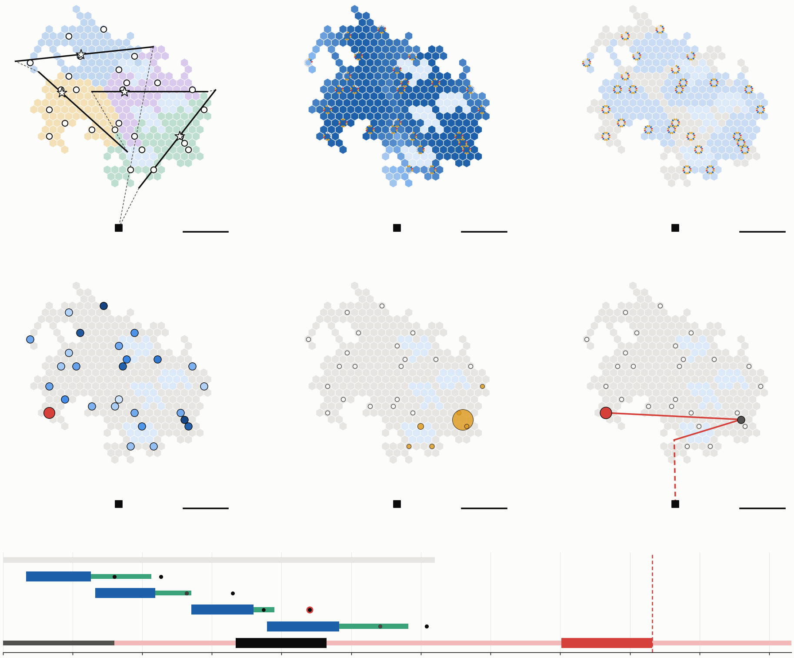

# Tổng quan nghiên cứu River

**Giao truy vấn tìm kiếm tới mạng camera IoT bằng một lượt bay UAV cánh bằng và hợp tác mặt đất có lập kế hoạch**

- **Phiên bản:** 2026‑10‑21, bản đang chốt cho paper.
- **Lời gốc của mọi yêu cầu:** CLAUDE.md §8, mục 1–119. Lời người dùng ở đó, và lời mới hơn, thắng mọi tài liệu khác khi có mâu thuẫn.
- **Phạm vi:** tài liệu này tổng hợp, không thay thế các tài liệu chi tiết. Mỗi mục có đường dẫn tới tài liệu gốc, để đọc sâu hơn.
- **Bản trang web** (có mục lục và chú thích thuật ngữ khi rê chuột; riêng tư cho tới khi được chia sẻ): https://claude.ai/artifact/BTcAwySMrwES5tHsLdCKw2. Dựng lại bằng `paper/overview-page/build.py`.

> **Cách đọc**
> - Thuật ngữ quan trọng được giải thích ở §14 (Thuật ngữ); ký hiệu toán ở §15.
> - Lần đầu xuất hiện, thuật ngữ được in đậm và có liên kết tới §14.
> - Mọi con số ở đây là **số thăm dò**: 10 bản đồ cho mỗi cỡ mạng, dưới quy tắc N ≥ 120 của dự án. Chưa số nào đủ để công bố.

**Lộ trình đọc gợi ý**

| Thời gian | Đọc | Để biết |
|---|---|---|
| 15 phút | §1 → §3 → §10.1 | bài toán, kiến trúc, kết quả chính |
| 1 giờ | thêm §2, §4, §7, §8, §11 | mô hình hệ thống, River, pha 2, giới hạn |
| Trước khi làm việc trên mã | thêm §5, §6, §9, §12, §13 | lớp 1, lớp 2, phương pháp, lịch sử, kho mã |

---

## 1. Tóm tắt một trang

**Bài toán.**
- Một người cần tìm (trẻ đi lạc, đối tượng sau một vụ việc) có thể đã đi qua trước nhiều camera IoT trong thành phố.
- Các camera đã ghi hình, nhưng không biết cần tìm ai.
- Dữ liệu thô không thể tải về (thiếu băng thông) và không được phép tải về (ràng buộc pháp lý).
- Hướng giải: đưa một **[truy vấn](#g-truy-van)** xuống tận từng camera. Truy vấn là một bộ nhỏ ảnh tham chiếu của mục tiêu. Camera tự đối sánh tại chỗ và chỉ gửi về vài byte kết quả.

**Kiến trúc nhiệm vụ: ba pha.**
- **Pha 0:** chia mạng mặt đất thành **[cluster](#g-cluster)** và lập kế hoạch tại **[BS](#g-bs)**.
- **Pha 1:** một **[UAV cánh bằng](#g-canh-bang)** bay qua mỗi cluster một lần và phát truy vấn.
  - Mạng mặt đất chuyển truy vấn tới các **[critical cell](#g-critical-cell)**: các ô có camera đủ mạnh để đối sánh.
  - Mỗi critical cell đối sánh, rồi báo điểm về BS qua **[LoRa](#g-lora)**.
- **Pha 2:** một **[UAV cánh quay](#g-canh-quay)** mang bộ tham chiếu đầy đủ tới xác minh từng cell, theo thứ tự BS đề xuất.

**Khó khăn chính.**
- UAV cánh bằng không dừng được và chỉ bay qua mỗi cluster một lần.
- Node ngay dưới đường bay nghe được chuỗi gói liền mạch dài. Node cách đường bay 600–900 m chỉ nghe được những mẩu rời rạc: chuỗi liền dài nhất khoảng 50 và 14 gói, so với khoảng 850 gói ngay dưới đường bay (§4.5).
- Một file ảnh chỉ dùng được khi có đủ mọi gói của nó. Vì vậy critical cell nằm xa đường bay thiếu dữ liệu.

**Đóng góp chính: [River](#g-river) (lớp 3).**
- **Nhận xét then chốt:** đường bay biết trước, nên BS biết trước cell nào sẽ nghe được đoạn dữ liệu nào. River lập kế hoạch hợp tác mặt đất từ chính thông tin đó.
- Các cell dưới đường bay (**[Axe](#g-axe)**) giữ từng đoạn dữ liệu.
- Các cell ở mép dải nghe tốt (**[Bank](#g-bank)**) được Axe bù cho đủ.
- Các cell hàng xóm quanh mỗi critical cell (**[Circle](#g-circle)**) lấy sẵn từng phần từ Bank, rồi giao cho critical cell khi được hỏi.
- Mọi dữ liệu đi theo **[cell path](#g-cell-path)** cố định, trên **[MAC IEEE 802.15.4](#g-802154)** đầy đủ, với lịch kênh dạng lưới.

**Kết quả** (thăm dò; mô phỏng **[ns‑3](#g-ns3)** trên 40 bản đồ, 200 cluster):
- River ít hơn 20–22 % khung so với **[kéo thẳng](#g-keo-thang)** khi cluster có từ 4 critical cell trở lên, và nhanh hơn ở 19–20/20 lượt bay.
- Ở cấp nhiệm vụ, hợp tác rút **[T\*](#g-tstar)** (thời điểm xác minh xong cell nghi vấn cao nhất) 26–68 s so với không hợp tác, trên 39/40 bản đồ.
  - Cơ chế: xếp hạng đúng hơn, không phải báo cáo sớm hơn.
- Cả kiến trúc nhanh hơn baseline UAV cánh quay tốt nhất 1,9–2,8 lần, và nhanh hơn 2,2–4,0 lần so với khi không có pha 1.
  - Phần lớn lợi thế thời gian này đến từ kiến trúc nhiệm vụ: cánh bằng một lượt, đội 2 cất cánh sớm và **[đón đầu](#g-don-dau)**. Không nên quy nó riêng cho River.

**Đang mở.**
- Lớp 2 (tái cấu trúc cluster theo đường bay) chưa thắng cluster có sẵn, và phép so sánh hiện tại chưa công bằng về số và cỡ cluster.
- Tham số lớp 1 cần neo vào số đo thật.
- Mọi số liệu cần chạy lại với N ≥ 120.

---

## 2. Bối cảnh và động cơ

Lời gốc: CLAUDE.md §8 mục 38–39. Chi tiết: `paper/INTRO-vi.md`, `paper/RELATED-vi.md`.

### 2.1 Tình huống
- **Nhiều camera:** một khu đô thị có hàng nghìn thiết bị IoT, mỗi thiết bị phục vụ một mục đích khác nhau: camera an ninh, chuông cửa, máy bán hàng tự động, cả camera hành trình của ô tô.
- **Khác nhau về năng lực:** quan sát, tính toán, kênh vô tuyến, bộ nhớ. Chủ sở hữu cũng khác nhau.
- **Bằng chứng có thời hạn:** camera ghi liên tục và dữ liệu mới ghi đè dữ liệu cũ. Đây là cuộc chạy đua thời gian.
- **Camera không biết phải tìm gì:** mỗi camera chỉ làm việc riêng của nó. Thứ còn thiếu là *truy vấn*: một mô tả cô đọng về đối tượng, đặt được vào từng nút biên trước khi bằng chứng bị ghi đè.

### 2.2 Vì sao không tải dữ liệu về
- Ở vùng hoang dã (rừng quốc gia, khu bảo tồn), thiết bị chỉ có LoRa hoặc vệ tinh, chuyển được vài trăm byte mỗi giờ.
- Ở đô thị, dữ liệu thô vướng ràng buộc pháp lý và quyền riêng tư.
- Vì thế ta đảo chiều: **đưa truy vấn xuống**, đối sánh tại chỗ, chỉ gửi kết quả vài byte lên.

### 2.3 Vì sao UAV, và vì sao hai loại
- UAV đưa được truy vấn tới nơi không có hạ tầng băng rộng.
- **Cánh bằng (đội 1):** nhanh (50 m/s), tầm xa. Nhưng không lơ lửng được, phải bay trên tốc độ thất tốc, và bán kính quay lớn (khoảng 255 m). Vì thế mỗi cluster chỉ được bay qua **một lần**.
- **Cánh quay (đội 2):** lơ lửng được nhưng chậm (15 m/s). Dùng để xác minh, khi cần đứng yên và gửi tệp lớn.

### 2.4 Khoảng trống nghiên cứu
- Các công trình UAV giao dữ liệu cho mạng cảm biến thường giả định UAV dừng hoặc quay lại đủ lâu để mọi node nhận trọn.
- Các cơ chế hợp tác mặt đất (gossip, D2D, network coding) thường không được lập kế hoạch theo một đường bay biết trước.
- **Định vị bài (giả thuyết, cần khảo sát tài liệu để khẳng định):** chưa có công trình nào lập kế hoạch hợp tác mặt đất từ một đường bay biết trước, để bù cho một lượt phát duy nhất.

---

## 3. Kiến trúc nhiệm vụ

### 3.1 Ba pha

| Pha | Ai làm | Làm gì |
|---|---|---|
| **Pha 0: chuẩn bị** | BS, trước giờ bay | Chia mạng thành cluster, bầu **[CH](#g-ch)** và **[CL](#g-cl)**, chọn critical cell. Tính đường bay, tour đội 1, bảng Axe, River và Circle. Gửi kế hoạch xuống CH |
| **Pha 1: giao truy vấn** | Đội 1 (cánh bằng), mạng mặt đất | Đội 1 bay qua từng cluster và phát **[bộ manh mối](#g-bo-manh-moi)**. River chuyển phần còn thiếu tới critical cell. Critical cell đối sánh |
| **Phản hồi** | Critical cell → CH → LoRa → BS | Mỗi critical cell báo điểm cao nhất và tập manh mối nó giữ. BS tính xác suất mỗi cell là cell nghi vấn cao nhất |
| **Pha 2: xác minh** | Đội 2 (cánh quay) | Bay tới các critical cell theo thứ tự xác suất, lơ lửng, gửi bộ tham chiếu đầy đủ, chờ đối sánh. Nhiệm vụ đạt mục tiêu khi xác minh xong **[c\*](#g-cstar)** |

### 3.2 Ba lớp của Pha 1

| Lớp | Câu hỏi | Trạng thái trong bài |
|---|---|---|
| **Lớp 1: nhận dạng** | Camera cần bao nhiêu dữ liệu, tổ chức thế nào, để chấm điểm đáng tin? | Mô hình điểm tổng quát dựa trên cosine (§5). Không phải đóng góp chính |
| **Lớp 2: phân phát bằng UAV cánh bằng** | Bay đường nào, chia cluster thế nào, để phủ hiệu quả một miền không lồi? | Đường thẳng qua CH, cluster có sẵn (§6). Tái cấu trúc cluster còn đang thử |
| **Lớp 3: định tuyến mặt đất** | Sau lượt bay, chuyển dữ liệu thế nào để mọi critical cell có đủ, nhanh và ít khung? | **River, đóng góp chính** (§7) |

### 3.3 Dòng chảy của một nhiệm vụ



---

## 4. Mô hình hệ thống

Lời gốc: mục 9–15, 38–42, 56–61. Chi tiết: `paper/SYSTEM-vi.md`, `uav-coop/docs/DEPLOY-vi.md`, `uav-coop/docs/ROUTING-vi.md`, `uav-l2/docs/MAP-vi.md`.

### 4.1 Miền, cell và node
- **Miền** là vùng đất có node, sinh ngẫu nhiên:
  - mọc kiểu **[Eden](#g-eden)** từ một ô gốc;
  - lấp dần các chỗ lõm theo một tham số **[độ lồi](#g-do-loi)**;
  - khoét hồ (vùng không có node, UAV bay qua được).
- **[Cell](#g-cell)** là ô lục giác đều, bán kính R = 100 m. Khoảng cách giữa hai cạnh song song là √3·R ≈ 173 m, diện tích khoảng 0,026 km².
- **Node:** mật độ một node trên 35 m × 35 m, tức khoảng 21 node mỗi cell.
- **Thuộc tính:** mỗi node có ba năng lực ngẫu nhiên:
  - quan sát và tính toán, ~ U[0, 1);
  - giao tiếp, ~ U(0, 1], luôn dương.
- **Điểm năng lực** của node là tích ba năng lực: cao chỉ khi cả ba cùng cao.

### 4.2 Vai trò
- **CL (cell leader):** node mạnh nhất của mỗi cell. CL giữ và phục vụ dữ liệu của cell.
- **CH (cluster head):** node mạnh nhất của cluster trong số các node cách biên ít nhất 300 m.
  - Cluster quá mảnh thì ngưỡng hạ dần xuống 200, 100, rồi 0 m.
  - Ràng buộc này chỉ đổi nhãn, không làm lệch phân bố các node khác (mục 13).
- **Critical cell:** cell có camera đủ mạnh để đối sánh truy vấn. CH tính trước giờ bay. Gọi μ, σ là trung bình và độ lệch chuẩn của điểm CL trong cluster. Critical cell gồm:
  - cell của CH (luôn là critical cell);
  - cell có điểm CL > μ + 2σ (vượt trội toàn cluster);
  - cell có điểm CL > μ + σ và mạnh nhất trong bán kính 2 vòng cell quanh nó (vượt trội cục bộ).
- Trung bình mỗi cluster có khoảng 6–7 critical cell.

### 4.3 Cluster và bản đồ thử nghiệm
- **Chia cluster:** k‑medoids có sức chứa trên đồ thị cell, chặn trên 80 cell mỗi cluster (khoảng 2,1 km²). Khoảng cách giữa hai cell là số bước qua đất, nên hồ phải đi vòng. Mọi cluster liền một mảnh. Đây là **[cluster có sẵn](#g-cluster-co-san)**.
- **Bản đồ của chiến dịch:**
  - miền kiểu "khối có hồ", rộng khoảng 80 × K cell, mỗi cluster có một hồ 10 cell;
  - BS cách miền 1 km về phía nam;
  - cỡ K = 2, 4, 6, 8 cluster, mỗi cỡ 10 bản đồ: tổng 40 bản đồ, 200 cluster.


*Hình: bốn bản đồ ví dụ, từ trái sang 2, 4, 6, 8 cluster.*
- Mỗi màu là một cluster; vùng gạch chéo là hồ.
- Mũi tên đậm là đoạn bay phát dữ liệu trong cluster; nét đứt là chặng nối.
- Ngôi sao là CH, vòng tròn trắng là các critical cell khác, ô vuông đen là BS.
- Thanh ngang dài 1 km.

### 4.4 Định tuyến nền ([PECEE](#g-pecee)) và lịch kênh
- **Tính trước tại BS.** Không node nào được bị cô lập (mục 15).
- **Liên kết:**
  - liên kết thường dài tối đa 50 m;
  - BS thêm liên kết "bắc cầu" khi cần nối các mảnh rời.
- **Giữa hai cell kề chỉ có một đường:** đúng một cặp **[gateway](#g-gateway)**. Mọi dữ liệu liên cell đi qua cặp này. Trong ns‑3, BS chọn cặp có liên kết tốt nhất.
- **Bảng định tuyến của mỗi node:**
  - next hop về CL của cell mình;
  - next hop tới từng cell kề;
  - "đường chính" là đường ngắn nhất về CH.
- **Kênh:**
  - mỗi cell một kênh theo **[lưới 7 màu](#g-luoi-7-mau)** (cùng kênh chỉ lặp lại ở cell cách 3 ô);
  - mỗi cặp gateway có radio và kênh riêng.
- **Lịch:** mỗi cell và mỗi cặp gateway chỉ có một máy phát tại một thời điểm.
- **MAC 802.15.4 đầy đủ:** **[CSMA/CA](#g-csma)**, **[ACK](#g-ack)**, gửi lại.

### 4.5 Kênh truyền

| Liên kết | Mô hình | Nguồn hoặc tình trạng |
|---|---|---|
| **[A2G](#g-a2g)** (UAV xuống đất) | Không gian tự do tới 100 m (−80,05 dB), sau đó [suy hao](#g-path-loss) theo (d/100)^−α với α = 3,0 (quét 2,6 và 3,35). Fading **[Rician](#g-fading)** K = 2, bốc lại mỗi gói | α theo đo A2G của Qiu 2017 (cần trích đầy đủ); K = 2 là giả định |
| **[G2G](#g-g2g)** (đất với đất) | Số mũ n = 3,5 từ 1 m. **[Che khuất](#g-shadowing)** σ = 7,8 dB, cố định cho mỗi cặp node. Fading Rayleigh theo khối 100 ms | 3GPP TR 38.901, UMi NLoS; khối 100 ms là giả định |
| Vô tuyến | 2,4 GHz, 250 kb/s. **[PSDU](#g-psdu)** 127 B, tải hữu ích 99 B. Thời gian chiếm sóng 4,256 ms. Phát +10 dBm, độ nhạy −100 dBm | IEEE 802.15.4 |
| LoRa (phản hồi) | Thời gian phát 0,4 s, **[duty cycle](#g-duty-cycle)** 1 %, nên mỗi CH một bản tin mỗi 40 s | ETSI EN 300 220 (1 %); 0,4 s cần tính lại theo Semtech |

**Hai thí nghiệm kênh đầu tiên** (nhánh đô thị, `uav-sar/docs/A2G-RUN-vi.md`, `G2G-CHAIN-vi.md`) đặt nền cho cả nghiên cứu.

**A2G‑RUN:** UAV bay ở độ cao 100 m, 50 m/s, phát một gói mỗi 10 ms. Đo trên 200 lượt, α = 3,0:

| Lệch ngang khỏi đường bay | 0 m | 300 m | 600 m | 900 m |
|---|---|---|---|---|
| Gói nhận được (trên 8 001) | 4 002 | 3 789 | 3 077 | 1 828 |
| **Chuỗi liền mạch dài nhất** | **850 ± 226** | **245 ± 85** | **50 ± 11** | **14 ± 2** |

- Node xa vẫn nhận được nhiều gói. Nhưng gói của nó rời rạc, nên không ghép được thành file.
- Đây là lý do cần hợp tác mặt đất.

**G2G‑CHAIN:** chuyển một file qua một chuỗi node mặt đất (unicast, ACK, phát lại).
- Thời gian bị quyết định bởi **hop yếu nhất**: nó giãn ra đúng bằng 1/p, với p là tỉ lệ thành công của hop nghẽn.
- Nguyên nhân chính của hop yếu là che khuất tĩnh: một cặp node bị che thì bị che suốt.
- Bài học cho River: phải chọn gateway theo chất lượng liên kết, và tránh dồn mọi luồng qua một đường.

### 4.6 Đội bay

| | Đội 1 | Đội 2 |
|---|---|---|
| Loại | Cánh bằng | Cánh quay |
| Tốc độ, độ cao | 50 m/s, 100 m | 15 m/s |
| Ràng buộc | Không lơ lửng; bán kính quay tối thiểu 255 m (nghiêng 45°) | Lơ lửng được |
| Đường bay | Mỗi cluster một đoạn thẳng qua CH. Nối giữa các cluster bằng đường **[Dubins](#g-dubins)** | Tới từng critical cell theo quyết định của BS |
| Việc | Phát bộ manh mối | Xác minh: ổn định 5 s, gửi bộ tham chiếu 1 MB bằng unicast (khoảng 72,9 s), đối sánh (khoảng 0,2 s), tổng khoảng 78 s |

Mỗi đội có một UAV. Chưa xét năng lượng.

### 4.7 Dữ liệu và gói
- UAV phát liên tục một gói 99 B mỗi 10 ms, tức mỗi 0,5 m đường bay.
- **Một file chỉ dùng được khi có đủ mọi gói** (mục 34). Không dùng mã sửa xoá (**[erasure code](#g-erasure)**).
- **Bộ manh mối:** 12 ảnh, tổng Q = 4 036 gói (khoảng 400 kB, ứng với khoảng 2 km bay).
- **[Cửa sổ River](#g-cua-so)** (bản đang dùng):
  - UAV phát một bản sao bộ manh mối trên đoạn Q gói của Axe quanh CH, và lặp lại trước và sau đoạn đó;
  - River chỉ chuyển cửa sổ 400 kB này tới các critical cell.

---

## 5. Lớp 1: đối sánh tại critical cell

Lời gốc: mục 83–102 (nghiên cứu nguồn), 110–114 (mô hình chốt), 118 (cách viết). Chi tiết đầy đủ, có công thức (1)–(24) và tài liệu tham khảo: `paper/L1-MODEL-vi.md`. Mã: `uav-l2/tools/l1_model.py`.

Bài báo không đóng góp về xử lý ảnh. Lớp 1 là một mô hình tổng quát, chỉ giữ lại những gì ảnh hưởng tới mạng:
- lượng dữ liệu phải giao và cách tổ chức nó;
- độ tin cậy của điểm khi dữ liệu thiếu hoặc tới muộn;
- thời gian xử lý tại nút và thời gian xác minh.

### 5.1 Ý tưởng
- Mỗi camera đã cắt sẵn mỗi người đi qua thành một ảnh **[crop](#g-crop)**.
- Camera tính sẵn **[vector đặc trưng](#g-embedding)** (embedding) cho mỗi crop và lưu thành chỉ mục.
- Khi truy vấn tới, so khớp chỉ là tính **[độ giống cosine](#g-cosine)** giữa vector của crop và vector của ảnh truy vấn. Đây là cách mà các hệ nhận dạng mặt và **[tái nhận dạng người](#g-reid)** (re‑ID) hiện đại đều dùng.
- Mỗi người được nhìn qua ba **[khía cạnh](#g-khia-canh)**: mặt, dáng toàn thân, bộ phận (quần áo, giày, túi, tóc).

### 5.2 Bộ manh mối

BS trích từ bộ tham chiếu đầy đủ R (khoảng 1 MB) ra L = 12 **[manh mối](#g-manh-moi)**. Mỗi manh mối j có hai chỉ số:
- **[Độ nhận diện](#g-do-nhan-dien)** r_j: ảnh thể hiện mục tiêu trung thành tới đâu. Gần 1 nhưng luôn nhỏ hơn 1.
- **[Độ quan trọng](#g-do-quan-trong)** w_j: do BS chấm. Cho biết một lần khớp ở khía cạnh này nói lên bao nhiêu về danh tính.

| Khía cạnh | Số ảnh | Cỡ mỗi ảnh | r_j | w_j | Độ quan trọng khía cạnh W_v |
|---|---|---|---|---|---|
| Mặt | 2 | 24,9 kB | 0,825 / 0,875 | 4 | 8 |
| Dáng toàn thân | 4 | 49,9 kB | 0,889–0,941 | 2 | 8 |
| Bộ phận | 6 | 24,9 kB | 0,953–0,987 | 2/3 | 4 |

- Ảnh mặt khó chụp trung thành nhất (r thấp) nhưng quan trọng nhất.
- Màu áo dễ khớp (r cao) nhưng ít quan trọng, vì nhiều người mặc giống nhau.
- UAV phát **[xen kẽ](#g-xen-ke)** các khía cạnh dọc luồng, để một cell chỉ nghe được một đoạn vẫn có đủ loại khía cạnh.

### 5.3 Giá trị khớp

Gọi μ_v là hướng của mục tiêu ở khía cạnh v trong không gian đặc trưng. Crop i có độ giống thật a_{i,v} với mục tiêu. Tách vector của crop và của manh mối thành phần dọc μ_v và phần vuông góc, ta được giá trị khớp đo được:

$$m_{ij} = r_j\,a_{i,v(j)} + \varepsilon_{ij}, \qquad \varepsilon_{ij} \sim \mathcal{N}\!\left(0,\ \frac{(1-a_{i,v(j)}^2)(1-r_j^2)}{d}\right)$$

- Nghĩa là: giá trị khớp bằng độ giống thật, thu nhỏ theo độ nhận diện, cộng một nhiễu.
- Nhiễu nhỏ đi khi:
  - manh mối càng trung thành (r → 1);
  - crop càng giống hẳn hoặc khác hẳn mục tiêu (|a| → 1);
  - không gian đặc trưng càng nhiều **[số chiều hiệu dụng](#g-so-chieu)** d.
- d = 128 (quét 64 và 256) là tham số quyết định mức T\* nhiều nhất.

### 5.4 Kho ảnh của camera
- **Kho:** mỗi critical cell có M = 223 crop. Con số này suy từ điểm vận hành đầu tiên đã công bố cho re‑ID tập mở (Li, Wu, Zheng, ECCV 2018):
  - tỉ lệ nhận nhầm 0,1 % mỗi crop;
  - chấp nhận tỉ lệ báo nhầm 20 % mỗi camera;
  - từ đó M = ln(1 − 0,2)/ln(1 − 0,001) ≈ 223.
- **Không mô hình hoá ảnh của chính mục tiêu** (mục 112): mọi crop là người lạ. Câu hỏi của pha 2 không phải "mục tiêu có ở đây không", mà là *cell nào đáng xác minh trước*.
- **Độ giống của người lạ** với mục tiêu, theo từng khía cạnh:
  - mặt: trung bình 0,10, độ lệch 0,10;
  - dáng: 0,35 / 0,12;
  - bộ phận: 0,45 / 0,15.
- **Người mặc giống:** 2 % người lạ mặc giống mục tiêu. Khía cạnh bộ phận của họ có trung bình 0,85, độ lệch 0,05.
- Các giá trị này là giả định kịch bản. Chỉ thứ tự giữa các khía cạnh là có cơ sở từ tài liệu.

### 5.5 Chấm điểm hai bước và báo cáo

Gọi H_c là tập manh mối mà cell c giữ trọn vẹn.

**Bước 1.** Ước lượng không chệch độ giống ở từng khía cạnh có mặt:

$$\hat a_{i,v} = \frac{\sum_{j\in H_c,\,v(j)=v} w_j\, m_{ij}}{\sum_{j\in H_c,\,v(j)=v} w_j\, r_j}$$

**Bước 2.** Gộp các khía cạnh có mặt theo độ quan trọng W_v. Điểm của cell là điểm của crop giống nhất:

$$S_i = \frac{\sum_{v} W_v\, \hat a_{i,v}}{\sum_{v} W_v}, \qquad S_c = \max_i S_i$$

- **Báo cáo** gồm S_c (1 byte) và bitmap của H_c (2 byte). Đường đi: critical cell → CH → LoRa → BS.
- **Vì sao hai bước:** khi thiếu một ảnh dáng, các ảnh dáng còn lại gánh phần của dáng. Gộp một bước sẽ làm lệch tỉ trọng giữa các khía cạnh.

### 5.6 Điểm xác minh, c\* và T\*
- **Điểm xác minh:** với bộ tham chiếu đầy đủ, nút đo đúng mọi khía cạnh. Điểm xác minh của cell là

$$U_c = \max_i \frac{\sum_v W_v\, a_{i,v}}{\sum_v W_v}$$

- **c\*** là critical cell có U_c cao nhất. Đội 2 thăm mọi critical cell, nhưng **pha 2 hoàn thành khi xác minh xong c\*** (mục 114).
- **T\*** là thời điểm đó: chỉ số chính của mọi so sánh cấp nhiệm vụ.
- **Mối nối giữa các lớp:** S_c là một ước lượng có nhiễu của U_c.
  - Ước lượng tốt khi H_c đầy đủ, kém khi thiếu manh mối, nhất là thiếu mặt.
  - Đây là chỗ lớp 2 và lớp 3 tác động lên lớp 1.

### 5.7 BS suy diễn
- **Hiệu chỉnh.** Trước nhiệm vụ, BS mô phỏng 2 000 camera. Với mỗi tập manh mối H, nó khớp quan hệ U_c | (S_c, H) bằng một phân phối chuẩn. H càng thiếu thì độ lệch càng lớn, nên bitmap cho BS biết điểm đáng tin tới đâu.
- **Tiên nghiệm** cho cell chưa báo: **[ước lượng mật độ nhân](#g-kde)** (KDE) của U_c mô phỏng.
- **Xác suất là c\*.** Tại mỗi thời điểm, BS tính cho mỗi cell đã báo xác suất p_c rằng nó có U_c cao nhất. Phép tính so với các cell đã báo khác, các cell chưa báo và các cell đã xác minh.
- **P_U** là xác suất c\* nằm trong số các cell chưa báo.

### 5.8 Thời gian
- **Đối sánh tại nút:** τ_m ≈ 0,11 s với L = 12, M = 223, trên Raspberry Pi 5 + Hailo‑8L (khoảng 258 ảnh/s). Ảnh tới nơi là gần như có kết quả ngay.
- **Xác minh của đội 2:** τ_v = 5 s ổn định + 10 592 khung × 6,88 ms + 0,18 s ≈ 78 s.
  - 6,88 ms là thời gian một khung unicast có ACK theo IEEE 802.15.4: lùi ngẫu nhiên, CCA, khung 133 byte, ACK, khoảng nghỉ.

### 5.9 Mô hình cho thấy gì (3 200 camera mô phỏng)

| Cell giữ | Tương quan S_c với U_c | Cell đứng đầu theo S đúng là c\* |
|---|---|---|
| đủ 12 manh mối | 0,88 | 54 % |
| nửa luồng, phát xen kẽ | 0,75–0,82 | 41–59 % |
| nửa luồng, phát xếp nhóm | 0,43–0,51 | 16–29 % |
| thiếu cả hai ảnh mặt | 0,44 | 20 % |
| chỉ có ảnh bộ phận | 0,04 | 4 % |
| đủ 12, bỏ độ quan trọng | 0,43 | 28 % |

- **Ngay cả khi đủ dữ liệu**, pha 1 chỉ chọn đúng c\* khoảng một nửa số lần. Vì vậy thứ tự thăm của pha 2 vẫn quan trọng.
- **Thiếu manh mối** làm xếp hạng kém đi nhanh, nhất là thiếu mặt.
- **Phát xen kẽ** giữ được chất lượng khi cell chỉ nghe được một đoạn luồng.

---

## 6. Lớp 2: đường bay và chia cluster

Lời gốc: mục 56–64, 70, 82, 84, 103–106, 115–118. Chi tiết: `uav-l2/docs/FLIGHTLINE-vi.md`, `MISSION-vi.md`, `RESTRUCTURE-vi.md`, `CURVE-vi.md`, `L2-DIAG-vi.md`.

### 6.1 Cấu hình đang dùng cho paper
- **Cluster có sẵn:** k‑medoids, tối đa 80 cell mỗi cluster (§4.3).
- **Đường bay qua mỗi cluster (FlightLine):**
  - Từ CH, xét mọi hướng từ 0° tới 178°, bước 2°.
  - Chọn hướng có đoạn nằm trong cluster dài nhất. Hồ, khe hở và cell của cluster khác không được tính vào độ dài.
  - Dựng đường Dubins: điểm vào → CH → điểm ra, bán kính quay tối thiểu.
  - Kiểm tra: đường cắt biên gọn, và đoạn dẫn vào, dẫn ra nằm ngoài cluster. Nếu không đạt thì lấy hướng dài kế tiếp. Trên 200 cluster, chưa lần nào phải dùng tới.
  - Lý do chọn tiêu chí này:
    - UAV phát 1 gói mỗi 0,5 m, nên đoạn trong cluster càng dài thì cluster càng nhận nhiều dữ liệu.
    - Axe dài hơn thì River dài hơn.
    - CH luôn nằm trên đường bay.
- **Tour đội 1:**
  - Thứ tự các cluster cực tiểu **[độ trễ có trọng số](#g-tour-do-tre)** Σ_k n_k · t_k^rời, với n_k là số critical cell của cluster k và t_k^rời là lúc đội 1 rời cluster đó. Vì c\* có thể là bất kỳ critical cell nào, cái cần cực tiểu là thời điểm *trung bình* các critical cell được bỏ lại.
  - Giải chính xác bằng **[Held–Karp](#g-held-karp)** khi có tới 12 cluster; nhiều hơn thì dùng heuristic (tham lam + 2‑opt).
  - Bản động học (mục 117) thay các chặng nối thẳng bằng đường Dubins bán kính 255 m.

```text
Algorithm FlightLine(Cluster, ρ)
  CH ← strongest node at least Margin from the edge of Cluster
  for each bearing θ ∈ {0°, 2°, …, 178°}:
      Len(θ) ← length of the line through CH at θ that lies inside Cluster
  for θ in order of decreasing Len(θ):
      Entry, Exit ← farthest points of that line still in Cluster, one on each side of CH
      Path ← Dubins(Entry → CH → Exit, turn radius ρ)
      if Path crosses the edge and its leads stay outside Cluster: return Path
```

### 6.2 Các cách tái cấu trúc cluster đã thử

Ý tưởng chung của mục 84: thay vì chia cluster trước rồi mới chọn đường bay, chọn đường bay trước rồi chia cluster theo nó. Mục tiêu là cluster dài và hẹp dọc đường bay, để River được tận dụng tốt.

| Cách | Ý tưởng | Kết quả |
|---|---|---|
| **[LANE](#g-lane)** | Cắt miền thành luồng thẳng song song rộng 4,5 cell, cắt dọc luồng thành cluster ≤ 80 cell, tour quét luống | Thua cả k‑medoids lẫn MEANDER trên 3 bản đồ; đã bỏ khỏi chiến dịch |
| **[MEANDER](#g-meander)** | Luồng cong theo địa hình: toạ độ dọc và ngang đo theo xương sống trắc địa của miền. Đường bay cong mượt (độ cong ≤ 1/255 m). Bank theo pháp tuyến cục bộ | Chậm hơn k‑medoids 62–150 s, thua trên cả 40/40 bản đồ |
| **[subCH](#g-subch)** (baseline) | Cắt cluster có sẵn quanh các critical cell cách nhau ≥ 6 cell; mỗi cluster con bay qua CH của nó | Chậm hơn 15–61 s; nhanh hơn chỉ trên 8/40 bản đồ |
| MEANDER đã chỉnh | Luồng rộng 7,5 cell; gộp các mảnh vụn nhỏ hơn nửa cluster | Khoảng cách rút còn khoảng một nửa, nhưng k‑medoids vẫn thắng ở mọi cỡ |

**Chẩn đoán (mục 115):**
- **Nhiều cluster hơn:** MEANDER tạo nhiều hơn 50–65 % cluster (3,3 / 6,2 / 9,0 / 12,1 so với 2 / 4 / 6 / 8). Mỗi cluster thêm một CH và thêm critical cell, nên đội 2 phải chọn giữa nhiều ứng viên hơn.
- **Tour dài hơn:** MEANDER phủ kín miền bằng luống, nên đoạn bay trong cluster dài hơn khoảng 50 %. Phần thiếu của k‑medoids vốn đã do River lo.
- **Dữ liệu thô thấm gần hết ở mọi cách chia:** sóng A2G với tới khoảng 1 km. MEANDER cho gấp đôi số cell tự giữ đủ 12 manh mối, nhưng trọng số manh mối trung bình mỗi cell như nhau (khoảng 77 %).
- **Động học** (đường nối Dubins) làm mọi cách chia chậm đi, và MEANDER chậm thêm nhiều nhất, vì có nhiều chỗ nối hơn.

**Tính công bằng (mục 118):**

| Cách chia | Cluster (k2 / k4 / k6 / k8) | Cell mỗi cluster (TB) | Hệ số biến thiên cỡ cluster |
|---|---|---|---|
| k‑medoids | 2 / 4 / 6 / 8 | 75–77 | 0,06–0,11 |
| MEANDER gốc | 3,3 / 6,2 / 9,0 / 12,1 | 46–50 | 0,31–0,34 |
| MEANDER đã chỉnh | 2,9 / 5,1 / 7,2 / 9,7 | 52–63 | 0,16–0,21 |
| subCH | 2,7 / 6,4 / 8,3 / 11,5 | 48–56 | 0,38–0,44 |

- Chỉ k‑medoids có đúng K cluster cỡ đều. Vì vậy các so sánh lớp 2 tới nay chỉ dùng để chẩn đoán, chưa đưa vào bài báo.
- **Đề xuất, đang chờ người dùng duyệt:**
  - **MEANDER‑K:** nối các luồng thành một chuỗi luống liền, rồi cắt thành đúng K đoạn bằng nhau.
  - **subCH‑K:** chạy k‑medoids với K/2 cluster lớn, rồi tách mỗi cluster thành hai.
- Ý của người dùng (mục 117): khi đã cân bằng độ rộng cluster và số file mỗi cluster, phương án luống không tệ hơn cluster có sẵn. Phép so sánh công bằng ở trên là để kiểm chứng điều này.

---

## 7. Lớp 3: River (đóng góp chính)

Lời gốc: mục 38–55 (ý tưởng và ns‑3), 66–67 (Circle động), 103 (Axe cong). Đặc tả và mã giả: `uav-coop2/docs/L3-vi.md`. Chạy ns‑3: `uav-coop2/docs/RIVER-NS3-vi.md`. Keyword cho paper: `paper/RIVER-vi.md`.

### 7.1 Nhận xét then chốt
Đường bay γ, vị trí phát của từng gói, và đường cong tỉ lệ mất gói theo khoảng cách ngang đều biết trước. Vì vậy BS biết trước ai sẽ giữ gì, và lập được kế hoạch hợp tác **trước giờ bay**. Mọi đơn vị là cell; mọi đường đi là cell path cố định.

Dữ liệu "chảy" như một dòng sông: Axe → Bank → Circle → critical cell.

### 7.2 Trước giờ bay (tính sẵn)

**1. Bảng Axe** (tại BS):
- Axe là chuỗi cell mà đường bay cắt qua, theo thứ tự bay.
- **[Seg](#g-seg)**(a) là đoạn gói được phát khi UAV ở trên cell Axe a.
- BS gửi bảng (a, Seg(a)) cho CH; CH phát mỗi dòng xuống đúng cell Axe của nó.

**2. River và Bank** (tại mỗi cell Axe):
- Từ tâm cell Axe, đi theo hướng vuông góc với **[vector tổng](#g-vector-tong)** của Axe, hai phía, mỗi phía một khoảng ω (nửa bề rộng River).
- Cell cuối cùng còn trong cluster ở mỗi phía là Bank của cell Axe đó. Chuỗi cell đi qua là đường Axe → Bank.
- River là hợp mọi đường Axe → Bank. Bề rộng River 3–4 cell, tức ω ≈ 1,75 cell ≈ 303 m, ứng với tỉ lệ mất gói khoảng 1 % ở Bank.
- River chạm biên cluster thì biên chính là Bank.
- Khi đường bay cong, mỗi Bank được dựng theo pháp tuyến cục bộ tại điểm cắt của nó (mục 103).

**3. Critical cell** (tại CH): như §4.2.

**4. Circle** (tại CH, cho mỗi critical cell k):
- Circle là các cell kề k (6 cell, ít hơn ở biên), xếp theo vị trí dọc đường bay.
- Chia Axe thành các nhóm Seg liên tiếp; mỗi thành viên Circle nhận một nhóm.
- Thành viên lấy mỗi Seg từ **đúng Bank của Seg đó**, phía gần mình hơn, theo cell path.
- Critical cell nằm ngay trên Axe (ví dụ cell của CH) vẫn dựng Circle như thường, vì nó cũng chỉ nhận được một đoạn dữ liệu.


*Hình: một cluster với đường bay thẳng (mũi tên).*
- Cell xanh đậm nằm dọc đường bay là Axe.
- Các cell xanh nhạt dần ra hai bên là River; cell ở mép ngoài River là Bank.
- Cell xám nằm ngoài River.


*Hình: thiết lập River.*
- Mũi tên đỏ sẫm là vector tổng u của Axe; chấm trắng là cell trung tâm.
- Đường liền là đường vuông góc qua cell trung tâm; hai chấm đen nằm cách nó ω.
- Hai cell xanh lá đậm và cam đậm là hai Bank của cell trung tâm.
- Đường đứt là các đường song song qua những cell Axe khác. Xanh lá nhạt và vàng là các Bank còn lại; xanh nhạt là River.


*Hình: Circle quanh một critical cell.*
- Nét đứt: Axe bù cho Bank.
- Nét liền: từng thành viên Circle kéo đoạn Seg của mình từ Bank của đoạn đó; mỗi màu là phần dữ liệu của một thành viên.
- Mũi tên ngắn: các thành viên giao cho critical cell khi được hỏi.
- Hình tròn chia màu ở giữa: phần dữ liệu của từng thành viên.

### 7.3 Sau lượt bay (thực thi)

| Bước | Ai | Làm gì |
|---|---|---|
| **Gom nội cell** | Mọi node → CL | Node gửi phần mình có về CL theo đường ETX nhỏ nhất. Chỉ cell có vai trò mới gom, và gom đúng phần cần |
| **BANKFILL** | Bank ↔ Axe | Bank gửi **[manifest](#g-manifest)** "có" của Seg(a) về cell Axe a; Axe gửi lại phần Bank thiếu |
| **CIRCLEFILL** | Thành viên Circle ↔ Bank | Thành viên lấy nhóm Seg của mình từ Bank. Biến thể *chuẩn bị sẵn*: lấy ngay. Biến thể *theo yêu cầu*: chỉ lấy khi critical cell hỏi |
| **CRITPULL** | Critical cell ↔ Circle | Critical cell gửi mỗi thành viên phần nó thiếu trong nhóm của thành viên đó; xong khi không còn thiếu gì |

**Quy ước:**
- Dữ liệu đi qua cell khác thì cell đó giữ một bản sao, nhưng không chủ động xin thêm.
- Mỗi chặng có xác nhận và gửi lại.
- Yêu cầu là một manifest "có": danh sách những gói mình đang có, mã hoá gọn trong khung ≤ 100 B. Bên được hỏi gửi lại phần còn thiếu.

**Cận dưới thời gian:** CL của critical cell k chỉ có một radio, nên nhận nhiều nhất một gói mỗi khe:

$$T_k \ge |\mathrm{Lack}(k)| \cdot \tau_{\text{slot}}$$

Circle không làm cận này nhỏ đi. Việc của nó là chuẩn bị sẵn dữ liệu cạnh k, để đường vào k không phải chờ.

### 7.4 Biến thể
- **Circle động** (mục 66–67): CL của critical cell ước lượng lượng thiếu, rồi gọi số thành viên Circle tương ứng: thiếu nhiều gọi tới 12 (vòng 1–2), thiếu ít gọi dưới 6, tối thiểu 1–2.
- **Kéo thẳng** (ablation): critical cell hỏi thẳng từng cell Axe phần nó thiếu.
- **Bank cục bộ** cho đường bay cong (mục 103).
- **River cửa sổ** (bản đang dùng ở cấp nhiệm vụ): chỉ chuyển cửa sổ 400 kB quanh CH.

### 7.5 Mã giả ngắn (bản conference)

```text
Algorithm 1  AXETABLE                                   ▷ BS, before the flight
1: Axe ← cells crossed by γ, in flight order
2: for each a ∈ Axe do  Seg(a) ← { s : γ(d0 + sΔ) ∈ a }
3: send { (a, Seg(a)) } and u to CH; CH gives every Axe cell its row

Algorithm 2  RIVERSETUP(a)                              ▷ each Axe cell a, before the flight
1: n ← u rotated by 90°
2: for σ ∈ {+1, −1} do
3:     Path_σ(a) ← cells on the segment z(a) → z(a) + σ·ω·n, cut at the cluster edge
4:     Bank_σ(a) ← last cell of Path_σ(a)

Algorithm 3  CRITICAL                                   ▷ CH, before the flight
1: μ, σ ← mean, std of score(c) over Cells
2: Crit ← {cell of CH} ∪ { c : score(c) > μ + κ_g·σ }
3:        ∪ { c : score(c) > μ + κ_l·σ and score(c) = max over c and its r-ring }

Algorithm 4  CIRCLE(k)                                  ▷ CH, before the flight, every k ∈ Crit
1: Circ(k) ← Neig(k), ordered along u
2: split Axe into |Circ(k)| consecutive groups; neighbour m_j takes group G_j
3: for each a ∈ G_j: m_j will fetch Seg(a) from a's Bank on the side nearer m_j

Algorithm 5  BANKFILL                                   ▷ after the pass, each Bank b of Axe a
1: b sends a "have" manifest of Seg(a) to a along Path(a → b)
2: a returns what b lacks of Seg(a)

Algorithm 6  CIRCLEFILL                                 ▷ after the pass, each Circle cell m_j of k
1: for each a ∈ G_j: ask Bank(a) for Seg(a) \ have(m_j); keep what comes back
2: on a request X from k: send X ∩ have(m_j), the rest as it arrives

Algorithm 7  CRITPULL                                   ▷ after the pass, each k ∈ Crit
1: for each m_j ∈ Circ(k): send m_j the part of Lack(k) in ⋃_{a ∈ G_j} Seg(a)
2: done when Lack(k) = ∅
```

Tham số: W = 3,5 cell (ω = 303 m), κ_g = 2, κ_l = 1, r = 2.

### 7.6 Cài đặt trên ns‑3
- **MAC:** 802.15.4 đầy đủ của ns‑3 (module `lr-wpan`): CSMA/CA, ACK, gửi lại.
- **Kênh theo lưới cell PECEE:**
  - mỗi cell một kênh, 11 + (q + 3r) mod 7;
  - mỗi cặp gateway một radio và kênh riêng (18–26).
- **Lịch:** một máy phát tại một thời điểm cho mỗi cell và mỗi cặp gateway, xoay vòng giữa các radio có gói chờ.
- **Kênh G2G:** che khuất và fading lấy từ hash của (lượt bay, cặp node, khối thời gian). Nhờ vậy mọi cấu hình thấy cùng một kênh, và so sánh ghép cặp được.
- **Gateway:** chọn theo chất lượng liên kết. Không còn cặp gateway yếu, và mọi cấu hình đều chạy xong.

### 7.7 Kết quả lớp 3

Một cluster 91 cell, 7 critical cell, đường bay thẳng, 20 lượt, so sánh ghép cặp theo lượt (`uav-coop2/docs/data/camp54/`).

| So sánh | TB critical cell xong | Critical cell cuối | Khung |
|---|---|---|---|
| Kéo thẳng → River, 1 critical cell | −0,3 s | −0,3 s | River tốn hơn 0,8 k |
| Kéo thẳng → River, 4 critical cell | −2,5 s (19/20) | −2,7 s (16/20) | −20 % (20/20) |
| Kéo thẳng → River, 7 critical cell | −4,0 s (20/20) | −5,2 s (19/20) | −21 % (20/20) |
| Kéo thẳng → River, 16 critical cell | −10,6 s (20/20) | −19,7 s (20/20) | −22 % (20/20) |
| 7 màu → 3 màu | +0,6 s (chậm hơn 20/20) | +1,2 s | như nhau |
| 7 màu → 13 màu | −0,04 s | −0,1 s | như nhau |
| River rộng 3,5 → 2,5 / 4,5 / 6,5 cell | −1,0 / −0,5 / −0,4 s | +0,6 / −0,8 / −0,5 s | +3 % / +0,4 % / +1,6 % |

Giá trị tuyệt đối (River, 7 màu, rộng 3,5, 7 critical cell): trung bình critical cell xong sau 16,4 s; critical cell cuối sau 31,8 s; 67 400 khung.

**Rút ra:**
- **Lợi thế của River tăng theo số critical cell.** Với 1 critical cell (chỉ CH, nằm trên Axe), kéo thẳng rẻ hơn.
- **Lưới 7 màu là đủ.** Nhiều màu hơn không nhanh hơn: tách xa cell cùng kênh thì lại còn ít kênh cho các cặp gateway.
- **Trên đường bay thẳng, độ rộng River gần như không quan trọng.** Axe → Bank luôn là 0 khung, vì ở bề rộng 3,5 cell Bank đã có đủ phần của Axe ngay sau khi gom.

---

## 8. Phản hồi và Pha 2

Lời gốc: mục 68–73, 111–114. Chi tiết: `uav-l2/docs/L1-MISSION2-vi.md` §2, `paper/L1-MODEL-vi.md` §4.7–4.8.

### 8.1 Phản hồi qua LoRa
- Critical cell gửi kết quả về CH, mất 0,1 s cho mỗi cell trên đường đi. CH gom mọi kết quả mới vào một bản tin LoRa mỗi 40 s. Pha khe của mỗi CH là ngẫu nhiên.
- **[Báo hai lần](#g-bao-hai-lan):**
  - lần đầu ngay sau khi gom nội cell, với phần tự nghe được: sớm nhưng kém chính xác;
  - lần sau khi River xong: đủ bộ, chính xác hơn.
  - Không tốn thêm khe LoRa, vì CH vốn phát mỗi khe 40 s.

### 8.2 Quy tắc của đội 2
1. **Cất cánh cùng đội 1** (t = 0), không chờ báo cáo đầu tiên.
2. Khi đã có báo cáo, chọn cell có p_c / (thời gian bay + τ_v) lớn nhất.
3. Chỉ đi xác minh cell đó nếu p_c ≥ β · P_U, với β = 1/4 (chọn trên 40 bản đồ).
4. Nếu chưa đủ chắc thì **đón đầu**: bay về tâm có trọng số xác suất của các cell chưa thăm, và chờ báo cáo kế tiếp.
5. Thăm hết mọi critical cell. Chỉ số là T\*, lúc xác minh xong c\*.
6. **Tùy chọn đổi hướng giữa đường:** khi có báo cáo mới lúc đang bay, quyết định lại từ vị trí hiện tại. Rút thêm 5–15 s, trên 36/40 bản đồ. Chưa đưa vào định nghĩa P\*.

**Vì sao β:**
- β = 0 (đi ngay) làm đội 2 xác minh nhiều cell sai. Mỗi lần sai tốn khoảng 78 s cộng thời gian bay.
- β = 1 làm đội 2 chờ quá lâu, nhất là khi còn nhiều cluster chưa bay.

### 8.3 Một nhiệm vụ minh hoạ (bản đồ k4‑s2, P\*)



*Hình: sáu bản đồ, đọc trái sang phải, trên xuống dưới, và một dòng thời gian.*
1. **Cluster và đường bay:** CH là ngôi sao, critical cell là vòng trắng, tour đội 1 là nét đứt.
2. **Ngay sau lượt bay:** cell tô theo phần dữ liệu nghe được (đậm là nhiều). Vòng quanh mỗi critical cell là 12 manh mối: đỏ là mặt, xanh là dáng, vàng là bộ phận, xám là chưa có.
3. **Sau River:** vẽ lại vòng manh mối; cell thuộc River tô xanh nhạt.
4. **Lớp 1:** critical cell tô theo điểm xác minh; c\* tô đỏ.
5. **BS biết gì lúc đội 2 cam kết lần đầu:** đĩa vàng có diện tích theo xác suất của cell đã báo.
6. **Pha 2:** đường đội 2; nét đứt là đón đầu.
7. **Dòng thời gian** (vạch lưới 60 s):
   - hàng xám là đội 1;
   - mỗi hàng tiếp theo là một cluster: lượt bay (xanh), River (xanh lá), báo cáo (chấm; chấm đỏ là c\*);
   - hàng dưới cùng là đội 2: bay (hồng), xác minh cell sai (đen), xác minh c\* (đỏ);
   - vạch đỏ đứt là T\*.

**Diễn biến:**
- **Đội 1** bay bốn cluster theo tour độ trễ và về BS lúc 372 s.
- **River** xong 18–60 s sau khi đội 1 rời mỗi cluster. Sau River, mọi critical cell ở ba cluster giữ đủ 12 manh mối. Cluster thứ tư có Axe chỉ 3 735 gói, ít hơn bộ manh mối (4 036), nên chỉ giữ được 10.
- **Cam kết đầu tiên của đội 2:**
  - lúc 96 s, báo cáo đầu tiên về BS;
  - BS cho một cell xác suất 27 %, còn 20 cell chưa báo chia nhau 73 %;
  - vì 27 % ≥ 73 %/4, đội 2 đi xác minh cell đó. Nó chỉ đứng thứ ba theo điểm xác minh, nên lượt này tốn 104 s bay và 78 s xác minh.
- **Tới c\*:** báo cáo của c\* về BS lúc 264 s. Đội 2 bay 202 s sang phía tây và xác minh xong c\* lúc **559 s**. Nếu biết trước c\* và bay thẳng tới đó, chỉ mất khoảng 250 s.
- **Kiểu tốn thời gian điển hình:** lần cam kết đầu rơi vào một cell điểm cao nhưng sai, ở xa c\*.

---

## 9. Phương pháp đánh giá

Chi tiết: `uav-l2/docs/L1-MISSION2-vi.md` §1, `paper/BASELINES-vi.md`.

### 9.1 Công cụ
- **Mô phỏng mạng:** ns‑3.46, module `lr-wpan` với MAC 802.15.4 đầy đủ.
- **[Binary đóng băng](#g-binary-dong-bang):** mọi lần chạy của một chiến dịch dùng cùng một bản biên dịch.
  - `uav-coop-deploy`: sinh mạng, vai trò, định tuyến.
  - `uav-coop-pass`: lượt bay, bitmap gói nhận của từng node.
  - `uav-coop2-river`: River và kéo thẳng.
- **Python** (`uav-l2/tools/`): sinh bản đồ, chia cluster, đường bay, tour, mô hình lớp 1, toàn bộ nhiệm vụ, baseline, hình.

### 9.2 Thiết kế thực nghiệm
- **40 bản đồ** (K = 2 / 4 / 6 / 8 cluster, mỗi cỡ 10 bản đồ), tổng 200 cluster. Mỗi cluster chạy một lượt ns‑3: lượt bay, rồi River.
- **Mỗi bản đồ 100 lượt bốc** cho phần ngẫu nhiên của lớp 1: kho ảnh, nhiễu đối sánh, pha khe LoRa.
- **[Ghép cặp](#g-ghep-cap):** mọi phương án dùng cùng bản đồ và cùng lượt bốc, tức cùng một "thế giới". Kho ảnh gắn theo cell, nên giống nhau dù cách chia cluster khác.
- **Đơn vị độc lập là bản đồ.**
  - **[Khoảng tin cậy](#g-ci)** 95 % tính trên trung bình của từng bản đồ (phân phối t, 9 bậc tự do).
  - Bằng chứng chính là chiều chênh lệch nhất quán: đếm số bản đồ mà phương án thắng.

### 9.3 Chỉ số
- **Cấp nhiệm vụ:**
  - T\* (chính);
  - **[phân vị 90](#g-p90)** của T\*;
  - hạng của c\* trong thứ tự thăm của đội 2;
  - T_all (thăm hết rồi về BS).
- **Lớp 3:** thời điểm critical cell cuối cùng có đủ dữ liệu; thời gian trung bình của các critical cell; số khung MAC.

### 9.4 Phương án đề xuất P\*

| Thành phần | Lựa chọn |
|---|---|
| Lớp 2 | Cluster có sẵn (k‑medoids ≤ 80 cell), đường thẳng qua CH theo hướng dài nhất, tour theo độ trễ có trọng số |
| Lớp 1 | 12 manh mối phát xen kẽ, chấm điểm hai bước |
| Lớp 3 | River cửa sổ 400 kB, Circle chuẩn bị sẵn, 7 màu |
| Phản hồi | Báo hai lần qua CH và LoRa |
| Pha 2 | Cất cánh lúc 0, đón đầu, β = 1/4, chọn theo p / (bay + xác minh), thăm hết |

### 9.5 Baseline và ablation

| Tên | Pha 1 | Mô tả | Cô lập điều gì |
|---|---|---|---|
| **B1** | không | Một UAV cánh quay đi TSP qua mọi critical cell từ t = 0, gửi bộ tham chiếu đầy đủ bằng unicast, chờ đối sánh | giá trị của cả pha 1 |
| **B2‑r** | không | Gom critical cell trong bán kính r, lơ lửng ở tâm nhóm, multicast bộ tham chiếu đầy đủ | multicast thay cho pha 1 |
| **B3‑r** | cánh quay | Lơ lửng multicast bộ manh mối theo nhóm bán kính r, rồi đội 2 như P\* | cánh bằng + River so với cánh quay lơ lửng |
| **B4** | có | **Không hợp tác:** mỗi cell chỉ dùng manh mối tự nghe được | giá trị của River ở cấp nhiệm vụ |
| B5 | cánh bằng quét luống | chưa làm | đường bay (lớp 2) |
| **B6** | cánh quay | Lơ lửng từng critical cell, unicast bộ manh mối | như B3 với nhóm cỡ 1 |
| **B7** | — | Đội 2 biết trước c\*, bay thẳng lúc t = 0 và xác minh | **[cận dưới](#g-can-duoi)** |
| Kéo thẳng | có | Critical cell hỏi thẳng từng cell Axe | ablation lớp 3 |
| subCH, MEANDER | có | Cách chia cluster khác (§6.2) | lớp 2 |

**Ablation chính sách** (mỗi cái đổi một phần của P\*): đi ở báo cáo đầu; không đón đầu; β = 0 / ½ / 1; chỉ báo sau River; tour l3first hoặc ngắn nhất; phát xếp nhóm; trọng số đều; đội 2 kiểu cũ; P của vòng trước.

### 9.6 Quy tắc phương pháp của dự án
- **N ≥ 120** cho số công bố. Không tin một seed duy nhất. Không biên dịch lại giữa chiến dịch. Kiểm tra mọi chỉnh sửa bằng script (CLAUDE.md §6).
- Mọi lần chạy đều ghi log dạng `.md` vào `logs/<ngày_giờ>-<tên>/`, kèm README tóm tắt (mục 94, 106).
- Thảo luận và lên kế hoạch với người dùng trước mọi lần chạy tốn thời gian (mục 35).
- Hình gửi cho người dùng không có chữ (mục 63). Hình được mô tả bằng lời trong tài liệu.

---

## 10. Kết quả chính (bản đang chốt)

Nguồn: `uav-l2/docs/L1-MISSION2-vi.md` §5–6 (E1, E2, độ nhạy) và `uav-l2/docs/L2-DIAG-vi.md` §6–7. Tất cả là số thăm dò: 10 bản đồ mỗi cỡ × 100 lượt bốc, ghép cặp.

### 10.1 Nhiệm vụ so với các baseline

T\* trung bình (giây), theo cỡ bản đồ 2 / 4 / 6 / 8 cluster:

| Phương án | T\* | So với P\* |
|---|---|---|
| **P\*** | **408 / 566 / 675 / 769** | |
| Không hợp tác (B4) | 434 / 622 / 734 / 838 | chậm hơn 26–68 s; P\* thắng 39/40 bản đồ |
| P của vòng trước | 513 / 678 / 783 / 867 | chậm hơn 98–112 s; 40/40 |
| Cánh quay tốt nhất (B3‑500) | 783 / 1 267 / 1 795 / 2 123 | gấp 1,9–2,8 lần |
| Cánh quay unicast (B6) | 855 / 1 457 / 2 094 / 2 488 | gấp 2,1–3,2 lần |
| Không pha 1, multicast (B2‑500) | 826 / 1 446 / 2 135 / 2 563 | gấp 2,0–3,3 lần |
| Không pha 1, TSP (B1) | 897 / 1 699 / 2 498 / 3 083 | gấp 2,2–4,0 lần |
| Cận dưới, biết trước c\* (B7) | 245 / 287 / 314 / 347 | |

- Khoảng cách tới các baseline cánh quay tăng theo cỡ bản đồ, vì UAV cánh quay phải dừng ở từng nhóm critical cell.
- P\* còn cách cận dưới B7 163–423 s.

### 10.2 Chính sách nào đáng giá nhất

Mỗi dòng bỏ hoặc đổi một thành phần của P\*. Đây là mức chậm thêm; các phần đo riêng, không cộng thẳng được.

| Thay đổi | Chậm thêm (s) |
|---|---|
| Không đón đầu (chờ tại chỗ) | +95 / +114 / +127 / +136 |
| Đi ở báo cáo đầu (không cất cánh lúc 0) | +74 / +58 / +41 / +27 |
| β = 1 thay cho 1/4 | +8 / +26 / +56 / +70 |
| Tour ngắn nhất thay tour độ trễ | +22 / +22 / +26 / +24 |
| Chỉ báo sau River | +8 / +10 / +6 / +6 |
| Phát xếp nhóm thay xen kẽ (có River) | gần như 0 |
| Không hợp tác và phát xếp nhóm | +83 / +211 / +352 / +385 |
| Bỏ độ quan trọng (trọng số đều) | gấp 1,8–3,1 lần |

- **Đòn bẩy lớn nhất là pha 2:** đón đầu, cất cánh lúc 0, ngưỡng β.
- 54–65 % của T\* nằm *sau* lúc báo cáo đầu của c\* về BS. Báo cáo này tới lúc 147 / 221 / 280 / 344 s.

### 10.3 Hợp tác so với không hợp tác

| | k2 | k4 | k6 | k8 |
|---|---|---|---|---|
| T\*: P\* / không hợp tác (s) | 408 / 434 | 566 / 622 | 675 / 734 | 769 / 838 |
| T\* phân vị 90 (s) | 653 / 728 | 923 / 1 117 | 1 088 / 1 322 | 1 243 / 1 470 |
| Hạng trung bình của c\* trong thứ tự thăm | 1,93 / 2,11 | 2,21 / 2,53 | 2,37 / 2,67 | 2,33 / 2,65 |

- **Cơ chế là xếp hạng đúng hơn, không phải báo sớm hơn.** Báo cáo đầu của c\* về BS cùng lúc ở cả hai. Với River, c\* đứng hạng cao hơn, nên đội 2 xác minh ít cell sai hơn.
- **Lượng dữ liệu critical cell giữ:**
  - sau River: 97 % trọng số manh mối; chỉ tự nghe: 77 %;
  - chỉ 56 % critical cell giữ đủ cả 12, vì 90/200 cluster có Axe ngắn hơn bộ manh mối;
  - nhưng cận trên "mọi cell đủ 12" chỉ nhanh hơn 0–7 s, nên độ đầy đủ không còn là nút thắt.

### 10.4 Độ nhạy theo tham số lớp 1

40 bản đồ × 50 lượt, cỡ bản đồ gộp chung.

| Thay đổi | T\* của P\* (s) | P\* nhanh hơn không hợp tác |
|---|---|---|
| Gốc (d = 128, 2 % mặc giống, M = 223) | 605 | 50 s, 38/40 bản đồ |
| d = 64 (đối sánh nhiễu hơn) | 747 | 92 s, 37/40 |
| d = 256 (đối sánh sạch hơn) | 536 | 34 s, 34/40 |
| Không ai mặc giống / 5 % mặc giống | 610 / 591 | 51 / 52 s |
| M = 105 / 693 | 589 / 615 | 53 / 62 s |

- Kết luận "hợp tác nhanh hơn" đứng vững ở mọi biến thể (34–38/40 bản đồ).
- Đối sánh càng nhiễu thì lợi ích của hợp tác càng lớn.
- d quyết định mức T\* nhiều nhất, nên là tham số cần neo vào số đo thật trước tiên.

### 10.5 Lớp 2

T\* của P\* (s), k2 / k4 / k6 / k8. Cột "thắng" là số bản đồ trên 40 mà cách chia đó nhanh hơn k‑medoids.

| Cách chia | Nối thẳng | Nối Dubins | Thắng k‑medoids |
|---|---|---|---|
| k‑medoids (cluster có sẵn) | 408 / 566 / 675 / 769 | 420 / 586 / 716 / 824 | — |
| subCH | 423 / 617 / 717 / 830 | 433 / 633 / 762 / 890 | 8/40 (nối thẳng) |
| MEANDER gốc | 470 / 642 / 792 / 919 | 487 / 679 / 845 / 987 | 0/40 (nối thẳng) |
| MEANDER đã chỉnh | 464 / 608 / 722 / 860 | 479 / 634 / 770 / 921 | 4/40 (nối thẳng); 0–2 trên 10 mỗi cỡ (nối Dubins) |

- Cận dưới B7 gần như bằng nhau ở mọi cách chia. Phần chênh nằm ở tour dài hơn và nhiều critical cell hơn.
- Các so sánh này chưa công bằng về số và cỡ cluster (§6.2), nên chưa đưa vào bài báo.

### 10.6 Điều được nói và điều không được nói

**Được nói** (vẫn kèm nhãn số thăm dò):
- River giao dữ liệu tới critical cell với ít khung hơn kéo thẳng, và lợi thế tăng theo số critical cell.
- Hợp tác làm xếp hạng đúng hơn, và rút T\* so với không hợp tác.
- Kiến trúc cánh bằng một lượt + River + chính sách pha 2 nhanh hơn rõ rệt so với các baseline cánh quay.

**Không được nói:**
- "River làm nhiệm vụ nhanh gấp 2–4 lần." Phần lớn lợi thế thời gian đến từ kiến trúc nhiệm vụ và pha 2.
- "Tái cấu trúc cluster (MEANDER) tốt hơn." Chưa có so sánh công bằng nào cho thấy điều đó.
- Bất kỳ số nào như số công bố, trước khi chạy lại với N ≥ 120.

---

## 11. Giả định, giới hạn và việc còn mở

### 11.1 Giả định của mô hình
- Mỗi cluster chỉ được bay qua một lần; dữ liệu không được phát lại (mục 39).
- Chưa xét năng lượng, bộ nhớ, quyền sở hữu và vật cản cứng. Mỗi đội một UAV.
- Fading A2G không đổi trong một gói. Thời gian kết hợp ở 50 m/s khoảng 1 ms, ngắn hơn thời gian chiếm sóng 4,256 ms, nên kết quả A2G lạc quan.
- Đây là kịch bản đô thị. Không đem số liệu sang nhánh rừng.
- **Lớp 1:**
  - các khía cạnh độc lập ở người lạ;
  - mọi camera dùng chung mô hình đặc trưng và thang điểm;
  - BS biết đúng mô hình khi hiệu chỉnh;
  - xác minh với bộ đầy đủ đo đúng tuyệt đối.

### 11.2 Tham số cần nguồn hoặc cần sửa
Theo `uav-l2/docs/PARAM-SOURCES-vi.md` §7, xếp theo mức ảnh hưởng:
1. **Lệch mô hình fading:** lượt bay dùng Rician K = 2, nhưng tính toán multicast của các baseline (`mission_baselines.py`) còn dùng Nakagami m = 1,8. Cần thống nhất.
2. **Rician K = 2 cho A2G** chưa có nguồn đo. Nó quyết định số gói nhận ở vùng rìa, tức độ rộng River.
3. **Thời gian phát LoRa 0,4 s:** cần chốt SF và kích thước báo cáo, rồi tính theo công thức Semtech. Nó quyết định khe 40 s, hiện là độ trễ lớn nhất.
4. **"Qiu 2017" cho α = 3,0:** cần trích đầy đủ và kiểm lại.
5. **Pha 2 (ổn định 5 s, tệp 1 MB):** giả định, chờ mô hình xác minh.
6. **Chu kỳ 10 ms:** chuẩn 802.15.4 không có "khe 10 ms". Trong paper nên gọi là chu kỳ phát được chọn.
7. **Độ nhạy −100 dBm:** cần ghi tên chip và datasheet.
8. **Thời gian kết hợp G2G 100 ms:** cần nguồn, hoặc giữ phần quét độ nhạy.
9. **Tham số lớp 1** (d, độ giống người lạ, tỉ lệ mặc giống) là giả định kịch bản. Trước hết cần neo d vào số đo thật.

### 11.3 Việc còn mở cho paper
1. Chạy lại các số chính với N ≥ 120.
2. So sánh lớp 2 công bằng: MEANDER‑K và subCH‑K (đang chờ duyệt).
3. B5: baseline quét luống.
4. Khảo sát tài liệu cho Related Work. Các mục `[tr]` trong `paper/RELATED-vi.md` chưa có tài liệu cụ thể.
5. Chốt nơi gửi bài (hội nghị 6 trang hay tạp chí), trọng tâm, tên gọi, và bài PECEE của nhóm để trích (`paper/OUTLINE-vi.md`, phần "Cần chốt").

### 11.4 Hướng phát triển (chưa cài)
- **Xác minh hai bước:** đội 2 gửi trước một phần nhỏ bộ tham chiếu và bỏ dở nếu điểm thấp. Hiện mỗi lần xác minh sai tốn đủ 78 s.
- **Cell báo thêm độ tự tin:** ví dụ khoảng cách giữa điểm cao nhất và điểm thứ hai.
- **Lớp 2 nhắm vào T\*:** ít cluster, mỗi Axe ≥ 2 km, một đường bay liên tục nối các Axe.

### 11.5 Câu hỏi nghiên cứu phụ, để sau
- Độ rộng River tối ưu, và Bank nên thiếu bao nhiêu so với Axe (mục 46).
- Bank song song có còn hợp lý với đường bay phức tạp không.
- Ghép Circle khi hai critical cell nằm cạnh nhau (mục 46–47).
- Khác biệt điểm số giữa các loại thiết bị (mục 88).

---

## 12. Lịch sử phát triển

Mỗi dòng ghi số mục trong CLAUDE.md §8, nơi lưu nguyên văn yêu cầu của người dùng.

| Thời gian | Thư mục | Mục | Nội dung |
|---|---|---|---|
| 05–06/10 | `uav-sar/` | 1–8 | Thí nghiệm kênh nhánh đô thị: A2G‑RUN (chuỗi gói liền, độ cao), A2G‑SWEEP (quét luống, mục 5), G2G‑CHAIN (chuỗi unicast mặt đất) |
| 07–08/10 | `uav-coop/` | 9–32 | Lưới lục giác, mọc miền và độ lồi, thuộc tính node, CH/CL, đường Dubins qua CH, lượt phát, định tuyến PECEE, tóm tắt nội cell, cơ chế **Manifest** (giải pháp hợp tác đầu tiên) |
| 08–13/10 | `uav-coop2/` | 33–55 | Giải pháp mới: file chỉ từ gói liền mạch; tầm nhìn 3 pha, 3 lớp; **River / Axe / Bank / critical cell / Circle**; chạy thử mức logic; ns‑3 với MAC đầy đủ; quét màu, độ rộng, số critical cell; chiến dịch 20 lượt |
| 13–14/10 | `uav-l2/` | 56–73 | Miền lớn có hồ, chia cluster, giả lập trọn nhiệm vụ, phản hồi LoRa, đội 2, xác minh tệp lớn, các baseline |
| 14–15/10 | `paper/` | 74–82 | Khung paper, Intro, Related Work, System Model, River, Baselines; mã giả FlightLine |
| 15–20/10 | `paper/`, `uav-l2/` | 83, 85, 88–102, 107–113 | Nghiên cứu nguồn cho lớp 1; từ ngưỡng công bố chuyển sang mô hình vector/cosine tổng quát, độ quan trọng, điểm hai bước |
| 15–20/10 | `uav-l2/` | 84, 86–87, 103–106 | Tái cấu trúc cluster: LANE, Bank cục bộ cho Axe cong, MEANDER |
| 20–21/10 | `uav-l2/` | 114 | Nhiệm vụ trọn vẹn với mô hình lớp 1 mới; chọn β; E1, E2; baseline subCH; độ nhạy |
| 21/10 | `uav-l2/`, `paper/` | 115–119 | Chẩn đoán lớp 2, điều chỉnh MEANDER, động học Dubins, yêu cầu công bằng, viết lại mô hình lớp 1, tài liệu này |

**Hai bước ngoặt cần biết:**
- **Manifest → River** (mục 33, 49): Manifest để các cell biên chủ động gửi danh sách "có" về phía CH. River thay nó bằng một kế hoạch tính trước từ đường bay. Người dùng chốt không cần so sánh với Manifest.
- **Ngưỡng công bố → mô hình vector** (mục 110–112): bản đầu của lớp 1 lấy thẳng tỉ lệ nhận đúng / nhận nhầm từ một bài re‑ID (`paper/L1-STATEMENT-vi.md`). Bản chốt mô hình hoá từng ảnh bằng độ giống cosine, để không phụ thuộc vào kịch bản của một bài cụ thể (`paper/L1-MODEL-vi.md`).

**Dự án tiền thân `uav-sar/`.** Đây là một bài toán khác: tìm nạn nhân bằng đội UAV và mạng cảm biến hợp tác. Nó để lại cho dự án hiện tại hai thứ:
- các thí nghiệm kênh ở trên;
- một bài học phương pháp: phải tách được lợi ích của bản thân cơ chế hợp tác khỏi lợi ích của kiến trúc. Trước khi làm gì trong thư mục đó, đọc `uav-sar/docs/STATUS.md`.

---

## 13. Bản đồ kho mã và tài liệu

| Đường dẫn | Chứa gì |
|---|---|
| `CLAUDE.md` §8 | Nguyên văn mọi yêu cầu của người dùng, mục 1–119. Tham chiếu gốc |
| `paper/OUTLINE-vi.md` | Khung paper, các câu cần chốt |
| `paper/INTRO-vi.md`, `RELATED-vi.md`, `SYSTEM-vi.md`, `RIVER-vi.md`, `REST-vi.md`, `BASELINES-vi.md` | Keyword từng phần của paper |
| `paper/L1-MODEL-vi.md` | **Mô hình lớp 1 bản chốt**: công thức (1)–(24), bảng tham số, tài liệu tham khảo |
| `paper/L1-STATEMENT-vi.md`, `L1-VECTOR-vi.md`, `MEMO-2026-10-19-L1-vi.md` | Các bản lớp 1 trước, phần bàn về vector và độ chuẩn hoá; giữ để tra cứu |
| `uav-sar/docs/` | Dự án tiền thân; A2G‑RUN, A2G‑SWEEP, G2G‑CHAIN; `STATUS.md` |
| `uav-coop/` | Module ns‑3: `coop-deploy` (sinh mạng, vai trò, định tuyến), `coop-pass` (lượt bay), tóm tắt nội cell, Manifest. Tham số chung: `models/common/coop-params.h` |
| `uav-coop2/docs/L3-vi.md` | **Đặc tả River**, mã giả ngắn và đầy đủ |
| `uav-coop2/docs/RIVER-RUN-vi.md`, `RIVER-NS3-vi.md` | River chạy thử mức logic; River trên ns‑3, các phép quét |
| `uav-coop2/examples/coop2-river.cc` | Chương trình ns‑3 của River và kéo thẳng |
| `uav-l2/docs/MAP-vi.md`, `MISSION-vi.md`, `FLIGHTLINE-vi.md` | Bản đồ, giả lập nhiệm vụ, chọn đường bay |
| `uav-l2/docs/L1-MISSION2-vi.md` | **Kết quả cấp nhiệm vụ bản chốt** (E1, E2, độ nhạy, nhiệm vụ minh hoạ) |
| `uav-l2/docs/RESTRUCTURE-vi.md`, `CURVE-vi.md`, `L2-DIAG-vi.md` | LANE, MEANDER, chẩn đoán lớp 2 và tính công bằng |
| `uav-l2/docs/PARAM-SOURCES-vi.md` | Nguồn của từng tham số, những gì còn thiếu nguồn |
| `uav-l2/tools/` | Mã Python: `map_gen.py`, `partition.py`, `mission.py`, `meander_mission.py`, `l1_model.py`, `l1_rank.py`, `l1_compare.py`, `dubins.py`, `tour_heur.py`, … |
| `uav-l2/docs/anim/` | Hình động của nhiệm vụ (`l1-replay.html`) |
| `logs/<ngày_giờ>-<tên>/` | Log mọi lần chạy, mỗi thư mục có `README.md` |
| `tools/runlog.py` | Ghi một lần chạy thành file log `.md` |

**Chạy lại** (ví dụ; xem từng tài liệu để biết đủ tham số):

```bash
# biên dịch các module ns-3
cd /home/user/ns3-dev && cmake --build cmake-cache -j 3
# một nhiệm vụ trọn vẹn: bản đồ 4 cluster, seed 2 (từ uav-l2/)
python3 tools/mission.py --clusters 4 --seed 2 --work WORK/k4 --bin BIN
# T* của mọi phương án trên một bộ bản đồ đã chạy ns-3
python3 tools/l1_rank.py --set kmedoids "WORK/k*" --draws 100 --methods "P+prog-latency-puq-stage-zero,B4-latency-puq-stage-zero" --out OUT
# ghi log một lần chạy
python3 ../tools/runlog.py ../logs/<thư-mục>/<bước>.md "<lệnh>" --cwd .
```

---

## 14. Thuật ngữ

### 14.1 Mạng mặt đất và định tuyến

| Thuật ngữ | Tiếng Anh | Giải thích |
|---|---|---|
| <a id="g-bs"></a>**BS** | base station | Trạm gốc. Nơi lập kế hoạch trước nhiệm vụ, nhận báo cáo qua LoRa, và điều khiển đội 2 |
| <a id="g-cell"></a>**Cell** | cell | Ô lục giác đều bán kính 100 m. Đơn vị cơ bản của mọi cơ chế: vai trò, đường đi, River đều tính theo cell |
| <a id="g-cluster"></a>**Cluster** | cluster | Cụm cell liền nhau, tối đa 80 cell, do một CH quản lý. UAV bay qua mỗi cluster một lần |
| <a id="g-cluster-co-san"></a>**Cluster có sẵn** | pre-existing clusters | Cluster chia bằng k‑medoids mà không xét đường bay. Đây là cấu hình của P\* và là ablation "không tái cấu trúc" của lớp 2 |
| <a id="g-cl"></a>**CL** | cell leader | Node mạnh nhất của một cell. Giữ và phục vụ dữ liệu của cell; "cell có gói s" nghĩa là CL của nó có gói s |
| <a id="g-ch"></a>**CH** | cluster head | Node mạnh nhất cluster trong số các node cách biên ít nhất 300 m. Cell của CH luôn là critical cell |
| <a id="g-critical-cell"></a>**Critical cell** | critical cell | Cell có camera đủ mạnh để đối sánh truy vấn: cell của CH và các cell có CL vượt trội toàn cục hoặc cục bộ. Là nơi cần đủ bộ dữ liệu |
| <a id="g-gateway"></a>**Gateway** | gateway | Cặp node (một ở mỗi cell) nối hai cell kề. Giữa hai cell kề chỉ có đúng một cặp gateway, nên dữ liệu liên cell chỉ có một đường |
| <a id="g-pecee"></a>**PECEE** | PECEE elastic clustering | Cơ chế định tuyến theo cell của nhóm, dùng làm nền: next hop về CL, tới mỗi cell kề, và đường chính về CH, tính trước tại BS |
| <a id="g-cell-path"></a>**Cell path** | cell path | Chuỗi cell mà dữ liệu đi qua, cố định từ trước. Trong mỗi cell đi theo bảng định tuyến tới gateway, giữa hai cell đi qua đúng cặp gateway |
| <a id="g-luoi-7-mau"></a>**Lưới 7 màu** | 7-colour channel grid | Gán kênh cho cell sao cho hai cell cùng kênh cách nhau ít nhất 3 ô: kênh = 11 + (q + 3r) mod 7, với (q, r) là toạ độ lục giác |
| <a id="g-eden"></a>**Mọc Eden** | Eden growth | Cách sinh miền ngẫu nhiên: bắt đầu từ một ô, mỗi bước thêm một ô kề biên chọn ngẫu nhiên |
| <a id="g-do-loi"></a>**Độ lồi** | convexity | Số cell của miền chia cho số cell của bao lồi. Bằng 1 khi miền lồi hoàn toàn |
| <a id="g-manifest"></a>**Manifest** | manifest | Bản tin liệt kê những gói bên gửi đang **có**, mã hoá gọn trong khung ≤ 100 B. Bên nhận gửi lại phần còn thiếu. Cũng là tên giải pháp hợp tác đầu tiên của dự án (`uav-coop`) |

### 14.2 Vô tuyến và kênh truyền

| Thuật ngữ | Tiếng Anh | Giải thích |
|---|---|---|
| <a id="g-802154"></a>**IEEE 802.15.4** | IEEE 802.15.4 | Chuẩn vô tuyến công suất thấp cho mạng cảm biến: 2,4 GHz, 250 kb/s, khung tối đa 127 byte. Cả UAV và mạng mặt đất dùng chuẩn này |
| <a id="g-psdu"></a>**PSDU** | PHY service data unit | Phần khung vật lý mang dữ liệu, tối đa 127 byte, gồm cả tiêu đề MAC và mã kiểm tra. Tải hữu ích còn khoảng 99 byte |
| <a id="g-csma"></a>**CSMA/CA** | carrier-sense multiple access with collision avoidance | Trước khi phát, máy phát chờ một khoảng ngẫu nhiên và nghe kênh; chỉ phát khi kênh rảnh |
| <a id="g-ack"></a>**ACK** | acknowledgement | Khung xác nhận bên nhận gửi lại. Không có ACK thì bên gửi phát lại |
| <a id="g-a2g"></a>**A2G** | air-to-ground | Liên kết từ UAV xuống node mặt đất. Phần lớn là đường nhìn thẳng, nên suy hao nhẹ hơn G2G |
| <a id="g-g2g"></a>**G2G** | ground-to-ground | Liên kết giữa hai node mặt đất. Nhiều vật chắn, suy hao mạnh, che khuất lớn |
| <a id="g-path-loss"></a>**Suy hao đường truyền, số mũ α / n** | path loss exponent | Công suất nhận giảm theo khoảng cách mũ α. Không gian tự do α = 2; đô thị lớn hơn (A2G 3,0; G2G 3,5) |
| <a id="g-fading"></a>**Fading (Rician, Nakagami, Rayleigh)** | fading | Dao động nhanh của công suất nhận do nhiều đường phản xạ. Rician có một thành phần nhìn thẳng mạnh (K = 2 là tỉ lệ của nó); Rayleigh không có thành phần nhìn thẳng; Nakagami là một họ xấp xỉ |
| <a id="g-shadowing"></a>**Che khuất** | shadowing | Suy hao thêm do vật chắn lớn (nhà, cây), thay đổi chậm. Ở đây cố định cho mỗi cặp node, độ lệch 7,8 dB |
| <a id="g-per"></a>**PER** | packet error rate | Tỉ lệ gói lỗi. Dùng để xác định bề rộng River: ở Bank, PER khoảng 1 % |
| <a id="g-lora"></a>**LoRa** | LoRa | Kỹ thuật vô tuyến tầm xa, tốc độ rất thấp. Dùng làm kênh phản hồi từ CH về BS |
| <a id="g-duty-cycle"></a>**Duty cycle** | duty cycle | Phần thời gian một máy phát được phép phát. Băng 868 MHz ở châu Âu giới hạn 1 %, nên phát 0,4 s thì phải nghỉ 39,6 s |
| <a id="g-erasure"></a>**Mã sửa xoá, mã fountain** | erasure code, fountain code | Mã cho phép khôi phục file từ một tập con đủ lớn các gói bất kỳ. Dự án **không** dùng: một file cần đủ mọi gói của một bản sao |
| <a id="g-xen-ke"></a>**Phát xen kẽ** | interleaving | Rải các manh mối của mỗi khía cạnh đều dọc luồng phát, để một đoạn luồng bất kỳ đều có đủ loại khía cạnh |

### 14.3 UAV và đường bay

| Thuật ngữ | Tiếng Anh | Giải thích |
|---|---|---|
| <a id="g-canh-bang"></a>**UAV cánh bằng** | fixed-wing UAV | Bay nhanh, tầm xa, nhưng không lơ lửng được và có bán kính quay tối thiểu. Đội 1 |
| <a id="g-canh-quay"></a>**UAV cánh quay** | rotary-wing UAV | Lơ lửng được nhưng chậm. Đội 2, dùng để xác minh |
| <a id="g-dubins"></a>**Đường Dubins** | Dubins path | Đường ngắn nhất giữa hai tư thế (vị trí và hướng) cho phương tiện có bán kính quay tối thiểu, ghép từ cung tròn và đoạn thẳng (Dubins, 1957) |
| <a id="g-held-karp"></a>**Held–Karp** | Held–Karp algorithm | Quy hoạch động giải chính xác bài toán người du lịch (TSP); dùng được tới khoảng 12 điểm |
| <a id="g-tour-do-tre"></a>**Tour theo độ trễ có trọng số** | latency-weighted tour | Thứ tự bay các cluster cực tiểu tổng (số critical cell × lúc rời cluster), thay vì tổng quãng bay |
| <a id="g-flightline"></a>**FlightLine** | flight line | Thuật toán chọn đường bay qua mỗi cluster: đường thẳng qua CH theo hướng có đoạn trong cluster dài nhất |
| <a id="g-lane"></a>**LANE** | lane partition | Tái cấu trúc cluster theo luồng thẳng song song; đã bỏ |
| <a id="g-meander"></a>**MEANDER** | meander partition | Tái cấu trúc cluster theo luồng cong bám địa hình, đường bay cong. Lớp 2 đề xuất, chưa thắng cluster có sẵn |
| <a id="g-subch"></a>**subCH** | sub-cluster heads | Baseline lớp 2: cắt cluster có sẵn thành cluster con quanh các critical cell xa nhau |
| <a id="g-quet-luong"></a>**Quét luống** | boustrophedon, lawnmower | Bay đi bay lại theo các luống song song, đổi chiều ở cuối mỗi luống |

### 14.4 Cơ chế River

| Thuật ngữ | Tiếng Anh | Giải thích |
|---|---|---|
| <a id="g-river"></a>**River** | River | Cơ chế hợp tác mặt đất có lập kế hoạch: dải cell dọc đường bay, nơi dữ liệu chảy từ Axe ra Bank, vào Circle, tới critical cell. Cũng là tên dải cell đó |
| <a id="g-axe"></a>**Axe** | Axe | Chuỗi cell mà đường bay cắt qua, theo thứ tự bay. Mỗi cell Axe giữ một đoạn dữ liệu |
| <a id="g-seg"></a>**Seg(a)** | segment | Đoạn gói được phát khi UAV ở trên cell Axe a. BS biết trước, gửi cho cell đó qua bảng Axe |
| <a id="g-bank"></a>**Bank** | Bank | Cell ở mép River, cách Axe khoảng ω theo hướng vuông góc với đường bay. Ngay sau lượt bay Bank đã gần đủ, Axe bù phần còn thiếu |
| <a id="g-vector-tong"></a>**Vector tổng của Axe** | Axe sum vector | Hướng từ cell Axe đầu tới cell Axe cuối. Các Bank được dựng trên những đường vuông góc với nó |
| <a id="g-circle"></a>**Circle** | Circle | Các cell kề quanh một critical cell. Mỗi thành viên lấy sẵn một nhóm Seg từ Bank, rồi giao cho critical cell khi được hỏi |
| <a id="g-circle-dong"></a>**Circle động** | adaptive Circle | Biến thể: số thành viên Circle theo lượng dữ liệu critical cell còn thiếu, từ 1–2 tới 12 |
| <a id="g-keo-thang"></a>**Kéo thẳng** | direct pull | Ablation lớp 3: critical cell hỏi thẳng từng cell Axe phần nó thiếu, không qua Bank và Circle |
| <a id="g-cua-so"></a>**Cửa sổ River** | River window | Bản đang dùng ở cấp nhiệm vụ: River chỉ chuyển đoạn 400 kB của Axe quanh CH, nơi có một bản sao bộ manh mối |
| <a id="g-gom-noi-cell"></a>**Gom nội cell** | in-cell gathering | Bước đầu sau lượt bay: các node gửi phần mình có về CL |
| <a id="g-bankfill"></a>**BANKFILL, CIRCLEFILL, CRITPULL** | — | Ba bước thực thi của River: Axe bù cho Bank; Circle lấy từ Bank; critical cell kéo từ Circle |

### 14.5 Nhận dạng (lớp 1)

| Thuật ngữ | Tiếng Anh | Giải thích |
|---|---|---|
| <a id="g-truy-van"></a>**Truy vấn** | query | Mô tả cô đọng về đối tượng cần tìm, gửi xuống camera. Ở đây là bộ manh mối |
| <a id="g-bo-manh-moi"></a>**Bộ manh mối** | clue set | 12 ảnh của mục tiêu do BS trích ra (2 mặt, 4 dáng, 6 bộ phận), khoảng 400 kB. Thứ mà pha 1 giao tới critical cell |
| <a id="g-manh-moi"></a>**Manh mối** | clue | Một ảnh trong bộ manh mối, thể hiện một khía cạnh của mục tiêu |
| <a id="g-bo-tham-chieu"></a>**Bộ tham chiếu đầy đủ R** | full reference set | Mọi ảnh rõ nét của mục tiêu mà BS có, khoảng 1 MB. Chỉ đội 2 mang tới, khi xác minh |
| <a id="g-crop"></a>**Crop** | crop | Ảnh cắt một người từ video. Mỗi camera giữ M crop, mỗi người đi qua một crop tốt nhất |
| <a id="g-khia-canh"></a>**Khía cạnh** | aspect | Phần của người được dùng để so: mặt, dáng toàn thân, hay bộ phận (quần áo, giày, túi, tóc) |
| <a id="g-embedding"></a>**Vector đặc trưng (embedding)** | embedding | Vector do một mạng nơ‑ron tạo ra từ ảnh, sao cho hai ảnh cùng người cho hai vector gần nhau |
| <a id="g-cosine"></a>**Độ giống cosine** | cosine similarity | Tích vô hướng của hai vector đơn vị, từ −1 đến 1. Càng gần 1 càng giống |
| <a id="g-reid"></a>**Re‑ID** | person re-identification | Bài toán nhận ra cùng một người qua nhiều camera, chủ yếu theo dáng và quần áo |
| <a id="g-so-chieu"></a>**Số chiều hiệu dụng d** | effective dimension | Số chiều mà dữ liệu thật sự trải ra trong không gian đặc trưng, nhỏ hơn nhiều số chiều danh nghĩa (512 hoặc 2 048). Quyết định độ nhiễu khi đối sánh |
| <a id="g-do-nhan-dien"></a>**Độ nhận diện r** | recognizability | Mức một ảnh tham chiếu thể hiện trung thành khía cạnh của mục tiêu, gần 1 nhưng nhỏ hơn 1 |
| <a id="g-do-quan-trong"></a>**Độ quan trọng w** | importance | Do BS chấm cho mỗi manh mối: một lần khớp ở đây nói lên bao nhiêu về danh tính. Mặt cao, màu áo thấp |
| <a id="g-diem-xac-minh"></a>**Điểm xác minh U** | verification score | Điểm đúng của cell, đo được khi có bộ tham chiếu đầy đủ |
| <a id="g-cstar"></a>**c\*** | top cell | Critical cell có điểm xác minh cao nhất trên toàn bản đồ |
| <a id="g-tstar"></a>**T\*** | time to verify c\* | Thời điểm đội 2 xác minh xong c\*. Chỉ số chính của cấp nhiệm vụ |
| <a id="g-kde"></a>**Ước lượng mật độ nhân (KDE)** | kernel density estimate | Dựng một phân phối trơn từ các mẫu bằng cách đặt một hàm chuông lên mỗi mẫu. Dùng làm tiên nghiệm cho cell chưa báo |
| <a id="g-hieu-chinh"></a>**Hiệu chỉnh** | calibration | BS mô phỏng trước để biết, với điểm S và tập manh mối H, điểm xác minh U phân bố thế nào |

### 14.6 Pha 2 và chính sách

| Thuật ngữ | Tiếng Anh | Giải thích |
|---|---|---|
| <a id="g-p-c"></a>**p_c** | probability of being c\* | Xác suất cell c là c\*, theo thông tin BS có tại thời điểm đó |
| <a id="g-p-u"></a>**P_U** | unreported mass | Xác suất c\* nằm trong số các cell chưa báo về |
| <a id="g-beta"></a>**β** | wait threshold | Ngưỡng chờ: đội 2 chỉ đi xác minh khi p_c ≥ β · P_U. Đang dùng β = 1/4 |
| <a id="g-don-dau"></a>**Đón đầu** | intercept, pre-positioning | Khi chưa đủ chắc, đội 2 bay về tâm có trọng số xác suất của các cell chưa thăm để rút quãng bay sau này |
| <a id="g-bao-hai-lan"></a>**Báo hai lần** | two-stage report | Mỗi critical cell báo một lần sau gom nội cell và một lần sau River; BS dùng báo cáo mới nhất |
| <a id="g-doi-huong"></a>**Đổi hướng giữa đường** | mid-flight redirect | Tùy chọn: khi có báo cáo mới lúc đội 2 đang bay, quyết định lại đích từ vị trí hiện tại |
| <a id="g-pstar"></a>**P\*** | proposed scheme | Phương án đề xuất đầy đủ (§9.4) |

### 14.7 Đánh giá và thống kê

| Thuật ngữ | Tiếng Anh | Giải thích |
|---|---|---|
| <a id="g-ns3"></a>**ns‑3** | ns-3 | Bộ mô phỏng mạng mã nguồn mở, mô phỏng tới từng khung vô tuyến. Dự án dùng bản 3.46, module `lr-wpan` |
| <a id="g-binary-dong-bang"></a>**Binary đóng băng** | frozen binary | Bản biên dịch cố định dùng cho cả một chiến dịch, để mọi lần chạy so được với nhau |
| <a id="g-baseline"></a>**Baseline** | baseline | Phương án khác hẳn để so sánh, ví dụ không có pha 1 |
| <a id="g-ablation"></a>**Ablation** | ablation | Bỏ hoặc thay đúng một thành phần của phương án đề xuất, để đo đóng góp của thành phần đó |
| <a id="g-ghep-cap"></a>**Ghép cặp** | paired comparison | So hai phương án trên cùng bản đồ và cùng lượt bốc, để loại phần chênh do may rủi |
| <a id="g-luot-boc"></a>**Lượt bốc** | draw | Một lần bốc ngẫu nhiên phần thế giới không do ns‑3 quyết định: kho ảnh, nhiễu đối sánh, pha LoRa |
| <a id="g-ci"></a>**Khoảng tin cậy 95 %** | 95 % confidence interval | Khoảng mà giá trị trung bình thật nằm trong với độ tin 95 %, tính trên trung bình của từng bản đồ |
| <a id="g-p90"></a>**Phân vị 90** | 90th percentile | Giá trị mà 90 % số lượt không vượt quá. Đo trường hợp xấu |
| <a id="g-can-duoi"></a>**Cận dưới B7** | lower bound | T\* khi đội 2 biết trước c\*. Không phương án thật nào nhanh hơn |
| <a id="g-so-tham-do"></a>**Số thăm dò** | exploratory numbers | Số chạy dưới quy tắc N ≥ 120 của dự án. Dùng để định hướng, chưa dùng để công bố |

---

## 15. Ký hiệu

| Ký hiệu | Nghĩa | Giá trị đang dùng |
|---|---|---|
| R | bán kính cell | 100 m |
| K | số cluster của bản đồ | 2, 4, 6, 8 |
| γ, d_track | đường bay, toạ độ dọc đường bay | |
| Δ | quãng bay giữa hai gói | 0,5 m |
| B | tải hữu ích của một gói | 99 byte |
| Q | số gói của bộ manh mối | 4 036 |
| ω, W | nửa bề rộng River, bề rộng River | 1,75 cell (303 m), 3,5 cell |
| κ_g, κ_l, r | ngưỡng vượt trội toàn cục, cục bộ, bán kính vòng | 2, 1, 2 |
| L, j | số manh mối, chỉ số manh mối | 12 |
| M, i | số crop trong kho, chỉ số crop | 223 |
| v, W_v | khía cạnh, độ quan trọng của khía cạnh | mặt 8, dáng 8, bộ phận 4 |
| r_j, w_j | độ nhận diện, độ quan trọng của manh mối j | §5.2 |
| d | số chiều hiệu dụng | 128 (quét 64, 256) |
| a_{i,v} | độ giống thật của crop i với mục tiêu ở khía cạnh v | |
| m_{ij} | giá trị khớp đo được giữa crop i và manh mối j | |
| H_c | tập manh mối cell c giữ trọn vẹn | |
| S_c, U_c | điểm pha 1, điểm xác minh của cell c | |
| c\*, T\* | cell có U cao nhất; lúc xác minh xong nó | |
| p_c, P_U | xác suất cell c là c\*; xác suất c\* chưa báo | |
| β | ngưỡng chờ của đội 2 | 1/4 |
| τ_m, τ_v | thời gian đối sánh, thời gian xác minh | 0,11 s; 78 s |
| G | chu kỳ khe LoRa của mỗi CH | 40 s |
| V_1, V_2 | tốc độ đội 1, đội 2 | 50 m/s, 15 m/s |
| ρ | bán kính quay tối thiểu của đội 1 | 255 m |

---

## 16. Tài liệu tham khảo chính

Danh sách đầy đủ cho lớp 1: `paper/L1-MODEL-vi.md` §8. Danh sách cho Related Work còn phải khảo sát.

1. IEEE Std 802.15.4‑2020, *IEEE Standard for Low‑Rate Wireless Networks*.
2. 3GPP TR 38.901, *Study on channel model for frequencies from 0.5 to 100 GHz* (UMi NLoS: số mũ 3,53, che khuất 7,82 dB).
3. Qiu 2017, đo kênh không–đất độ cao thấp (α 2,6–3,35). **Cần trích đầy đủ và kiểm lại.**
4. ETSI EN 300 220‑2 V3.2.1 (2018): giới hạn duty cycle 1 % ở 868 MHz.
5. Semtech AN1200.13 (2013), *LoRa modem designer's guide*: công thức thời gian phát.
6. L. E. Dubins, "On curves of minimal length with a constraint on average curvature…," *American Journal of Mathematics*, 1957.
7. M. Held, R. M. Karp, "A dynamic programming approach to sequencing problems," *J. SIAM*, 1962.
8. F. Schroff et al., "FaceNet," CVPR 2015; J. Deng et al., "ArcFace," CVPR 2019. Nhận dạng mặt bằng cosine.
9. H. Luo et al., "Bag of tricks and a strong baseline for deep person re‑identification," CVPRW 2019; M. Ye et al., "Deep learning for person re‑identification: A survey and outlook," IEEE TPAMI 2022.
10. X. Li, A. Wu, W.‑S. Zheng, "Adversarial open‑world person re‑identification," ECCV 2018 (arXiv:1807.10482). Điểm vận hành dùng để suy ra M.
11. B. W. Silverman, *Density Estimation for Statistics and Data Analysis*, 1986. Độ rộng nhân của KDE.
12. Hailo Community, "Raspberry Pi 5 with Hailo‑8L benchmark," 2024. Tốc độ tính vector tại nút; benchmark cộng đồng, chưa bình duyệt.
