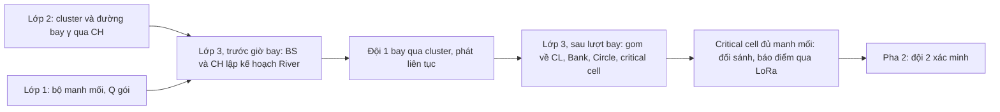
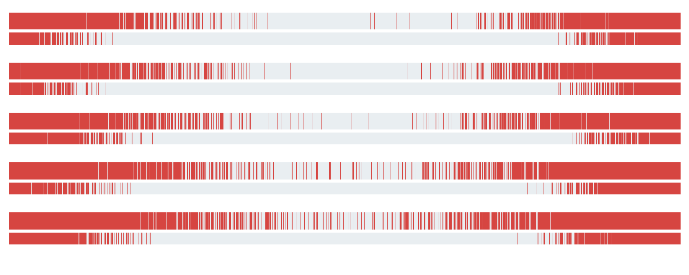
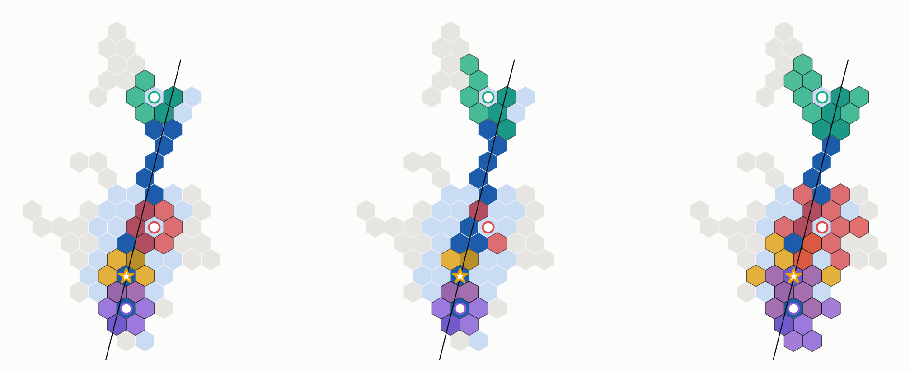
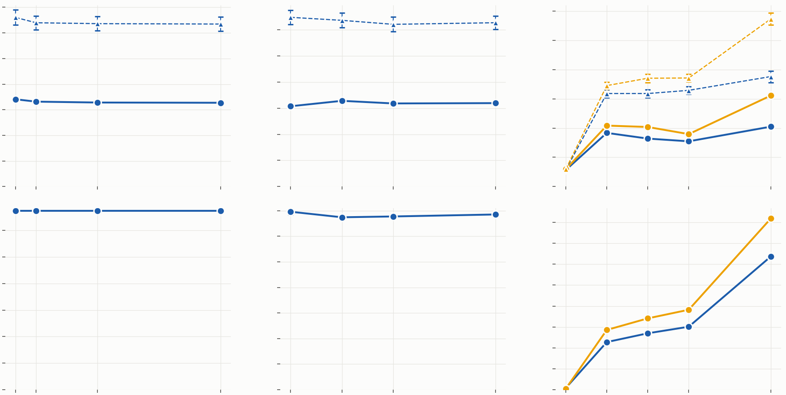
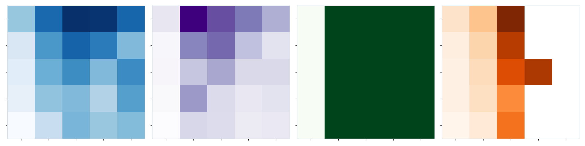
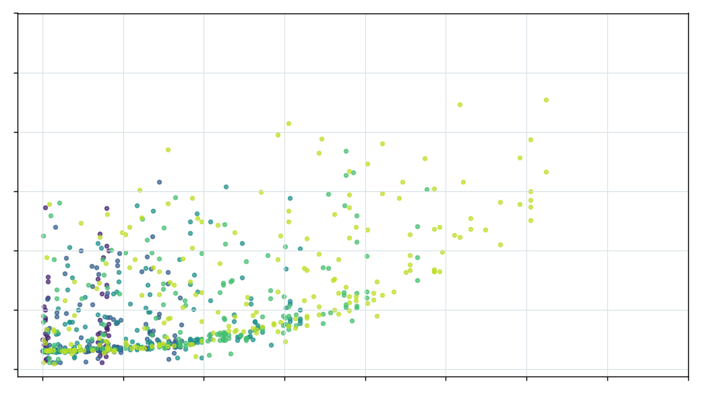

# River: lớp 3 chi tiết

**Hợp tác mặt đất có lập kế hoạch sau một lượt bay UAV: bài toán, khái niệm, thuật toán từng bước, cài đặt ns‑3 và kết quả**

- **Phiên bản:** 2026‑10‑22.
- **Lời gốc:** CLAUDE.md §8. Các mục liên quan:
  - 14–25: nền định tuyến PECEE, tóm tắt nội cell, manifest;
  - 38–55: River và cài đặt ns‑3;
  - 64–67: cluster C3, Circle động;
  - 103: Axe cong;
  - 120–122: cửa sổ theo critical cell, ngưỡng bão hoà, và tài liệu này.
- **Phạm vi:** chỉ lớp 3 của Pha 1. Bối cảnh cả nghiên cứu (lớp 1, lớp 2, pha 2, baseline) nằm trong [OVERVIEW-vi.md](OVERVIEW-vi.md). Mỗi mục ở đây có ghi tài liệu gốc để đọc sâu hơn.
- **Bản trang web** (có mục lục và chú thích thuật ngữ khi rê chuột; riêng tư cho tới khi được chia sẻ): https://claude.ai/artifact/WpB2R7G7pVpo4QUwjW4DXB. Dựng lại bằng `python3 paper/overview-page/build.py . <thư mục ra> --doc river-l3`.

> **Cách đọc**
> - Mỗi thuật toán có ba phần: ý tưởng bằng lời, **mã giả ngắn** (bản cho bài hội nghị), và **mã giả đầy đủ** (đủ để cài lại).
> - Ví dụ chạy từng bước là cluster **C3**: 80 cell, bay thẳng 2,3 km qua CH (§5–§6). Hình không có chữ; ngay dưới mỗi hình có lời giải thích cách đọc.
> - Thuật ngữ in đậm có liên kết tới §12 (Thuật ngữ). Ký hiệu toán ở §13.
> - Mọi con số là **số thăm dò**: một lượt cho các ví dụ từng bước, 20 lượt cho các phép quét. Quy tắc của dự án là N ≥ 120 cho số công bố.

**Lộ trình đọc gợi ý**

| Thời gian | Đọc | Để biết |
|---|---|---|
| 15 phút | §1, §4, hình ở §5–§6 | River là gì và chạy ra sao |
| 1 giờ | thêm §2, §3, toàn bộ §5–§6 | bài toán, nền mạng, từng thuật toán |
| Trước khi viết bài hoặc sửa mã | thêm §7–§11 | cài đặt ns‑3, kết quả, phân tích, giới hạn, mã nguồn |

---

## 1. Tóm tắt một trang

**Lớp 3 giải quyết việc gì.**
- Ở Pha 1, một UAV cánh bằng bay qua mỗi cluster **một lần** và phát liên tục **[bộ manh mối](#g-bo-manh-moi)** của truy vấn. Mỗi gói 99 B, cứ 0,5 m đường bay một gói.
- Các **[critical cell](#g-critical-cell)** (ô có camera đủ mạnh để đối sánh) cần **đủ mọi gói** của bộ manh mối. Một ảnh thiếu một gói là không dùng được.
- Critical cell càng xa đường bay thì nghe được càng ít và càng rời rạc. Lớp 3 phải chuyển phần còn thiếu tới chúng qua mạng mặt đất 802.15.4, nhanh và ít khung truyền nhất có thể.

**Nhận xét then chốt.** Đường bay, vị trí phát của từng gói, và đường cong mất gói theo khoảng cách đều **biết trước**. Vì vậy BS biết trước cell nào sẽ giữ đoạn dữ liệu nào, và lập được kế hoạch hợp tác **trước giờ bay**.

**River** là kế hoạch đó. Dữ liệu chảy như một dòng sông, theo bốn vai trò, tính theo đơn vị cell:

| Vai trò | Là gì | Làm gì sau lượt bay |
|---|---|---|
| **[Axe](#g-axe)** | các cell nằm ngay dưới đường bay | mỗi cell Axe a giữ **[Seg](#g-seg)**(a), đoạn gói phát khi UAV ở trên nó |
| **[Bank](#g-bank)** | hai cell ở mép dải nghe tốt, mỗi bên của mỗi cell Axe | được Axe bù phần Seg còn thiếu, rồi phục vụ thay Axe |
| **[Circle](#g-circle)** | các cell hàng xóm của một critical cell | mỗi hàng xóm lấy sẵn một nhóm Seg từ đúng Bank của nhóm đó |
| **Critical cell** | nơi đối sánh truy vấn | hỏi từng hàng xóm phần mình còn thiếu, xong khi đủ |

- Mọi dữ liệu đi theo **[cell path](#g-cell-path)** cố định, trên **[MAC 802.15.4](#g-802154)** đầy đủ, với lịch kênh dạng lưới và một **[gateway](#g-gateway)** cho mỗi cặp cell kề.
- Mỗi cell giữ dữ liệu tại **[CL](#g-cl)** (node mạnh nhất cell). Trước mọi bước, các node gom phần mình có về CL.

**Các thuật toán và biến thể.**
- Trước giờ bay: Thuật toán 1 (bảng Axe), 2 (River và Bank), 3 (critical cell), 3b (cửa sổ manh mối), 4 (Circle).
- Sau lượt bay: G (gom về CL), 5 (Axe bù Bank), 6 (Circle chuẩn bị), 7 (critical cell kéo về).
- Biến thể: Bank theo pháp tuyến cục bộ cho đường cong (2b), **[Circle động](#g-circle-dong)** theo lượng thiếu (4b), Circle chỉ lấy khi được hỏi, và **[kéo thẳng](#g-keo-thang)** (ablation: critical cell hỏi thẳng Axe).

**Kết quả chính** (thăm dò; **[ns‑3](#g-ns3)**, MAC 802.15.4 đầy đủ):
- **So với kéo thẳng:** từ 4 critical cell trở lên, River dùng ít hơn 20–22 % khung ở cả 20/20 lượt, và nhanh hơn ở 19–20/20 lượt. Với 16 critical cell, critical cell cuối xong sớm hơn 19,7 s. Với 1 critical cell (chỉ CH, nằm trên Axe), kéo thẳng rẻ hơn.
- **Axe → Bank luôn tốn 0 khung.** Ở bề rộng River 3,5 cell, Bank đã đủ phần của mình ngay sau khi gom trong cell.
- **Lưới 7 màu là đủ;** độ rộng River gần như không quan trọng trên đường bay thẳng.
- **Cửa sổ theo từng critical cell** gỡ được giới hạn chiều dài cluster. Trên dải 6 cell × 4 km, critical cell cuối xong sau 25 s thay vì 88 s, và số khung chỉ còn khoảng 1/10.
- **Ở cấp nhiệm vụ,** hợp tác rút thời điểm xác minh xong cell nghi vấn cao nhất 26–68 s so với không hợp tác, trên 39/40 bản đồ. Cơ chế là xếp hạng đúng hơn, không phải báo cáo sớm hơn.

---

## 2. Bài toán lớp 3

Lời gốc: mục 38–43. Chi tiết: `uav-coop2/docs/L3-vi.md` §1.

### 2.1 Vị trí trong nhiệm vụ



- **Đầu vào từ lớp 2:** cluster (tập cell và node), CH, đường bay γ qua CH, và tốc độ bay.
- **Đầu vào từ lớp 1:** bộ manh mối gồm 12 ảnh, tổng Q = 4 036 gói (khoảng 400 kB, ứng với khoảng 2 km bay). UAV phát lặp bộ manh mối liên tục, xen kẽ các manh mối.
- **Đầu ra cho lớp 1:** thời điểm mỗi critical cell có đủ dữ liệu. Từ đó critical cell đối sánh và báo điểm về BS.
- **Chỉ số của lớp 3:**
  - thời điểm critical cell xong, tính từ lúc UAV rời cluster (trung bình các critical cell, và critical cell cuối);
  - số **[khung](#g-khung)** truyền thành công trên mọi chặng (tải mạng, tỉ lệ với năng lượng);
  - số gói còn thiếu khi kết thúc (phải bằng 0).

### 2.2 Vì sao mặt đất phải hợp tác

**Thí nghiệm A2G‑RUN** (`uav-sar/docs/A2G-RUN-vi.md`). UAV ở độ cao 100 m, 50 m/s, phát một gói mỗi 10 ms. Kênh **[A2G](#g-a2g)** đô thị, α = 3,0, fading bốc lại mỗi gói. 200 lượt:

| Lệch ngang khỏi đường bay | 0 m | 300 m | 600 m | 900 m |
|---|---|---|---|---|
| Gói nhận được (trên 8 001) | 4 002 | 3 789 | 3 077 | 1 828 |
| **Chuỗi liền mạch dài nhất** | **850 ± 226** | **245 ± 85** | **50 ± 11** | **14 ± 2** |

- Node xa vẫn nhận được khá nhiều gói, nhưng rời rạc. Một ảnh cần mọi gói của nó, nên các mẩu rời không ghép được thành ảnh.
- Không dùng **[mã sửa xoá](#g-erasure)**: một file chỉ dùng được khi có đủ mọi gói (mục 34).



*Hình: một lượt bay ns‑3 trên dải 10 cell × 4 km (8 000 gói, khoảng 4 km bay).*
- Năm cặp hàng, từ trên xuống: node cách đường bay 0, 200, 400, 600 và 800 m, cùng ở giữa dải.
- Trong mỗi cặp, hàng dày là **một node**, hàng mỏng là **cả cell** của node đó (hợp mọi node trong cell).
- Trục ngang là thứ tự gói. Xám nhạt là gói nhận được, đỏ là gói mất.
- **Đọc hình:**
  - Một node nhận 2 222–3 991 gói trên 8 000. Chuỗi liền dài nhất là 460, 688, 92, 42 và 20 gói. Càng xa đường bay càng nhiều vạch đỏ ở giữa.
  - Cả cell gộp lại thì liền mạch suốt khoảng 2,5–3 km giữa lượt bay: chuỗi liền 3 960–5 004 gói. Đây là lý do có bước gom về CL.
  - Hai đầu đỏ ở mọi hàng là các gói phát khi UAV còn cách cell hơn khoảng 1,5 km. Không node nào trong cell nghe được, nên chỉ River mang tới được.


*Hình: cluster C3 ngay sau lượt bay. Trái: cả cell (hợp mọi node). Phải: riêng CL.*
- Màu càng đậm, cell càng có nhiều phần của D (tập gói cần giao).
- UAV phát 5 703 gói trên cả đường bay, 4 685 gói khi đang ở trên cluster. Cả 4 685 gói đều có ít nhất một node nhận, nên |D| = 4 685.
- Cả cell: trung vị 92 % D, thấp nhất 43 % (nhánh trên cùng, xa đường bay). Riêng CL: trung vị 63 %, thấp nhất 18 %.

### 2.3 Phát biểu bài toán

**Cho trước** (trước giờ bay):
- tập cell của cluster, node và năng lực của chúng, CH, bảng định tuyến PECEE và các cặp gateway;
- đường bay γ; gói s được phát tại toạ độ đường bay d_s = d_0 + sΔ, với Δ = vτ = 0,5 m;
- đường cong tỉ lệ mất gói A2G theo khoảng cách ngang, p(ρ);
- Q, số gói của bộ manh mối.

**Sau lượt bay**, node v giữ một tập gói ngẫu nhiên rx(v). Mỗi critical cell k phải có đủ tập cần giao D_k tại CL của nó:
- bản gốc: D_k = D, mọi gói phát trong cluster mà ít nhất một node nhận được;
- bản cửa sổ (§5.4): D_k là Q gói liền nhau của Axe gần k nhất.

**Ràng buộc:**
- radio bán song công, mỗi node một radio trên kênh của cell mình; gateway có thêm một radio trên kênh của cặp gateway;
- giữa hai cell kề, dữ liệu chỉ đi qua đúng một cặp gateway;
- dữ liệu chỉ đi theo cell path đã định trước;
- mọi gói phải tới nơi: mỗi chặng có ACK và gửi lại.

**Mục tiêu:** thời điểm critical cell xong nhỏ nhất, với số khung nhỏ nhất. Hai mục tiêu được báo cáo riêng, không gộp thành một hàm.

**Cận dưới.** CL của k có một radio, nên nhận nhiều nhất một khung mỗi lần truyền:

$$T_k \;\ge\; |\mathrm{Lack}(k)| \cdot \tau_{\text{frame}}$$

- Lack(k) là phần D_k mà CL của k chưa có sau khi gom; τ_frame là thời gian một khung dữ liệu có ACK qua một chặng.
- Với khung 100 B trên 802.15.4 (250 kb/s), τ_frame khoảng 5–6 ms: khoảng 3,7 ms phát, cộng ACK, thời gian quay radio và backoff CSMA trung bình. Bản mô phỏng mức logic dùng khe 10 ms.
- Circle không làm cận này nhỏ đi. Việc của Circle là chuẩn bị sẵn dữ liệu ngay cạnh k, để đường vào k không phải chờ.

### 2.4 Nhận xét then chốt

- γ, d_s và p(ρ) đều biết trước, nên **ai sẽ giữ gì cũng biết trước**, về mặt xác suất.
- Cell dưới đường bay giữ gần đủ đoạn dữ liệu phát ngay trên nó. Cell xa đường bay chỉ có mẩu rời.
- Vì vậy kế hoạch có thể giao trước cho từng cell một **đoạn dữ liệu** phải giữ, và một **đường đi** cố định để chuyển nó. Không cần thăm dò hay đàm phán sau lượt bay.

---

## 3. Nền mạng mà River chạy trên đó

Lời gốc: mục 9–15, 50–51. Chi tiết: `uav-coop/docs/ROUTING-vi.md`, `uav-coop/docs/SUMMARY-vi.md`, `uav-coop2/docs/RIVER-NS3-vi.md`.

### 3.1 Cell, node và vai trò
- **[Cell](#g-cell)**: ô lục giác đều, bán kính R = 100 m. Hai cạnh song song cách nhau w = √3·R ≈ 173 m.
- **Node:** mật độ một node trên 35 m × 35 m, khoảng 21 node mỗi cell. Mỗi node có ba năng lực ngẫu nhiên: quan sát, tính toán, giao tiếp. **Điểm năng lực** là tích của ba năng lực.
- **CL:** node có điểm cao nhất cell. CL giữ và phục vụ dữ liệu của cell.
- **[CH](#g-ch):** node mạnh nhất cluster trong số các node cách biên ít nhất 300 m. Cluster quá mảnh thì ngưỡng hạ dần xuống 200, 100, rồi 0 m.

### 3.2 Định tuyến nền PECEE

**[PECEE](#g-pecee)** tính sẵn tại BS. Không node nào được bị cô lập (mục 15).
- **Liên kết:** liên kết thường dài tối đa 50 m. Khi đồ thị bị đứt, BS thêm liên kết bắc cầu ngắn nhất có thể (trong cell, hoặc giữa hai cell kề).
- **Giữa hai cell kề chỉ có một đường:** đúng một cặp gateway (a, b), a thuộc cell A, b thuộc cell B. Mọi dữ liệu A → B và B → A đi qua cặp này.
- **Bảng của mỗi node:**
  - `toCL`: next hop về CL của cell mình;
  - `toCell[B]`: next hop tới từng cell kề B (tới gateway a, rồi a → b);
  - đường chính: next hop mở đầu đường ngắn nhất về CH.
- Trên bố trí gốc (một node mỗi 35 m), 100 % node tới được CH. Đường chính trung bình 21,1 hop, dài hơn đường ngắn nhất không xét ranh giới cell 8 %.


*Hình: cluster C3 ở pha 0.*
- Chấm nhỏ là node, chấm trắng là CL, ngôi sao là CH. Đường xám mảnh là đường ngắn nhất từ mỗi node về CL (theo **[ETX](#g-etx)**).
- Đoạn đen đậm là cặp gateway giữa hai cell kề. Đường thẳng mảnh là đường bay.
- **Số liệu:** 80 cell, 1 725 node, CH là node #1193 ở cell (8, −5). 113 cặp gateway; cặp yếu nhất có tỉ lệ thành công q = 0,89. 57 % node gửi thẳng tới CL trong 1 hop.

### 3.3 Kênh và lịch phát
- **[Lưới 7 màu](#g-luoi-7-mau):** cell (q, r) dùng kênh 11 + (q + 3r) mod 7. Hai cell cùng kênh cách nhau ít nhất 3 ô.
- **Kênh gateway:** mỗi cặp gateway có radio riêng, trên các kênh 18–26. Một cặp lấy kênh thấp nhất trong số các kênh chưa bị cặp nào trong vòng 300 m dùng.
- **Lịch:** mỗi cell và mỗi cặp gateway là một **môi trường truyền** (medium). Tại mỗi thời điểm chỉ một radio trong môi trường được phát; các radio có khung chờ thay phiên nhau (Thuật toán S, §7).

### 3.4 MAC và kênh G2G
- **MAC:** IEEE 802.15.4 đầy đủ của ns‑3 (module `lr-wpan`): **[CSMA/CA](#g-csma)** không phân khe, **[ACK](#g-ack)**, gửi lại.
- **Kênh [G2G](#g-g2g):** suy hao số mũ n = 3,5 từ 1 m; **[che khuất](#g-shadowing)** σ = 7,8 dB, cố định cho mỗi cặp node; **[fading](#g-fading)** Rayleigh theo khối 100 ms. Số mũ và σ lấy từ 3GPP TR 38.901 (UMi NLoS); khối 100 ms là giả định.
- **Thí nghiệm G2G‑CHAIN** (`uav-sar/docs/G2G-CHAIN-vi.md`): chuyển file qua một chuỗi node, thời gian bị quyết định bởi **hop yếu nhất**, giãn ra đúng 1/p với p là tỉ lệ thành công của hop đó. Nguyên nhân chính là che khuất tĩnh. Bài học cho River: chọn gateway theo chất lượng liên kết, và không dồn mọi luồng qua một đường.

### 3.5 Ba quy ước thực thi

Ba quy ước này áp dụng cho mọi thuật toán ở §5–§6.

1. **Mỗi cell giữ dữ liệu tại [Holder](#g-holder)(c) = CL(c).** Ngay khi UAV rời đi, các node gom phần cần thiết về CL (Thuật toán G). "Cell c có gói s" nghĩa là CL của c có gói s.
2. **Một cell path (c_0, …, c_h) chạy thành một đường node:** CL(c_0) → gateway gw(c_0, c_1) → … → CL(c_h). Trong mỗi cell, khung đi theo bảng định tuyến tới gateway kế tiếp. Mỗi chặng có ACK và gửi lại.
3. **Yêu cầu là một [manifest](#g-manifest) "có":** tập gói bên yêu cầu đang có, mã hoá gọn trong các khung ≤ 100 B. Bên được hỏi gửi lại phần nó có mà bên kia thiếu.

Thêm một quy tắc: dữ liệu đi qua một cell thì CL của cell đó giữ một bản sao, nhưng không chủ động xin thêm (mục 25).

---

## 4. Khái niệm của River

Lời gốc: mục 40–42. Chi tiết: `uav-coop2/docs/L3-vi.md` §1.


*Hình: một cluster với đường bay thẳng (mũi tên).*
- Cell xanh đậm nằm dọc đường bay là Axe.
- Các cell xanh nhạt dần ra hai bên là **[River](#g-river)**; cell ở mép ngoài River là Bank.
- Cell xám nằm ngoài River.

| Khái niệm | Định nghĩa | Ai tính, khi nào |
|---|---|---|
| Axe = (a_1, …, a_n) | các cell mà γ cắt qua, theo thứ tự bay | BS, trước giờ bay |
| Seg(a) | các gói phát khi UAV ở trên cell Axe a; đường thẳng thì là một đoạn liền [first, last] | BS |
| **[Vector tổng](#g-vector-tong)** u | hướng của Axe: từ tâm a_1 tới tâm a_n, chuẩn hoá | BS |
| ω | nửa bề rộng River. Chọn để River rộng 3–4 cell; đang dùng 1,75 cell ≈ 303 m | tham số |
| Bank_±(a), Path_±(a) | hai Bank mà a phục vụ, ở hai phía, và cell path từ a tới mỗi Bank | mỗi cell Axe |
| River | hợp các Path | mỗi cell Axe |
| Crit | critical cell: cell của CH và các cell có CL vượt trội | CH |
| Circ(k) | Circle của critical cell k: các hàng xóm phục vụ k, mỗi hàng xóm giữ sẵn một nhóm Seg | CH |
| D_k, **[Lack](#g-lack)**(k) | tập k phải có; phần D_k mà CL của k còn thiếu | CL của k, sau lượt bay |

**Vì sao cần Bank?**
- Bank nằm ở mép dải nghe tốt: ở ω = 303 m, một node chỉ thiếu khoảng 1 % gói, và cả cell gộp lại gần như không thiếu gì. Axe chỉ phải bù rất ít.
- Bank phục vụ thay Axe, nên tải được tách khỏi dải Axe hẹp, nơi mọi luồng kéo thẳng sẽ dồn vào.

**Vì sao cần Circle?**
- Critical cell chỉ có một radio. Nếu nó kéo thẳng từ mọi cell Axe, các luồng đi dài, chồng lên nhau ở giữa cluster, và cùng dồn vào một vài gateway.
- Circle chia việc chuẩn bị cho 6 hàng xóm. Mỗi hàng xóm lấy một nhóm Seg từ Bank gần mình theo đường riêng. Chặng cuối vào critical cell chỉ còn 1 cell, từ 6 hướng.

**Dòng chảy dữ liệu:** Axe → Bank → Circle → critical cell. Mỗi đoạn Seg chỉ đi đúng một đường đã định.

---

## 5. Trước giờ bay: lập kế hoạch

Toàn bộ phần này chạy trước giờ bay, tại BS, CH và các cell Axe. Đầu ra là một **kế hoạch**: Axe và Seg, Bank và đường tới Bank, critical cell, cửa sổ, Circle và đường của từng thành viên. Mã: `uav-coop2/tools/river_plan.py`; xuất cho ns‑3 bằng `river_export.py`.

Tham số đang dùng: W = 2ω/w = 3,5 cell (ω = 303 m), κ_g = 2, κ_l = 1, r = 2.

### 5.1 Thuật toán 1: bảng Axe (tại BS)

**Làm gì.** BS lấy mẫu đường bay theo từng gói. Cell chứa vị trí phát của gói s là chủ của gói đó. Chuỗi các cell chủ, theo thứ tự bay, là Axe. BS gửi cho CH bảng (a, Seg(a)); CH chuyển mỗi dòng xuống đúng cell Axe của nó (mục 43–44).

```text
Algorithm 1  AXETABLE                                   ▷ BS, before the flight
1: Axe ← cells crossed by γ, in flight order
2: for each a ∈ Axe do  Seg(a) ← { s : γ(d0 + sΔ) ∈ a }
3: send { (a, Seg(a)) } and u to CH; CH gives every Axe cell its row
```

```text
Algorithm 1  AXETABLE(γ, d0, Δ, N)
1: Axe ← ()                                         ▷ ordered list
2: for s ← 0 to N−1 do
3:     c ← cell containing γ(d0 + sΔ)
4:     if c ∉ Cells then continue                   ▷ sent outside the cluster: no owner
5:     if c ∉ Axe then append c to Axe; Seg(c) ← ∅
6:     Seg(c) ← Seg(c) ∪ {s}                        ▷ straight path: an interval [first, last]
7: u ← unit( z(a_n) − z(a_1) )                      ▷ the Axe's sum vector
8: send header (d0, Δ, N, u, ω) and rows { (a_i, first(Seg(a_i)), last(Seg(a_i))) } to CH
9: CH forwards row i to Axe cell a_i
```

- Gói phát ngoài cluster không giao cho ai. Cell nào nhận được thì vẫn lưu, và gửi khi được hỏi (mục 44).
- Khi đường bay cong cắt lại một cell (vào lại), Seg(a) là lần đi qua dài nhất; các gói của lần đi qua khác không giao cho ai.
- **Kích thước bảng:** mỗi dòng là (q, r, first, last), khoảng 6 B. Một Axe 17 cell cần khoảng 102 B, tức hai khung.


*Hình: Axe của C3. Màu càng đậm, cell càng về sau theo hướng bay.*
- 17 cell Axe. Seg lần lượt có 361, 255, 285, 361, 317, 170, 71, 343, 360, 260, 281, 360, 322, 151, 90, 338, 360 gói; trung bình 276 gói, tức 2,8 s phát trên mỗi cell.
- Các Seg nhỏ (71, 90, 151, 170 gói) là chỗ đường bay chỉ cắt qua góc cell.

### 5.2 Thuật toán 2: River và Bank (tại mỗi cell Axe)

**Làm gì** (mục 44). Từ tâm của mỗi cell Axe, kẻ đường vuông góc với vector tổng u của Axe. Đi trên đường đó về mỗi phía một khoảng ω. Cell cuối cùng còn trong cluster là Bank của phía đó; chuỗi cell đi qua là cell path Axe → Bank. Mọi đường vuông góc song song với nhau. River là hợp mọi đường. Nếu River chạm biên cluster thì biên chính là Bank.

```text
Algorithm 2  RIVERSETUP(a)                              ▷ each Axe cell a, before the flight
1: n ← u rotated by 90°
2: for σ ∈ {+1, −1} do
3:     Path_σ(a) ← cells on the segment z(a) → z(a) + σ·ω·n, cut at the cluster edge
4:     Bank_σ(a) ← last cell of Path_σ(a)
```

```text
Algorithm 2  RIVERSETUP(a, u, ω)
1: n ← (−u_y, u_x)                                  ▷ the same normal for every a: parallel lines
2: for σ ∈ {+1, −1} do
3:     Path_σ(a) ← (a)
4:     for t ← 0 to ω step w/20 do                  ▷ w: cell width
5:         c ← cell containing z(a) + σ·t·n
6:         if c ∉ Cells then break                  ▷ River reaching the edge: the edge is the Bank
7:         if c ≠ last(Path_σ(a)) then append c to Path_σ(a)
8:     Bank_σ(a) ← last(Path_σ(a))
9:     tell Bank_σ(a): "you are a's Bank, for Seg(a), via Path_σ(a)"
10: River ← ⋃_{a ∈ Axe, σ} Path_σ(a)
```

**Chọn ω.** Bề rộng River 3–4 cell (mục 42) ứng với tỉ lệ mất gói khoảng 1 % ở Bank. Khi đó Bank chỉ thiếu một chút so với Axe, nên Axe đẩy dữ liệu ra dễ. Một Bank có thể nhận hai Seg liền nhau nếu hai đường song song rơi vào cùng một cell.


*Hình: cách dựng Bank.*
- Mũi tên đỏ sẫm là vector tổng u của Axe; chấm trắng là cell trung tâm.
- Đường liền là đường vuông góc qua cell trung tâm; hai chấm đen nằm cách nó ω.
- Hai cell xanh lá đậm và cam đậm là hai Bank của cell trung tâm.
- Đường đứt là các đường song song qua những cell Axe khác. Xanh lá nhạt và vàng là các Bank còn lại; xanh nhạt là River.


*Hình: kết quả của Thuật toán 2.*
- Cell Axe tô đỏ, đậm dần theo thứ tự bay (đường bay đi từ dưới lên).
- Mỗi mũi tên đi từ một cell Axe tới một Bank của nó: xanh lá ở bên trái, vàng ở bên phải. Màu mũi tên là màu của cell Axe.
- Xanh nhạt là phần còn lại của River.


*Hình: River của C3.*
- Xanh đậm là Axe, xanh lá là Bank, xanh nhạt là phần còn lại của River. Đường đen nối mỗi cell Axe tới Bank của nó.
- River gồm 51/80 cell, với 24 Bank khác nhau.
- Trong 34 đường Axe → Bank: 20 đường dài 2 cell, 5 dài 1 cell, 9 dài 0 cell (cell Axe nằm sát biên nên chính nó là Bank). 14/34 Bank bị biên cluster cắt ngắn.
- C3 hẹp, nhất là nhánh trên, nên River chạm biên ở nhiều chỗ.

#### Thuật toán 2b: Bank theo pháp tuyến cục bộ (đường bay cong)

Lời gốc: mục 103. Chi tiết: `uav-l2/docs/CURVE-vi.md` Phần 1.

**Vì sao cần.** Khi đường bay cong, các đường song song lệch khỏi pháp tuyến thật. Bank ở phía trong khúc cong bị kéo lại gần đường bay; Bank ở phía ngoài bị đẩy ra xa hoặc rơi ra khỏi River.

**Làm gì.** Mỗi cell Axe dựng Bank theo **[pháp tuyến cục bộ](#g-phap-tuyen)** của đường bay tại chỗ nó cắt qua cell. Phía trong khúc cong, các pháp tuyến hội tụ ở tâm cong, nên quãng đi bị cắt ở bán kính cong. Phía ngoài, các pháp tuyến toả ra, nên bắn thêm tia để lấp chỗ hở của River.

```text
Algorithm 2b  LOCALBANKS(a)                             ▷ curved flight, each Axe cell a
1: n ← normal of γ where it crosses a
2: Path_±(a), Bank_±(a) ← as in Alg. 2, along ±n; on the inner side of a bend stop at the radius of curvature
```

```text
Algorithm 2b  LOCALBANKS(a, γ, ω)
1: m ← middle packet of Seg(a)
2: t ← unit tangent of γ at d_m, measured over ±10 m;  n ← (−t_y, t_x)
3: θ ← heading change of γ between d_m − 100 m and d_m + 100 m          ▷ signed
4: ρ_c ← 200 m / |θ|  (∞ if θ = 0)                                      ▷ local radius of curvature
5: reach ← ω on both sides; on the side γ turns towards: reach ← min(ω, ρ_c)
6: for σ ∈ {+1, −1}: walk from γ(d_m) along σ·n for reach_σ as in Alg. 2 → Path_σ(a), Bank_σ(a)
7: for every 20th packet s of Seg(a), on both normals of γ at d_s:       ▷ the fan outside a bend
8:     add the cells within ω to River
9: Circle members are ordered by their closest point on γ instead of ⟨z, u⟩   (Alg. 4)
```


*Hình: một cluster của bản đồ 6 cluster, bay theo bốn đường cong khác nhau.*
- **Hàng trên:** Bank song song (Thuật toán 2). **Hàng dưới:** Bank cục bộ (Thuật toán 2b).
- **Cột:** góc thoát 180°, 135°, 100° và 70°. 180° là đường thẳng; góc càng nhỏ đường càng cong.
- **Màu:** xanh đậm là Axe, xanh lá là Bank, xanh nhạt là River đúng chỗ, vàng là River thừa (cách đường bay quá ω), đỏ là cell lẽ ra thuộc River nhưng không có.
- **Nét:** nét mảnh là đường Axe → Bank; nét đậm là đường bay.
- **Đọc hình:** ở cột 70°, hàng trên có nhiều ô đỏ ở phía ngoài khúc cong; hàng dưới gần như không còn.

### 5.3 Thuật toán 3: critical cell (tại CH)

**Làm gì** (mục 40–41, 45). Không cần mọi cell đều đối sánh. CH chọn vài cell có CL vượt trội làm điểm xử lý chính. Gọi μ, σ là trung bình và độ lệch chuẩn điểm năng lực của các CL trong cluster. Critical cell gồm:
- cell của CH (luôn là critical cell);
- cell vượt trội toàn cluster: điểm > μ + κ_g·σ;
- cell vượt trội trong khu vực của nó: điểm > μ + κ_l·σ, và cao nhất trong bán kính r vòng cell quanh nó.

```text
Algorithm 3  CRITICAL                                   ▷ CH, before the flight
1: μ, σ ← mean, std of score(c) over Cells
2: Crit ← {cell of CH}
3:     ∪ { c : score(c) > μ + κ_g·σ }                           ▷ outstanding in the cluster
4:     ∪ { c : score(c) > μ + κ_l·σ and score(c) = max over c and its r-ring }   ▷ … in its area
```

```text
Algorithm 3  CRITICAL(Cells, score, κ_g, κ_l, r)
1: μ ← mean_{c ∈ Cells} score(c);  σ ← std_{c ∈ Cells} score(c)
2: Crit ← { cell of CH }                            ▷ always critical
3: for each c ∈ Cells do
4:     if score(c) > μ + κ_g·σ then                 ▷ far above the whole cluster
5:         Crit ← Crit ∪ {c}
6:     else if score(c) > μ + κ_l·σ and
7:             score(c) ≥ max { score(c') : c' ∈ Ring_1(c) ∪ … ∪ Ring_r(c) } then
8:         Crit ← Crit ∪ {c}                        ▷ the best of its area, and well above average
9: return Crit
```

- Trung bình mỗi cluster có khoảng 6–7 critical cell (κ_g = 2, κ_l = 1, r = 2).
- Một critical cell nằm trong River (ví dụ cell của CH, nằm trên Axe) vẫn dựng Circle như thường, vì nó cũng chỉ nhận được một đoạn dữ liệu (mục 44).


*Hình: critical cell trên cluster minh hoạ.*
- Ngôi sao là CH; chấm đỏ trên ô hồng là các critical cell khác.
- Xanh nhạt là River, xanh lá và vàng là Bank hai bên, xám là ngoài River.
- Mũi tên xanh: hướng dữ liệu rời River tới các critical cell nằm ngoài River.


*Hình: critical cell của C3. Màu là điểm năng lực của CL (nhạt → đậm); vòng tròn là critical cell.*
- Điểm CL trung bình 0,531, độ lệch chuẩn 0,154. Vượt trội toàn cụm khi điểm > 0,840; vượt trội cục bộ khi điểm > 0,685 và cao nhất trong 2 vòng.
- (8, −2): 0,907 (+2,4σ), toàn cụm. (9, −7): 0,850 (+2,1σ), toàn cụm. (4, 6): 0,803 (+1,8σ), cục bộ.
- CH (8, −5): 0,740 (+1,4σ). CH phải cách biên ít nhất 300 m, nên không phải node mạnh nhất cụm.

### 5.4 Thuật toán 3b: cửa sổ manh mối

Lời gốc: mục 68 (nhiệm vụ trọn vẹn), 120–121 (cửa sổ theo critical cell). Chi tiết: `uav-l2/docs/L1-MISSION2-vi.md`, `uav-l2/docs/SAT-vi.md`.

**Vì sao cần.** UAV phát **lặp** bộ manh mối suốt đường bay. Một cluster dài 4 km nhận khoảng 8 000 gói, tức gần hai bản bộ manh mối. Critical cell chỉ cần **một bản đủ**: Q gói liền nhau bất kỳ của dòng phát. River không cần chở cả D.

**Hai cách đặt [cửa sổ](#g-cua-so):**
- **Quanh CH** (bản dùng trong chiến dịch nhiệm vụ): một cửa sổ chung cho cả cluster, gồm Q gói Axe quanh chỗ UAV bay gần CH nhất.
- **Theo từng critical cell** (mục 120): mỗi critical cell k cần Q gói Axe liền nhau quanh chỗ UAV bay gần k nhất, tức bản sao gần nó nhất. Giả định thêm: gói cùng vị trí ở hai bản phát liền nhau là cùng một nội dung, nên thay thế được cho nhau.

```text
Algorithm 3b  WINDOW                                    ▷ BS/CH, before the flight; Q packets per clue set
1: for each k ∈ Crit: Need(k) ← the Q consecutive Axe packets around where γ passes closest to k
2: keep in Seg only packets of ⋃_k Need(k); drop Axe cells left empty
```

```text
Algorithm 3b  WINDOW(Crit, Q, mode)
1: P ← ⋃_{a ∈ Axe} Seg(a), in order                ▷ all Axe packets
2: function AROUND(z)
3:     s* ← argmin_s ‖γ(d0 + sΔ) − z‖              ▷ where the UAV passes closest to z
4:     i ← clamp( rank of s* in P − ⌊Q/2⌋, 0, |P| − Q )
5:     return [P_i, P_{i+Q−1}]
6: if mode = ch then for every k ∈ Crit: Need(k) ← AROUND(z(CH))     ▷ one window for the cluster
7: else for every k ∈ Crit: Need(k) ← AROUND(z(k))                   ▷ the copy nearest to k
8: for each a ∈ Axe: Seg(a) ← Seg(a) ∩ ⋃_k Need(k)
9: Axe ← (a ∈ Axe : Seg(a) ≠ ∅);  drop the Banks and Paths of removed cells
10: for each k ∈ Crit: D_k ← Need(k) ∩ D         ▷ what k must hold at the end
```

- Nếu Axe ngắn hơn Q gói thì cửa sổ là cả Axe, và không critical cell nào có đủ bộ manh mối. Đó là cận dưới chiều dài cluster: khoảng 2 km.
- Thuật toán 4 chỉ chia cho Circle của k các cell Axe có Seg giao với Need(k).
- Trong ns‑3, kế hoạch mang thêm một dòng `NEED k first last` cho mỗi critical cell. Không có dòng này thì chương trình cho đúng kết quả cũ.


*Hình: dải 6 cell × 4 km, một lượt bay, 10 critical cell. Ba hàng dùng chung trục ngang (vị trí dọc đường bay).*
- **Hàng trên:** bản đồ dải. Xanh đậm là Axe (hai hàng cell, vì đường bay chạy dọc ranh giới giữa hai hàng). Ngôi sao là CH, chấm là các critical cell khác. Nét đứt nối mỗi critical cell với điểm UAV bay gần nó nhất. Màu theo vị trí dọc đường bay, từ tím (đầu) tới vàng (cuối).
- **Hàng giữa:** dòng gói của Axe. Vạch xám trên cùng là mọi gói Axe. Vạch đen là cửa sổ quanh CH. Mỗi vạch màu bên dưới là cửa sổ riêng của một critical cell; chấm trắng là điểm gần nhất của nó. Cửa sổ của các critical cell gần hai đầu bị kẹp vào hai đầu Axe.
- **Hàng dưới:** thời điểm critical cell xong, vạch lưới mỗi 20 s. Chấm rỗng: cửa sổ quanh CH. Chấm đặc: cửa sổ riêng.
- **Đọc hình:**
  - Với cửa sổ quanh CH, critical cell nằm trong đoạn quanh CH xong trong 3–13 s; các critical cell ngoài đoạn đó mất 39–88 s. Chúng không nghe được đoạn quanh CH, nên phải kéo nó qua River từ xa, và mọi luồng dồn về cùng đoạn Axe.
  - Với cửa sổ riêng, mỗi critical cell đã nghe được phần lớn bản sao gần nó: 3–25 s. Trung bình 7,6 s thay vì 51,6 s.
  - Số khung cả lượt: 41 nghìn thay vì 412 nghìn.

### 5.5 Thuật toán 4: Circle (tại CH, cho mỗi critical cell)

**Làm gì** (mục 40–42). Circle của critical cell k là các cell kề k: 6 cell, ít hơn ở biên. Xếp các thành viên theo vị trí dọc đường bay. Chia Axe thành các nhóm Seg liên tiếp, số nhóm bằng số thành viên; thành viên thứ j nhận nhóm thứ j. Thành viên lấy mỗi Seg từ **đúng Bank của Seg đó**, ở phía gần mình hơn, theo cell path (mục 42). Không hỏi Bank gần nhất, vì Bank gần chưa chắc có đoạn dữ liệu cần (mục 66).

```text
Algorithm 4  CIRCLE(k)                                  ▷ CH, before the flight, every k ∈ Crit
1: Circ(k) ← Neig(k), ordered along u
2: split Axe into |Circ(k)| consecutive groups; neighbour m_j takes group G_j
3: for each a ∈ G_j: m_j will fetch Seg(a) from a's Bank on the side nearer m_j
```

```text
Algorithm 4  CIRCLE(k, Axe, Seg, Bank)
1: Circ(k) ← Neig(k)                                ▷ 6 cells; fewer at the cluster edge
2: order Circ(k) = (m_1..m_q) by ⟨z(m_j), u⟩         ▷ further along the flight → later data
3: Axe_k ← (a ∈ Axe : Seg(a) ∩ Need(k) ≠ ∅)         ▷ all of Axe without a window
4: split Axe_k into q consecutive groups G_1..G_q of near-equal size
5: for j ← 1 to q do
6:     for each a ∈ G_j do
7:         σ ← side whose Bank_σ(a) is fewer cells from m_j (then fewer metres)
8:         src_j(a) ← Bank_σ(a);  P_j(a) ← shortest cell path src_j(a) → m_j avoiding k
9:     send m_j its task { (a, src_j(a), P_j(a)) : a ∈ G_j };  send k the list (m_j, G_j)
```

- Đường P_j(a) tránh đi qua k, trừ khi k là cell cắt duy nhất tới m_j.
- Một cell có thể vừa là critical cell, vừa là thành viên Circle của một critical cell khác. Hai critical cell kề nhau thì Circle chồng lên nhau; cách ghép Circle là câu hỏi nghiên cứu phụ (mục 46–47).


*Hình: Circle quanh một critical cell (chấm đỏ ở bên trái).*
- Sáu ô màu quanh chấm đỏ là sáu thành viên Circle. Mỗi màu là phần dữ liệu (một nhóm Seg liên tiếp) của một thành viên.
- Nét đứt ngắn: Axe bù cho Bank (Thuật toán 5).
- Nét liền: từng thành viên kéo các Seg của mình từ Bank của chúng (Thuật toán 6). Đường bay đi từ dưới lên, nên thành viên ở trên (xa hơn theo hướng bay) lấy các Seg cuối Axe, thành viên ở dưới lấy các Seg đầu Axe.
- Mũi tên đen ngắn: các thành viên giao cho critical cell khi được hỏi (Thuật toán 7).
- Hình tròn chia màu ở giữa: phần dữ liệu của từng thành viên.


*Hình: Circle của bốn critical cell trên C3.*
- Viền màu là thành viên Circle; mỗi critical cell một màu: (4, 6) xanh dương, CH (8, −5) xanh lá, (8, −2) vàng, (9, −7) đỏ.
- Đường màu là đường Bank → thành viên.
- Mỗi critical cell có 5–6 thành viên, cùng chia nhau 17 Seg (khoảng 3 Seg mỗi thành viên).
- Đường Bank → thành viên dài trung bình 3,5 / 4,8 / 6,1 / 6,1 cell, dài nhất 7 / 10 / 12 / 13 cell, cho (8, −2), CH, (9, −7), (4, 6).
- Hai critical cell ở hai đầu, (4, 6) và (9, −7), phải lấy Seg từ đầu kia của River, nên đường đi dài nhất.

#### Thuật toán 4b: Circle động theo lượng thiếu

Lời gốc: mục 66–67. Chi tiết: `uav-l2/docs/CLUSTER-C3-vi.md`.

**Làm gì.** Circle cố định 6 thành viên có thể thừa khi critical cell thiếu ít, và thiếu khi nó thiếu nhiều. Ở biến thể này, CL của critical cell ước lượng nhanh lượng thiếu ngay sau lượt bay, rồi gọi số thành viên tương ứng trong vòng 1–2: thiếu nhiều thì tới 12, thiếu ít thì dưới 6, tối thiểu 1–2. Kể cả cell nằm trên Axe cũng cần 1–2 thành viên, để lấy các đoạn khác của River (mục 67).

```text
Algorithm 4b  ADAPTIVECIRCLE(k)                         ▷ after the pass, at the CL of k
1: lack ← packets of D_k that no node of k holds      ▷ one summary frame per node
2: n ← clamp(⌈|lack| / share⌉, n_min, n_max);  members ← n cells of rings 1–2 (ring 1 first)
3: split Axe into n consecutive groups; ask member j for lack ∩ its group
```

```text
Algorithm 4b  ADAPTIVECIRCLE(k, share, n_min, n_max)
   ▷ before the flight, at CH: every size n the CL may pick
1: for n ← 1 to |Ring_1(k) ∪ Ring_2(k)| do
2:     Mem_n ← n cells spread evenly round k over Ring_1(k), then over Ring_2(k); order them along γ
3:     G_{n,j} ← j-th of n consecutive groups of Axe
4: for every candidate m and every a ∈ Axe: src(m, a) ← Bank of a nearer m;  P(m, a) ← its cell path to m
   ▷ after the pass, at the CL of k
5: every node of k sends the CL one summary frame of what it holds
6: lack ← { s ∈ D_k : no node of k holds s };  if lack = ∅ then return
7: n ← clamp(⌈|lack| / share⌉, n_min, n_max)
8: for j ← 1 to n: send m_j = Mem_n[j] the request X_j ← lack ∩ ⋃_{a ∈ G_{n,j}} Seg(a)
   ▷ at member m_j, on request X_j
9: send X_j ∩ have(m_j) to k now
10: gather the packets of X_j that nodes of m_j hold (Alg. G)
11: for the rest, s ∈ Seg(a): ask src(m_j, a) along P(m_j, a); pass each packet on to k as it arrives
```

- Tham số đã thử: share = 200 hoặc 400 gói mỗi thành viên, n_min = 2, n_max = 12.
- Yêu cầu đi ngay sau tóm tắt, song song với việc gom trong cell.



*Hình: ba cách dựng Circle trên C3, từ trái sang: cố định vòng 1; động với share = 200; n = 12.*
- Mỗi critical cell (vòng tròn trắng có viền màu; ngôi sao là CH) có một họ màu riêng; các ô cùng họ màu là thành viên Circle của nó. Xanh đậm là Axe, xanh nhạt là River.
- Với share = 200: (4, 6) gọi 7 thành viên, CH 4, (8, −2) 2, (9, −7) 6, theo lượng thiếu 1 313 / 636 / 1 / 1 127 gói.
- Với n = 12, các Circle chồng lên nhau: CH nằm trong Circle của (9, −7) và ngược lại.

### 5.6 Kế hoạch được gửi đi

| Bản ghi | Nội dung | Ai nhận |
|---|---|---|
| Axe | (a, first, last) cho mỗi cell Axe; u, ω | CH, rồi từng cell Axe |
| Bank | (a, σ, Bank_σ(a), Path_σ(a)) | cell Axe và Bank của nó |
| Crit, Need | danh sách critical cell; cửa sổ [first, last] của mỗi critical cell | CH, critical cell |
| Circle | (k, m_j, a, src_j(a), P_j(a)) | thành viên m_j và critical cell k |
| Circle động | các tập thành viên theo n, nguồn và đường cho mọi ứng viên vòng 1–2 | critical cell và các ứng viên |
| Kéo thẳng (ablation) | (k, a, đường k → a) | critical cell và cell Axe |

- Mọi bản ghi tính tuyến tính theo số cell. Mỗi cell chỉ cần các dòng nói về chính nó.
- Kế hoạch đi xuống cùng bảng định tuyến PECEE, trước giờ bay. Bài này chưa tính chi phí phát kế hoạch.

---

## 6. Sau lượt bay: thực thi

Mọi bước bắt đầu ngay khi UAV rời cluster, và chạy chồng lên nhau theo từng gói: một gói được chuyển đi ngay khi bên gửi có nó. Mã: `uav-coop2/examples/coop2-river.cc`.

| Bước | Ai | Bắt đầu khi | Xong khi |
|---|---|---|---|
| G. Gom về CL | node → CL của mọi cell có vai trò | UAV rời cluster | CL có mọi gói cần mà node trong cell có |
| 5. BANKFILL | Bank ↔ Axe | Bank gom xong | Bank có đủ Seg(a) |
| 6. CIRCLEFILL | thành viên Circle ↔ Bank | thành viên gom xong (chuẩn bị sẵn), hoặc khi được hỏi | thành viên có đủ nhóm của mình |
| 7. CRITPULL | critical cell ↔ Circle | critical cell gom xong | Lack(k) = ∅ |

### 6.1 Thuật toán G: gom về CL

Lời gốc: mục 17–21. Chi tiết: `uav-coop/docs/SUMMARY-vi.md`.

**Làm gì.** Chỉ những cell có vai trò mới gom, và chỉ gom phần cần:
- cell Axe gom Seg của chính nó;
- Bank gom Seg của cell Axe mà nó phục vụ;
- thành viên Circle (chuẩn bị sẵn) gom nhóm Seg của mình;
- critical cell gom D_k.

Với mỗi gói cần mà CL chưa có, node trong cell giữ gói đó với ETX tới CL nhỏ nhất sẽ gửi nó về CL.

```text
Algorithm G  GATHER(c)                                  ▷ after the pass, every cell with a role
1: Need(c) ← own Seg (Axe) ∪ its Axe cell's Seg (Bank) ∪ its group (Circle) ∪ D_k (critical)
2: for each s ∈ Need(c) that CL(c) lacks: the node of c holding s nearest CL(c) by ETX sends it
```

```text
Algorithm G  GATHER(c, Need(c))
1: (summary) every node reports what it holds; up the toCL tree each node sends
       missing(branch) = missing(self) ∩ missing(child_1) ∩ …                ▷ uav-coop, SUMMARY-vi.md
2: for each s ∈ Need(c) \ have(CL(c)) do
3:     v ← argmin { ETX(v → CL(c)) : v ∈ c, s ∈ rx(v) }
4:     if v exists then send s from v to CL(c) along the least-ETX route
5: gathered(c) ← true once every such s has arrived         ▷ Alg. 5, 6, 7 wait on this
```

**Tóm tắt nội cell** (dòng 1, thử riêng trong `uav-coop`, 120 lượt × 109 cell):
- Mỗi node gửi lên cha **phần nhánh thiếu**: giao của phần thiếu của chính nó và của các nhánh con. Tập này co lại rất nhanh trên đường lên, nên gần CL nó thường rỗng.
- Trung vị 0,63 s để CL biết chính xác cell có gì và thiếu gì; đúng ở 99,24 % lần; trung vị 26 khung, 701 B mỗi cell.
- **Trong ns‑3 của River, dòng 1 chưa được mô phỏng:** CL được coi là đã biết node nào giữ gói nào. Riêng biến thể Circle động có tính một khung tóm tắt từ mỗi node của critical cell.


*Hình: gom trong cell về CL trên C3 (River chuẩn bị sẵn).*
- Đoạn xanh là liên kết dùng để gom; nét càng đậm càng nhiều khung. Ngôi sao là CH, vòng tròn là các critical cell khác.
- 9 105 khung gom về 41 CL (chỉ những cell có vai trò mới gom). Khung gom cuối cùng lúc 9,8 s.
- Critical cell gom xong: (8, −2) lúc 7,4 s, CH 8,0 s, (4, 6) 9,0 s, (9, −7) 9,8 s.

### 6.2 Thuật toán 5: Axe bù cho Bank

```text
Algorithm 5  BANKFILL                                   ▷ after the pass, each Bank b of Axe a
1: b sends a "have" manifest of Seg(a) to a along Path(a → b)
2: a returns what b lacks of Seg(a)
```

```text
Algorithm 5  BANKFILL(b, a)                          ▷ b = Bank_σ(a); starts when the UAV leaves
1: wait until Holder(b) has gathered its cell's packets (Alg. G)
2: H ← Seg(a) ∩ have(b)
3: send manifest(H) to a along Path_σ(a)
4: at a: send each s ∈ Seg(a) \ H to b along Path_σ(a) reversed, as soon as Holder(a) has s
5: at b: store; Seg(a) ⊆ have(b) now, apart from packets no Axe node received
```

- Ở W = 3,5, một node của Bank thiếu khoảng 1 % của Seg(a), tức khoảng 4/346 gói. Cả cell Bank gộp lại còn thiếu ít hơn nữa.
- **Thực tế đo được:** 0 khung ở mọi cluster và cấu hình đã thử (120 lượt mức logic, 20 lượt ns‑3, C3). Sau khi gom trong cell, mọi Bank đã có đủ phần của mình.

### 6.3 Thuật toán 6: Circle chuẩn bị và giao dữ liệu

**Hai biến thể** (mục 50–51):
- **[Chuẩn bị sẵn](#g-chuan-bi-san)** (`prep=full`): thành viên lấy cả nhóm của mình từ Bank ngay khi gom xong, không chờ critical cell hỏi.
- **[Khi được hỏi](#g-khi-duoc-hoi)** (`prep=ondemand`): thành viên chỉ đi lấy những gói critical cell hỏi, sau khi nó hỏi. Trước hết lấy từ node trong cell mình, không có thì lấy từ Bank.

```text
Algorithm 6  CIRCLEFILL                                 ▷ after the pass, each Circle cell m_j of k
1: for each a ∈ G_j: ask Bank(a) for Seg(a) \ have(m_j); keep what comes back
2: on a request X from k: send X ∩ have(m_j), the rest as it arrives
```

```text
Algorithm 6  CIRCLEFILL(m_j, task_j, k, prep)
1: if prep = full then
2:     wait until Holder(m_j) has gathered its group (Alg. G)
3:     for each (a, src, P) ∈ task_j do                 ▷ in parallel over the sources
4:         send manifest(Seg(a) ∩ Need(k) ∩ have(m_j)) to src along P
5:         src sends the rest of Seg(a) ∩ Need(k) to m_j along P reversed, each packet once src has it
6: on request X from k:                               ▷ may arrive before line 5 finishes
7:     send X ∩ have(m_j) to k now; send the rest of X as it arrives
8:     if prep = ondemand then
9:         gather the packets of X that nodes of m_j hold (Alg. G)
10:        for the others, s ∈ Seg(a): ask src(a) along P(a) for them
```

### 6.4 Thuật toán 7: critical cell kéo về

```text
Algorithm 7  CRITPULL                                   ▷ after the pass, each k ∈ Crit
1: for each m_j ∈ Circ(k): send m_j the part of Lack(k) in ⋃_{a ∈ G_j} Seg(a)
2: done when Lack(k) = ∅
```

```text
Algorithm 7  CRITPULL(k)
1: wait until Holder(k) has gathered its cell's packets (Alg. G)
2: Lack(k) ← D_k \ have(k)
3: for each (m_j, G_j) ∈ Circ(k) do
4:     send manifest(have(k) ∩ ⋃_{a ∈ G_j} Seg(a)) to m_j     ▷ "I have these, send the rest"
5: on receipt of packets: store; Lack(k) ← Lack(k) \ received
6: done when Lack(k) = ∅                                 ▷ or only packets no node received remain
```

### 6.5 Thuật toán D: kéo thẳng (ablation)

**[Kéo thẳng](#g-keo-thang)** bỏ Bank và Circle: mỗi critical cell hỏi thẳng từng cell Axe phần nó thiếu, theo cell path ngắn nhất. Đây là phép so sánh chính cho River.

```text
Algorithm D  DIRECTPULL(k)                              ▷ ablation, after the pass
1: wait until Holder(k) has gathered its cell's packets (Alg. G)
2: for each a ∈ Axe: send a request for Seg(a) ∩ Lack(k) along the shortest cell path k → a
3: a returns each requested packet along the path reversed, as soon as Holder(a) has it
```

### 6.6 Dòng dữ liệu và tiến độ trên C3


*Hình: dòng dữ liệu sau khi gom trên C3. Ba ô, từ trái sang: River chuẩn bị sẵn, River khi được hỏi, kéo thẳng.*
- Vàng là Bank → Circle, đỏ là → critical cell, xám mảnh là yêu cầu. Nét càng đậm càng nhiều khung.
- Với River, dữ liệu chảy dọc River từ Bank tới các thành viên Circle (vàng), rồi chặng cuối ngắn vào critical cell (đỏ).
- Với kéo thẳng, mọi gói đi suốt từ Axe tới critical cell: các đường đỏ dài chồng lên nhau dọc Axe.

| Khung truyền thành công | River chuẩn bị sẵn | River khi được hỏi | Kéo thẳng |
|---|---|---|---|
| Gom trong cell | 9 105 | 5 484 | 4 165 |
| Axe → Bank | 0 | 0 | — |
| Bank → Circle | 66 684 | 61 639 | — |
| → critical cell | 12 622 | 12 622 | 96 994 |
| Yêu cầu | 1 255 | 638 | 1 029 |
| **Tổng** | **89 666** | **80 383** | **102 188** |
| [MAC bỏ cuộc](#g-mac-bo-cuoc) | 3 171 | 2 758 | 3 722 |


*Hình: tỉ lệ D mà CL của mỗi critical cell có theo thời gian. Ba ô như hình trên.*
- Trục ngang 0–50 s, vạch lưới mỗi 10 s. Trục dọc 0–1.
- Màu như ở §5.5: (4, 6) xanh dương, CH xanh lá, (8, −2) vàng, (9, −7) đỏ. Vạch đứng trên mỗi đường là lúc cell đó gom xong.
- Đường của CH có đoạn nằm ngang (khoảng 15–28 s với chuẩn bị sẵn, 13–35 s với kéo thẳng): lúc chờ các Seg từ đầu xa của River. Với River, các Seg này tới sớm hơn vì Circle đã chuẩn bị sẵn.

| Critical cell | CL thiếu / cả cell thiếu (gói) | Chuẩn bị sẵn | Khi được hỏi | Kéo thẳng |
|---|---|---|---|---|
| (8, −2) | 930 / 1 | 7,5 s | 5,6 s | 6,0 s |
| (9, −7) | 2 029 / 1 127 | 32,9 s | 38,1 s | 39,8 s |
| CH (8, −5) | 1 564 / 636 | 35,8 s | 41,4 s | 48,0 s |
| (4, 6) | 2 377 / 1 313 | 37,2 s | 44,2 s | 50,3 s |

**Đọc kết quả C3** (một lượt):
1. **Chi phí nằm ở chặng Bank → Circle:** 74 % số khung của River chuẩn bị sẵn. Đổi lại, chặng cuối vào critical cell chỉ còn 12,6 nghìn khung, so với 97 nghìn của kéo thẳng.
2. **Critical cell nằm ngay trên Axe, (8, −2), không cần River.** Cả cell chỉ thiếu 1 gói; gom trong cell là đủ. Ở chế độ chuẩn bị sẵn nó còn chậm hơn kéo thẳng (7,5 s so với 6,0 s), vì lưu lượng chuẩn bị Circle tranh môi trường truyền với nó.
3. **Chuẩn bị sẵn hay khi được hỏi:** khi được hỏi tiết kiệm 10 % khung, nhưng chậm hơn 5–7 s ở ba critical cell xa đường bay.

### 6.7 Manifest "có"

Lời gốc: mục 16, 23–25. Mã: `uav-coop/models/common/manifest.{h,cc}`.

| Phần | Kích thước |
|---|---|
| loại, nguồn, đích, số thứ tự, cờ "đã gửi đủ" | 5 B |
| mặt nạ các node đã được tính (1 bit mỗi node trong cell; dùng cho tóm tắt) | ⌈n/8⌉ B |
| một đoạn [a, b) của file: header | 8 B |
| nội dung đoạn: cách ngắn nhất trong ba cách | còn lại, tổng ≤ 100 B |

- **Ba cách mã hoá nội dung:** danh sách gói **có** (mã Rice khoảng cách giữa các chỉ số); danh sách gói **thiếu** (mã Rice tương tự); **bitmap** của đoạn.
- Mỗi khung mô tả trọn một đoạn [a, b), nên mất một khung chỉ mất đúng đoạn đó.
- Nhánh không thiếu gì thì cả file gói trong 1 khung khoảng 15 B.
- **Trong ns‑3 của River,** mỗi yêu cầu là một khung điều khiển 20 B. Với Seg có vài trăm gói và gần như không thiếu gì, một khung là đủ; yêu cầu thiếu nhiều có thể cần 2–3 khung. Phần chênh này chưa được tính.

---

## 7. Lớp truyền trên ns‑3

Lời gốc: mục 50–55. Chi tiết: `uav-coop2/docs/RIVER-NS3-vi.md`. Mã: `uav-coop2/examples/coop2-river.cc`.

**Thuật toán S** là phần lịch phát và chuyển tiếp nằm dưới các Thuật toán G, 5, 6, 7, D. Mỗi gói cần chuyển là một **công việc** (job) gồm cell path, gói và giai đoạn.

```text
Algorithm S  TRANSPORT                                  ▷ every node; one medium per cell and per gateway pair
1: a frame enters the queue of the radio facing its next hop; the radio joins its medium's wait list
2: a free medium hands its turn to the first radio waiting: that radio gives its head frame to the 802.15.4 MAC
3: on the MAC's confirm: free the medium; success → drop the frame, failure → keep it for the radio's next turn
```

```text
Algorithm S  TRANSPORT
1: function FORWARD(v, job, i)              ▷ node v holds job's frame, in cell number i of its cell path
2:     c ← cell(v)
3:     if c is the path's last cell then
4:         if v = CL(c) then DELIVER(c, job) and return
5:         next ← least-ETX next hop of v towards CL(c)
6:     else
7:         (g_a, g_b) ← gateway pair of (c, path[i+1])
8:         next ← g_b if v = g_a else least-ETX next hop of v towards g_a
9:     ENQUEUE(radio of v facing next, job)     ▷ the cell's radio, or the gateway pair's radio
10: function ENQUEUE(r, job)
11:    append job to queue(r); if r is not waiting then append r to wait(medium(r)); GRANT(medium(r))
12: function GRANT(M)                         ▷ one transmitter at a time per medium, round robin
13:    if owner(M) = none and wait(M) ≠ ∅ then owner(M) ← pop front of wait(M); MAC.send(head of queue(owner))
14: on MAC confirm at radio r:
15:    owner(medium(r)) ← none
16:    if success then pop head of queue(r) else count a give-up      ▷ the frame stays for r's next turn
17:    if queue(r) ≠ ∅ then append r to wait(medium(r)); GRANT(medium(r))
18: on receipt of (job, i) at node v: drop it if seen before (lost ACK); else FORWARD(v, job, i)
19: function DELIVER(c, job)
20:    store the packet at CL(c); wake every step waiting for it (Alg. 5, 6, 7, D); run job's callback
```

**Cấu hình đang dùng:**

| Thành phần | Giá trị | Ghi chú |
|---|---|---|
| Radio | IEEE 802.15.4, 2,4 GHz, 250 kb/s, +10 dBm | ns‑3 `lr-wpan` |
| Khung | dữ liệu 100 B (tải 99 B), yêu cầu 20 B | MSDU |
| MAC | CSMA/CA không phân khe, ACK, gửi lại | mặc định ns‑3 |
| Kênh cell | 11 + (q + 3r) mod 7 | lưới 7 màu |
| Kênh gateway | 18–26; mỗi cặp lấy kênh thấp nhất chưa bị cặp nào trong 300 m dùng | 235 cặp trên cluster gốc, 150 cặp phải dùng chung kênh |
| Kênh G2G | n = 3,5 từ 1 m; che khuất σ = 7,8 dB theo cặp node; Rayleigh khối 100 ms | 3GPP TR 38.901 UMi NLoS |
| Bốc ngẫu nhiên | hash của (lượt bay, cặp id node, khối fading) | mọi cấu hình của một lượt thấy cùng một kênh |
| Gateway | `--gwSelect=quality`: BS chọn cho mỗi cặp cell kề cặp node có liên kết tốt nhất | che khuất tĩnh, BS biết trước |
| Đường trong cell | ETX nhỏ nhất trên liên kết của lượt đó | |

**Hai sửa đổi đã làm trước khi so sánh** (mục 54):
1. **Kênh không phụ thuộc cấu hình.** Trước đây che khuất được bốc theo thứ tự liên kết được dùng lần đầu, nên hai cấu hình khác nhau thấy hai kênh khác nhau. Nay che khuất và fading lấy từ hash. Đã kiểm tra: 140/140 cặp chung giữa hai kế hoạch có cùng tỉ lệ thành công; che khuất có độ lệch chuẩn 7,82 dB; P(fading < −10 dB) = 0,096 so với 0,095 của Rayleigh.
2. **Gateway theo chất lượng liên kết.** Gateway của `uav-coop` chọn theo hình học, nên lượt 1 có 4 cặp gần như chết, và mọi lần chạy bị kẹt đều qua một trong các cặp đó. Chọn theo chất lượng cho 0 cặp yếu thay vì 22, và mọi cấu hình đều xong. Ràng buộc một gateway cho mỗi cặp cell vẫn giữ.

**Phép so sánh ghép cặp.** Mọi cấu hình của cùng một lượt bay thấy cùng bitmap A2G và cùng kênh G2G. Vì vậy so sánh **[ghép cặp](#g-ghep-cap)** theo lượt là phép đo đúng: nó loại phần chênh lệch giữa các lượt.

---

## 8. Kết quả

### 8.1 Mức logic: 120 lượt (cận lạc quan)

Chi tiết: `uav-coop2/docs/RIVER-RUN-vi.md`. Mô phỏng Python theo khe 10 ms; mỗi cell một khung mỗi khe; không mô phỏng va chạm giữa các cell; fading độc lập mỗi khung.

| | Tổng khung | Gom trong cell | Axe → Bank | Circle chuẩn bị | Critical cell yêu cầu | Điều khiển |
|---|---|---|---|---|---|---|
| River | **184 k** | 39 k | 0 | 107 k | 34 k | 4,5 k |
| Kéo thẳng | 234 k | 27 k | — | — | 202 k | 4,8 k |

- River nhanh hơn kéo thẳng ở cả 7 critical cell (theo trung vị), và tốn ít hơn 21 % khung.
- Với critical cell gần River, gần như chỉ còn bước gom: River xong 0,2–3 s sau khi gom xong.
- Đuôi phân bố (phân vị 90 tới hàng trăm giây) do gateway yếu. Đây là lý do của sửa đổi 2 ở §7.

### 8.2 ns‑3, một cluster, 20 lượt: số màu, độ rộng River, số critical cell

Cluster gốc 91 cell, đường bay thẳng, River chuẩn bị sẵn, gateway theo chất lượng. 16 cấu hình × 20 lượt = 320 lần chạy; mọi critical cell xong ở mọi lần chạy. Dữ liệu: `uav-coop2/docs/data/camp54/`.



*Hình: trung bình 20 lượt, vạch là khoảng tin cậy 95 %.*
- **Cột trái:** số màu của lưới cell (3, 4, 7, 13). **Cột giữa:** độ rộng River (2,5; 3,5; 4,5; 6,5 cell). **Cột phải:** số critical cell (1, 4, 7, 10, 16).
- **Hàng trên:** thời điểm xong (s). Đường liền chấm tròn là trung bình các critical cell; đường đứt tam giác là critical cell cuối. Vạch lưới mỗi 5 s (hai cột đầu) và mỗi 10 s (cột phải).
- **Hàng dưới:** số khung truyền thành công. Vạch lưới mỗi 10 nghìn (hai cột đầu) và mỗi 25 nghìn (cột phải).
- Xanh là River, cam là kéo thẳng (chỉ ở cột phải).
- **Đọc hình:** hai cột đầu gần như phẳng. Ở cột phải, đường cam tách khỏi đường xanh từ 4 critical cell, và tách rộng nhất ở 16.

**Giá trị tuyệt đối** (trung bình ± khoảng tin cậy 95 %):

| Cấu hình | TB critical cell | Critical cell cuối | Khung |
|---|---|---|---|
| River, 7 màu, rộng 3,5, 7 critical | 16,4 ± 0,3 s | 31,8 ± 1,4 s | 67,4 ± 0,9 k |
| Kéo thẳng, 7 critical | 20,4 ± 0,5 s | 37,0 ± 1,4 s | 85,2 ± 1,0 k |
| River, 16 critical | 20,5 ± 0,6 s | 37,6 ± 2,0 s | 159,2 ± 1,4 k |
| Kéo thẳng, 16 critical | 31,1 ± 0,7 s | 57,3 ± 2,0 s | 204,6 ± 2,0 k |

**So sánh ghép cặp** (B − A, trung bình ± 95 %, kèm số lượt B tốt hơn A):

| So sánh (A → B) | TB critical cell | Critical cell cuối | Khung |
|---|---|---|---|
| Kéo thẳng → River, 1 critical | −0,3 ± 0,1 s | −0,3 ± 0,1 s | +0,8 k (River tốn hơn) |
| Kéo thẳng → River, 4 critical | −2,5 ± 0,8 s (19/20) | −2,7 ± 1,6 s (16/20) | −14,5 ± 0,9 k (−20 %, 20/20) |
| Kéo thẳng → River, 7 critical | −4,0 ± 0,5 s (20/20) | −5,2 ± 1,4 s (19/20) | −17,8 ± 0,9 k (−21 %, 20/20) |
| Kéo thẳng → River, 10 critical | −2,5 ± 0,4 s (20/20) | −4,2 ± 1,3 s (19/20) | −20,3 ± 1,0 k (−21 %, 20/20) |
| Kéo thẳng → River, 16 critical | −10,6 ± 0,9 s (20/20) | −19,7 ± 2,9 s (20/20) | −45,4 ± 2,1 k (−22 %, 20/20) |
| 7 màu → 3 màu | +0,6 ± 0,1 s (0/20) | +1,2 ± 0,3 s (0/20) | 0 |
| 7 màu → 4 màu | +0,2 ± 0,1 s (1/20) | +0,2 ± 0,1 s (5/20) | 0 |
| 7 màu → 13 màu | −0,04 s (15/20) | −0,1 ± 0,1 s (13/20) | 0 |
| River 3,5 → 2,5 | −1,0 ± 0,1 s (20/20) | +0,6 ± 0,3 s (5/20) | +2,2 ± 0,6 k (+3 %) |
| River 3,5 → 4,5 | −0,5 ± 0,0 s (20/20) | −0,8 ± 0,2 s (20/20) | +0,3 ± 0,2 k |
| River 3,5 → 6,5 | −0,4 ± 0,1 s (20/20) | −0,5 ± 0,5 s (13/20) | +1,1 ± 0,2 k |

**Kết luận cho ba câu hỏi** (mục 53–54):
1. **Nhiều màu hơn 7 không tốt hơn.** Ít màu hơn thì chậm hơn một cách nhất quán (3 màu chậm hơn ở 20/20 lượt). Từ 7 màu trở lên, lợi ích của việc tách xa cell cùng kênh bị triệt tiêu vì còn ít kênh cho cặp gateway: 13 màu chỉ còn 3 kênh cho 235 cặp.
2. **River càng rộng không càng tốt.** Mọi khác biệt dưới 1 s và dưới 3 % khung, không theo một chiều nào. River hẹp (2,5) tốn thêm 3 % khung, vì Bank sát Axe nên đường Bank → Circle dài hơn. Trên đường bay thẳng, độ rộng chỉ đổi đường Bank → Circle, vì Axe → Bank luôn là 0 khung.
3. **Lợi thế của River tăng theo số critical cell.** Với 1 critical cell, kéo thẳng tốn ít khung hơn. Từ 4 critical cell trở lên, River thắng về khung ở 20/20 lượt và về thời gian ở 19–20/20 lượt. Critical cell cuối của River giữ khoảng 32–38 s, của kéo thẳng tăng từ 34 lên 57 s.

### 8.3 Cluster của miền có hồ, và Circle động (một lượt)

Chi tiết: `uav-l2/docs/CLUSTER-RIVER-vi.md`, `CLUSTER-C3-vi.md`.

**Bốn cluster (chặn trên 80 cell), lượt 1:**

| Cluster | Đường bay trong cluster | Axe | \|D\| | Critical | River: TB / cuối | Kéo thẳng: TB / cuối | Khung River so với kéo thẳng |
|---|---|---|---|---|---|---|---|
| C1 | 1,2 km | 8 | 2 404 | 7 | 5,1 / 12,8 s | 5,2 / 13,8 s | +13 % |
| C2 | 2,3 km | 17 | 4 266 | 6 | 17,0 / 35,8 s | 20,6 / 43,1 s | −5 % |
| C3 | 1,2 km | 9 | 2 494 | 4 | 7,4 / 25,4 s | 8,7 / 31,4 s | +1 % |
| C3, bay 76° | 2,3 km | 17 | 4 685 | 4 | 28,3 / 37,2 s | 36,0 / 50,3 s | −12 % |
| C4 | 1,0 km | 7 | 2 091 | 4 | 3,7 / 12,9 s | 4,3 / 15,3 s | −24 % |

- River nhanh hơn kéo thẳng ở cả 4 cluster. Về khung, River có lợi khi Axe dài và nhiều critical cell nằm xa đường bay; với Axe ngắn (8–9 cell), phần chuẩn bị Circle trở thành chi phí thêm.
- Bay C3 theo hướng có đoạn trong cluster dài nhất (76°) cho gần gấp đôi dữ liệu, và lợi thế của River tăng rõ: từ hoà về khung thành tiết kiệm 12 %.

**Circle động trên C3 bay 76°:**

| Cấu hình | Thành viên (4,6) / CH / (8,−2) / (9,−7) | Xong cuối | Khung | Bank → Circle | → critical cell |
|---|---|---|---|---|---|
| Kéo thẳng | — | 50,3 s | 102 188 | 0 | 96 994 |
| River chuẩn bị sẵn | 5 / 6 / 6 / 6 | 36,9 s | 89 666 | 66 684 | 12 622 |
| River khi được hỏi | 5 / 6 / 6 / 6 | 44,2 s | 80 383 | 61 639 | 12 622 |
| Động, share 400 | 4 / 2 / 2 / 3 | 47,8 s | 84 238 | 64 757 | 13 354 |
| Động, share 200 | 7 / 4 / 2 / 6 | 39,2 s | 75 817 | 56 423 | 13 201 |
| Cố định 6, yêu cầu sớm | 6 / 6 / 6 / 6 | 42,1 s | 78 845 | 61 122 | 11 476 |
| Cố định 12, yêu cầu sớm | 11 / 12 / 12 / 12 | **33,0 s** | **65 540** | 40 322 | 18 479 |

- Trên lượt này, Circle càng nhiều thành viên càng nhanh, và cũng ít khung hơn: n = 12 so với chuẩn bị sẵn là −11 % thời gian và −27 % khung. Mỗi thành viên phụ trách ít Seg hơn, và lấy chúng từ Bank thật sự gần nó.
- Thu nhỏ Circle khi thiếu ít (share 400) làm chậm hẳn: CH chỉ có 2 thành viên, mỗi thành viên ôm nửa Axe.
- Ở n = 12 các Circle chồng lên nhau. Một phần lợi có thể đến từ chính việc chồng này; đây là câu hỏi ghép Circle đang để dành.

### 8.4 Bank cục bộ trên đường cong

Chi tiết: `uav-l2/docs/CURVE-vi.md` §1.3–1.4.

**Hình học** (17 cluster, mỗi góc một đường Dubins qua CH). Phủ là phần dải cách đường bay ≤ ω nằm trong River; lệch là khoảng cách Bank–đường bay chia cho ω:

| Góc thoát | Bank | Phủ | Lệch |
|---|---|---|---|
| 180° | song song / cục bộ | 0,916 / 0,960 | 1,00 / 0,99 |
| 135° | song song / cục bộ | 0,892 / 0,964 | 0,98 / 0,92 |
| 100° | song song / cục bộ | 0,837 / 0,962 | 0,78 / 0,94 |
| 70° | song song / cục bộ | 0,776 / 0,976 | 0,63 / 0,88 |

**ns‑3** (18 cluster × góc 100° và 70° = 36 cặp, mỗi cặp một lượt):

| | Bank song song | Bank cục bộ |
|---|---|---|
| Critical cell xong, trung bình | 9,0 s | 9,1 s |
| Critical cell chậm nhất | 21,1 s | 21,5 s |
| Số chặng truyền | 41 953 | 45 187 (+7,7 %) |

- Bank cục bộ **đúng về hình học** nhưng **không rút ngắn thời gian River** trong các cluster này, và tốn thêm khoảng 8 % chặng, vì Bank xa đường bay hơn nên Axe phải đẩy dữ liệu xa hơn.
- Lý do có thể: cluster nhỏ (≤ 80 cell), khúc cong thường nằm gần biên, và thời gian chủ yếu do gom trong cell và Circle quyết định.

### 8.5 Cửa sổ và ngưỡng bão hoà theo hình dạng cluster

Chi tiết: `uav-l2/docs/SAT-vi.md`. 75 dải: bề ngang W ∈ {3; 4,5; 6; 8; 10} cell × chiều dài L ∈ {1,5; 2; 3; 4; 6} km × 3 seed, cộng một dải thử 14 cell × 4 km.

**Critical cell cuối xong** (s, sau khi UAV rời cụm), L = 1,5 / 2 / 3 km:

| W (cell) | Cửa sổ quanh CH | Cửa sổ theo critical cell |
|---|---|---|
| 3 | 4 / 13 / **62** | 4 / 12 / 20 |
| 6 | 8 / 22 / **75** (4 km: 88) | 8 / 21 / 26 (4 km: 20) |
| 10 | 18 / 33 / **102** | 18 / 31 / 39 |

- **Cửa sổ quanh CH bão hoà theo chiều dài ở khoảng 2 km**, đúng bằng độ dài cửa sổ dọc đường bay. Từ 2 lên 3 km, critical cell cuối chậm hơn 2,7–4,8 lần.
- **Cửa sổ theo critical cell gỡ được giới hạn này.** Từ 3 km trở lên, thời gian xong không tăng theo chiều dài nữa; ở 6 km, critical cell cuối vẫn xong trong 19–32 s.
- **Cận dưới chiều dài khoảng 2 km:** cụm 1,5 km không chứa trọn một bản bộ manh mối, nên không critical cell nào có đủ.



*Hình: bốn ô lưới. Trong mỗi ô, hàng là bề ngang (dưới lên: 3; 4,5; 6; 8; 10 cell), cột là chiều dài (trái sang: 1,5; 2; 3; 4; 6 km). Màu đậm là giá trị lớn.*
- Ô 1 (xanh dương): critical cell cuối xong, cửa sổ theo critical cell.
- Ô 2 (tím): khung trên mỗi critical cell, cửa sổ theo critical cell.
- Ô 3 (xanh lá): tỉ lệ critical cell có đủ bộ manh mối. Cột 1,5 km nhạt (0 %), còn lại đậm (100 %).
- Ô 4 (cam): critical cell cuối xong, cửa sổ quanh CH; ô trắng là chưa chạy. Cột 3 km đậm hẳn: đó là ngưỡng chiều dài.



*Hình: mỗi chấm là một critical cell (cửa sổ theo critical cell, mọi dải L ≥ 2 km).*
- Trục ngang là khoảng cách tới đường bay, vạch lưới mỗi 200 m. Trục dọc là thời gian xong, vạch lưới mỗi 10 s.
- Màu theo bề ngang dải, từ tím (3 cell) tới vàng (10 cell).
- Các chấm nằm thấp và phẳng tới khoảng 600 m, rồi tản lên cao.

| Cách đường bay | 0–200 m | 200–400 m | 400–600 m | 600–800 m | 800–1 000 m | > 1 000 m |
|---|---|---|---|---|---|---|
| Critical cell | 253 | 151 | 82 | 65 | 26 | 6 |
| Xong, trung bình (s) | 7 | 10 | 10 | 15 | 22 | 26–39 |

**Bề ngang** (L = 4 km):

| Bề ngang (cell) | 3 | 4,5 | 6 | 8 | 10 | 14 |
|---|---|---|---|---|---|---|
| Critical cell cuối xong (s) | 18 | 15 | 20 | 29 | 38 | 67 |
| Khung trên mỗi cell của cụm | 227 | 259 | 317 | 385 | 618 | 1 306 |
| MAC bỏ cuộc trên 1 000 khung | 35 | 28 | 39 | 31 | 38 | 37 |

- **Điểm gãy theo bề ngang ở khoảng 600 m** (nửa bề rộng River 303 m cộng khoảng 300 m), và **ngưỡng bão hoà ở khoảng 8–10 cell**: tải mạng trên mỗi cell tăng chậm tới 8 cell, rồi tăng 1,6 lần ở 10 cell và thêm 2,1 lần ở 14 cell.
- MAC chưa nghẽn: tỉ lệ bỏ cuộc giữ nguyên. Thứ tăng là số chặng mỗi gói phải đi.
- **Điểm tối ưu cấp miền** (mô hình miền chữ nhật, bay theo luồng): luồng rộng 8–10 cell, cụm dài 2–3 km, khoảng 110–190 cell mỗi cụm, với cửa sổ theo critical cell. Chặn trên 80 cell hiện nay là quá nhỏ cho cụm dạng luồng.

### 8.6 Cấp nhiệm vụ: hợp tác so với không hợp tác

Chi tiết: `uav-l2/docs/L1-MISSION2-vi.md` §5. 40 bản đồ (2, 4, 6, 8 cluster; 10 bản đồ mỗi cỡ), cluster có sẵn, River cửa sổ quanh CH. **[T\*](#g-tstar)** là thời điểm đội 2 xác minh xong cell có điểm cao nhất.

| | k2 | k4 | k6 | k8 |
|---|---|---|---|---|
| T\*: River / không hợp tác (s) | 408 / 434 | 566 / 622 | 675 / 734 | 769 / 838 |
| T\* phân vị 90 (s) | 653 / 728 | 923 / 1 117 | 1 088 / 1 322 | 1 243 / 1 470 |
| Hạng trung bình của cell thật trong thứ tự thăm | 1,93 / 2,11 | 2,21 / 2,53 | 2,37 / 2,67 | 2,33 / 2,65 |

- River rút T\* 26–68 s, thắng trên 39/40 bản đồ.
- **Cơ chế là xếp hạng đúng hơn, không phải báo cáo sớm hơn.** Critical cell giữ 97 % trọng số manh mối sau River, so với 77 % nếu chỉ tự nghe. Đội 2 vì vậy xác minh ít cell sai hơn.
- Chỉ 56 % critical cell giữ đủ cả 12 manh mối, vì 90/200 cluster có Axe ngắn hơn bộ manh mối. Đây là lý do cần cận dưới chiều dài cluster ở §8.5.
- Kết luận "hợp tác nhanh hơn" đứng vững qua các biến thể tham số lớp 1 (34–38/40 bản đồ). Đối sánh càng nhiễu thì lợi ích của hợp tác càng lớn.

### 8.7 Tóm lại: River mua được gì

**Được nói** (vẫn kèm nhãn số thăm dò):
- River giao dữ liệu tới critical cell với ít khung hơn kéo thẳng, và lợi thế tăng theo số critical cell và độ dài Axe.
- Axe → Bank không tốn gì ở bề rộng 3–4 cell; chi phí của River nằm ở chặng Bank → Circle.
- Cửa sổ theo critical cell cho phép cluster dài mà River không chậm đi.
- Ở cấp nhiệm vụ, hợp tác làm xếp hạng đúng hơn và rút T\*.

**Không được nói:**
- "River làm nhiệm vụ nhanh gấp nhiều lần." Phần lớn lợi thế thời gian của cả kiến trúc đến từ cánh bằng một lượt và chính sách pha 2.
- "River luôn tốt hơn kéo thẳng." Với một critical cell nằm trên Axe, hoặc Axe ngắn, kéo thẳng rẻ hơn.
- Bất kỳ số nào như số công bố, trước khi chạy lại với N ≥ 120.

---

## 9. Phân tích

**Chi phí lập kế hoạch.**
- Thuật toán 1: một lần quét qua N gói, O(N).
- Thuật toán 2: mỗi cell Axe đi hai đoạn dài ω, O(|Axe|·ω/w).
- Thuật toán 3: mỗi cell so với vòng r quanh nó, O(|Cells|·r²).
- Thuật toán 4: với mỗi critical cell, mỗi Seg một đường ngắn nhất (BFS trên đồ thị cell), O(|Crit|·|Axe|·|Cells|).
- Mọi việc đều chạy tại BS hoặc CH, trước giờ bay, trên vài trăm cell: không đáng kể.

**Số bản tin điều khiển sau lượt bay:** O(|Axe| + |Crit|·|Circ|). Mỗi Bank gửi một manifest cho mỗi Seg nó phục vụ; mỗi thành viên Circle một manifest cho mỗi Seg trong nhóm; mỗi critical cell một manifest cho mỗi thành viên. Trên C3: 1 255 khung yêu cầu, so với 89 666 khung tổng (1,4 %).

**Vì sao River ít khung hơn kéo thẳng.**
- Với kéo thẳng, mỗi critical cell kéo cả D_k dọc Axe về mình, mỗi gói đi suốt từ Axe tới nó. K critical cell thì đoạn gần Axe bị đi lại K lần.
- Với River, mỗi Seg đi từ Bank tới một thành viên Circle; chặng cuối chỉ 1 cell. Đường Bank → thành viên ngắn hơn đường Axe → critical cell, vì Bank đã nằm ở mép River, gần critical cell hơn.
- Lợi thế vì vậy tăng theo số critical cell (đoạn chung được chia sẻ nhiều hơn) và theo độ dài Axe (đường kéo thẳng dài hơn).

**Khi River không có lợi.**
- Một critical cell nằm trên Axe: gom trong cell là đủ, phần chuẩn bị Circle thành chi phí thêm.
- Axe ngắn (dưới khoảng 10 cell): đường kéo thẳng vốn đã ngắn.
- Critical cell ở hai đầu cluster: Circle của nó phải lấy Seg từ đầu kia của River, đường đi 12–13 cell.

**Điều chi phối thời gian.**
- Gom trong cell: 7–10 s cho critical cell trên C3. Đây là cận dưới thực tế cho mọi phương án.
- Phần còn lại tỉ lệ với lượng cả cell thiếu, chia cho tốc độ một radio nhận: cận dưới T_k ≥ |Lack(k)|·τ_frame ở §2.3.
- Đuôi phân bố do liên kết gateway yếu (che khuất tĩnh). Chọn gateway theo chất lượng đã gỡ phần lớn.

**Chọn bề rộng River.**
- Hẹp hơn 3 cell: Bank sát Axe, đường Bank → Circle dài hơn (+3 % khung ở 2,5 cell).
- Rộng hơn: Bank có thể thiếu nhiều hơn, Axe → Bank bắt đầu tốn khung. Tới 6,5 cell vẫn chưa thấy chi phí này trên đường thẳng.
- Câu hỏi phụ để dành (mục 46): Bank nên thiếu bao nhiêu so với Axe, và có độ rộng River tối ưu không. Con số 3–4 cell là con số hợp lý ban đầu.

---

## 10. Giới hạn và câu hỏi mở

**Giả định của mô hình:**
- Gom trong cell coi CL đã biết node nào giữ gói nào. Tóm tắt nội cell (§6.1) chỉ được thử riêng.
- Mỗi yêu cầu là một khung 20 B. Manifest thật có thể cần 2–3 khung.
- Kế hoạch được phát xuống trước giờ bay; chi phí phát kế hoạch chưa tính.
- Cửa sổ theo critical cell giả định gói cùng vị trí ở hai bản phát liền nhau thay thế được cho nhau. Điều này đúng nếu UAV phát lặp bộ manh mối theo đúng chu kỳ Q gói.
- Fading A2G bốc lại mỗi gói, và độc lập giữa các node. Che khuất thật làm các node gần nhau mất gói cùng lúc, nên "cả cell gộp lại gần đủ" có thể lạc quan.
- Một cluster, một lượt bay; chưa có nhiễu từ cluster bên cạnh.

**Số liệu chưa đủ để công bố:**
- Phép quét chính là 20 lượt trên một cluster; các ví dụ C3 là một lượt; chiến dịch bão hoà là 3 seed mỗi hình dạng.
- Cần chạy lại với N ≥ 120 ở cấu hình được chọn.

**Câu hỏi nghiên cứu phụ, để sau:**
- Độ rộng River tối ưu, và Bank nên thiếu bao nhiêu so với Axe (mục 46).
- Đường Axe → Bank song song hay theo pháp tuyến khi đường bay phức tạp (mục 46, 103). Đã có Bank cục bộ, nhưng chưa thấy lợi về thời gian.
- Ghép Circle khi hai critical cell nằm cạnh nhau, hoặc mở rộng lên 12 thành viên (mục 46–47). Dữ liệu C3 với n = 12 gợi ý chồng Circle có lợi.
- Chọn chuẩn bị sẵn hay khi được hỏi theo lượng thiếu của từng thành viên.

**Việc tiếp theo đang chờ duyệt:**
- Chạy lại nhiệm vụ trên 40 bản đồ với cửa sổ theo critical cell, cho cả k‑medoids và MEANDER‑K ở điểm tối ưu (luồng 8 cell, cụm 2–3 km).
- Quyết định có dùng cửa sổ theo critical cell làm bản River chính hay không.

---

## 11. Mã nguồn và cách chạy lại

| Phần | File | Vai trò |
|---|---|---|
| Kế hoạch (Thuật toán 1–4, 2b, 3b, 4b) | `uav-coop2/tools/river_plan.py` | tính kế hoạch như BS, CH và các cell Axe |
| Xuất kế hoạch cho ns‑3 | `uav-coop2/tools/river_export.py` | các dòng AXE, BANK, CRIT, NEED, CIRC, CSET, CSRC, CLINK, DIRECT |
| Đọc kế hoạch (C++) | `uav-coop2/models/river-plan.{h,cc}` | |
| Thực thi (Thuật toán G, 5–7, D, S) | `uav-coop2/examples/coop2-river.cc` | ns‑3, MAC 802.15.4, lưới kênh, kênh G2G |
| Mức logic (120 lượt) | `uav-coop2/tools/river_sim.py` | cận lạc quan |
| Lượt bay A2G | `uav-coop` (`uav-coop-pass --bits`) | bitmap gói nhận của từng node |
| Định tuyến PECEE, tóm tắt, manifest | `uav-coop/models/common/{routing,manifest}.*`, `examples/coop-summary.cc` | |
| Từng bước trên một cluster | `uav-l2/tools/cluster_steps.py` | hình c3-step0 … c3-step8 |
| Dải bão hoà | `uav-l2/tools/sat_strip.py`, `sat_report.py` | §8.5 |
| Hình mới của tài liệu này | `uav-l2/tools/window_figure.py`, `pass_strips_figure.py`; `uav-coop2/tools/river_sweep_figure.py --plain` | river-window, river-pass-strips, ns3-sweeps-plain |

```bash
# biên dịch các module ns-3
cd /home/user/ns3-dev && cmake --build cmake-cache -j 3
# một lần chạy River trên một cluster đã triển khai (từ uav-coop2/)
python3 tools/river_export.py --deploy=D --path=PATH.csv --banks=parallel --windowKB=400 --windowAt=crit --out=plan.txt
uav-coop2-river --nodes=… --routes=… --gateways=… --plan=plan.txt --bits=BITS/p --runs=1 \
    --scheme=river --prep=full --gwSelect=quality --colours=7 --out=OUT
# một dải của chiến dịch bão hoà (từ uav-l2/)
python3 tools/sat_strip.py --width 6 --length 4 --seed 1 --schemes rf,rfc --work WORK --bin BIN
# ghi log một lần chạy
python3 tools/runlog.py logs/<YYYY-MM-DD_HHMM>-<tên>/<bước>.md "<lệnh>" --cwd <thư mục>
```

**Log của tài liệu này:** `logs/2026-10-22_0502-river-l3-doc/`.

**Bản trang web:** https://claude.ai/artifact/WpB2R7G7pVpo4QUwjW4DXB

---

## 12. Thuật ngữ

### 12.1 Mạng mặt đất và định tuyến

| Thuật ngữ | Tiếng Anh | Giải thích |
|---|---|---|
| <a id="g-cell"></a>**Cell** | cell | Ô lục giác đều bán kính 100 m. Đơn vị của mọi vai trò và đường đi trong River |
| <a id="g-cl"></a>**CL** | cell leader | Node có điểm năng lực cao nhất cell. Giữ và phục vụ dữ liệu của cell; "cell có gói s" nghĩa là CL của nó có gói s |
| <a id="g-holder"></a>**Holder** | holder | Node giữ dữ liệu của một cell; trong River chính là CL |
| <a id="g-ch"></a>**CH** | cluster head | Node mạnh nhất cluster trong số các node cách biên ít nhất 300 m. Cell của CH luôn là critical cell |
| <a id="g-critical-cell"></a>**Critical cell** | critical cell | Cell có camera đủ mạnh để đối sánh truy vấn: cell của CH và các cell có CL vượt trội toàn cục hoặc cục bộ. Là nơi cần đủ bộ manh mối |
| <a id="g-gateway"></a>**Gateway** | gateway | Cặp node (một ở mỗi cell) nối hai cell kề. Giữa hai cell kề chỉ có đúng một cặp, nên dữ liệu liên cell chỉ có một đường |
| <a id="g-pecee"></a>**PECEE** | PECEE elastic clustering | Cơ chế định tuyến theo cell, dùng làm nền: next hop về CL, tới mỗi cell kề, và đường chính về CH, tính trước tại BS |
| <a id="g-cell-path"></a>**Cell path** | cell path | Chuỗi cell cố định mà dữ liệu đi qua. Trong mỗi cell đi theo bảng định tuyến tới gateway; giữa hai cell đi qua đúng cặp gateway |
| <a id="g-etx"></a>**ETX** | expected transmission count | Số lần truyền kỳ vọng để một khung qua được một liên kết, bằng 1/tỉ lệ thành công. Đường ETX nhỏ nhất là đường tốn ít lần truyền nhất |
| <a id="g-manifest"></a>**Manifest** | manifest | Bản tin liệt kê những gói bên gửi đang **có**, mã hoá gọn trong khung ≤ 100 B. Bên nhận gửi lại phần bên gửi còn thiếu |
| <a id="g-luoi-7-mau"></a>**Lưới 7 màu** | 7-colour channel grid | Gán kênh cho cell: kênh = 11 + (q + 3r) mod 7, nên hai cell cùng kênh cách nhau ít nhất 3 ô |

### 12.2 Vô tuyến và MAC

| Thuật ngữ | Tiếng Anh | Giải thích |
|---|---|---|
| <a id="g-802154"></a>**IEEE 802.15.4** | IEEE 802.15.4 | Chuẩn vô tuyến công suất thấp: 2,4 GHz, 250 kb/s, khung tối đa 127 B. Mọi liên kết trong River dùng chuẩn này |
| <a id="g-csma"></a>**CSMA/CA** | carrier-sense multiple access with collision avoidance | Nghe kênh trước khi phát; kênh bận thì chờ một khoảng ngẫu nhiên rồi thử lại |
| <a id="g-ack"></a>**ACK** | acknowledgement | Khung xác nhận bên nhận gửi lại ngay. Không có ACK thì bên gửi phát lại |
| <a id="g-mac-bo-cuoc"></a>**MAC bỏ cuộc** | MAC give-up | MAC đã thử hết số lần cho phép mà không thành công. Trong River, khung được giữ lại và gửi ở lượt sau, nên không mất gói |
| <a id="g-khung"></a>**Khung** | frame | Một lần truyền thành công qua một chặng. Tổng số khung là thước đo tải mạng |
| <a id="g-a2g"></a>**A2G** | air-to-ground | Liên kết UAV xuống đất. Không gian tự do tới 100 m, sau đó suy hao số mũ 3,0; fading bốc lại mỗi gói |
| <a id="g-g2g"></a>**G2G** | ground-to-ground | Liên kết giữa hai node mặt đất. Suy hao số mũ 3,5, che khuất 7,8 dB, fading Rayleigh khối 100 ms |
| <a id="g-shadowing"></a>**Che khuất** | shadowing | Suy hao thêm do vật cản, cố định cho mỗi cặp node. Một cặp bị che thì bị che suốt nhiệm vụ |
| <a id="g-fading"></a>**Fading** | fading | Dao động nhanh của tín hiệu do đa đường. Ở G2G giữ nguyên trong mỗi khối 100 ms |
| <a id="g-erasure"></a>**Mã sửa xoá** | erasure code | Mã cho phép khôi phục dữ liệu từ một phần gói bất kỳ. Dự án không dùng: một file cần đủ mọi gói |

### 12.3 Cơ chế River

| Thuật ngữ | Tiếng Anh | Giải thích |
|---|---|---|
| <a id="g-river"></a>**River** | River | Cơ chế hợp tác lớp 3, và dải cell quanh đường bay gồm Axe và các đường tới Bank |
| <a id="g-axe"></a>**Axe** | Axe | Chuỗi cell mà đường bay cắt qua, theo thứ tự bay. Mỗi cell Axe giữ một đoạn Seg |
| <a id="g-seg"></a>**Seg** | segment | Seg(a): các gói phát khi UAV ở trên cell Axe a |
| <a id="g-bank"></a>**Bank** | bank | Cell ở mép River, cách Axe khoảng ω về mỗi phía. Được Axe bù đủ Seg, rồi phục vụ thay Axe |
| <a id="g-circle"></a>**Circle** | circle | Các cell hàng xóm của một critical cell. Mỗi thành viên giữ sẵn một nhóm Seg liên tiếp và giao cho critical cell khi được hỏi |
| <a id="g-circle-dong"></a>**Circle động** | adaptive Circle | Số thành viên Circle chọn sau lượt bay theo lượng thiếu của critical cell, 2–12 cell trong vòng 1–2 |
| <a id="g-vector-tong"></a>**Vector tổng** | sum vector | Hướng của Axe, từ tâm cell Axe đầu tới tâm cell Axe cuối. Đường tới Bank vuông góc với nó |
| <a id="g-phap-tuyen"></a>**Pháp tuyến cục bộ** | local normal | Hướng vuông góc với đường bay tại chỗ nó cắt qua một cell. Dùng dựng Bank khi đường bay cong |
| <a id="g-lack"></a>**Lack** | lack | Lack(k): phần dữ liệu critical cell k phải có mà CL của nó còn thiếu |
| <a id="g-chuan-bi-san"></a>**Chuẩn bị sẵn** | prepared Circle | Thành viên Circle lấy cả nhóm Seg của mình từ Bank ngay khi gom xong |
| <a id="g-khi-duoc-hoi"></a>**Khi được hỏi** | on-demand Circle | Thành viên Circle chỉ lấy những gói critical cell hỏi, sau khi nó hỏi |
| <a id="g-keo-thang"></a>**Kéo thẳng** | direct pull | Ablation: critical cell hỏi thẳng từng cell Axe phần nó thiếu, không qua Bank và Circle |
| <a id="g-bo-manh-moi"></a>**Bộ manh mối** | clue set | 12 ảnh tham chiếu của mục tiêu, tổng 4 036 gói (khoảng 400 kB). UAV phát lặp liên tục |
| <a id="g-cua-so"></a>**Cửa sổ** | window | Q gói liền nhau của Axe mà River phải giao: quanh CH (một cho cả cluster) hoặc quanh từng critical cell |

### 12.4 Đánh giá

| Thuật ngữ | Tiếng Anh | Giải thích |
|---|---|---|
| <a id="g-ns3"></a>**ns‑3** | ns-3 | Bộ mô phỏng mạng mã nguồn mở. Dự án dùng bản 3.46 với module `lr-wpan` |
| <a id="g-ghep-cap"></a>**Ghép cặp** | paired comparison | So hai cấu hình trên cùng lượt bay và cùng kênh, rồi lấy hiệu. Loại phần chênh lệch giữa các lượt |
| <a id="g-tstar"></a>**T\*** | T\* | Thời điểm đội 2 xác minh xong cell có điểm cao nhất. Chỉ số chính của cả nhiệm vụ |

---

## 13. Ký hiệu

| Ký hiệu | Nghĩa | Giá trị đang dùng |
|---|---|---|
| R, w | bán kính cell; khoảng cách hai cạnh song song | 100 m; 173 m |
| γ, d_s | đường bay; toạ độ dọc đường bay của gói s | |
| Δ | quãng bay giữa hai gói | 0,5 m |
| N | số gói phát trên cả đường bay | |
| D, D_k | gói phát trong cluster mà ít nhất một node nhận; phần critical cell k phải có | |
| Q | số gói của bộ manh mối; cửa sổ River | 4 036; 4 041 (400 kB) |
| Cells, z(c) | các cell của cluster; tâm cell c | |
| Neig(c), Ring_r(c) | các cell kề c; các cell cách c đúng r bước | |
| score(c) | điểm năng lực của CL của cell c | |
| Axe, Seg(a) | các cell đường bay cắt qua; đoạn gói của cell Axe a | |
| u, n | vector tổng của Axe; pháp tuyến | |
| ω, W | nửa bề rộng River; bề rộng River = 2ω/w | 303 m; 3,5 cell |
| Bank_σ(a), Path_σ(a) | Bank phía σ ∈ {+1, −1} của a; cell path a → Bank | |
| Crit; κ_g, κ_l, r | critical cell; ngưỡng vượt trội toàn cục, cục bộ; bán kính vòng | 2; 1; 2 |
| Need(k) | cửa sổ của critical cell k | |
| Circ(k), m_j, G_j | Circle của k; thành viên thứ j; nhóm Seg của nó | 6 thành viên |
| share, n_min, n_max | gói mỗi thành viên; số thành viên ít nhất, nhiều nhất (Circle động) | 200 hoặc 400; 2; 12 |
| have(c), Lack(k) | gói CL của c đang có; phần D_k mà CL của k còn thiếu | |
| T_k, τ_frame | thời điểm critical cell k xong; thời gian một khung có ACK qua một chặng | ; khoảng 5–6 ms |

---

## 14. Tài liệu tham khảo

1. IEEE Std 802.15.4‑2020, *IEEE Standard for Low‑Rate Wireless Networks*.
2. 3GPP TR 38.901, *Study on channel model for frequencies from 0.5 to 100 GHz* (UMi NLoS: số mũ 3,53, che khuất 7,82 dB).
3. Qiu 2017, đo kênh không–đất độ cao thấp (α 2,6–3,35). **Cần trích đầy đủ và kiểm lại.**
4. D. S. J. De Couto, D. Aguayo, J. Bicket, R. Morris, "A high‑throughput path metric for multi‑hop wireless routing," MobiCom 2003. Thước đo ETX.
5. R. F. Rice, "Some practical universal noiseless coding techniques," JPL Publication 79‑22, 1979. Mã Rice cho manifest.
6. ns‑3 Network Simulator, bản 3.46, module `lr-wpan`. https://www.nsnam.org
7. L. E. Dubins, "On curves of minimal length with a constraint on average curvature…," *American Journal of Mathematics*, 1957. Đường bay có bán kính quay tối thiểu.
8. Tài liệu nội bộ: `uav-coop2/docs/L3-vi.md` (đặc tả và mã giả gốc), `RIVER-NS3-vi.md`, `RIVER-RUN-vi.md`; `uav-coop/docs/ROUTING-vi.md`, `SUMMARY-vi.md`; `uav-l2/docs/CLUSTER-C3-vi.md`, `CURVE-vi.md`, `SAT-vi.md`, `L1-MISSION2-vi.md`.
