# River: cơ chế lớp 3

**Hợp tác mặt đất sau một lượt bay UAV: từng thuật toán, mã giả và hình từng bước**

- **Phiên bản:** 2026‑10‑22, bản rút gọn.
- **Bản trang web** (riêng tư cho tới khi được chia sẻ): https://claude.ai/artifact/WpB2R7G7pVpo4QUwjW4DXB.

> **Cách đọc**
> - Chỉ trình bày cơ chế lớp 3. Bối cảnh nhiệm vụ, kênh truyền và baseline nằm trong `paper/OVERVIEW-vi.md`.
> - Mỗi thuật toán có một đoạn ý tưởng, mã giả ngắn và mã giả đầy đủ.
> - Ví dụ từng bước là cluster C3: 80 cell, bay thẳng 2,3 km qua CH, 17 cell Axe, 4 critical cell, một lượt ns‑3. Hình không có chữ.

---

## 1. Bài toán

- **Mục tiêu:** sau lượt bay, CL của mỗi critical cell k phải có đủ tập D_k. D_k là Q gói của bộ manh mối, hoặc toàn bộ D (mọi gói phát trong cluster). Cần xong nhanh nhất, với ít khung truyền nhất.
- **Ràng buộc:**
  - radio bán song công;
  - giữa hai cell kề chỉ có một cặp gateway;
  - dữ liệu đi theo cell path định trước;
  - mỗi chặng có ACK và gửi lại.
- **Nhận xét then chốt:** đường bay γ, vị trí phát của từng gói, và tỉ lệ mất gói theo khoảng cách đều biết trước. Vì vậy BS biết trước cell nào giữ đoạn dữ liệu nào, và lập được kế hoạch **trước giờ bay**.
- **Cận dưới:** CL của k chỉ có một radio, nên T_k ≥ |Lack(k)| · τ_frame, với τ_frame khoảng 5–6 ms cho một khung 100 B có ACK.

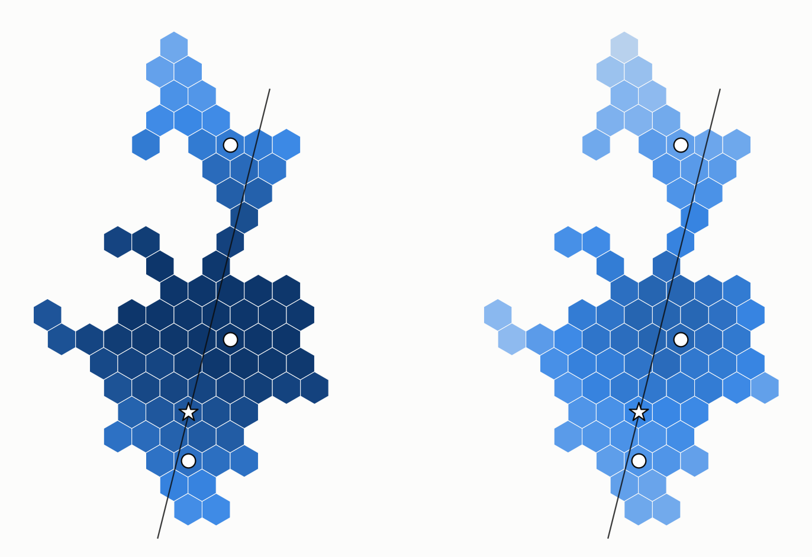

*Hình: C3 ngay sau lượt bay. Trái: cả cell (hợp mọi node). Phải: riêng CL. Màu càng đậm, cell càng có nhiều phần của D.*
- |D| = 4 685 gói.
- Cả cell: trung vị 92 % D. Riêng CL: trung vị 63 %, thấp nhất 18 %.
- Vì vậy bước đầu tiên luôn là gom về CL, và phần còn thiếu phải đi qua River.

---

## 2. Khái niệm

| Khái niệm | Định nghĩa | Ai tính |
|---|---|---|
| Axe = (a_1, …, a_n) | các cell mà γ cắt qua, theo thứ tự bay | BS |
| Seg(a) | các gói phát khi UAV ở trên cell Axe a | BS |
| u, ω | hướng của Axe (vector tổng); nửa bề rộng River, 1,75 cell ≈ 303 m | BS |
| Bank_±(a), Path_±(a) | hai cell ở mép River mà a phục vụ; cell path a → Bank | mỗi cell Axe |
| Crit | critical cell: cell của CH và các cell có CL vượt trội | CH |
| Circ(k), G_j | các hàng xóm phục vụ k; nhóm Seg mà hàng xóm m_j giữ | CH |
| D_k, Lack(k) | tập k phải có; phần D_k mà CL của k còn thiếu | CL của k |

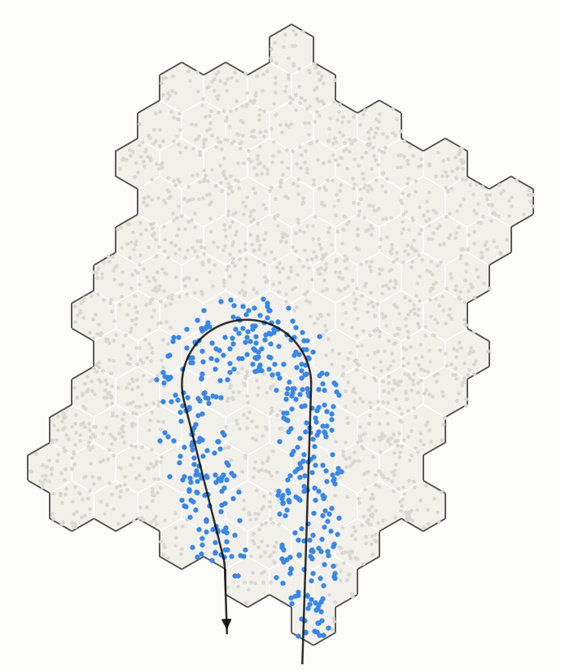

*Hình: cluster minh hoạ, đường bay thẳng (mũi tên). Xanh đậm dọc đường bay là Axe; xanh nhạt dần ra hai bên là River, mép ngoài là Bank; xám là ngoài River.*

**Dòng chảy:** Axe → Bank → Circle → critical cell. Mỗi Seg đi đúng một đường đã định.

**Ba quy ước thực thi:**
1. Dữ liệu của cell c nằm ở Holder(c) = CL(c).
2. Một cell path (c_0, …, c_h) chạy thành đường node: CL(c_0) → gateway → … → CL(c_h).
3. Yêu cầu là một manifest **"có"**: tập gói bên hỏi đang có, trong các khung ≤ 100 B. Bên được hỏi gửi lại phần còn thiếu.

Dữ liệu đi qua một cell thì CL của cell đó giữ một bản sao, nhưng không chủ động xin thêm.

---

## 3. Trước giờ bay: lập kế hoạch

Tham số: bề rộng River W = 3,5 cell (ω = 303 m), κ_g = 2, κ_l = 1, r = 2.

### 3.1 Thuật toán 1: bảng Axe (BS)

BS lấy mẫu đường bay theo từng gói. Cell chứa vị trí phát của gói s là chủ của gói đó. BS gửi bảng (a, Seg(a)) cho CH; CH chuyển mỗi dòng xuống đúng cell Axe.

```text
Algorithm 1  AXETABLE                                   ▷ BS, before the flight
1: Axe ← cells crossed by γ, in flight order
2: for each a ∈ Axe do  Seg(a) ← { s : γ(d0 + sΔ) ∈ a }
3: send { (a, Seg(a)) } and u to CH; CH gives every Axe cell its row
```

```text
Algorithm 1  AXETABLE(γ, d0, Δ, N)
1: Axe ← ()                                         ▷ ordered list
2: for s ← 0 to N−1 do
3:     c ← cell containing γ(d0 + sΔ)
4:     if c ∉ Cells then continue                   ▷ sent outside the cluster: no owner
5:     if c ∉ Axe then append c to Axe; Seg(c) ← ∅
6:     Seg(c) ← Seg(c) ∪ {s}                        ▷ straight path: an interval [first, last]
7: u ← unit( z(a_n) − z(a_1) )                      ▷ the Axe's sum vector
8: send header (d0, Δ, N, u, ω) and rows { (a_i, first(Seg(a_i)), last(Seg(a_i))) } to CH
9: CH forwards row i to Axe cell a_i
```

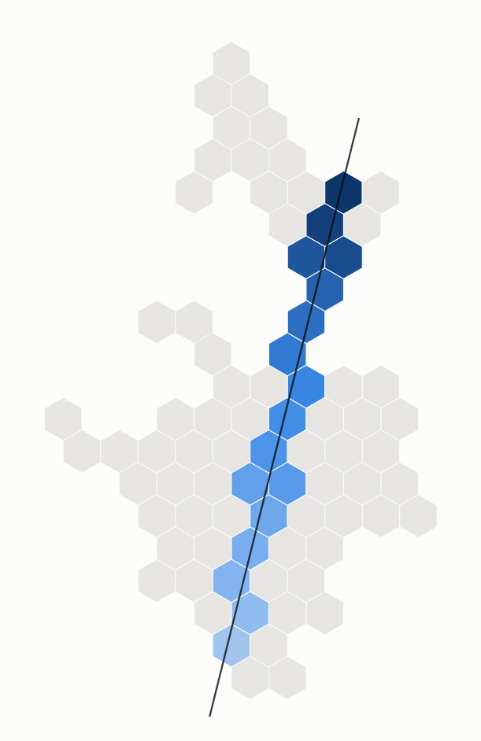

*Hình: 17 cell Axe của C3, càng đậm càng về sau theo hướng bay. Seg trung bình 276 gói (2,8 s phát mỗi cell); các Seg nhỏ (71–170 gói) là chỗ đường bay chỉ cắt góc cell.*

### 3.2 Thuật toán 2: River và Bank (mỗi cell Axe)

Từ tâm mỗi cell Axe, đi theo hướng vuông góc với u về mỗi phía một khoảng ω. Cell cuối cùng còn trong cluster là Bank; các cell đi qua là Path. Mọi đường vuông góc song song nhau. River chạm biên thì biên là Bank.

```text
Algorithm 2  RIVERSETUP(a)                              ▷ each Axe cell a, before the flight
1: n ← u rotated by 90°
2: for σ ∈ {+1, −1} do
3:     Path_σ(a) ← cells on the segment z(a) → z(a) + σ·ω·n, cut at the cluster edge
4:     Bank_σ(a) ← last cell of Path_σ(a)
```

```text
Algorithm 2  RIVERSETUP(a, u, ω)
1: n ← (−u_y, u_x)                                  ▷ the same normal for every a: parallel lines
2: for σ ∈ {+1, −1} do
3:     Path_σ(a) ← (a)
4:     for t ← 0 to ω step w/20 do                  ▷ w: cell width
5:         c ← cell containing z(a) + σ·t·n
6:         if c ∉ Cells then break                  ▷ River reaching the edge: the edge is the Bank
7:         if c ≠ last(Path_σ(a)) then append c to Path_σ(a)
8:     Bank_σ(a) ← last(Path_σ(a))
9:     tell Bank_σ(a): "you are a's Bank, for Seg(a), via Path_σ(a)"
10: River ← ⋃_{a ∈ Axe, σ} Path_σ(a)
```

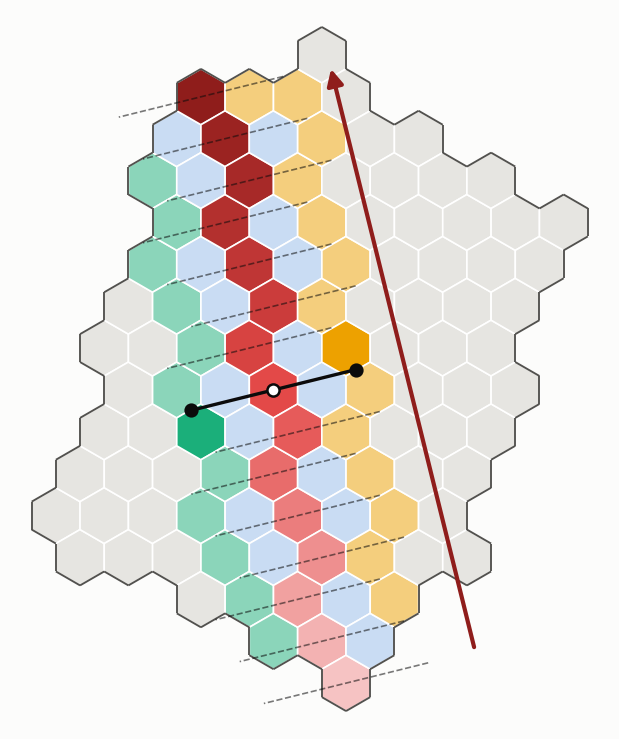

*Hình: cách dựng Bank.*
- Mũi tên đỏ sẫm là u; chấm trắng là một cell Axe.
- Đường liền là đường vuông góc qua cell đó; hai chấm đen cách nó ω. Hai cell xanh lá đậm và cam đậm là hai Bank của nó.
- Đường đứt là các đường song song qua những cell Axe khác. Xanh lá nhạt và vàng là các Bank còn lại.

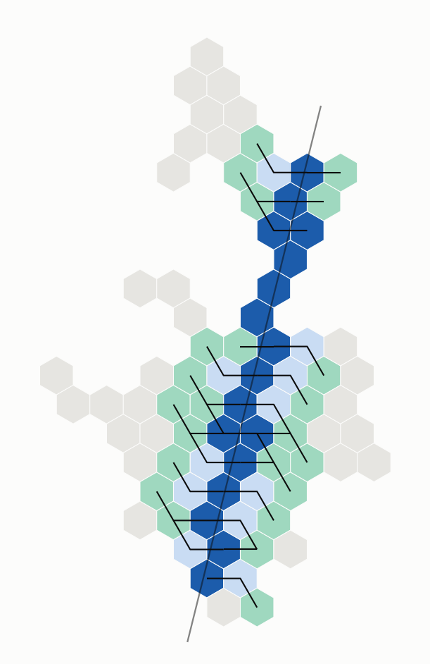

*Hình: River của C3. Xanh đậm là Axe, xanh lá là Bank, xanh nhạt là phần còn lại của River; đường đen nối mỗi cell Axe với Bank của nó. River gồm 51/80 cell; 14/34 Bank bị biên cắt ngắn, vì C3 hẹp.*

**Thuật toán 2b: Bank theo pháp tuyến cục bộ.** Khi đường bay cong, các đường song song lệch khỏi pháp tuyến thật. Mỗi cell Axe dùng pháp tuyến của đường bay tại chỗ nó cắt qua cell. Phía trong khúc cong, quãng đi bị cắt ở bán kính cong.

```text
Algorithm 2b  LOCALBANKS(a)                             ▷ curved flight, each Axe cell a
1: n ← normal of γ where it crosses a
2: Path_±(a), Bank_±(a) ← as in Alg. 2, along ±n; on the inner side of a bend stop at the radius of curvature
```

```text
Algorithm 2b  LOCALBANKS(a, γ, ω)
1: m ← middle packet of Seg(a)
2: t ← unit tangent of γ at d_m, measured over ±10 m;  n ← (−t_y, t_x)
3: θ ← heading change of γ between d_m − 100 m and d_m + 100 m          ▷ signed
4: ρ_c ← 200 m / |θ|  (∞ if θ = 0)                                      ▷ local radius of curvature
5: reach ← ω on both sides; on the side γ turns towards: reach ← min(ω, ρ_c)
6: for σ ∈ {+1, −1}: walk from γ(d_m) along σ·n for reach_σ as in Alg. 2 → Path_σ(a), Bank_σ(a)
7: for every 20th packet s of Seg(a), on both normals of γ at d_s:       ▷ the fan outside a bend
8:     add the cells within ω to River
```

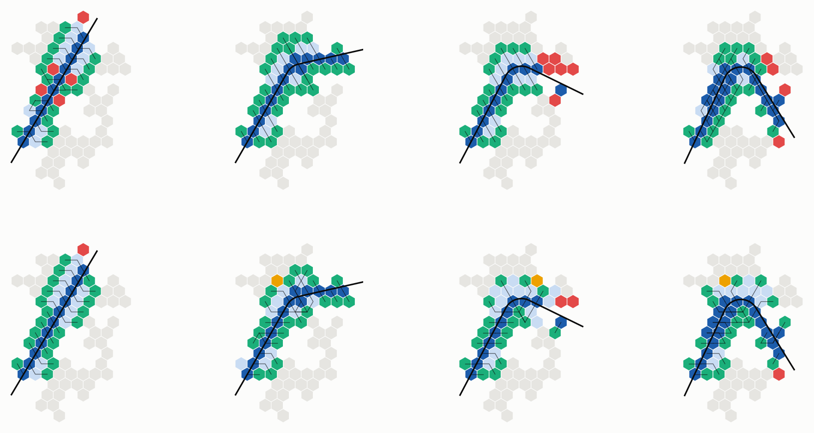

*Hình: một cluster, bốn đường bay. Hàng trên: Bank song song; hàng dưới: Bank cục bộ. Cột: góc thoát 180°, 135°, 100°, 70° (càng nhỏ càng cong).*
- Xanh đậm là Axe, xanh lá là Bank, xanh nhạt là River đúng chỗ, vàng là River thừa, đỏ là cell lẽ ra thuộc River mà thiếu.
- Ở 70°, hàng trên có nhiều ô đỏ phía ngoài khúc cong; hàng dưới gần như không còn.

### 3.3 Thuật toán 3: critical cell (CH)

Gọi μ, σ là trung bình và độ lệch chuẩn điểm năng lực của các CL. Critical cell gồm cell của CH, cell vượt trội toàn cluster, và cell vượt trội trong khu vực r vòng quanh nó.

```text
Algorithm 3  CRITICAL                                   ▷ CH, before the flight
1: μ, σ ← mean, std of score(c) over Cells
2: Crit ← {cell of CH}
3:     ∪ { c : score(c) > μ + κ_g·σ }                           ▷ outstanding in the cluster
4:     ∪ { c : score(c) > μ + κ_l·σ and score(c) = max over c and its r-ring }   ▷ … in its area
```

```text
Algorithm 3  CRITICAL(Cells, score, κ_g, κ_l, r)
1: μ ← mean_{c ∈ Cells} score(c);  σ ← std_{c ∈ Cells} score(c)
2: Crit ← { cell of CH }                            ▷ always critical
3: for each c ∈ Cells do
4:     if score(c) > μ + κ_g·σ then                 ▷ far above the whole cluster
5:         Crit ← Crit ∪ {c}
6:     else if score(c) > μ + κ_l·σ and
7:             score(c) ≥ max { score(c') : c' ∈ Ring_1(c) ∪ … ∪ Ring_r(c) } then
8:         Crit ← Crit ∪ {c}                        ▷ the best of its area, and well above average
9: return Crit
```

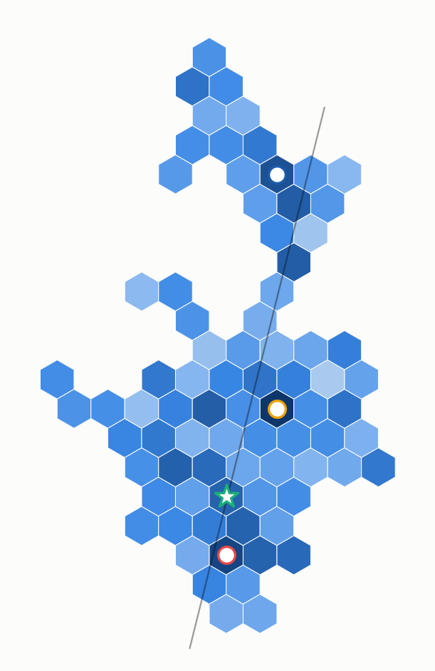

*Hình: màu là điểm năng lực của CL (nhạt → đậm); vòng tròn là critical cell. C3 có 4 critical cell: hai vượt trội toàn cụm, một vượt trội cục bộ, và cell của CH.*

### 3.4 Thuật toán 3b: cửa sổ manh mối (BS/CH)

UAV phát lặp bộ manh mối suốt đường bay. Critical cell chỉ cần **một bản đủ**: Q gói Axe liền nhau. Cửa sổ có thể đặt quanh CH, chung cho cả cluster, hoặc quanh từng critical cell. Cách thứ hai lấy bản sao gần critical cell nhất; nó giả định gói cùng vị trí ở hai bản phát liền nhau là cùng nội dung.

```text
Algorithm 3b  WINDOW                                    ▷ BS/CH, before the flight; Q packets per clue set
1: for each k ∈ Crit: Need(k) ← the Q consecutive Axe packets around where γ passes closest to k
2: keep in Seg only packets of ⋃_k Need(k); drop Axe cells left empty
```

```text
Algorithm 3b  WINDOW(Crit, Q, mode)
1: P ← ⋃_{a ∈ Axe} Seg(a), in order                ▷ all Axe packets
2: function AROUND(z)
3:     s* ← argmin_s ‖γ(d0 + sΔ) − z‖              ▷ where the UAV passes closest to z
4:     i ← clamp( rank of s* in P − ⌊Q/2⌋, 0, |P| − Q )
5:     return [P_i, P_{i+Q−1}]
6: if mode = ch then for every k ∈ Crit: Need(k) ← AROUND(z(CH))     ▷ one window for the cluster
7: else for every k ∈ Crit: Need(k) ← AROUND(z(k))                   ▷ the copy nearest to k
8: for each a ∈ Axe: Seg(a) ← Seg(a) ∩ ⋃_k Need(k)
9: Axe ← (a ∈ Axe : Seg(a) ≠ ∅);  drop the Banks and Paths of removed cells
10: for each k ∈ Crit: D_k ← Need(k) ∩ D         ▷ what k must hold at the end
```


*Hình: dải 6 cell × 4 km, 10 critical cell; ba hàng chung trục ngang (vị trí dọc đường bay).*
- **Trên:** bản đồ. Xanh đậm là Axe, sao là CH, chấm là critical cell khác. Nét đứt nối mỗi critical cell với điểm UAV bay gần nó nhất. Màu theo vị trí dọc đường bay.
- **Giữa:** dòng gói của Axe. Xám là mọi gói, đen là cửa sổ quanh CH, mỗi vạch màu là cửa sổ riêng của một critical cell.
- **Dưới:** thời điểm xong, vạch lưới mỗi 20 s. Chấm rỗng: cửa sổ quanh CH (3–88 s). Chấm đặc: cửa sổ riêng (3–25 s).

### 3.5 Thuật toán 4: Circle (CH, cho mỗi critical cell)

Circle của k là các cell kề k (6, ít hơn ở biên), xếp theo vị trí dọc đường bay. Axe được chia thành các nhóm Seg liên tiếp, mỗi thành viên một nhóm. Thành viên lấy mỗi Seg từ **đúng Bank của Seg đó**, ở phía gần mình hơn, theo cell path.

```text
Algorithm 4  CIRCLE(k)                                  ▷ CH, before the flight, every k ∈ Crit
1: Circ(k) ← Neig(k), ordered along u
2: split Axe into |Circ(k)| consecutive groups; neighbour m_j takes group G_j
3: for each a ∈ G_j: m_j will fetch Seg(a) from a's Bank on the side nearer m_j
```

```text
Algorithm 4  CIRCLE(k, Axe, Seg, Bank)
1: Circ(k) ← Neig(k)                                ▷ 6 cells; fewer at the cluster edge
2: order Circ(k) = (m_1..m_q) by ⟨z(m_j), u⟩         ▷ further along the flight → later data
3: Axe_k ← (a ∈ Axe : Seg(a) ∩ Need(k) ≠ ∅)         ▷ all of Axe without a window
4: split Axe_k into q consecutive groups G_1..G_q of near-equal size
5: for j ← 1 to q do
6:     for each a ∈ G_j do
7:         σ ← side whose Bank_σ(a) is fewer cells from m_j (then fewer metres)
8:         src_j(a) ← Bank_σ(a);  P_j(a) ← shortest cell path src_j(a) → m_j avoiding k
9:     send m_j its task { (a, src_j(a), P_j(a)) : a ∈ G_j };  send k the list (m_j, G_j)
```

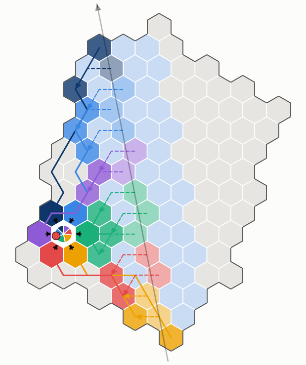

*Hình: Circle quanh critical cell (chấm đỏ bên trái).*
- Sáu ô màu quanh nó là sáu thành viên; mỗi màu là một nhóm Seg liên tiếp.
- Nét đứt ngắn: Axe bù Bank (Thuật toán 5).
- Nét liền: thành viên kéo các Seg của mình từ Bank của chúng (Thuật toán 6).
- Mũi tên đen ngắn: thành viên giao cho critical cell (Thuật toán 7).

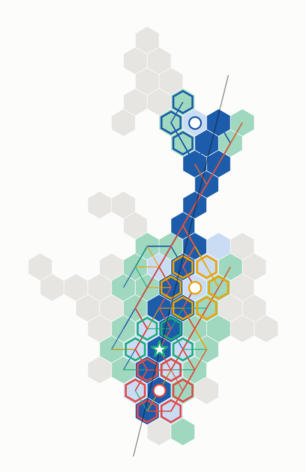

*Hình: Circle của bốn critical cell trên C3. Mỗi critical cell một màu viền: (4, 6) xanh dương, CH xanh lá, (8, −2) vàng, (9, −7) đỏ. Đường màu là đường Bank → thành viên, dài trung bình 3,5–6,1 cell; hai critical cell ở hai đầu cluster có đường dài nhất (12–13 cell).*

**Thuật toán 4b: Circle động.** Sau lượt bay, CL của k đếm lượng thiếu và gọi số thành viên tương ứng trong vòng 1–2: thiếu nhiều thì tới 12, thiếu ít thì 2.

```text
Algorithm 4b  ADAPTIVECIRCLE(k)                         ▷ after the pass, at the CL of k
1: lack ← packets of D_k that no node of k holds      ▷ one summary frame per node
2: n ← clamp(⌈|lack| / share⌉, n_min, n_max);  members ← n cells of rings 1–2 (ring 1 first)
3: split Axe into n consecutive groups; ask member j for lack ∩ its group
```

```text
Algorithm 4b  ADAPTIVECIRCLE(k, share, n_min, n_max)
   ▷ before the flight, at CH: every size n the CL may pick
1: for n ← 1 to |Ring_1(k) ∪ Ring_2(k)| do
2:     Mem_n ← n cells spread evenly round k over Ring_1(k), then over Ring_2(k); order them along γ
3:     G_{n,j} ← j-th of n consecutive groups of Axe
4: for every candidate m and every a ∈ Axe: src(m, a) ← Bank of a nearer m;  P(m, a) ← its cell path to m
   ▷ after the pass, at the CL of k
5: every node of k sends the CL one summary frame of what it holds
6: lack ← { s ∈ D_k : no node of k holds s };  if lack = ∅ then return
7: n ← clamp(⌈|lack| / share⌉, n_min, n_max)
8: for j ← 1 to n: send m_j = Mem_n[j] the request X_j ← lack ∩ ⋃_{a ∈ G_{n,j}} Seg(a)
   ▷ at member m_j, on request X_j
9: send X_j ∩ have(m_j) to k now
10: gather the packets of X_j that nodes of m_j hold (Alg. G)
11: for the rest, s ∈ Seg(a): ask src(m_j, a) along P(m_j, a); pass each packet on to k as it arrives
```

---

## 4. Sau lượt bay: thực thi

Mọi bước bắt đầu khi UAV rời cluster và chạy chồng lên nhau theo từng gói: bên gửi có gói nào thì chuyển ngay gói đó.

| Bước | Ai | Bắt đầu khi | Xong khi |
|---|---|---|---|
| G. Gom về CL | node → CL của mọi cell có vai trò | UAV rời cluster | CL có mọi gói cần mà node trong cell có |
| 5. BANKFILL | Bank ↔ Axe | Bank gom xong | Bank có đủ Seg(a) |
| 6. CIRCLEFILL | thành viên ↔ Bank | thành viên gom xong, hoặc khi được hỏi | thành viên có đủ nhóm của mình |
| 7. CRITPULL | critical cell ↔ Circle | critical cell gom xong | Lack(k) = ∅ |

### 4.1 Thuật toán G: gom về CL

Chỉ cell có vai trò mới gom, và chỉ gom phần cần: Axe gom Seg của mình, Bank gom Seg của cell Axe nó phục vụ, thành viên Circle gom nhóm của mình, critical cell gom D_k. Mỗi gói cần do node giữ nó có ETX tới CL nhỏ nhất gửi về.

```text
Algorithm G  GATHER(c)                                  ▷ after the pass, every cell with a role
1: Need(c) ← own Seg (Axe) ∪ its Axe cell's Seg (Bank) ∪ its group (Circle) ∪ D_k (critical)
2: for each s ∈ Need(c) that CL(c) lacks: the node of c holding s nearest CL(c) by ETX sends it
```

```text
Algorithm G  GATHER(c, Need(c))
1: (summary) every node reports what it holds; up the toCL tree each node sends
       missing(branch) = missing(self) ∩ missing(child_1) ∩ …
2: for each s ∈ Need(c) \ have(CL(c)) do
3:     v ← argmin { ETX(v → CL(c)) : v ∈ c, s ∈ rx(v) }
4:     if v exists then send s from v to CL(c) along the least-ETX route
5: gathered(c) ← true once every such s has arrived         ▷ Alg. 5, 6, 7 wait on this
```

Trong ns‑3, dòng 1 chưa được mô phỏng: CL được coi là đã biết node nào giữ gói nào.

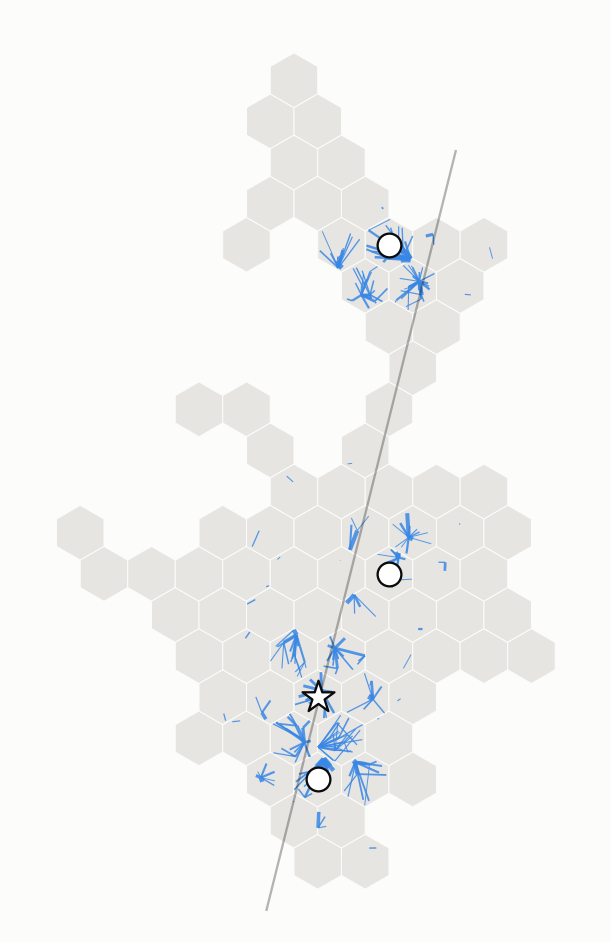

*Hình: liên kết dùng để gom, nét càng đậm càng nhiều khung. 9 105 khung về 41 CL; khung cuối lúc 9,8 s; các critical cell gom xong trong 7,4–9,8 s.*

### 4.2 Thuật toán 5: Axe bù cho Bank

```text
Algorithm 5  BANKFILL                                   ▷ after the pass, each Bank b of Axe a
1: b sends a "have" manifest of Seg(a) to a along Path(a → b)
2: a returns what b lacks of Seg(a)
```

```text
Algorithm 5  BANKFILL(b, a)                          ▷ b = Bank_σ(a); starts when the UAV leaves
1: wait until Holder(b) has gathered its cell's packets (Alg. G)
2: H ← Seg(a) ∩ have(b)
3: send manifest(H) to a along Path_σ(a)
4: at a: send each s ∈ Seg(a) \ H to b along Path_σ(a) reversed, as soon as Holder(a) has s
5: at b: store; Seg(a) ⊆ have(b) now, apart from packets no Axe node received
```

Ở bề rộng 3,5 cell, bước này tốn 0 khung ở mọi lần chạy: Bank đã đủ ngay sau khi gom.

### 4.3 Thuật toán 6: Circle chuẩn bị và giao

Hai biến thể. **Chuẩn bị sẵn:** thành viên lấy cả nhóm từ Bank ngay khi gom xong. **Khi được hỏi:** thành viên chỉ lấy những gói critical cell hỏi, sau khi nó hỏi.

```text
Algorithm 6  CIRCLEFILL                                 ▷ after the pass, each Circle cell m_j of k
1: for each a ∈ G_j: ask Bank(a) for Seg(a) \ have(m_j); keep what comes back
2: on a request X from k: send X ∩ have(m_j), the rest as it arrives
```

```text
Algorithm 6  CIRCLEFILL(m_j, task_j, k, prep)
1: if prep = full then
2:     wait until Holder(m_j) has gathered its group (Alg. G)
3:     for each (a, src, P) ∈ task_j do                 ▷ in parallel over the sources
4:         send manifest(Seg(a) ∩ Need(k) ∩ have(m_j)) to src along P
5:         src sends the rest of Seg(a) ∩ Need(k) to m_j along P reversed, each packet once src has it
6: on request X from k:                               ▷ may arrive before line 5 finishes
7:     send X ∩ have(m_j) to k now; send the rest of X as it arrives
8:     if prep = ondemand then
9:         gather the packets of X that nodes of m_j hold (Alg. G)
10:        for the others, s ∈ Seg(a): ask src(a) along P(a) for them
```

### 4.4 Thuật toán 7: critical cell kéo về

```text
Algorithm 7  CRITPULL                                   ▷ after the pass, each k ∈ Crit
1: for each m_j ∈ Circ(k): send m_j the part of Lack(k) in ⋃_{a ∈ G_j} Seg(a)
2: done when Lack(k) = ∅
```

```text
Algorithm 7  CRITPULL(k)
1: wait until Holder(k) has gathered its cell's packets (Alg. G)
2: Lack(k) ← D_k \ have(k)
3: for each (m_j, G_j) ∈ Circ(k) do
4:     send manifest(have(k) ∩ ⋃_{a ∈ G_j} Seg(a)) to m_j     ▷ "I have these, send the rest"
5: on receipt of packets: store; Lack(k) ← Lack(k) \ received
6: done when Lack(k) = ∅                                 ▷ or only packets no node received remain
```

**Phép so sánh (kéo thẳng):** critical cell hỏi thẳng từng cell Axe phần nó thiếu, không qua Bank và Circle.

```text
Algorithm D  DIRECTPULL(k)                              ▷ ablation
1: after GATHER(k), ask every a ∈ Axe for Seg(a) ∩ Lack(k) along the shortest cell path; a returns it
```

### 4.5 Lớp truyền

Mỗi cell và mỗi cặp gateway là một môi trường truyền, chỉ một máy phát tại một thời điểm.

```text
Algorithm S  TRANSPORT                                  ▷ every node; one medium per cell and per gateway pair
1: a frame enters the queue of the radio facing its next hop; the radio joins its medium's wait list
2: a free medium hands its turn to the first radio waiting: that radio gives its head frame to the 802.15.4 MAC
3: on the MAC's confirm: free the medium; success → drop the frame, failure → keep it for the radio's next turn
```

- MAC 802.15.4 đầy đủ: CSMA/CA, ACK, gửi lại.
- Kênh cell theo lưới 7 màu: 11 + (q + 3r) mod 7. Mỗi cặp gateway có radio và kênh riêng (18–26).
- Trong cell đi theo ETX nhỏ nhất; giữa hai cell đi qua đúng một cặp gateway, chọn theo chất lượng liên kết.

### 4.6 Từng bước trên C3

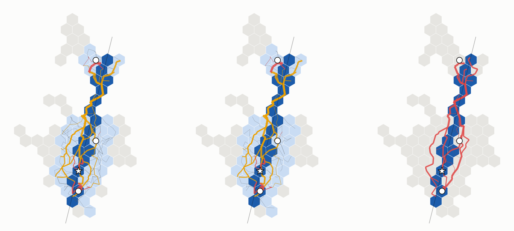

*Hình: dòng dữ liệu sau khi gom. Từ trái sang: River chuẩn bị sẵn, River khi được hỏi, kéo thẳng. Vàng là Bank → Circle, đỏ là → critical cell, xám mảnh là yêu cầu; nét càng đậm càng nhiều khung.*
- Với River, dữ liệu chảy dọc River tới các thành viên, rồi chặng cuối ngắn vào critical cell.
- Với kéo thẳng, các đường đỏ dài chồng lên nhau dọc Axe.

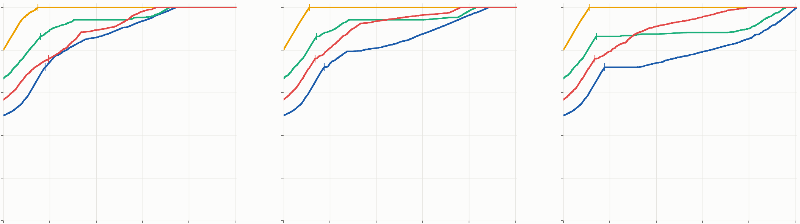

*Hình: phần D mà CL của từng critical cell có, theo thời gian (0–50 s, vạch lưới 10 s). Ba ô như hình trên. Vạch đứng trên mỗi đường là lúc cell đó gom xong.*

| Critical cell | Cả cell thiếu (gói) | Chuẩn bị sẵn | Khi được hỏi | Kéo thẳng |
|---|---|---|---|---|
| (8, −2) | 1 | 7,5 s | 5,6 s | 6,0 s |
| (9, −7) | 1 127 | 32,9 s | 38,1 s | 39,8 s |
| CH (8, −5) | 636 | 35,8 s | 41,4 s | 48,0 s |
| (4, 6) | 1 313 | 37,2 s | 44,2 s | 50,3 s |
| **Tổng khung** | | **89,7 k** | **80,4 k** | **102,2 k** |

---

## 5. Kết quả chính

Số thăm dò; ns‑3, MAC 802.15.4 đầy đủ.
- **River so với kéo thẳng** (một cluster, 20 lượt, ghép cặp): từ 4 critical cell trở lên, River dùng ít hơn 20–22 % khung ở 20/20 lượt, và nhanh hơn ở 19–20/20 lượt. Với 1 critical cell nằm trên Axe, kéo thẳng rẻ hơn.
- **Chi phí của River nằm ở chặng Bank → Circle:** 74 % số khung trên C3. Axe → Bank tốn 0 khung.
- **Lưới 7 màu là đủ.** Bề rộng River 2,5–6,5 cell gần như không đổi kết quả trên đường bay thẳng.
- **Circle động với n = 12** nhanh hơn Circle cố định 11 % và tốn ít hơn 27 % khung trên C3 (một lượt). Các Circle khi đó chồng lên nhau.
- **Cửa sổ theo từng critical cell** gỡ được giới hạn chiều dài cluster. Trên dải 6 × 4 km, critical cell cuối xong sau 25 s thay vì 88 s, và số khung chỉ còn khoảng 1/10. Bề ngang bão hoà ở khoảng 8–10 cell.
- **Cấp nhiệm vụ** (40 bản đồ): hợp tác rút T\* 26–68 s so với không hợp tác, trên 39/40 bản đồ.

**Câu hỏi mở:** bề rộng River tối ưu; ghép Circle khi hai critical cell kề nhau; chạy lại với N ≥ 120.

---

## 6. Ký hiệu

| Ký hiệu | Nghĩa | Giá trị |
|---|---|---|
| γ, d_s, Δ | đường bay; vị trí phát của gói s; quãng bay giữa hai gói | Δ = 0,5 m |
| w | bề rộng cell (hai cạnh song song) | 173 m |
| Q | số gói của bộ manh mối | 4 036 (cửa sổ 4 041) |
| ω, W | nửa bề rộng River; bề rộng River | 303 m; 3,5 cell |
| κ_g, κ_l, r | ngưỡng vượt trội toàn cục, cục bộ; bán kính vòng | 2; 1; 2 |
| Need(k), D_k | cửa sổ của k; phần k phải có | |
| have(c), Lack(k) | gói CL của c đang có; phần D_k CL của k còn thiếu | |
| share, n_min, n_max | gói mỗi thành viên; số thành viên ít nhất, nhiều nhất | 200–400; 2; 12 |
| τ_frame | thời gian một khung có ACK qua một chặng | khoảng 5–6 ms |

Mã: `uav-coop2/tools/river_plan.py` (Thuật toán 1–4, 2b, 3b, 4b), `uav-coop2/examples/coop2-river.cc` (G, 5–7, D, S).
