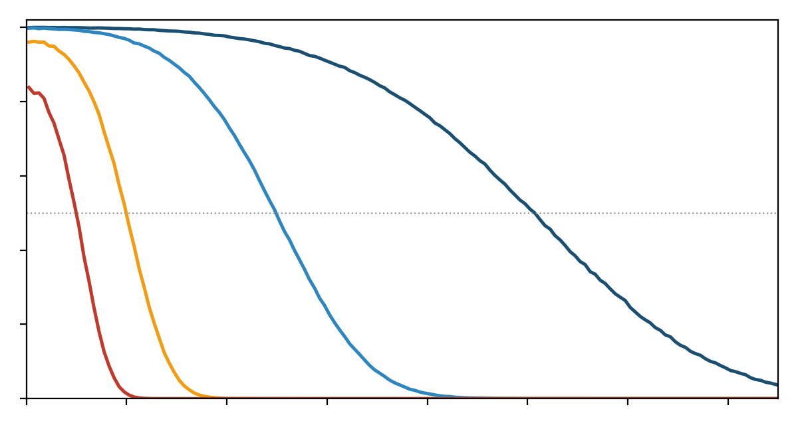
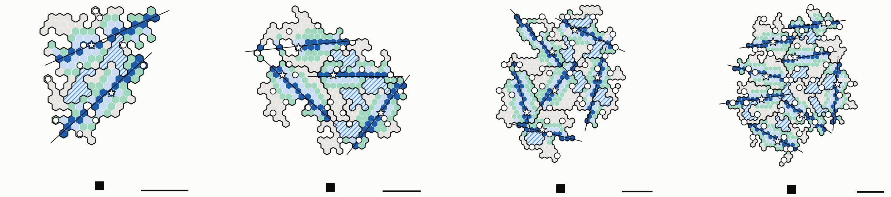
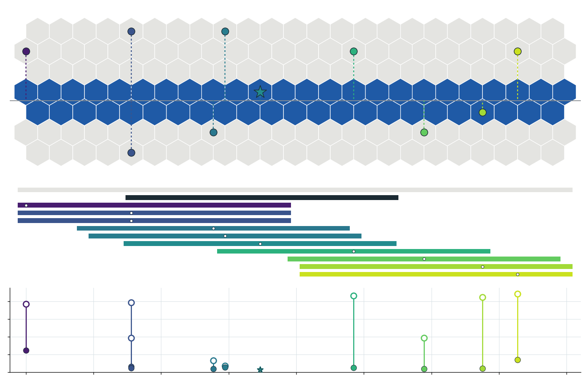
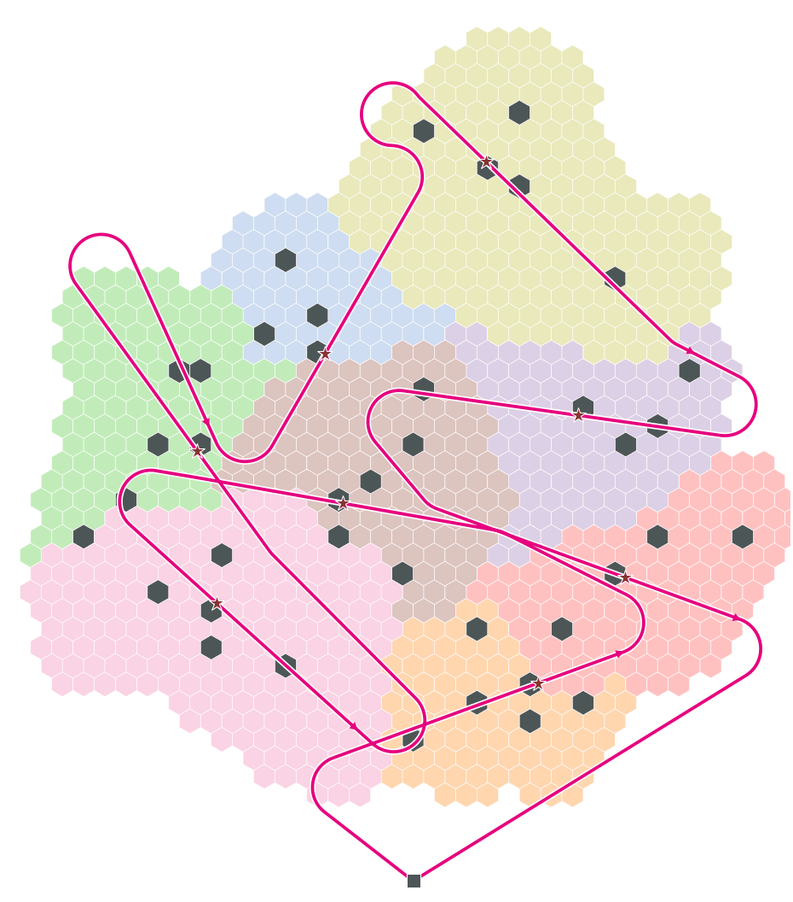
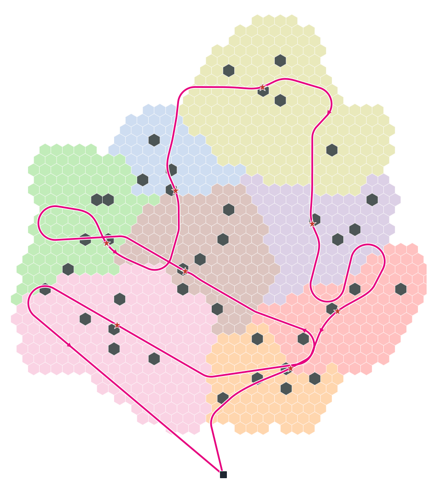
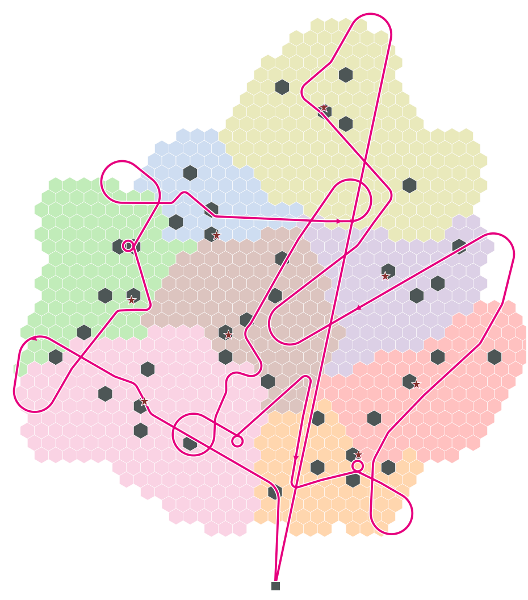
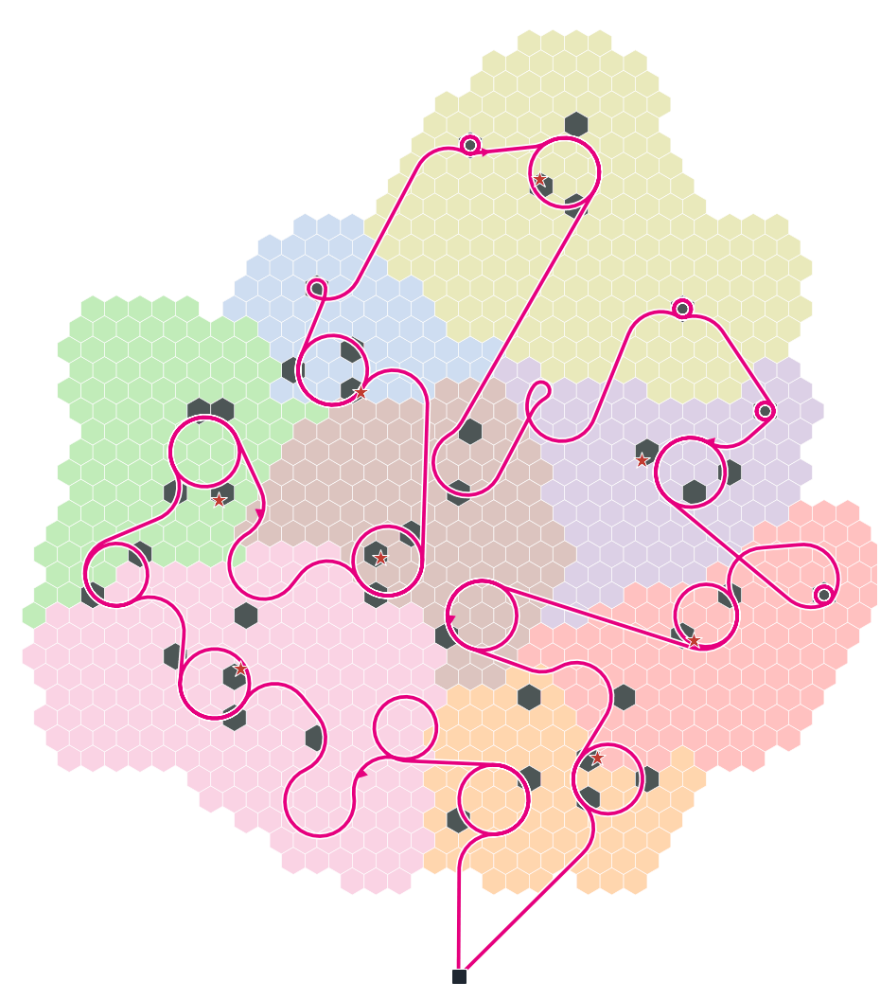
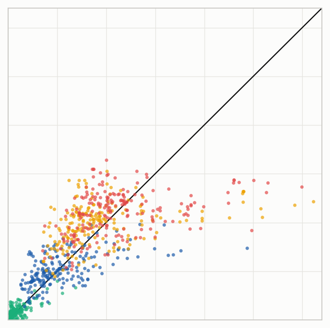

# Technical report: SigDrop, chiến dịch 4 (CHORD, LM-Tour, DTSP-N + River, FC + DTSP-N)

- **Phiên bản:** 2026-10-28, bản 1. Đây là tài liệu sống: mỗi lần chiến dịch có thêm seed, cập nhật §0 và §3 (cách làm trong `docs/progress/HANDOFF.md`).
- **Dữ liệu chụp lúc:** commit `1c299d0` của `origin/claude/document-review-xslwgg` (2026-10-28 19:10 UTC; bảng §3 cập nhật ở mốc 70 %, mục 208).
- **Phạm vi:** toàn bộ quá trình từ mục 186 tới mục 205 của CLAUDE.md §8, cộng phần nền (hệ thống, River, bộ dự đoán) mà các mục này dựa vào.
- **Tài liệu gốc nên đọc kèm:**
  - `paper/SYSTEM-vi.md`, `paper/RIVER-vi.md`, `paper/BASELINES-vi.md`, `paper/L1-MODEL-vi.md`: nền;
  - `logs/2026-10-27_1714-campaign4/README.md`: chiến dịch 4;
  - `logs/2026-10-28_0810-phase1-paths/README.md`: hình và độ dài đường bay.

---

## 0. Trạng thái nhanh

| Hạng mục | Trạng thái |
|---|---|
| Chiến dịch 4 (4 phương án × 10 seed × 3 bản đồ × 4 kênh) | **70 %** (252/360 job). CHORD 84/120, LM-Tour 86/120, DTSP-N + River 82/120 job. Seed 1, 3, 5, 6, 7 đủ 12/12 ô; seed 2 còn bản đồ k8; seed 4, 8, 9, 10 tạm dừng (mục 206) |
| Bảng T\* | §3.1. Mỗi ô chỉ gộp các seed mà **mọi** phương án đều đã xong (ghép cặp) |
| Phiên cloud | Lúc 16:22 UTC chỉ seed 5 (và có lẽ 6) còn push. Seed 2, 3, 4, 7, 8, 9, 10 im lặng từ 14:19–14:55. Cần kiểm tra (`docs/progress/HANDOFF.md`) |
| Khảo sát Bậc 3 (bộ dự đoán học bằng cây) | Đã chạy 192 lượt River trên k8. Với dữ liệu hiện có, HGB chưa chọn đường tốt hơn công thức Bậc 2; **còn cân nhắc** (§5.7) |
| Quy tắc thống kê | Số liệu là **thăm dò** cho tới khi N ≥ 120, tức đủ 10 seed × 12 ô (CLAUDE.md) |

**Thông điệp chính đến lúc này (sẽ được xác nhận khi đủ seed):**
1. LM-Tour + River nhanh nhất trong các phương án thực tế ở mọi ô: so với CHORD + River nhanh hơn 1–10 %, so với DTSP-N + River 8–26 %, so với FC + DTSP-N 10–72 %.
2. Lợi thế của LM-Tour so với CHORD đến chủ yếu từ **tour DTSP-N qua các CH** (tour đội 1 ngắn hơn 14–28 % quãng đường). Bước uốn về landmark chỉ thêm 7–22 s (mức mô hình, k8).
3. Hợp tác River là phần đáng giá nhất khi kênh xấu: ở r200/r100, mọi phương án có River nhanh hơn FC + DTSP-N 50–72 %.
4. Ở kênh open, FC + DTSP-N gần ngang các phương án River (chỉ chậm hơn LM-Tour 10–14 %), vì cell nghe trực tiếp được hầu hết dữ liệu.

---

## 1. Bài toán và hệ thống (tóm tắt)

### 1.1 Kịch bản
- **Mục tiêu:** tìm một người (mục tiêu) đã đi qua một vùng có mạng cảm biến/camera mặt đất.
- **Đội 1:** UAV cánh bằng, phát quảng bá một **bộ manh mối** 400 kB (12 ảnh: 2 mặt, 4 dáng, 6 bộ phận; 4 041 gói 99 B, mỗi gói 10 ms) xuống các cell trong một lượt bay.
- **Critical cell:** cell CH và cell có camera (CL) có điểm vượt trội. Đây là các cell phải có đủ bộ manh mối để đối sánh tại chỗ.
- **Báo cáo:** mỗi critical cell đối sánh rồi báo điểm qua CH → LoRa (duty cycle 1 %, một bản tin mỗi 40 s) → BS.
- **Đội 2:** UAV cánh quay, 15 m/s, bay tới các critical cell theo xác suất là c\* để xác minh: ổn định 5 s, nhận bộ tham chiếu 1 MB qua unicast, đối sánh. Tổng khoảng 78 s mỗi cell.
- **Chỉ số chính T\*:** thời điểm đội 2 xác minh xong c\*, cell có điểm xác minh cao nhất. c\* là một critical cell, bốc theo mô hình lớp 1 (`paper/L1-MODEL-vi.md`).

### 1.2 Ba lớp
| Lớp | Câu hỏi | Thành phần trong chiến dịch 4 |
|---|---|---|
| Lớp 1 | cell nào giữ mục tiêu, khi nào đủ chắc để gửi đội 2 | mô hình điểm cosine, BS tính P(c = c\*), quy tắc gửi β = 1/4 |
| Lớp 2 | đội 1 bay đường nào | CHORD, LM-Tour, DTSP-N, tour FC |
| Lớp 3 | dữ liệu đi từ đường bay tới critical cell thế nào | River (Axe / Bank / Circle) trong ns-3, hoặc không có (FC) |

### 1.3 Mạng và kênh
- Lưới cell lục giác bán kính 100 m. Miền không lồi, có hồ. Cluster k-medoids ≤ 80 cell, mỗi cluster một CH.
- 802.15.4 (lr-wpan ns-3), lưới kênh 7 màu, một cặp gateway cho mỗi cặp cell kề.
- **A2G:** UAV ở 100 m, +10 dBm, ngưỡng −100 dBm, Nakagami m = 1,8. Bốn chế độ kênh, khác nhau ở suy hao thêm:

| Chế độ | Suy hao thêm (dB) | R50 ngang (m) | ξ tự chọn của LM-Tour (m) |
|---|---|---|---|
| open (r = 1 km) | 0 | 1 015 | 255 |
| r500 | 9,03 | 498 | 255 |
| r200 | 19,77 | 199 | 199 |
| r100 (r = 150 m) | 25,74 | 99 | 99 |

R50 là khoảng cách ngang mà ở đó một node nhận được một nửa số gói.



*Hình 1: xác suất một gói tới được node theo khoảng cách ngang từ UAV, đo trên lượt bay ns-3. Bốn đường từ open (R50 1 015 m) tới r100 (R50 99 m); đường chấm là mức 1/2.*

### 1.4 Đội 1: động học và ràng buộc giao đủ dữ liệu
- 50 m/s, nghiêng 45°: bán kính quay ρ = R_TURN = 255 m. Vòng hẹp nhất ở vận tốc tối thiểu: R_LOOP = 63,7 m.
- **Ràng buộc giao đủ (`pass_speed.fit`, mục 157):** mỗi cụm phải được phát **một bản sao trọn bộ manh mối** (4 041 gói, 40,4 s) trên chính các cell của nó. Nếu đường qua cụm ngắn, UAV giảm tốc; nếu giảm tới VMIN vẫn chưa đủ, nó lượn thêm vòng R_LOOP tại CH.
- **Hệ quả quan trọng cho thiết kế đường bay:** một đường ngắn bay chậm tốn **cùng thời gian trong cụm** như một dây cung dài bay nhanh. Vậy đường qua cụm nên ngắn và đặt sao cho các đoạn nối giữa các cụm ngắn. Đây là lý do tour DTSP-N thắng CHORD (§3, §4.3).

---

## 2. Khung evaluation và thiết lập chiến dịch 4

### 2.1 Các phương án (mục 187)

| Phương án | Vai trò trong paper | Lớp 2 (đường bay) | Lớp 3 |
|---|---|---|---|
| **CHORD + River** | đề xuất 1, nền lý thuyết | mỗi cụm một dây cung dài nhất qua CH; thứ tự tour theo độ trễ | River |
| **LM-Tour + River** | đề xuất 2, phương án chính | tour DTSP-N qua đĩa các CH, rồi uốn về landmark trọng số cao tới khi lợi ích bão hoà | River |
| **FC + DTSP-N** | baseline toàn hệ thống (lớp 2 + 3) | DTSP-N qua các nhóm critical cell, lượn vòng tới khi giao đủ | không, chỉ fountain code |
| **DTSP-N + River** | cô lập giá trị của River so với FC + DTSP-N | mỗi cụm một đường zigzag đi vào đĩa mọi critical cell, cắt cụm một lần | River |
| **Rotary TSP (B1)** | cận trên, không có pha 1 | — | — |

Đã bỏ: Oracle (B7, cận dưới; không có nhiều giá trị lập luận, 2026-10-29), CHORD + gom cell (mục 187), CHORD-T (CHORD chọn hướng chung với tour, mục 136). "CHORD" trong tài liệu này luôn là CHORD thường (mục 186).

**Mạch lập luận của mục Evaluation:**
- (a) Hai đề xuất so với FC + DTSP-N cho thấy lợi ích của cả lớp 2 + 3.
- (b) DTSP-N + River so với FC + DTSP-N tách riêng lợi ích của River.
- (c) LM-Tour so với CHORD và DTSP-N + River cho thấy chọn đúng landmark quan trọng hơn bay sát mọi cell.
- (d) Rotary TSP làm cận trên: cho thấy giá trị của cả pha 1.

### 2.2 Thiết lập
- **Bản đồ:** k8-s1, k12-s1, k16-s1, cố định. Hình học cụm, CH và critical cell giống nhau với mọi phương án.
  - Số cụm thật là **8, 12 và 15**. k16-s1 tên là "16" nhưng k-medoids chỉ cho 15 cụm; `prefly.py` đọc số cụm từ `map.json`.
  - Các bảng dưới đây ghi "K = 8 / 12 / 16" theo tên bản đồ. **Trong paper nên ghi 15** cho bản đồ thứ ba.
  - Số critical cell: 45 / 66 / 92.
- **Kênh:** open, r500, r200, r100.
- **Seed mô phỏng R = 1…10** (`mission.py --runSeed R`). Seed thay đổi:
  - chỉ số mission ns-3: 100000·K + 100 + k + 10⁷·(R − 1), quyết định fading của pass, che khuất và fading G2G, các lần bốc của MAC;
  - khối lượt bốc lớp 1: draw 100·(R − 1) … 100·R − 1;
  - pha LoRa và các khoá ngẫu nhiên phía Python (`/rR`).
- **Ghép cặp:** trong cùng (R, kênh, bản đồ), mọi phương án dùng chung lượt bốc lớp 1 và pha LoRa.
- **Mỗi ô:** 10 seed × 100 lượt bốc = 1 000 mẫu T\*, đến từ 10 hiện thực mạng ns-3. Khoảng tin cậy tính theo **trung bình từng seed** (Student t), vì 100 lượt bốc trong một seed dùng chung một hiện thực mạng.
- **Binary:** CAMP-BIN5, đóng băng.
  - Hash: deploy 508c170d8d7af589, pass 4bb3832ed668ac76, river 60a32c1245fd473c.
  - Kiểm chứng: giống từng byte với bản lưu trữ trên r500-k8 (`validate-r500-k8.md`).
- **River:** `--riverRepair 20`, cửa sổ 400 kB theo critical cell (`--windowAt crit`), `--axeNear`, critical cell theo điểm toàn miền (`--critRing domain`).
- **Chấm điểm:** `lm_tour.py score --mode ns3` cho ba phương án River. Phương án này trùng `l1_rank` từng lượt bốc với CHORD (lệch 0,0 s). FC + DTSP-N và B1 chấm bằng `l1_rank` (B7 vẫn được chấm nhưng không đưa vào bảng).

---

## 3. Kết quả thực nghiệm (thăm dò, khoảng 70 % job)

Bảng sinh bằng `python3 logs/2026-10-27_1714-campaign4/table.py` trên dữ liệu đã push.

Số seed đã gộp vào từng ô:

| | open | r500 | r200 | r100 |
|---|---|---|---|---|
| k8 | 5 | 5 | 5 | 6 |
| k12 | 6 | 6 | 6 | 7 |
| k16 | 9 | 7 | 8 | 10 |

### 3.1 T\* (s), bản đồ k8 / k12 / k16 (8 / 12 / 15 cụm)

Mọi bảng trong mục 3 xếp phương án theo T\* **giảm dần** (chậm nhất trước). Thứ tự này theo kênh r ≤ 500 m; ở kênh open, FC + DTSP-N nhanh hơn DTSP-N + River (690 so với 749 s ở k8).

| Phương án | r = 1 000 m (open) | 500 m | 200 m | 150 m (r100) |
|---|---|---|---|---|
| Rotary TSP (cận trên) | 2821 / 4211 / 5248 | 2821 / 4211 / 5178 | 2821 / 4211 / 5173 | 2809 / 4227 / 5242 |
| FC + DTSP-N | 690 / 907 / 1067 | 1065 / 1535 / 1877 | 1911 / 2696 / 3689 | 2220 / 3366 / 4523 |
| DTSP-N + River | 749 / 887 / 1092 | 914 / 1183 / 1452 | 965 / 1330 / 1669 | 1041 / 1374 / 1658 |
| CHORD + River | 656 / 812 / 946 | 783 / 1095 / 1190 | 849 / 1155 / 1322 | 859 / 1173 / 1335 |
| **LM-Tour + River** | **618 / 803 / 917** | **732 / 976 / 1164** | **791 / 1037 / 1229** | **800 / 1063 / 1262** |

**Tương đối (LM-Tour so với phương án khác, %, K = 8 / 12 / 16):**

| So với | open | r500 | r200 | r100 |
|---|---|---|---|---|
| Rotary TSP (lần nhanh hơn) | 4,6× / 5,2× / 5,7× | 3,9× / 4,3× / 4,4× | 3,6× / 4,1× / 4,2× | 3,5× / 4,0× / 4,2× |
| FC + DTSP-N | −10 / −11 / −14 | −31 / −36 / −38 | −59 / −62 / −67 | −64 / −68 / −72 |
| DTSP-N + River | −17 / −9 / −16 | −20 / −17 / −20 | −18 / −22 / −26 | −23 / −23 / −24 |
| CHORD + River | −6 / −1 / −3 | −6 / −11 / −2 | −7 / −10 / −7 | −7 / −9 / −6 |

### 3.2 Thời gian hoàn thành pha 1

**(a) Thời gian bay của đội 1** (s, cất cánh → mọi cụm → về BS). Lấy theo hình học, không phụ thuộc seed; với ba phương án River có tính phần giảm tốc/lượn để giao đủ.

| Kênh | Bản đồ | FC + DTSP-N | DTSP-N + River | CHORD | LM-Tour |
|---|---|---|---|---|---|
| open | k8 / k12 / k16 | 669 / 913 / 1134 | 1066 / 1553 / 2007 | 784 / 1292 / 1437 | 698 / 1085 / 1394 |
| r500 | k8 / k12 / k16 | 1320 / 2011 / 2563 | 1066 / 1553 / 2007 | 784 / 1292 / 1437 | 699 / 1085 / 1308 |
| r200 | k8 / k12 / k16 | 2687 / 4016 / 5567 | 1018 / 1556 / 2085 | 784 / 1292 / 1437 | 697 / 1083 / 1293 |
| r100 | k8 / k12 / k16 | 3305 / 5078 / 6808 | 1170 / 1589 / 2105 | 784 / 1292 / 1437 | 708 / 1082 / 1291 |

**(b) Thời điểm sẵn sàng trung bình của critical cell** (s, từ lúc cất cánh). Đây là lúc đội 1 rời cụm cộng với doneS của River ns-3, trung bình trên các critical cell, cùng tập seed với §3.1. Đại lượng này đo hiệu quả gộp của lớp 2 + 3 trước khi pha 2 và lớp 1 chen vào.

| Kênh | K | DTSP-N + River | CHORD | LM-Tour |
|---|---|---|---|---|
| open | 8 / 12 / 16 | 504 / 713 / 934 | 360 / 566 / 701 | 302 / 473 / 612 |
| r500 | 8 / 12 / 16 | 523 / 732 / 954 | 401 / 607 / 745 | 338 / 508 / 654 |
| r200 | 8 / 12 / 16 | 571 / 793 / 1072 | 437 / 642 / 777 | 374 / 544 / 692 |
| r100 | 8 / 12 / 16 | 630 / 859 / 1066 | 453 / 659 / 796 | 390 / 554 / 705 |

- LM-Tour đưa critical cell tới trạng thái sẵn sàng sớm hơn CHORD 58–105 s và sớm hơn DTSP-N + River 186–380 s.
- Phần chênh này **lớn hơn** phần chênh T\* (§3.1), vì pha 2 (đội 2 bay và xác minh khoảng 78 s mỗi cell) và lớp 1 làm loãng nó.
- FC + DTSP-N không có River nên không có cột này. Thời điểm giải mã từng cell nằm trong `l1-cells.csv`; chưa tổng hợp.
- Lệnh: `python3 logs/2026-10-27_1714-campaign4/ready.py logs/2026-10-27_1714-campaign4`.

### 3.3 Độ dài đường bay đội 1 (km)

| Bản đồ | FC + DTSP-N: open → r500 → r200 → r100 | DTSP-N + River | CHORD (mọi kênh) | LM-Tour |
|---|---|---|---|---|
| k8 | 30,5 → 58,7 → 110,8 → 113,1 | 43,6–51,1 | 38,6 | 30,8–31,1 |
| k12 | 40,9 → 85,9 → 166,9 → 172,7 | 65,4–69,1 | 64,0 | 46,3–46,5 |
| k16 | 49,5 → 117,3 → 251,2 → 227,5 | 86,2–91,1 | 70,7 | 56,1–60,5 |

Nguồn: `logs/2026-10-28_0810-phase1-paths/paths.md`.

**Cách đọc:**
- **LM-Tour ngắn hơn CHORD 14–28 % quãng đường.** Đường qua mỗi cụm của LM-Tour ngắn và bay chậm, nên thời gian trong cụm vẫn đủ 40,4 s, còn các đoạn nối giữa cụm ngắn lại. Thời gian đội 1 giảm 3–16 %.
- **DTSP-N + River dài nhất** trong ba phương án River, vì phải zigzag vào đĩa của mọi critical cell.
- **FC + DTSP-N:** ngắn nhất ở kênh open, nhưng khi kênh xấu thì số vòng lượn tăng mạnh, nên dài gấp khoảng 3,6–5,1 lần ở r200/r100.

### 3.4 Pass trong từng cụm

Trung bình mỗi cụm, bản đồ k16-s1 (15 cụm, 92 critical cell), kênh r200, seed 1. Nguồn: `logs/2026-10-28_0240-dtspn-check`, `logs/2026-10-28_0310-dtspn-fix`.

| Phương án | Độ dài trong cụm (m) | Thời gian trong cụm (s) | Tốc độ (m/s) | Góc quay trong cụm | Critical cell trong ξ | Tổng các pass (s) |
|---|---|---|---|---|---|---|
| DTSP-N + River | 2 438 | **62,4** | 39,6 | 346° | **92/92** | **1 462** |
| CHORD | 2 099 | 43,3 | 48,3 | 14° | 42/92 | 850 |
| LM-Tour | 1 560 | 40,5 | 38,5 | 111° | 36/92 | 784 |

**Đây là bằng chứng trực tiếp cho lập luận §1.4:**
- **Thời gian trong cụm bị ràng buộc giao đủ chốt ở khoảng 40,4 s.** CHORD bay 2,1 km ở 48 m/s, LM-Tour bay 1,6 km ở 38 m/s, và cả hai mất khoảng cùng thời gian.
  - Đường ngắn hơn khoảng 2 km không tiết kiệm được thời gian trong cụm, mà chỉ rút ngắn đoạn nối giữa các cụm.
  - Khúc cua của `bend_lane` không bắt UAV giảm tốc: độ cong ≤ 1/(2ρ). Chỗ chậm là do giảm tốc để đủ gói.
- **Đi qua mọi critical cell thì vượt ngưỡng 2 km**, nên thời gian trong cụm tăng 50 % (62 so với 43 s). Đây là lý do DTSP-N + River chậm.
- **LM-Tour đưa ít critical cell vào trong ξ nhất (36/92) nhưng nhanh nhất.** Đây là bằng chứng mạnh cho thông điệp "chọn đúng landmark": bay sát nhiều cell không phải là mục tiêu, River lo phần còn lại.

### 3.5 Độ ổn định so với seed 1

So seed 1 với trung bình các seed 2–10 đã xong:
- **LM − DTSP-N + River và CHORD − FC + DTSP-N rất ổn định** (lệch dưới khoảng 80 s). Ví dụ k16 r200: LM − DR ở R1 là −425 s, ở các seed khác −442 ± 74 s.
- **LM − CHORD ở k16 bị R1 thổi phồng 2–3 lần.**
  - R1: −66 / −87 / −193 / −185 s.
  - Các seed khác: −24 / −15 / −74 / −61 s.
  - k12 giữ nguyên, khoảng −105 đến −110 s ở ba kênh hẹp. k8 có quá ít seed để kết luận.
- **T\* tuyệt đối:** với mọi phương án có River, các seed khác cao hơn R1 khoảng 60–200 s ở k16 và 50–130 s ở k12, nhưng thấp hơn 30–80 s ở k8.
  - B7 (đội 2 biết trước c\*, vẫn chấm nội bộ dù đã bỏ khỏi bảng) chỉ lệch ±10 s, nên phần lệch không đến từ lớp 1.
  - Phần lệch đến từ hiện thực mạng ns-3 (fading, MAC), đúng biến số mà chiến dịch nhiều seed được thiết kế để bắt.
- **Hệ quả cho paper:** không viết con số "LM-Tour nhanh hơn CHORD 6–10 %" từ seed 1. Tính lại chênh ghép cặp bằng `table.py` khi đủ seed. Ước lượng hiện tại là 1–10 %, và có ý nghĩa thống kê ở các ô k12/k16 kênh hẹp.

### 3.6 Các câu có thể viết vào paper (theo số hiện tại)
1. **Toàn hệ thống (VI-A):** LM-Tour + River nhanh hơn FC + DTSP-N 10–14 % ở open, 35–38 % ở r500 và 60–72 % ở r200/r100. Khoảng cách tăng khi kênh xấu đi vì FC phải lượn tới khi từng cell tự nghe đủ.
2. **Giá trị của River (VI-B):**
   - DTSP-N + River so với FC + DTSP-N: −14 đến −23 % ở r500, −50 đến −63 % ở r200/r100.
   - Ở open, DTSP-N + River không hơn FC + DTSP-N (−2 đến +11 %), vì tour zigzag dài hơn tour FC còn River không có việc gì nhiều để làm.
3. **Chọn đúng landmark (VI-C):**
   - LM-Tour hơn DTSP-N + River 8–26 % dù cả hai đều dùng River và đều chọn tour bằng cùng một bộ giải (`chord_tour.choose`).
   - Bay sát mọi critical cell không đáng giá. Chỉ uốn về những cell mà bộ dự đoán thấy có lợi.
   - Ở k16 r200, LM-Tour chỉ đưa 36/92 critical cell vào trong ξ (CHORD 42/92, DTSP-N + River 92/92), nhưng lại nhanh nhất (§3.4).
4. **So với CHORD:** LM-Tour nhanh hơn 1–10 %, đi kèm đường bay ngắn hơn 14–28 %.
5. **Cận trên (VI-D):** nhanh hơn Rotary TSP 3,7–5,7 lần.

---

## 4. Các thuật toán

Ký hiệu chung:
- k: cụm. CH_k: cluster head. Crit_k: các critical cell của cụm, n_k = |Crit_k|.
- BS: trạm gốc, nơi đội 1 cất và hạ cánh.
- Dubins(p, q): đường Dubins bán kính ρ = 255 m giữa hai tư thế (vị trí, hướng).
- leave_k: thời điểm đội 1 rời cụm k.
- FIT(γ): bay đường γ theo hồ sơ vận tốc, giảm tốc hoặc lượn cho tới khi phát đủ 4 041 gói trên cell của cụm (§1.4).

Hình đường bay pha 1 (mục 204): bản đồ k8-s1, kênh r500, seed 1. Cùng một khung nhìn và một màu đường bay.
- Ô cụm tô màu nhạt riêng từng cụm, ô xám đậm là critical cell, sao đỏ là CH, ô vuông đen là BS.
- Mũi tên chỉ chiều bay.

### 4.0 River (lớp 3, chung cho CHORD, LM-Tour và DTSP-N + River)

**Ý tưởng:**
- Đường bay biết trước, nên BS biết trước gói nào rơi xuống cell nào (gói s được phát tại vị trí γ(d₀ + sΔ)).
- Vì vậy kế hoạch phân phối lại được tính sẵn trước giờ bay. Dữ liệu "chảy" từ dải cell dưới đường bay (**Axe**), ra hai dải song song cách ±ω (**Bank**, ω = 303 m), rồi qua một vòng hàng xóm (**Circle**) vào critical cell.

**Trình tự:**
```text
Algorithm RIVER (per cluster; plan at the BS/CH before take-off, execution after the pass)
Plan:
 1: Axe ← cells under the pass; Seg(a) ← packet interval broadcast over Axe cell a
 2: window(c) ← the Q-packet copy of the clue set nearest critical cell c  (--windowAt crit)
 3: Bank ← cells at ±ω perpendicular to the Axe direction (cluster border if closer)
 4: Circle(c) ← neighbours of c (rings 1–2, adaptive); each Seg group fetched from its own Bank
Execute (ns-3, 802.15.4, 7-colour channel grid, one gateway per cell pair):
 5: in-cell gather: nodes → CL (min-ETX paths)
 6: BANKFILL: Banks report what they lack → Axe cells repair from their Seg
 7: CIRCLEFILL: Circle members pull their Seg groups from the Banks
 8: CRITPULL: c asks its Circle for what it still lacks (repair rounds ≤ 20)
 9: done(c) when c holds its window → match → report via CH/LoRa
```



*Hình 2: River trên bốn bản đồ ví dụ. Đường đen là pass. Xanh đậm là Axe, xanh lá là Bank, xanh nhạt là dải River, xám là phần còn lại của cluster; sao và vòng trắng là critical cell (sao là cell CH); ô vuông đen là BS.*



*Hình 3: dải 6 cell × 4 km, 10 critical cell; ba hàng chung trục ngang (vị trí dọc đường bay).*
- *Trên: Axe (xanh đậm), CH (sao), critical cell (chấm), nét đứt tới điểm UAV bay gần nhất.*
- *Giữa: xám là mọi gói, đen là cửa sổ quanh CH, mỗi vạch màu là cửa sổ riêng của một critical cell.*
- *Dưới: thời điểm xong. Chấm rỗng là cửa sổ quanh CH (3–88 s), chấm đặc là cửa sổ riêng (3–25 s).*

Chi tiết và mã giả đầy đủ: `paper/RIVER-vi.md`, `uav-coop2/docs/L3-vi.md` §3–4.

### 4.1 CHORD + River (đề xuất 1)

**Ý tưởng:** mỗi cụm bay đúng một đường thẳng qua CH theo hướng có đoạn trong cụm dài nhất. Đường dài cho Axe dài, nên River có nhiều nguồn. Thứ tự các cụm chọn để cực tiểu độ trễ trung bình của critical cell.

```text
Algorithm CHORD
Input: clusters k with CH_k, Crit_k; BS
 1: for each cluster k:
 2:     b_k ← argmax_b length of the line through CH_k at bearing b inside cluster k   (scan bearings)
 3:     γ_k ← that chord, straight lead-in/lead-out ρ; FIT(γ_k)
 4: order, directions ← argmin Σ_k n_k · leave_k        ▷ Held-Karp ≤ 12 clusters, heuristic beyond
                          transits Dubins(end of γ_prev, start of γ_k), free heading at the BS
 5: fly; then RIVER in every cluster
```

- **Mã:** `mission.py` (stage deploy + bearing), `mission_policy.tour(M, "kin")`, `pass_speed.py`.
- **Tính chất:**
  - mọi cụm có thời gian trong cụm khoảng 40 s (dây cung dài, nên FIT hầu như không cần giảm tốc);
  - đường bay giống nhau ở mọi kênh;
  - điểm yếu: dây cung dài nhất chỉ theo một hướng tuỳ ý, nên tour mất nhiều thời gian quay và nối giữa các cụm (38,6 km trên k8).



*Hình 4: CHORD + River, k8-s1, r500. Mỗi cụm một dây cung dài qua CH; tour 38,6 km, đội 1 bay 784 s.*

### 4.2 LM-Tour + River (đề xuất 2)

Phần này mô tả kỹ nhất. Mục 5 trình bày riêng bộ dự đoán học máy mà LM-Tour dùng.

#### 4.2.1 Ý tưởng
- **Hình học đường bay chính là lịch phát.** Vì vậy đường bay nên được thiết kế cho River, không phải cho độ phủ.
- **Bước 1: tour DTSP-N qua các CH.** Thay dây cung dài nhất bằng một tour Dubins đi qua đĩa B(CH_k, ξ) của mọi cụm. Do ràng buộc giao đủ (§1.4), đường ngắn qua cụm không thiệt thời gian trong cụm, mà tiết kiệm được đoạn nối.
- **Bước 2: uốn về landmark.** Trong mỗi cụm, uốn dần đường bay về các critical cell có trọng số cao, chừng nào hàm mục tiêu J_k còn giảm, tức lợi ích chưa bão hoà. J_k dùng **bộ dự đoán thời gian River** học từ ns-3 (§5).
- **Ràng buộc:**
  - CH luôn được ghim trên đường (pass ns-3 cần đi qua CH);
  - đường cắt mỗi cụm đúng một lần, khe hở do hồ < 300 m, nên mỗi cụm chỉ một River.

#### 4.2.2 Bán kính đĩa ξ (draft v5, công thức (5))
$$\xi = \min\bigl(\omega,\ \rho,\ \sqrt{r^2 - h^2}\bigr) = \min(303,\ 255,\ R50) \Rightarrow 255 / 255 / 199 / 99\ \text{m}$$
- Trong ω, node nằm trong dải River.
- ξ ≤ ρ để đường còn quay được tại landmark.
- Trong R50, node nghe UAV trực tiếp.

#### 4.2.3 Trọng số
- w_c = điểm CL của critical cell c chia cho trung bình trên bản đồ (`--weight cl`).
- Trọng số của cụm W_k = Σ_{c ∈ Crit_k} w_c.
- Ứng viên để uốn phải có w_c ≥ wmin (wmin = 1, tức từ trung bình trở lên).
- **Lưu ý trung thực:** trong mô hình lớp 1 hiện tại, c\* được bốc không phụ thuộc điểm CL. Vì vậy trọng số chỉ ảnh hưởng T\* qua việc định hình lại tour; với trọng số đều, T\* ở r200 là 827 s so với 808 s, nằm trong nhiễu. Xem §5.6 về điều kiện để trọng số có ý nghĩa thật.

#### 4.2.4 Hàm mục tiêu của một pass
$$J_k = \sum_{c \in \text{Crit}_k} w_c\,\text{ready}_c + \Bigl(\sum_{c} w_c\Bigr) t^{\text{in}}_k + \theta\, W^{\text{after}}_k \bigl(t^{\text{in}}_k + \text{dur}_k + t^{\text{out}}_k\bigr)$$
- **ready_c = min(own_c, dur_k + T̂_River(c)):**
  - own_c là lúc cell tự giải mã fountain dọc pass (kỳ vọng), cộng thời gian gom nội cell;
  - T̂_River(c) là bộ dự đoán §5 tính trên **kế hoạch River của chính pass này**.
- **dur_k:** thời lượng pass sau FIT.
- **t_in, t_out:** đoạn nối Dubins tới pass trước và pass sau. Uốn pass đổi tư thế đầu/cuối, nên đổi luôn hai đoạn này.
- **W_after:** tổng trọng số critical cell của các cụm bay sau. θ = 1.
- **Liên hệ với draft:** quy tắc w(v)/ΔL(v) ≥ θ trở thành "chèn nếu J_k giảm". ΔL được đo bằng **thời gian sau FIT**, không bằng độ dài, vì ở cụm phải giảm tốc thì quãng uốn thêm gần như miễn phí.

#### 4.2.5 Mã giả (đúng như đã cài, mục 187)
```text
Algorithm LM-TOUR(map, ξ, θ, weights w, wmin)
 1: for each cluster k, bearing b ∈ {0°, 30°, …, 150°}:
 2:     ℓ_{k,b} ← straight line through CH_k at bearing b, cut to its run over cluster k (lakes < 300 m bridged)
 3:     L_{k,b} ← V1 · dur(FIT(ℓ_{k,b}))                 ▷ cost of the leg = its delivery-feasible time
 4: (b_k, dir_k, order) ← argmin Σ_k W_k · leave_k        ▷ DTSP-N through the discs B(CH_k, ξ):
                          Held-Karp over (cluster, leg, direction), Dubins transits (chord_tour.choose)
 5: W_after, neighbours nb from order
 6: for each cluster k: γ_k ← LM-PASS(k, ℓ_{k,b_k}, nb_k, W_after_k)
 7: fly the passes in ns-3; RIVER

Function LM-PASS(k, ℓ, nb, W_after)
 1: base ← EVAL(BEND(ℓ, pulls = ∅, pin = CH_k)); cur ← base; pulls ← ∅
 2: repeat
 3:     Cand ← {c ∈ Crit_k \ pulls : w_c ≥ wmin, dist(c, cur) > ξ}
 4:     for c ∈ Cand: γ_c ← BEND(ℓ, pulls ∪ {c}, ξ, pin = CH_k); keep γ_c only if it crosses k once
 5:     c* ← argmin_c J(EVAL(γ_c))
 6:     if no candidate or J(EVAL(γ_c*)) ≥ J(cur) then break      ▷ benefit saturated
 7:     pulls ← pulls ∪ {c*}; cur ← EVAL(γ_c*)
 8: return cur

Function EVAL(γ)
 1: FIT(γ) → dur, packet positions
 2: River plan of γ (Axe, Seg, Bank, per-cell windows) → features x_c → T̂_River(c) = f(x_c)     ▷ §5
 3: own_c ← expected fountain decode along γ (+ in-cell gather); ready_c ← min(own_c, dur + T̂_River(c))

BEND(ℓ, P, ξ, pin) = meander_lane.bend_lane: Gaussian bumps pull ℓ into every disc B(c, ξ), c ∈ P,
                     the CH pinned, curvature ≤ 1/ρ
```

- **Mã:** `uav-l2/tools/lm_tour.py` (`plan --dtspn --weight cl --wmin 1 --xi auto --rounds 1`), `chord_tour.choose`, `meander_lane.bend_lane`, `pass_speed.fit`, `river_surrogate.py`.
- **Số lần uốn** trên k8 (8 cụm): 9 / 10 / 11 / 9 ở bốn kênh.
- **Phân tách lợi ích** (k8, mức mô hình, River dự đoán, T\* so với CHORD):

| Kênh | DTSP-N qua CH, không uốn | + uốn (LM-Tour) | phần do uốn |
|---|---|---|---|
| open | −19 ± 35 | −38 ± 31 | −19 ± 26 |
| r500 | −82 ± 37 | −93 ± 37 | −11 ± 14 |
| r200 | −66 ± 34 | −89 ± 33 | −22 ± 8 |
| r100 | −83 ± 34 | −90 ± 34 | −7 ± 7 |



*Hình 5: LM-Tour + River, k8-s1, r500. Tour DTSP-N qua các CH (sao), đường qua mỗi cụm ngắn (các vòng lượn là phần bù giao đủ của FIT), uốn nhẹ về critical cell; tour 30,8 km, đội 1 bay 699 s.*

#### 4.2.6 Phân tích thiết kế: tour làm phần chính, bước uốn tinh chỉnh
- **Tour DTSP-N qua CH tạo phần lớn lợi ích.** Ràng buộc giao đủ chốt thời gian trong cụm ở khoảng 40 s (§3.4), nên đường ngắn qua CH không mất gì trong cụm mà rút ngắn được các đoạn nối. Bảng phân tách ở §4.2.5: riêng tour đã cho −19 đến −83 s.
- **Bước uốn tinh chỉnh thêm 7–22 s.** Kéo đường về một cell chỉ đổi hops và một phần lackCell của cell đó, còn tổng lượng River của cả cụm (cluLack, §5) gần như không đổi. Vì vậy lợi ích của uốn bão hoà sau 1–2 lần mỗi cụm, đúng như tiêu chí dừng của LM-PASS.
- **Hệ quả cho cách trình bày:** LM-Tour = (chọn tour và hướng qua CH theo thời gian giao đủ) + (uốn theo bộ dự đoán tới khi bão hoà). Cả hai phần cùng tối ưu một đại lượng, tổng thời điểm sẵn sàng có trọng số.

### 4.3 DTSP-N + River (baseline)

**Ý tưởng:** giống FC + DTSP-N ở chỗ đường bay đi vào đĩa của **mọi** critical cell, nhưng mỗi cụm chỉ bay qua một lần (zigzag được, không quay lại thành hai River), rồi để River lo phần còn lại. Không bắt buộc qua CH.

```text
Algorithm DTSPN-RIVER (through_crit, item 193)
 1: for each cluster k, bearing b ∈ {0°, 30°, …, 150°}, arc radius r ∈ {R_LOOP, 2 R_LOOP, ρ}:
 2:     V ← Crit_k sorted along b
 3:     waypoints: one per v ∈ V inside B(v, 0.95 ξ), where the polyline through them cuts the corner most
 4:     straight entry/exit along b (60 m beyond the cluster's cells)
 5:     headings at the waypoints (8 candidates each) by dynamic programming for the shortest Dubins chain (radius r)
 6:     keep only passes crossing the cluster once (if any); assert every v within ξ
 7: (leg, dir, order) ← argmin Σ_k n_k · leave_k   (chord_tour.choose, cost = V1 · dur(FIT))
 8: prefly: pass-bin needs the CH on the path → add a receive-only fake CH at the path point nearest the CH,
    fly, strip its bitmap row (prefly.py; ns-3 source unchanged)
 9: fly; RIVER
```

- **Mã:** `lm_tour.py plan --dtspnRiver --xi auto`, `prefly.py`.
- **Vòng lượn khi pass không qua CH:** `pass_speed.fit` thường lượn tại điểm gần CH nhất. Nếu quanh điểm đó không có cell nào của cụm thì vòng lượn không thêm gói nào. Khi đó nó lượn ở đỉnh nằm trên cell của cụm gần CH nhất.
- **Tính chất:**
  - đường dài nhất trong ba phương án River (43–91 km);
  - đội 1 bay lâu hơn CHORD 20–49 %;
  - phần lợi do đi sát cell bị phần bay thêm ăn mất.



*Hình 6: DTSP-N + River, k8-s1, r500. Đường zigzag vào đĩa mọi critical cell, một lượt mỗi cụm; các vòng nhỏ là phần lượn/quay gắt; tour 46,6 km, đội 1 bay 1 066 s.*

### 4.4 FC + DTSP-N (baseline toàn hệ thống)

**Ý tưởng:** không có River. Bộ manh mối được mã fountain (mã rateless lý tưởng, ε = 0,05). Đội 1 bay một tour DTSP-N qua các **nhóm** critical cell gần nhau, và lượn vòng quanh mỗi nhóm cho tới khi mọi cell trong nhóm tự nghe đủ (theo kỳ vọng).

```text
Algorithm FC-DTSPN (dn_baseline.py, item 168)
 1: for each group radius R_g ∈ {200, 300, 400} m:
 2:     groups ← bottom-up merge of critical cells (closest centroids) while every member ≤ R_g from the centroid
 3:     orbit(g) ← circle about the centroid, radius = farthest member clipped to [R_LOOP, ρ], speed of 45° bank
 4:     laps(g) ← laps bringing every member to the FC target (1+ε)K_j + 3√((1+ε)K_j) per file, in expectation
 5:     order ← Euclidean TSP of the centroids from the BS (NN + 2-opt)
 6:     DP over 12 entry angles × 2 directions per group (Dubins radius ρ between exit and next entry)
 7: fly the shortest plan; leave an orbit once its members are served (counting what they heard on the way);
    skip groups already served
 8: each cell: decode at the packet that completes every file, then CL gathers what it lacks
    (0.07 + 0.00789 s × packets moved), report via LoRa; phase 2 as P*
```

- **Mã:** `uav-l2/tools/dn_baseline.py`, `fc_baseline.py`. Chấm bằng `l1_rank.py` (`DN-puq-stage-zero-redir`).
- **Tính chất:**
  - ở open: tour ngắn nhất (30,5 km trên k8), gần như không lượn;
  - ở r200/r100: phải lượn nhiều vòng vì mỗi cell chỉ nghe được khi UAV ở rất gần (R50 99–199 m). Tour dài 110–250 km, đội 1 bay 2 700–6 800 s.



*Hình 7: FC + DTSP-N, k8-s1, r500. Tour qua các nhóm critical cell, với các vòng lượn quanh mỗi nhóm cho tới khi giao đủ; tour 58,7 km, đội 1 bay 1 320 s.*

### 4.5 Rotary TSP (B1, cận trên)

| | Mô tả | Cô lập điều gì |
|---|---|---|
| **B1** | Không có pha 1. Một UAV cánh quay bay TSP (NN + 2-opt) qua mọi critical cell từ t = 0, gửi bộ tham chiếu đầy đủ bằng unicast và chờ đối sánh tại từng cell | giá trị của cả pha 1 |

Mã: `l1_rank.py --methods B1`. Oracle (B7: đội 2 biết trước c\*, bay thẳng lúc t = 0) đã bỏ khỏi khung vì không có nhiều giá trị lập luận.

Hình bổ sung: lưới 4 × 4 (kênh × phương án) cho từng bản đồ, `uav-l2/docs/figures/c4-phase1/c4-phase1-k{8,12,16}-s1-grid.png`.

---

## 5. Mô hình học trong LM-Tour: bộ dự đoán thời gian River

### 5.1 Vai trò
- J_k (§4.2.4) cần biết, **trước khi cất cánh**, River sẽ mất bao lâu để đưa đủ dữ liệu tới từng critical cell khi đường bay là γ.
- Chạy ns-3 cho mỗi ứng viên uốn là không khả thi: mỗi lượt River mất 2–4 phút, và LM-Tour thử hàng trăm ứng viên.
- Vì vậy BS dùng một **mô hình thay thế (surrogate)** f: đặc trưng của (cell, đường bay, kênh) → doneS.

### 5.2 Dựng bộ dữ liệu
**Nhãn:** doneS của từng critical cell, số giây từ lúc đội 1 rời cụm tới lúc CL giữ đủ cửa sổ của nó (bản sao 4 041 gói gần nó nhất), đo bằng River ns-3 (`r{k}-rf-crit.csv`).

**Nguồn hiện tại:**
- 12 thư mục FIX: 3 bản đồ (k8, k12, k16) × 4 kênh, CHORD-T, River `--repair 20`, CAMP-BIN4.
- 812 critical cell, 0 cell kẹt. doneS trung bình 67,3 s, độ lệch 54,8 s, từ 1,7 tới 311,3 s.

**Quy trình (`river_surrogate.dataset`):**
1. Với mỗi thư mục chạy và mỗi cụm, nạp hình học (`mission_report.load_map`).
2. Tính lại kế hoạch River bằng `river_plan.plan`, đúng tham số mà `river_export.py` đã ghi cho ns-3.
3. `check_plan`: đối chiếu từng dòng AXE / CRIT / NEED với `plan{k}.txt` ns-3 đã chạy. Chỉ cho lệch tối đa 2 gói ở biên cell.
4. Tính đặc trưng (§5.3) từ đường bay và mô hình nghe của kênh, ghép với nhãn ns-3.
5. Ghi `uav-l2/docs/data/results/river-surrogate.csv`, mỗi dòng một critical cell.

**Kiểm tra mô hình nghe:** lượng thiếu dự đoán khớp ns-3 gần như tuyệt đối (tương quan r = 1,000 cho cell và CL; trung bình 2 200 so với 2 183 gói).

### 5.3 Đặc trưng
Mọi đặc trưng đều tính được tại BS trước khi cất cánh, từ đường bay, triển khai và kênh.

| Đặc trưng | Nghĩa |
|---|---|
| hops | số cell từ critical cell tới cell Axe gần nhất trong cửa sổ của nó |
| dpath | khoảng cách (m) từ tâm cell tới đường bay trong cửa sổ |
| lackCell | số gói của cửa sổ mà các node của cell (hợp lại) dự đoán là thiếu, theo `hear_model` của kênh |
| lackCL | như trên, riêng CL |
| naxe | số cell Axe mà cửa sổ trải qua |
| ring1, ring2 | số cell của cụm trong vòng 1, vòng 2 (ứng viên Circle) |
| ncrit | số critical cell của cụm |
| share, shareLack | số critical cell khác có cửa sổ chồng lên, và tổng lackCell của chúng (Bank dùng chung) |
| **cluLack** | tổng lackCell của mọi critical cell trong cụm, tức toàn bộ lượng River phải chuyển |
| loss | suy hao thêm của kênh (dB) |

### 5.4 Huấn luyện và chọn mô hình
**Kiểm tra chéo:** bỏ một bản đồ (3 lượt), và bỏ một kênh (4 lượt). Tập thử luôn là bản đồ hoặc kênh mà mô hình chưa thấy.

| Mô hình | Cách học | Bỏ một bản đồ: MAE (s) / R² | Bỏ một kênh: MAE / R² |
|---|---|---|---|
| trung bình | hằng số | 42,4 / −0,02 | 51,9 / −0,40 |
| **công thức 3 biến (đang dùng)** | bình phương tối thiểu | **22,8 / 0,60** | **22,3 / 0,63** |
| tuyến tính, 12 đặc trưng | bình phương tối thiểu | 23,0 / 0,60 | 24,1 / 0,61 |
| cây tăng cường | sklearn GBR: sâu 2, 200 cây, lr 0,05, lá ≥ 20 | 26,1 / 0,40 | 28,6 / 0,55 |

Công thức khớp trên toàn bộ 812 cell:
$$\widehat{T}_{\text{River}}(c) = 0{,}71 + 2{,}29\,\text{hops}_c + 1{,}97\,\frac{\text{lackCell}_c}{1000} + 4{,}26\,\frac{\text{cluLack}_{k(c)}}{1000}\quad\text{(s)}$$



*Hình 8: mỗi chấm một critical cell (812 cell). Trục ngang là doneS ns-3; trục dọc là dự đoán khi bản đồ của nó bị giữ lại làm tập thử. Màu theo kênh; đường chéo là dự đoán đúng.*

**Đọc kết quả:**
- **89 % phương sai doneS nằm giữa các cụm** và đi theo cluLack (độ quan trọng trong cây 0,54, tiếp theo lackCell 0,24).
- Thời gian River của một cell chủ yếu do lượng dữ liệu cả cụm phải chuyển (River dùng chung Bank, gateway, kênh). Khoảng cách riêng của cell chỉ góp khoảng 2,3 s mỗi hop.
- **Cây không hơn công thức** vì mới có 3 bản đồ; cây sâu hơn học thuộc hai bản đồ và kém trên bản thứ ba.
- **Phần đuôi bị dự đoán thấp:** các cell có River 150–310 s đều được dự đoán thấp hơn thực tế.

### 5.5 Cách dùng và kiểm chứng
```text
python3 uav-l2/tools/river_surrogate.py --works FIX/open/k8-s1,...,FIX/r100/k16-s1 --out uav-l2/docs/data/results/river-surrogate
# lm_tour.py nạp lại khi chạy: Model.load(river-surrogate.csv, "formula") → refit bình phương tối thiểu
# trong EVAL: P = mission_plan(geo with uav packets); F = features(geo, P, loss); T̂ = model.predict(F[c])
```

- **Chế độ chấm dự đoán** (`lm_tour.py score --mode pred`): thay doneS ns-3 bằng T̂. Dùng để so các đường bay chưa chạy ns-3.
- **Kiểm chứng mức nhiệm vụ** (k8, CHORD): T\* dự đoán 672 / 816 / 897 / 917 s so với ns-3 672 / 802 / 877 / 892 s.
- **Kiểm chứng chênh LM-Tour − CHORD:** dự đoán −38 / −93 / −89 / −90 s so với ns-3 −38 / −83 / −84 / −90 s. Sai khác ≤ 10 s, đủ để so các đường bay với nhau.
- **Kiểm chứng trên DTSP-N + River:** T\* ước lượng bằng bộ dự đoán, trước khi chạy ns-3, lệch số ns-3 0–17 s ở 8 ô k12/k16 (`logs/2026-10-28_0310-dtspn-fix/est-*.md`).

### 5.6 Khảo sát các mức mô hình học (ba bậc theo `SigDrop2_LMTour_Surrogate_guide.pdf`)

Quá trình chọn bộ dự đoán đi từ đơn giản tới phức tạp; mỗi bậc chỉ được dùng khi nó chứng minh được lợi ích trên bản đồ chưa thấy.

| Bậc | Nội dung | Điều học được | Vai trò hiện tại |
|---|---|---|---|
| 1. Công thức vật lý | w = V·[Lack(u, d̄) − Lack(u, 0)]·τ_f·h, τ_f ≈ 5–6 ms | lượng thiếu dự đoán từ mô hình nghe khớp ns-3 gần như tuyệt đối (r = 1,000), nên các đại lượng vật lý là đặc trưng tốt | là nguồn đặc trưng lackCell, hops |
| 2. Hiệu chỉnh trên ns-3 | T ≈ a + b·hops + c·lackCell + d·cluLack, bình phương tối thiểu | 89 % phương sai nằm giữa các cụm và đi theo cluLack; 3 biến đủ ngang 12 biến (§5.4) | **đang dùng** trong J_k |
| 3. Mô hình cây kiểu LightGBM | 400 cây, lr 0,05, đơn điệu theo khoảng cách và lượng thiếu, tuỳ chọn mô hình p90 | với dữ liệu hiện có chưa chọn đường tốt hơn Bậc 2 (§5.7) | **còn cân nhắc** |

**Vì sao Bậc 2 là lựa chọn hiện tại:**
- Trọng số chỉ tác động lên T\* qua bước uốn, mà bước uốn góp 7–22 s; phần lợi lớn đến từ tour DTSP-N, vốn không phụ thuộc mô hình học.
- V(u) đang là hằng: tiên nghiệm π_u, cỡ cây camera n_u và tần suất sự kiện λ chưa có trong mô phỏng, và c\* không phụ thuộc điểm CL.
- J_k chấm lại cả kế hoạch River của cụm cho từng ứng viên, nên tránh được việc cộng dồn lợi ích riêng từng cell (cluLack không giảm khi kéo đường về một cell).

### 5.7 Thí nghiệm khảo sát Bậc 3

**Câu hỏi:** một mô hình cây học được có **chọn đường bay** tốt hơn công thức Bậc 2 không? Chỉ số quyết định không phải MAE trên từng cell, mà là xếp hạng các đường bay trong cùng một cụm.

**Thiết kế** (`logs/2026-10-28_t3-surrogate/`):
- **Đường bay thử** (`variants.py`): mỗi (kênh, cụm) của k8-s1 có 6 biến thể.
  - v0: đường DTSP-N của LM-Tour, không uốn;
  - v1–v5: uốn về một critical cell ngoài ξ (thứ tự ngẫu nhiên, seed = k), hết thì uốn về hai cell;
  - mọi biến thể phải cắt cụm một lần.
- **Chạy ns-3** (`run.sh`): 6 thư mục × 8 cụm × 4 kênh = 192 lượt pass + River. Thêm các đường bay khác đã chạy trên k8 (CHORD, LM-Tour và các đường thử).
- **Học và đánh giá** (`t3.py`):
  - tập học: k12, k16 trong `river-surrogate.csv` (632 cell), bản đồ k8 giữ làm tập thử (setting A);
  - setting B: thêm các đường thử của các cụm k8 khác, bỏ một cụm ra mỗi lượt;
  - mô hình so sánh: công thức, tuyến tính, GBR sâu 2 (§5.4) và HistGradientBoosting kiểu LightGBM (400 vòng, lr 0,05, lá ≥ 20, đơn điệu tăng theo hops, dpath, lackCell, lackCL, shareLack, cluLack).
- **Chỉ số:**
  - S = Σ doneS của các critical cell trong cụm;
  - Spearman giữa S dự đoán và S thật trên các đường của cùng một (kênh, cụm);
  - **regret** = S thật của đường mô hình chọn trừ S thật nhỏ nhất;
  - tỉ lệ chọn đúng đường tốt nhất; MAE từng cell.
- **Tiêu chí:** Bậc 3 được đưa vào J_k khi regret của nó thấp hơn công thức một cách rõ ràng (khoảng tin cậy không chứa 0).

**Kết quả** (192 lượt River xong, 0 cell kẹt; 1 457 kết quả cell, 253 đường bay khác nhau, 32 nhóm (kênh, cụm), 5–10 đường mỗi nhóm; `logs/2026-10-28_t3-surrogate/table.md`):

| Setting | Mô hình | MAE (s) | Spearman | Regret (s) | Chọn đúng |
|---|---|---|---|---|---|
| A | **công thức (Bậc 2)** | 19,5 | **0,52** | **26,2 ± 30,0** | 34 % |
| A | tuyến tính, 12 đặc trưng | 20,2 | 0,50 | 26,9 ± 30,0 | 34 % |
| A | GBR (sâu 2) | 19,7 | 0,42 | 45,9 ± 55,8 | 34 % |
| A | HGB (Bậc 3) | 21,5 | 0,47 | 43,9 ± 46,1 | 28 % |
| B | công thức | 19,4 | 0,39 | 59,4 ± 50,4 | 31 % |
| B | HGB (Bậc 3) | 20,3 | 0,43 | 46,9 ± 46,1 | 34 % |
| — | chọn ngẫu nhiên | — | 0 | 58,6 | — |

- Regret HGB − công thức: A **+17,7 ± 24,7 s** mỗi cụm (HGB hơn ở 9, kém ở 12 trong 32 nhóm); B −12,5 ± 37,4 s (10 hơn, 9 kém).
- **Kết quả hiện tại:** với cách dùng thật (học trên bản đồ khác, setting A), HGB chưa chọn đường tốt hơn công thức (regret cao hơn khoảng 18 s mỗi cụm, MAE cao hơn 2 s). Khi được học thêm đường của chính bản đồ (B), HGB nhỉnh hơn nhưng trong nhiễu. Vì vậy J_k tiếp tục dùng Bậc 2.
- **Công thức Bậc 2 xếp hạng đường trong một cụm ở mức trung bình:** Spearman 0,52, chọn đúng đường tốt nhất 34 %, regret 26 s so với 59 s của chọn ngẫu nhiên. Có ích cho bước uốn, và vẫn còn chỗ để cải thiện. Đây chính là chỗ một mô hình học tốt hơn có thể đóng góp.

**Vì sao Bậc 3 vẫn đáng cân nhắc:**
1. **Dữ liệu học còn nhỏ.** Mới có 632 cell từ hai bản đồ, trong khi kế hoạch của hướng dẫn là khoảng 50 bản đồ và khoảng 7 000 mẫu. Mô hình cây cần nhiều bản đồ hơn công thức ba hệ số. Dấu hiệu: khi thêm dữ liệu cùng bản đồ (setting B), khoảng cách đảo chiều, từ +18 thành −12 s.
2. **Phần đuôi.** Công thức dự đoán thấp các cell có River 150–310 s (§5.4). Mô hình phân vị p90 của Bậc 3 nhắm đúng phần này, và chưa được thử.
3. **Mục tiêu học chưa khớp mục tiêu dùng.** Mô hình được học để giảm sai số từng cell, nhưng được dùng để xếp hạng các đường bay trong một cụm. Học trực tiếp thứ hạng (theo cặp đường bay của cùng cụm, từ chính bộ 192 lượt này) chưa được thử.
4. **Khi kịch bản giàu hơn.** Với tiên nghiệm π không đều, cây camera legacy hay tần suất sự kiện, trọng số sẽ có các tương tác phi tuyến mà một công thức tuyến tính khó hấp thụ. Đó là chỗ mô hình cây có lợi thế tự nhiên.
5. **Chưa biết trần của bài toán.** Chưa đo nhiễu lặp lại của một lượt River (cùng đường bay, khác seed), nên chưa biết công thức đã gần mức tốt nhất có thể hay còn xa.

- **Cho paper:** trình bày Bậc 2 là bộ dự đoán được dùng, và Bậc 3 là hướng đã khảo sát: "một bộ hồi quy cây tăng cường kiểu LightGBM, ràng buộc đơn điệu, học trên hai bản đồ chưa chọn đường bay tốt hơn công thức ba biến trên bản đồ thứ ba; mở rộng dữ liệu và học trực tiếp thứ hạng là hướng tiếp theo".

---

## 6. Diễn giải chung (phần Discussion)

1. **Hình học tour quan trọng hơn bay sát cell.** Ràng buộc giao đủ biến thời gian trong cụm thành gần như hằng số (khoảng 40 s). Vì vậy thứ thay đổi được là các đoạn nối và thứ tự, và DTSP-N qua CH tối ưu đúng thứ đó.
2. **River làm phẳng chất lượng kênh.** Từ open sang r100, T\* của LM-Tour chỉ tăng 23–41 %, còn FC + DTSP-N tăng 3–4 lần.
3. **Ở kênh tốt, River ít giá trị.** Ở open, FC + DTSP-N gần ngang và DTSP-N + River còn chậm hơn FC. Paper nên nói rõ River là cơ chế cho kênh xấu.
4. **Pha 2 chiếm phần lớn T\*:** sau khi c\* báo về, đội 2 còn bay và xác minh khoảng 78 s mỗi cell. Cải tiến lớp 2/3 thêm nữa chỉ dịch T\* một phần nhỏ (mục 182: lớp 3 nhanh hơn vài chục giây chỉ đổi T\* ≤ 3 %).
5. **Kết quả seed 1 có thể lệch đáng kể** (§3.5). Chỉ chốt số khi đủ 10 seed.

---

Hạn chế, việc còn lại, môi trường, lệnh cập nhật, nhật ký phiên bản và bảng tham số: `docs/progress/HANDOFF.md`, mục "Cập nhật 2026-10-29".
