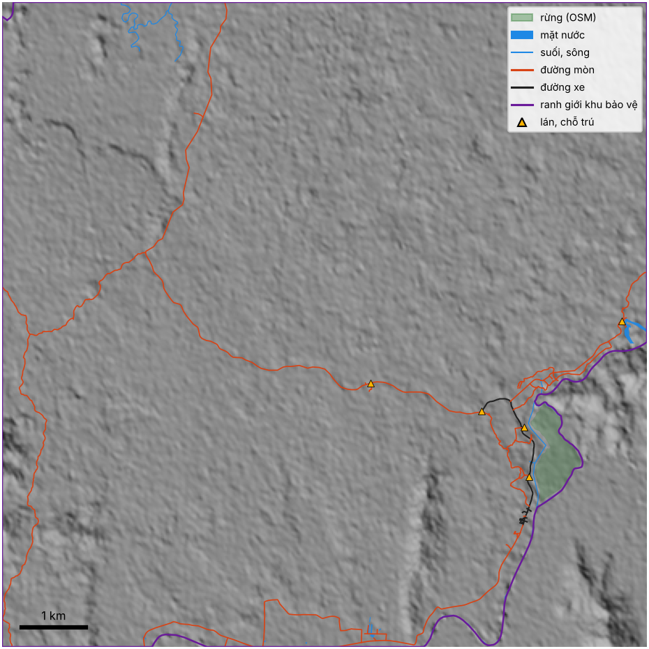
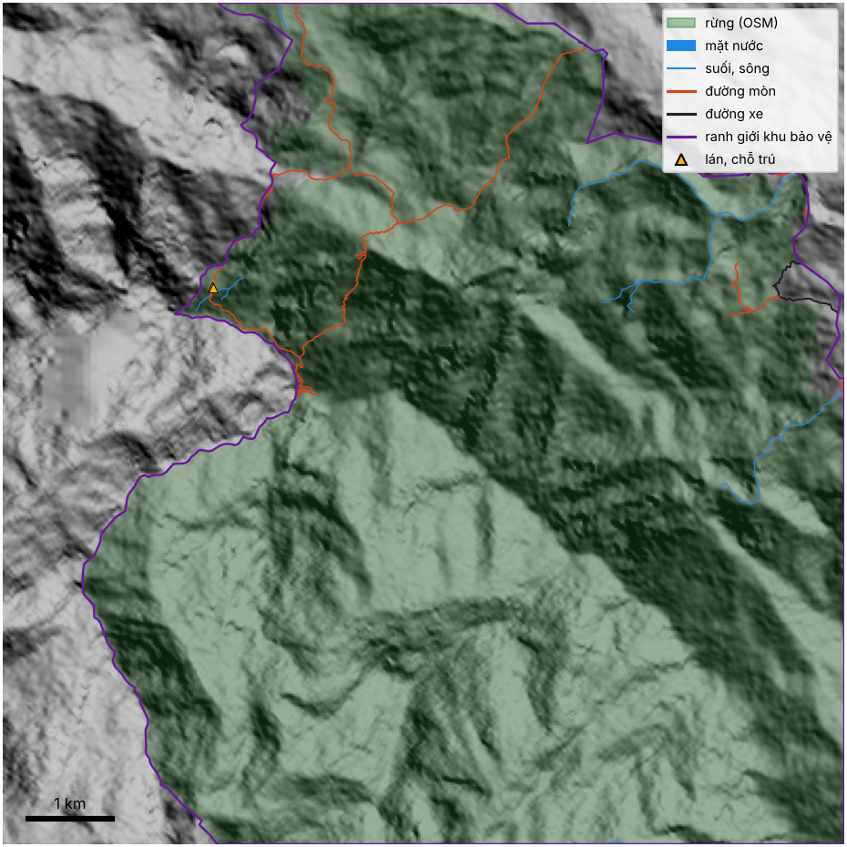

# J1 · Bối cảnh bài toán, phiên bản rừng và khu bảo tồn (v2)

Bắt đầu lại từ bước bối cảnh theo yêu cầu ở chatlog mục 408: kịch bản chuyển từ đô thị sang vùng thiếu kết nối như rừng quốc gia, khu
bảo tồn. Phiên bản đô thị được đóng gói ở [archive/urban-v1](archive/urban-v1/README.md). File này chốt dần qua thảo luận như lần
trước; mỗi ý ghi trạng thái **chốt**, **đề xuất** hoặc **mở**. Nhãn nguồn: [repo] lấy từ tài liệu trong repo, [web] tra trên internet,
[chung] kiến thức chung chưa đối chiếu nguồn.

## 1. Vì sao đổi kịch bản

Lập luận của bản đô thị có mấy chỗ phản biện dễ hỏi (urban-v1 mục 12, 15):
- Đô thị có sẵn mạng di động và Internet, nên phải giải thích dài vì sao node không gửi qua 4G.
- Ảnh camera trong khu dân cư vướng quyền riêng tư; phải dựng mạng dùng chung kiểu Sidewalk mới có chủ vận hành.
- Nhà cao tầng làm kênh A2G khó mô hình; vùng cấm bay và giấy phép bay trên khu đông người là rào cản lớn.

Ở rừng quốc gia và khu bảo tồn, mấy chỗ này nhẹ đi:
- Lõi rừng thường không có sóng di động, nên LoRa và UAV là đường liên lạc thực tế duy nhất [chung].
- Thiết bị do ban quản lý rừng sở hữu và vận hành; ảnh chủ yếu là động vật, người đi rừng và người xâm nhập [chung].
- Không có nhà cao tầng, ít nhiễu 2,4 GHz, bay ngoài tầm nhìn trên vùng ít người dễ được cấp phép hơn [chung].
- Đã có triển khai thật để dẫn chứng [repo, urban-v1 CONTEXT mục 7–8]:
  - Dryad Silvanet: cảm biến cháy rừng nối mesh, khoảng 1 node mỗi ha;
  - 65 camera bẫy ảnh 4G chạy pin mặt trời trên 34 km² (Kissling 2024);
  - camera bẫy ảnh thông minh gửi qua LoRa rồi Iridium (Gabon);
  - GreenOrbs, mạng TelosB tới 330 node trong rừng (Liu 2013).
- Bản ICC và bản đồ tổng hợp C4 vốn được mô tả là "rừng, camera và cảm biến" [repo, urban-v1 CONTEXT mục 8], nên các kết quả kỹ thuật
  đã có (T\*, River, cân tải, takeover, K9) dùng lại được.

## 2. Mang sang từ phiên bản trước (đề xuất giữ)

- Cơ chế: UAV cánh bằng phát truy vấn một lượt; mạng mặt đất chuyển phần còn thiếu theo kế hoạch tính trước (River, cân tải, cây
  dùng chung); takeover khi UAV lệch đường.
- Cấu trúc ba pha và ba bài toán (P0) chọn AI cell, (P1) pha 1, (P2) pha 2 xác minh (urban-v1 PROBLEMS); mục tiêu phân vị 0,9 của T\*.
- Lý thuyết: Định lý 1 (NP-khó), Định lý 2 (chặn phủ cho cách không hợp tác), chặn một radio cho lớp mặt đất.
- Một UAV ở pha 1; nhiều UAV để sau, khi có cơ chế phối hợp thật.

## 3. Lỗ hổng mới của kịch bản rừng (mở)

1. **Mật độ.** Triển khai thật trong rừng chỉ khoảng 0,01–100 node/km² (camera bẫy ảnh 0,01–1, ô nghiên cứu ForestGEO khoảng 50,
   Dryad 100–120), trong khi bài đang dùng khoảng 820 node/km² [repo, urban-v1 CONTEXT mục 8]. Đây là chỗ phản biện sẽ hỏi đầu tiên.
2. **Kênh qua tán rừng.** Sóng 2,4 GHz suy hao mạnh qua lá và thân cây, cả A2G lẫn G2G [chung, cần nguồn]. Đã có trong repo: tầm A2G
   802.15.4 thực tế khi UAV di chuyển chỉ còn khoảng 1/3 tầm danh định (Bacco 2018), độ cao tốt nhất khoảng 45 m (Nekrasov 2019)
   [repo, `research_notes/literature/2026-11-12/06-deployment.md`].
3. **Năng lượng.** Không có điện lưới; mọi node chạy pin hoặc pin mặt trời. Node phải ngủ phần lớn thời gian, nên đánh thức, ngân
   sách năng lượng cho luồng nền và cho River thành ràng buộc chính. Bản đô thị coi phần lớn node cắm điện.
4. **Loại nhiệm vụ và nội dung truy vấn.** Tìm người đi lạc, phát hiện người săn trộm, nhận dạng một cá thể động vật, hay việc khác.
   Mỗi loại cho truy vấn, dữ liệu nền và tiên nghiệm vị trí khác nhau.
5. **Địa hình.** Đồi núi làm khuất tầm nhìn, UAV phải bay theo độ cao địa hình, cell ở sườn khuất nhận kém.
6. **Quy mô vùng.** Vườn quốc gia thường rộng vài trăm km² [chung], trong khi một chuyến bay ước làm được khoảng 50 cụm, khoảng
   100 km² nếu cụm giống bản đồ k8 [repo, urban-v1 CONTEXT mục 7].
7. **Trạm gốc.** Trạm kiểm lâm ở bìa rừng; quãng bay tới vùng nhiệm vụ dài hơn bản đô thị.

## 4. Câu hỏi cần quyết trước

| Mã | Câu hỏi | Trạng thái |
|---|---|---|
| a | Nhiệm vụ điển hình: tìm người mất tích (chatlog mục 409) | chốt |
| b | Thiết bị và mật độ: camera bẫy ảnh thưa cộng cảm biến dày hơn dọc tuyến (đường mòn, suối, ranh giới), hay rải đều; mức mật độ mục tiêu. Hướng đã chốt (mục 409): mật độ hiện nay chưa đạt nhưng hợp lý trong tương lai, bài vẫn khảo sát và báo số thật (mục 5) | mở một phần |
| c | Băng tần mặt đất: giữ 802.15.4 2,4 GHz (cell nhỏ, cần mạng dày) hay chuyển sub-GHz (cell lớn, mạng thưa được). Đã trả lời ở dòng g | chốt |
| d | Vùng mẫu: khu thật nào để cắt bản đồ (ranh giới vườn quốc gia, đường mòn, suối, địa hình) | mở |
| e | Giữ cơ chế và cấu trúc ba pha như mục 2 | đề xuất |
| f | Kịch bản chính: rừng đất thấp (kiểu Cát Tiên); vườn núi là trường hợp khó cho phần độ nhạy hoặc mở rộng (mục 6, chatlog mục 411) | chốt |
| g | Băng tần mặt đất: giữ 802.15.4 2,4 GHz (chatlog mục 410) | chốt |

## 5. Mật độ thiết bị hiện có ở rừng và khu bảo tồn (2026-11-26, mục 409)

Mật độ do tôi chia số thiết bị cho diện tích nêu trong nguồn. Số [web] lấy từ đoạn trích tìm kiếm, chưa đọc toàn văn.

| Triển khai | Loại thiết bị, kết nối | Số thiết bị, diện tích | Mật độ (thiết bị/km²) | Nguồn |
|---|---|---|---|---|
| Dryad Silvanet, thí điểm Lebanon | cảm biến khí cháy, mesh LoRa, 2 gateway | 91 trên 78 ha | khoảng 117 | [repo] urban-v1 CONTEXT mục 7; [web] eenewseurope |
| Dryad Silvanet, Marsden Moor (Anh, 2024) | như trên | 50 trên khoảng 2 500 ha | khoảng 2 | [web] dryad.net, rcrwireless |
| Dryad, tổng | như trên | hơn 30 000 cảm biến ở khoảng 100 điểm (trung bình khoảng 300 mỗi điểm); điểm thí điểm tối thiểu 1 000 ha | — | [web] ITU EW4All, dryad.net |
| Camera 4G, Natura 2000 Hà Lan (Kissling 2024) | camera bẫy ảnh, 4G, pin mặt trời | 65 trên 34 km² | khoảng 1,9 | [repo] `kissling2024-wildcam` |
| VQG Pù Mát | camera bẫy ảnh, không nối mạng | 152 camera ở 5 điểm, vườn hơn 900 km² | khoảng 0,17 trên cả vườn | [web] Saola Working Group 2019 |
| KBT Pù Hoạt | camera bẫy ảnh | 45 trạm trên khoảng 350 km² | khoảng 0,13 | [web] đoạn trích tìm kiếm, chưa xác định bài gốc |
| VQG Bạch Mã, KBT Sao La, Xe Sap | camera bẫy ảnh | 138 trạm lưới thô ở 5 khu (53 ở Bạch Mã) | chưa tính (thiếu diện tích khảo sát) | [web] |
| TrailGuard AI (Grumeti, Tanzania) | camera AI chống săn trộm, 3G rồi LoRa và vệ tinh | bắt đầu với 6 thiết bị | rất thấp | [web] Smithsonian, Mongabay |
| Rainforest Connection Guardian | cảm biến âm thanh, phát hiện tiếng súng, cưa, xe | tầm nghe 50–1 500 m; không có số mật độ | — | [web] rfcx.org |
| ALERTCalifornia | camera PTZ phát hiện cháy trên tháp | khoảng 1 300 camera trên cả bang (khoảng 424 000 km²) | khoảng 1 trên 330 km² (dày hơn ở vùng nguy cơ cao) | [web] PetaPixel 2026, UCSD |
| GreenOrbs | TelosB 802.15.4, mesh nhiều chặng | tới 330 node, không ghi diện tích | — | [repo] `liu2013-greenorbs` |

Nhận xét:
- Trên toàn vườn, các mạng đang chạy thật chỉ có khoảng 0,003–2 thiết bị mỗi km². Mức trên 100 chỉ gặp ở ô thí điểm nhỏ (Dryad
  Lebanon, 78 ha). Bài đang dùng khoảng 820, cao hơn mức toàn vườn hàng trăm tới hàng trăm nghìn lần.
- Các mạng thưa này đều không dùng mesh 2,4 GHz. Chúng nối thẳng bằng 4G, LoRa hay vệ tinh, hoặc không nối mạng (camera bẫy ảnh thu thẻ
  nhớ theo đợt). Riêng Dryad dùng mesh sub-GHz. GreenOrbs là mesh 802.15.4 duy nhất trong rừng mà repo có số liệu.
- Ở bản đô thị, lưới cell R = 100 m dùng 802.15.4 chỉ còn liền khi các node cách nhau không quá khoảng 50–60 m, tức khoảng 300 node/km²
  trở lên (urban-v1 CONTEXT mục 10). Trong rừng, suy hao qua tán lá làm con số này còn cao hơn. Ở mật độ hiện nay, hợp tác mặt đất qua
  802.15.4 vì vậy không chạy được. Bài cần chọn một trong hai: lấy mật độ hướng tới tương lai làm giả định chính và nói rõ đó là giả
  định, hoặc chuyển lớp mặt đất sang sub-GHz.
- Lý lẽ cho mật độ tương lai: Dryad đã giao hơn 30 000 cảm biến và đặt quy mô thí điểm tối thiểu 1 000 ha; giá node giảm; nhiều mạng
  khác nhau (cảm biến cháy, camera, âm thanh) có thể dùng chung một lớp mesh. Đây là suy luận, chưa có nguồn nói thẳng xu hướng mật độ.

Tần suất tìm kiếm cứu nạn [web]: các khu do Cục Vườn quốc gia Hoa Kỳ (NPS) quản lý có 2 890 vụ tìm kiếm cứu nạn năm 2017 (159 người
chết). Trung bình giai đoạn 1992–2007 là 11,2 vụ mỗi ngày (bài "Dead men walking: search and rescue in US National Parks", Wilderness & Environmental Medicine 2009, theo đoạn trích). Grand Canyon
có 785 vụ trong ba năm 2018–2020, Yosemite 732 (phân tích của Outforia, không phải số chính thức). Chưa có số cho Việt Nam.

## 6. Địa hình của tám khu mẫu (2026-11-26, mục 410)

Băng tần mặt đất giữ 802.15.4 2,4 GHz (chốt, mục 410). Tám khu, mỗi khu một cửa sổ 10 × 10 km cỡ một chuyến bay, bảng đầy đủ ở
[maps-forest/INDEX.md](maps-forest/INDEX.md), script `analysis/osm_park.py`, log `logs/2026-11-26_1500-park-maps/` [mới tính].

| Khu | Địa hình | Độ cao (m) | Dốc trung vị | Diện tích dốc > 30° | Chênh cao trong 100 m quanh tâm cell (trung vị / p90) | Cell sát đường mòn hoặc đường xe |
|---|---|---|---|---|---|---|
| Cát Tiên | rừng đất thấp | 83–247 | 4° | 0 % | 14 / 26 m | 8 % |
| Bayerischer Wald | núi thấp thoải | 764–1 440 | 10° | 0 % | 44 / 79 m | 44 % |
| Cúc Phương | karst | 20–600 | 23° | 27 % | 92 / 140 m | 8 % |
| Yosemite | granit, thung lũng sâu | 1 203–2 766 | 20° | 29 % | 91 / 295 m | 27 % |
| Bạch Mã | núi ven biển | 32–1 455 | 28° | 40 % | 126 / 185 m | 4 % |
| Great Smoky Mountains | núi rừng | 730–2 025 | 29° | 42 % | 118 / 157 m | 19 % |
| Kinabalu | núi cao | 1 002–4 057 | 31° | 52 % | 152 / 296 m | 4 % |
| Hoàng Liên | núi cao | 1 180–3 117 | 32° | 58 % | 156 / 227 m | 5 % |

*Hình 6.1. Cửa sổ 10 × 10 km ở VQG Cát Tiên: địa hình phẳng, vài tuyến đường mòn dài; bóng đổ chủ yếu là nhiễu tán rừng.*

*Hình 6.2. Cửa sổ 10 × 10 km ở VQG Hoàng Liên: chênh cao gần 2 000 m trong cửa sổ, hơn một nửa diện tích dốc trên 30°.*

Nhận xét:
- Tám khu chia rõ hai nhóm. Nhóm phẳng hoặc thoải (Cát Tiên, Bayerischer Wald) có chênh cao trong một cell dưới 50 m, gần với giả định
  mặt đất phẳng của mô hình hiện tại. Nhóm núi (sáu khu còn lại) có chênh cao trong bán kính 100 m quanh tâm cell khoảng 90–160 m
  (trung vị), tới gần 300 m ở phân vị 90. Con số này ngang hoặc lớn hơn độ cao bay 100 m so với mặt đất.
- Ở nhóm núi, UAV không bay ở một độ cao cố định được mà phải bám địa hình; sườn núi chắn tầm nhìn từ UAV xuống các node ở thung lũng
  và sườn khuất; các node trong cùng một cell lệch nhau hàng trăm mét độ cao, nên kênh G2G trong cell cũng bị sườn chắn. Mô hình kênh
  hiện tại (khoảng cách ngang, không có địa hình) không mô tả được các hiệu ứng này.
- Đường mòn và đường xe chỉ phủ 4–8 % số cell ở các vườn Việt Nam và Kinabalu, 19–44 % ở các vườn Mỹ và Đức. Đặt mạng dày dọc tuyến
  thì ở Việt Nam mạng sẽ là các dải hẹp, có thể đứt; OSM thiếu đường mòn nên con số thật có thể cao hơn. Người đi lạc lại thường rời
  khỏi đường mòn [chung, cần nguồn từ Koester], nên mạng chỉ dọc tuyến chưa chắc phủ được nơi người đó ở.
- Chốt (mục 411): kịch bản chính đặt ở rừng đất thấp hoặc đồi thoải (kiểu Cát Tiên, Bayerischer Wald), giữ được mô hình mặt đất phẳng và
  chỉ thêm suy hao qua tán rừng; vườn núi (kiểu Hoàng Liên, Bạch Mã) là trường hợp khó, đưa vào phần độ nhạy hoặc mở rộng có che khuất
  địa hình.

## 7. Các khía cạnh tiếp theo cho kịch bản rừng đất thấp (2026-11-26, mục 411, đề xuất để bàn)

1. **Kênh A2G qua tán rừng.** Bốn chế độ kênh của bản ICC (suy hao môi trường 0 / 9 / 20 / 26 dB, R50 = 1 016 / 498 / 199 / 99 m) đã
   được đối chiếu với mô hình tán lá Weissberger ở 2,4 GHz: 9 / 20 / 26 dB ứng với 17 / 66 / 103 m đường đi ngang qua cây; tán dày 10 m
   nhìn xiên cho khoảng 8 dB ở góc ngẩng 45°, 17 dB ở 11°, 26 dB ở 6° [repo, `research_notes/literature/2026-11-12/04-a2g-channel.md`
   mục 1.8]. Bốn chế độ vì vậy hợp với rừng hơn hợp với đô thị. Đề xuất giữ nguyên, ghi rõ Weissberger vốn đo cho đường ngang nên áp cho
   đường xiên là ngoại suy; có bộ dữ liệu 802.15.4 2,4 GHz từ UAV của Nekrasov và cộng sự trên Dryad để hiệu chỉnh sau [repo].
2. **Kênh G2G dưới tán.** Mô hình hiện tại là 3GPP UMi NLoS (mô hình phố đô thị). Dưới tán, cả đường truyền đi qua cây: theo Weissberger
   thêm khoảng 12,6 dB ở 30 m, 17 dB ở 50 m, 26 dB ở 100 m [tính]. Cần một mô hình đo cho node đặt sát đất trong rừng; repo chưa có
   nguồn nào [cần tra].
3. **Thiết bị và nguồn điện.** Camera bẫy ảnh (chụp cả người lẫn động vật), cảm biến cháy kiểu Dryad, cảm biến âm thanh; mọi node chạy
   pin, có hoặc không có tấm pin mặt trời (dưới tán, pin mặt trời yếu [chung]). AI node là camera thông minh hoặc gateway đặt ở chỗ
   trống, có tấm pin lớn. Hệ quả: mọi node đều có ngân sách năng lượng, khác bản đô thị nơi phần lớn node cắm điện.
4. **Đánh thức.** Node ngủ phần lớn thời gian; giữ cách của bản đô thị (bản tin LoRa vài byte báo mã nhiệm vụ và giờ cất cánh, node tự
   tính cửa sổ thức) và thêm chi phí năng lượng của việc thức dậy.
5. **Truy vấn và dữ liệu nền.** Truy vấn vẫn là bộ ảnh người mất tích. Camera bẫy ảnh vốn chụp khi có chuyển động; dữ liệu nền gửi về AI
   node là ảnh cắt hoặc vector của người xuất hiện trong ảnh. Lưu lượng người trong rừng thấp hơn đô thị rất nhiều, nên luồng nền nhẹ
   hơn hẳn (K9 ở bản đô thị bị luồng nền chặn).
6. **Tiên nghiệm vị trí.** Bản đô thị chọn tiên nghiệm đều. Tìm kiếm cứu nạn ngoài hoang dã thường có điểm xuất phát đã biết (xe đỗ ở đầu
   tuyến, nơi thấy lần cuối) và phân bố khoảng cách theo loại người đi lạc (Koester) [chung, repo có hai bài Koester về người mất trí].
   Cần quyết: giữ tiên nghiệm đều, hay dùng tiên nghiệm quanh điểm xuất phát.
7. **Trạm gốc.** Trụ sở vườn hoặc trạm kiểm lâm ở bìa rừng, có LoRa gateway và chỗ cất hạ cánh cho VTOL.
8. **Vùng mẫu.** Cửa sổ Cát Tiên đã có. Có thể thêm một rừng đất thấp khác để so (ví dụ rừng nguyên sinh Białowieża ở Ba Lan, phẳng
   và có dữ liệu OSM tốt).

