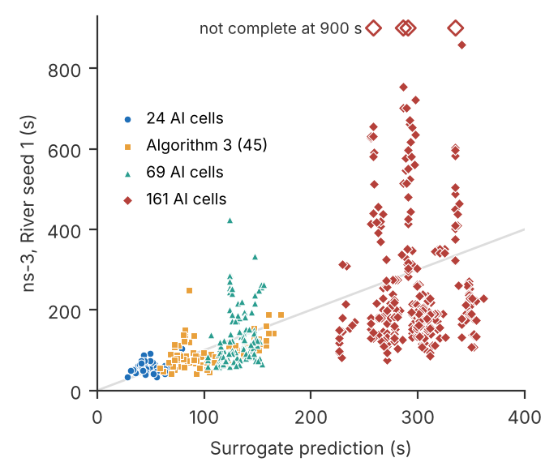
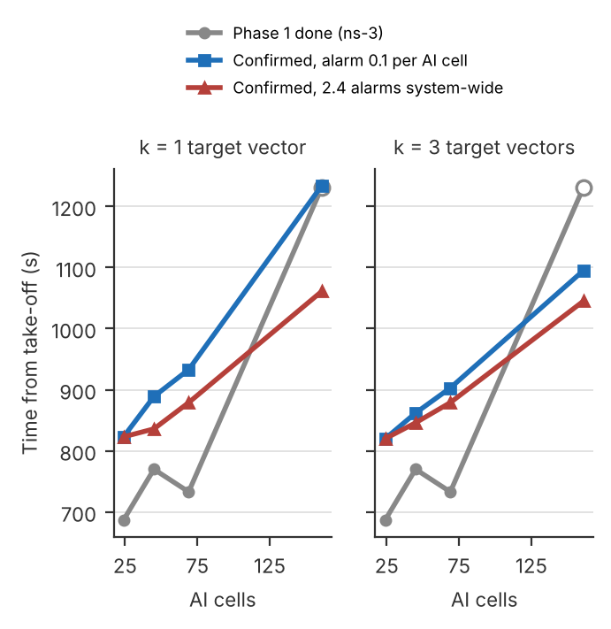

# Báo cáo kỹ thuật K9: đặt AI node và dữ liệu node thường gửi về

Báo cáo này tổng hợp việc K9 trong [PLAN-TRACKS](PLAN-TRACKS-vi.md), làm từ 2026-11-18 tới 2026-11-21 theo kế hoạch
[PLAN-K9-DATA](PLAN-K9-DATA-vi.md) (các bước B0–B8). Số liệu, lệnh và log từng bước nằm ở
[logs/2026-11-18_1036-k9](../../logs/2026-11-18_1036-k9/README.md); phần đưa vào bài là mục VIII-F của
[bản thảo J1](draft-v1/README-vi.md). Mọi số ns-3 ở đây là một seed (runSeed 1) trên bản đồ k8-s1 của chiến dịch C4.

## 1. Kết quả chính

Câu hỏi của K9: node thường (camera không có AI, "legacy" trong bài) gửi gì về AI node trước khi có sự cố, cần bao nhiêu AI
cell và đặt ở đâu, và lựa chọn đó làm tổng thời gian hai pha (pha 1 phát truy vấn, pha 2 xác minh) thay đổi ra sao.

1. Trên 802.15.4 chỉ vector đặc trưng chạy được làm luồng nền. Với 30 % node là camera và luồng nền dùng tối đa 10 % thời gian
   kênh, khung hình (40 KB) chỉ chịu được 0,2–1,9 người/h mỗi camera, ảnh cắt (10 KB) 0,7–7,7 người/h, vector 528 B 13–145 người/h,
   khi số AI cell tăng từ 8 lên 128 (bản đồ k8).
2. Số AI cell cần tăng nhanh theo lưu lượng người. Với vector, ρ = 20 / 50 / 100 / 200 người/h cần 24 / 34 / 69 / 161 AI cell trên
   k8; Algorithm 3 hiện tại chọn 45 cell nhưng chỉ chở được 18 người/h và có node cách AI cell của nó 8 cell. Đặt AI node ở cả 617
   cell thì chịu tối đa 640 người/h, nên phố thương mại (1 500) và giờ cao điểm (3 700) không khả thi.
3. Surrogate River dùng được tới khoảng 75 AI cell. Ns-3 khớp T1 (critical cell cuối xong) trong vòng 41 s ở mọi tập tới 75 cell,
   nhưng sai hẳn ở 161 cell (đo ≥ 1 231 s, mô hình 906 s).
4. Tính cả hai pha ở ρ = 20, tập ít AI cell cho thời gian trung bình ngắn nhất ở cả hai cách đặt ngưỡng báo nhầm: với α = 0,1 mỗi
   cell là 823 s ở 24 cell, 879–889 s ở 39–45 cell, 933–1 008 s ở 69–74 cell. Phân vị 0,9 (mục tiêu mới, chatlog mục 387) thì gần
   như phẳng: 1 102–1 154 s từ 24 tới 74 cell khi giữ báo nhầm cố định cho cả hệ thống, 1 140–1 203 s tới 69 cell khi α = 0,1 mỗi
   cell, rồi xấu đi ở 74 cell (1 425 s) và 161 cell (1 822 s).
5. Phương án lai (mục 375): nếu chỉ 80 % camera có NPU gửi vector, phần còn lại gửi ảnh cắt 5 KB, thì ở ρ = 20 cần 39 AI cell thay
   vì 24; 50 % có NPU thì cần 74. Ns-3 xác nhận T1 của hai tập này (lệch dưới 15 s) và tổng thời gian chậm hơn D3 56 và 185 s.
6. Bậc thiết bị không đổi kết luận với vector: tìm trong kho 80 MB và trích đặc trưng bộ tham chiếu mất dưới 5,5 s, nhỏ so với 78 s
   mỗi lần xác minh. Giữ K = 5 mô hình mỗi AI node chỉ thêm tối đa 6,4 s mỗi lần xác minh trên Pi 5 CPU.

Các quyết định của người dùng trong lúc làm: chỉ tối ưu D3, coi D1 và D2 là kết quả âm (mục 342); pha 2 dùng V1, kết thúc khi V1
xác nhận đúng AI cell (mục 347, 349); so hai cách đặt ngưỡng báo nhầm (mục 360); giữ D3, vector được rời camera để tới AI node
trong mạng, trạm gốc vẫn chỉ nhận điểm số (mục 376); phương án lai là phương án chính (mục 375); ns-3 chạy một seed (mục 348).

## 2. Mô hình dùng chung

### 2.1 Bản đồ, kênh và binary

- Bản đồ k8-s1 của C4: 617 cell, 13 086 node, 8 cụm, khoảng 816 node/km². B1 và B3 chạy thêm k12 và k16 ở mức mô hình.
- Kênh A2G r100 và r200 (R50 khoảng 99 và 199 m, đô thị cao tầng và đô thị dày).
- Ns-3.46 với binary đóng băng CAMP-BIN5 của C4 (deploy, pass, river) và đúng cờ của C4 (`--windowKB 400 --windowAt crit
  --critRing domain --axeNear --kinPass --riverRepair 20`, giới hạn River 900 s). Không cần build lại ns-3 vì tập critical cell
  được đưa vào từ phía Python.

### 2.2 Tập critical cell từ file ngoài (B2)

Algorithm 3 chọn critical cell bằng điểm vượt μ + 2σ, nằm ở `river_plan.plan` và một bản sao ở `meander_lane.critical`. K9 thêm
một đường vào khác: file `crit.csv` (các dòng q, r của mọi cụm) trong thư mục nhiệm vụ, nếu có thì thay Algorithm 3 ở cả bốn chỗ
dùng tập này: kế hoạch River (`uav-coop2/tools/river_plan.py`), tour và báo cáo (`uav-l2/tools/mission_report.py`), uốn chord
(`uav-l2/tools/mission.py`) và `meander_lane.py`. Cờ mới `mission.py --crit FILE` chép file vào thư mục một lần và dừng nếu đã có
file khác. Kiểm hồi quy (`paper/j1/analysis/crit_regress.py`): đưa đúng tập của Algorithm 3 vào thì kế hoạch và tour giống từng
byte, 12/12 trường hợp.

### 2.3 Mô hình luồng nền (B1)

`paper/j1/analysis/bg_load.py`. Mỗi node giao cho AI cell gần nhất trong cụm của nó theo số chặng cell (hoà thì theo khoảng cách
tâm); bản ghi đi theo đường cell ngắn nhất qua các cặp gateway. Tải dùng mô hình đã khớp ở `uav-coop2/tools/river_lb.py` trên trace
River (R² 0,89): gói 99 B tốn 1,5 khung ở cell nguồn và đích, 1,7 khung ở cell trung chuyển, 1 khung ở mỗi cặp gateway, mỗi khung
chiếm môi trường 6,5 ms. Mọi tải tuyến tính theo tốc độ byte mỗi camera, nên script tính độ bận mỗi môi trường cho 1 B/s mỗi node
một lần, rồi suy ra

  ρ_max = u_max / (u_đơn vị · f_cam · cỡ bản ghi) · 3 600 (người/h mỗi camera),

với u_max là ngân sách thời gian kênh (10 hoặc 20 %), f_cam là tỉ lệ node là camera (0,1 / 0,3 / 1). Cỡ bản ghi: D1 khung hình 40 KB,
D2 ảnh cắt 10 KB, D3 vector 512 chiều INT8 cộng 16 B là 528 B. Tham số và nguồn ở [K9-PARAMS](K9-PARAMS-vi.md).

### 2.4 Bộ chọn critical cell (B3)

`paper/j1/analysis/cc_select.py`, một bài facility location có sức chứa, giải riêng từng cụm:

- Ràng buộc luồng nền: môi trường bận nhất dưới u_max ở mức ρ đã cho.
- Ràng buộc chặng: không node nào cách AI cell của nó quá H = 5 cell (mục 338).
- Mục tiêu: thời gian River của cụm theo surrogate C4 (công thức, `uav-l2/docs/data/results/river-surrogate.csv`):
  doneS = 0,709 + 2,293 · hops + 1,973 · lackCell / 1 000 + 4,263 · cluLack / 1 000. Mọi biến trừ cluLack chỉ phụ thuộc cell, nên
  T_k(S) = max_{h∈S} (a + b · hops_h + c · lack_h / 1 000) + d · Σ_{h∈S} lack_h / 1 000; thêm critical cell làm cả cụm chậm đi.
- Tìm kiếm: số cell m ít nhất còn khả thi tìm bằng nhân đôi rồi chia đôi, đặt chỗ bằng tìm kiếm cục bộ (khởi đầu k-medoids, đổi một
  cell lấy một cell khác, khi chưa khả thi thì hạ môi trường bận nhất, khả thi rồi thì hạ T_k), thử thêm m + 1 và m + 2. Nếu đặt AI
  node ở mọi cell vẫn không đủ thì báo độ phủ = ngân sách / tải.
- T1 = max_k (leave_k + T_k), leave_k là lúc UAV rời cụm k theo `tour.json`.

Bản đầu tính tải bằng vòng lặp Python và bị dừng ở giới hạn 1 giờ. Bản hiện tại tính sẵn tensor tải C[AI cell, cell, môi trường]
(lớp `Fast`), nhanh hơn 50–100 lần và tự kiểm trùng với `bg_load.Cluster.load`; T_k tính lại từ kế hoạch River thật lệch 0,00 s.

### 2.5 Mô hình pha 2 (B5)

`paper/j1/analysis/b5_phase2.py`, chạy trên thư mục ns-3 của B4 và B8.

- Pha 1 lấy số đo ns-3: AI cell c giữ đủ truy vấn ở leave_k + doneS_c; cell chưa xong ở giới hạn tính là 900 s.
- Pha 2 dùng mô hình V1 của `uav-l2/tools/mission_policy.py`: kết quả qua CH rồi lên trạm gốc theo khe LoRa, đội 2 bay 15 m/s, rời
  trạm ở báo cáo đầu tiên, thăm theo điểm số; mỗi lần xác minh 78 s (5 s ổn định, 73 s gửi bộ tham chiếu 1 MB, CONTEXT mục 17).
- Lớp 1: kho của AI cell c có M_c = ρ · 2 h · 0,3 · n_c vector (n_c là số node giao về c, cửa sổ 2 h theo mục 345). Mỗi AI cell đặt
  ngưỡng riêng t_c = Φ⁻¹((1 − α)^(1/M_c)) để cell chỉ có người lạ báo YES với xác suất α. Điểm số theo mô hình binormal của
  `uav-l2/tools/l1_mission.py` (người lạ N(0, 1), mục tiêu N(4,429; 1,299)), k = 1 hoặc 3 vector của mục tiêu ở AI cell thật.
- Node thấy mục tiêu rút đều trên mọi node; AI cell của nó là AI cell thật. Trạm gốc xếp hạng bằng hậu nghiệm với tiên nghiệm n_c / n.
- T là thời gian từ cất cánh tới lúc V1 xác nhận đúng AI cell, chỉ tính trên các lượt AI cell thật báo YES (cột "thành công").
  300 lượt rút, ghép cặp giữa các tập cùng kênh.
- Hai cách đặt α: mỗi AI cell α = 0,1 (CONTEXT mục 16), hoặc giữ kỳ vọng E lần báo nhầm cho cả hệ thống, α = E / số AI cell.

## 3. Kết quả từng bước

### 3.1 Tham số (B0)

[K9-PARAMS](K9-PARAMS-vi.md): ρ thấp 20, giữa 200, cao 1 500 (Elizabeth Mall, Hobart, khoảng 24 000 người từ 8 h tới nửa đêm), đỉnh
3 700 (32nd Street, Manhattan, 17–18 h); cỡ bản ghi; bốn bậc thiết bị từ MCU tới Jetson; độ chính xác OSNet theo cỡ mô hình
(x1,0: Rank-1 94,8 %, mAP 84,9 %; x0,25: 92,2 % và 77,8 %). Hai số ρ cao lấy từ đoạn trích tìm kiếm, chưa đọc báo cáo gốc.

### 3.2 Chỉ vector chạy được làm luồng nền (B1)

Ngân sách 10 %, 30 % node là camera, AI cell đặt bằng k-medoids (`logs/.../data/b1-k8.md`):

| AI cell | xa nhất (cell) | ρ_max D1 | ρ_max D2 | ρ_max D3 |
|---|---|---|---|---|
| 8 | 12 | 0,18 | 0,71 | 13 |
| 24 | 8 | 0,38 | 1,5 | 29 |
| 47 | 4 | 0,74 | 3,0 | 56 |
| 129 | 2 | 1,9 | 7,7 | 145 |
| Algorithm 3 (45) | 8 | 0,24 | 0,96 | 18 |

Môi trường bận nhất là cell của chính AI node. Algorithm 3 chỉ ngang 16 medoids vì critical cell của nó dồn cục: một AI node nhận
1 269 node. k12 và k16 cùng cỡ. Ở mức ρ khả thi, năng lực tính của AI node không bị chạm (khoảng 2 bản ghi mỗi giây ở AI node bận
nhất khi có 8 AI cell).

### 3.3 Số AI cell cần theo ρ (B3)

Ngân sách 10 %, kênh r100, T1 theo mô hình (s), dạng "số AI cell: T1":

| ρ (người/h) | k8 | k12 | k16 |
|---|---|---|---|
| 20 | 24: 661 | 32: 992 | 49: 1 162 |
| 50 | 34: 674 | 52: 1 005 | 64: 1 168 |
| 100 | 69: 728 | 98: 1 061 | 123: 1 235 |
| 200 | 161: 906 | 220: 1 147 | 275: 1 362 |
| Algorithm 3 | 45: 753 | 66: 1 021 | 92: 1 232 |

- Ngân sách 20 % tương đương chia đôi ρ. Kênh r200 cho cùng số cell, T1 thấp hơn 7–30 s.
- Algorithm 3 vi phạm giới hạn 5 chặng trên cả ba bản đồ và không chở nổi luồng nền ở các mức ρ này, nên so T1 với nó chưa công
  bằng cho tập mới.
- Mỗi lượt k8 chạy 185–252 s.

### 3.4 Surrogate khớp ns-3 tới khoảng 75 AI cell (B4 và B8)

`paper/j1/analysis/b4_run.sh` chạy pha 1 trong ns-3 trên bản sao hình học C4 với `--crit`; `b4_compare.py` so doneS từng critical
cell với surrogate. B4 chạy 8 cấu hình trong 2 giờ 20 phút (4 job song song), B8 thêm 4 cấu hình trong 48 phút.

| kênh | tập | AI cell | T1 ns-3 (s) | T1 mô hình (s) | MAE từng cell (s) |
|---|---|---|---|---|---|
| r100 | ρ = 20 | 24 | 687 | 661 | 14 |
| r100 | lai F = 0,8 | 39 | 689 | 674 | 20 |
| r100 | Algorithm 3 | 45 | 770 | 753 | 31 |
| r100 | ρ = 100 | 69 | 733 | 728 | 44 |
| r100 | lai F = 0,5 | 74 | 733 | 728 | 52 |
| r100 | ρ = 200 | 161 | ≥ 1 231 | 906 | 143 |
| r200 | ρ = 20 | 24 | 658 | 654 | 15 |
| r200 | lai F = 0,8 | 39 | 658 | 665 | 20 |
| r200 | Algorithm 3 | 45 | 743 | 740 | 27 |
| r200 | ρ = 100 | 70 | 755 | 714 | 59 |
| r200 | lai F = 0,5 | 75 | 712 | 714 | 60 |
| r200 | ρ = 200 | 161 | ≥ 1 231 | 876 | 132 |

*Hình 1. Mỗi điểm là một AI cell (hai kênh, một seed); điểm rỗng ở trên cùng là cell chưa xong khi River dừng ở 900 s. Tới 70 cell
các điểm bám đường chéo; ở 161 cell ns-3 trải từ 75 tới trên 900 s trong khi mô hình đoán gần như một số cho cả cụm.*

- Ở ρ = 200, cụm 7 và 8 của mỗi kênh còn một cell chưa xong ở 900 s, nên T1 đo là cận dưới (leave của cụm 8 là 331 s).
- Mô hình đoán T_k thấp hơn đo ở mọi cấu hình, phần lớn do cụm 7 và 8 (ví dụ Algorithm 3 r100, cụm 8: mô hình 91 s, đo 248 s).
  Số đo cụm 8 trùng từng số với dữ liệu đã dùng để khớp surrogate, còn cụm 2 thì không (dữ liệu khớp 147–300 s, B4 99–188 s, cùng
  tập Algorithm 3); dữ liệu khớp đến từ thư mục FIX với CAMP-BIN4. Nguyên nhân chưa rõ, một seed chưa tách được sai số mô hình khỏi
  biến động theo lần chạy.
- Thứ tự các tập theo mô hình khớp ns-3 trừ một chỗ: ở r200, tập 70 cell xong sau Algorithm 3 12 s trong khi mô hình đoán trước 26 s.

### 3.5 Tổng hai pha: ít AI cell nhanh hơn ở giá trị trung bình (B5, B6)

ρ = 20, k = 1, T và phân vị 0,9 tính trên các lượt thành công, kênh r100:

| tập | AI cell | α = 0,1 mỗi cell: T / p90 / thành công | 2,4 lần báo nhầm cả hệ thống: T / p90 / thành công |
|---|---|---|---|
| ρ = 20 (D3) | 24 | 823 / 1 140 / 0,63 | 823 / 1 140 / 0,63 |
| lai F = 0,8 | 39 | 879 / 1 203 / 0,64 | 843 / 1 140 / 0,60 |
| Algorithm 3 | 45 | 889 / 1 203 / 0,66 | 836 / 1 102 / 0,58 |
| ρ = 100 (D3) | 69 | 933 / 1 190 / 0,69 | 879 / 1 154 / 0,59 |
| lai F = 0,5 | 74 | 1 008 / 1 425 / 0,69 | 905 / 1 146 / 0,58 |
| ρ = 200 (D3) | 161 | 1 234 / 1 822 / 0,71 | 1 061 / 1 348 / 0,58 |

*Hình 2. Thời gian từ cất cánh tới khi xác nhận đúng AI cell theo số AI cell, ρ = 20, r100, hai cách đặt ngưỡng; đường xám là lúc
pha 1 xong (điểm rỗng là cận dưới). Chưa có hai tập lai.*

- Với α = 0,1 mỗi cell, số cell báo YES tăng từ 2,8 (24 cell) lên 16,5 (161 cell) và số lần thăm từ 1,8 lên 3,6; pha 2 cộng thêm
  khoảng 120–200 s sau T1 (ở tập 161 cell, T1 đo chỉ là cận dưới).
- Giữ 2,4 lần báo nhầm cho cả hệ thống thì mọi tập chỉ còn khoảng 3 cell báo YES, khoảng cách T hẹp lại nhưng thứ tự giữ nguyên.
  Tỉ lệ thành công đổi chiều: tập ít cell có ngưỡng mỗi cell thấp hơn nên bắt mục tiêu tốt hơn (0,63 so với 0,58). Với E = 1 mọi tập
  còn 0,52–0,55.
- Kho lớn ít làm mất mục tiêu: kho 12 780 vector bắt được 0,63, kho 1 368 vector 0,71 (k = 1), vì ngưỡng chỉ tăng theo log cỡ kho.
  Với k = 3 vector mục tiêu, thành công lên 0,93–0,97 ở mọi tập.
- Phân vị 0,9 gần như phẳng từ 24 tới 74 cell ở cách hệ thống (1 102–1 154 s); ở cách mỗi cell nó phẳng tới 69 cell (1 140–1 203 s)
  rồi lên 1 425 s ở 74 cell. Lợi thế của tập ít cell nằm chủ yếu ở giá trị trung bình. Mục tiêu đã chốt là phân vị 0,9 (mục 387), nên phải đo lại với nhiều lượt và nhiều seed
  trước khi kết luận về tập tối ưu.
- Khoảng cách từ node thấy mục tiêu tới AI cell của nó trung bình 2,5 cell (tối đa 5) ở tập 24 cell và 1,0 cell (tối đa 4) ở tập 161
  cell. B5 cho V1 xác minh tại AI cell; nếu cần ảnh gốc ở node thường (mục 348) thì phải cộng thêm thời gian chuyển ảnh.

### 3.6 Độ nhạy: ρ cao, mật độ, bậc thiết bị (B6)

- ρ cao (`cc_select.py` với ρ = 400–3 700, 289 s): ρ = 400 cần 344 AI cell; từ ρ = 800 đặt AI node ở cả 617 cell vẫn không đủ. ρ lớn
  nhất là 640 người/h ở ngân sách 10 % và 1 275 ở 20 %.
- Mật độ (`b6_sens.py`): mọi tải và cỡ kho tuyến tính theo ρ × f_cam × mật độ, nên một tập chọn ở 816 node/km² cho ρ chở được ρ ×
  816 / 400 ở 400 node/km² và ρ × 816 / 280 ở 280 node/km² (tập ρ = 20 / 100 / 200 thành 41 / 204 / 408 và 58 / 291 / 583). Kiểm bằng
  cách lọc ngẫu nhiên node từng cell: khớp tới 1–2 % với 24 cell, nhưng tải thật cao hơn tới 23 % với 161 cell ở 280 node/km². Thời
  gian River ở mật độ thấp cần bản đồ ns-3 của K10.
- Bậc thiết bị: camera trích đặc trưng mỗi người đi qua bận 1,5 % ở ρ = 200 và 28 % ở ρ = 3 700 với ESP32-S3 (trường hợp xấu nhất),
  dưới 10 % ở các bậc khác. AI node tìm trong kho lớn nhất (152 280 vector, 80 MB) cộng trích bộ tham chiếu mất dưới 1 s ở lượt đầu
  và dưới 5,5 s khi xác minh. Chỉ MCU làm AI node mới cần thẻ nhớ cho kho lớn.

### 3.7 Phương án lai cần nhiều AI cell hơn (B8)

`cc_select.py --npu F --vec 532 --crop 5000`: F là tỉ lệ camera có NPU, rải đều nên mỗi môi trường chở tải kỳ vọng với bản ghi trung
bình F · 532 + (1 − F) · 5 000 B. Ngân sách 10 %, r100, số AI cell cần:

| phương án | ρ = 20 | ρ = 50 | ρ = 100 | ρ = 200 |
|---|---|---|---|---|
| D3, mọi camera gửi vector | 24 | 34 | 69 | 161 |
| lai F = 0,8 | 39 | 94 | 212 | 479 |
| lai F = 0,5 | 74 | 198 | 454 | không đủ (0,61) |
| lai F = 0,2 | 114 | 334 | không đủ (0,82) | không đủ (0,41) |
| chỉ ảnh cắt 5 KB | 140 | 414 | không đủ (0,68) | không đủ (0,34) |

- Số trong ngoặc là độ phủ khi đặt AI node ở mọi cell. Ngân sách 20 % gần như chia đôi số cell cần.
- Độ nhạy ở F = 0,5, ρ = 20: ảnh cắt 15 KB cần 237 cell; vector 2 048 chiều fp16 (4,1 KB) cần 122, gần bằng chỉ ảnh cắt.
- Ns-3 cho F = 0,8 và 0,5 ở ρ = 20 (39 và 74–75 cell, hai kênh): T1 lệch mô hình dưới 15 s (bảng ở mục 3.4); tổng hai pha 879 và
  1 008 s (α = 0,1 mỗi cell), chậm hơn D3 56 và 185 s; 843 và 905 s khi giữ 2,4 lần báo nhầm cho cả hệ thống.
- K mô hình mỗi AI node: AI node trích đặc trưng L ảnh truy vấn bằng từng mô hình. K = 5 thêm 0,95 s ở lượt đầu (L = 3) và 6,4 s mỗi
  lần xác minh (L = 20) trên Pi 5 CPU, dưới 0,4 s với Hailo-8L.

## 4. Giới hạn và việc còn mở

1. Mọi số ns-3 là một seed. Kết quả cụm 7 và 8 lệch lớn mà chưa rõ nguyên nhân; muốn đưa vào bài phải chạy thêm seed (TODO đỏ trong
   mục VIII-F).
2. Surrogate chỉ đúng tới khoảng 75 AI cell. Các tập lớn hơn (ρ ≥ 200 với D3, ρ ≥ 50 với F ≤ 0,5) cần khớp lại surrogate trên dữ liệu
   B4 và B8 (tới 20 cell mỗi cụm) hoặc chạy ns-3 trực tiếp.
3. Mục tiêu đã chốt là phân vị 0,9 của T\* (mục 387), còn K9 chọn tập theo T1 trung bình của mô hình và báo T trung bình. Ở phân vị
   0,9 các tập tới 75 cell gần như ngang nhau, nên cần đưa phân vị vào hàm mục tiêu của `cc_select.py` và tăng số lượt rút.
4. B5 rút node thấy mục tiêu đều trên mọi node và có điểm thấy cuối không xác định, khớp với quyết định tiên nghiệm đều (mục 384).
   Nếu sau này có tiên nghiệm vị trí (ví dụ hai bài Koester: trung vị 0,8 km quanh điểm thấy cuối) thì tập AI cell nên dồn về vùng đó.
5. Phần ảnh cắt của phương án lai được AI node trích bằng mô hình đầy đủ, có thể chính xác hơn vector của mô hình nhẹ; B8 chưa tính
   khác biệt này. Độ chính xác của vector mô hình nhẹ cũng dùng chung mô hình binormal của ResNet-50.
6. Node pin (11–22 % số node, CONTEXT-SUMMARY) không chuyển tiếp và không làm AI node; mô hình tải của K9 vẫn coi mọi node như nhau.
7. Trường hợp nghi vấn nằm ở node thường mà V1 cần ảnh gốc (mục 348) mới ghi chú ở K13, chưa vào mô hình.
8. Thời gian River ở 400 và 280 node/km² cần bản đồ ns-3 của K10.

## 5. Tệp và lệnh để tái lập

| Bước | Script | Lệnh và log | Đầu ra |
|---|---|---|---|
| B2 | `uav-coop2/tools/river_plan.py`, `uav-l2/tools/{mission,mission_report,meander_lane}.py`, `paper/j1/analysis/crit_regress.py` | `b2-regress.md` | kiểm hồi quy 12/12 |
| B1 | `paper/j1/analysis/bg_load.py` | `b1-bg-load-k{8,12,16}.md` | `data/b1-k*.{md,csv}` |
| B3 | `paper/j1/analysis/cc_select.py` | `b3-cc-select-*.md` | `data/cc-*.{md,csv}`, `data/crit-*.csv` |
| B4 | `paper/j1/analysis/b4_run.sh`, `b4_compare.py` | `b4-seed1.md`, `b4-compare-seed1.md` | `data/b4-seed1.{md,csv}`, `data/b4-seed1-raw/` |
| B5, B6 | `paper/j1/analysis/b5_phase2.py` (`--fa`), `b6_sens.py` | `b5-phase2-seed1.md`, `b6-fa-*.md`, `b6-high-rho.md`, `b6-density-devices.md` | `data/b5-seed1.*`, `data/b6-*` |
| B8 | `cc_select.py --npu`, `paper/j1/analysis/b8_summary.py`, `b4_run.sh` | `b8-cc-*.md`, `b8-summary.md`, `b8-ns3-seed1.md`, `b8-compare-seed1.md`, `b8-phase2-*.md` | `data/b8/`, `data/b8-*` |
| B7 | `paper/j1/draft-v1/analysis/fig_k9.py` | `paper/j1/draft-v1/runs/fig-k9.md` | Hình 8–9 và Bảng VII của bản thảo; bản không chữ ở `paper/j1/figures/` |

Log nằm ở `logs/2026-11-18_1036-k9/`. Các bước ns-3 cần thư mục scratchpad có CAMP-BIN5 và hình học C4, dựng bằng
`logs/2026-10-27_1714-campaign4/child-setup.sh`; thư mục làm việc ns-3 (khoảng 270 MB mỗi lượt B4) không commit, chỉ giữ
`r*-rf-crit.csv`, `tour.json` và `mission.log` của từng cấu hình.
