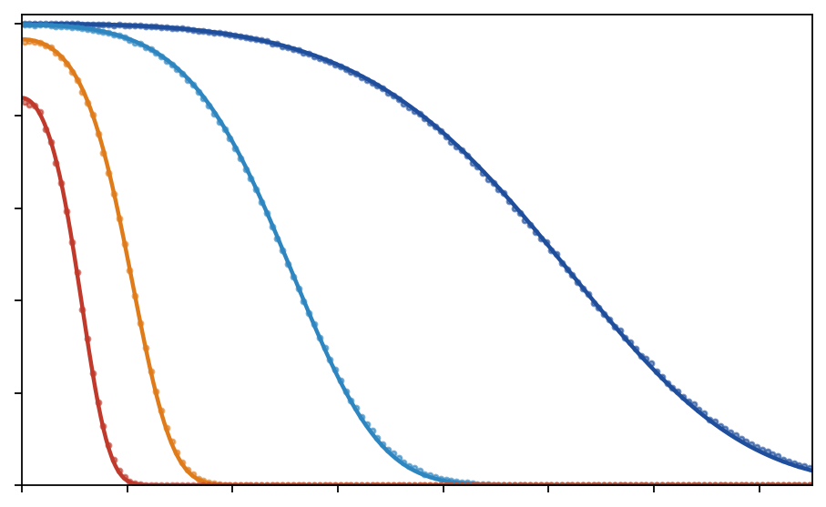
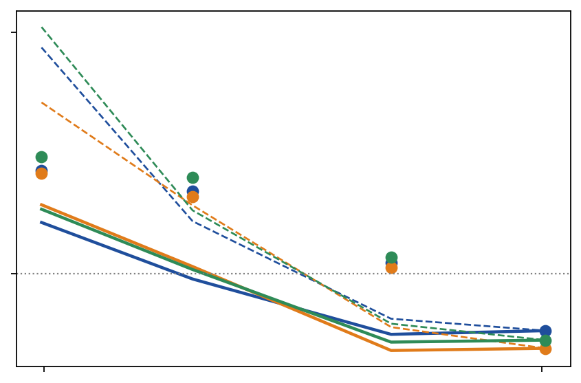

# J1 · Mô hình hệ thống (bản nháp, ND1 tuần 1)

Bản nháp **thử nghiệm** mục **System model** của bài tạp chí J1 (chưa chốt, không thay đổi đề cương; sổ thử nghiệm: `ND1-TRIAL-vi.md`), theo kế hoạch ND1 trong
`research_notes/proposal/SIGDROP-PROPOSAL-vi.md` (mục 7.2 và 9). Đây là kết quả ngày 1 (ký hiệu và giả định); kết quả
kiểm chứng ngày 2–4 ở mục 6. Log: `logs/2026-11-10_1000-nd1-week1/`.

## 1. Mạng và tổ chức pha 0

Mạng gồm N node 802.15.4 đứng yên, chia thành lưới lục giác bán kính R. Gọi G = (V, E) là đồ thị cell:
- mỗi đỉnh v ∈ V là một cell;
- mỗi cạnh e = (u, v) ∈ E là cặp gateway duy nhất giữa hai cell kề, có dung lượng c_e (gói/s).

Mỗi cell có một CL. Các cell được chia thành cụm, mỗi cụm tối đa 80 cell. Mỗi cụm có một CH và một tập critical cell
K_c; gọi K là hợp các K_c qua mọi cụm. Lưới cell, CL, cặp gateway, bảng định tuyến và lịch kênh được dựng ở pha 0 và
coi là cố định trong một nhiệm vụ (giả định A4).

## 2. Truy vấn, quỹ đạo và kênh A2G

**Truy vấn.** Truy vấn gồm Q gói (Q = 4 041 cho 400 KB), chia thành các ảnh không thay thế được cho nhau. UAV phát một
gói mỗi τ = 10 ms. Với fountain code, ảnh j giải được khi cell giữ ít nhất (1 + ε)·K_j gói mã khác nhau; dùng ε = 0,05.

**Quỹ đạo.** γ(t) là quỹ đạo dự kiến, γ′(t) là quỹ đạo thật. Gói s được phát tại γ′(sτ). Độ lệch ngang lớn nhất là

> ē = sup_t ‖γ′(t) − γ(t)‖.

UAV cánh bằng bay ở độ cao H = 100 m, tốc độ trong [v_min, v_max] = [25, 50] m/s, góc nghiêng tối đa 45°. Bán kính
quay tối thiểu vì vậy là v²/g, tức 63,7 m ở 25 m/s.

**Kênh A2G.** Gọi d là khoảng cách ngang từ node tới điểm UAV phát gói, và ℓ = √(d² + H²) là khoảng cách xiên.
- Suy hao theo hai đoạn, neo tại d_ref = 100 m: PL(ℓ) = 40,05 + 20·log₁₀ ℓ khi ℓ ≤ d_ref, và
  PL(ℓ) = 40,05 + 20·log₁₀ d_ref + 10·α·log₁₀(ℓ/d_ref) khi ℓ > d_ref, với α = 3,0.
- Mức môi trường cộng thêm suy hao L, lần lượt 0 / 9,03 / 19,77 / 25,74 dB.
- Công suất trung bình nhận được: P̄(d) = P_tx − PL(ℓ) − L, với P_tx = 10 dBm.
- Fading Rician K = 2, bốc lại mỗi gói. Gói được nhận khi công suất sau fading vượt ngưỡng hiệu dụng S. Do đó

> p(d) = Pr{ g > 10^{(S − P̄(d))/10} },  với 2(K + 1)·g ~ χ′²(2, 2K).

Ngưỡng S là tham số khớp duy nhất, dùng chung cho mọi môi trường: S = −101,04 dBm (mục 6.1). R50 là khoảng cách tại đó
p(d) = 0,5, lần lượt 1 016 / 498 / 199 / 99 m.

**Nhận ở mức cell.** Trong một cell, một gói được tính là có khi ít nhất một node của cell nghe được, vì CL gom gói từ
các node thành viên. Xác suất nhận của cell k khi UAV ở vị trí x là

> P_k(x) = 1 − ∏_{u ∈ k} (1 − p(‖x − u‖)).

## 3. Phân phối và thời gian nhiệm vụ

**River.** Trạm gốc giao cho mỗi SPINE cell a một đoạn gói Seg(a). Các đoạn này phân hoạch các gói phát khi UAV bay qua
cụm. Bank, Ring và các đường cell lập sẵn chuyển dữ liệu tới mọi critical cell. Takeover sửa lỗi khi quỹ đạo thật lệch
khỏi kế hoạch.

**FC + DTSP-N (baseline).** Không có hợp tác giữa các cell. Critical cell được gom thành nhóm. UAV lượn trên một quỹ đạo
tròn quanh tâm mỗi nhóm cho tới khi mọi thành viên đủ gói.

**Thời gian nhiệm vụ.**

> T* = T_bay + T_đất + T_đối sánh + T_LoRa + T_pha 2.

- T_bay: thời gian đội 1 bay hết tour.
- T_đất (thời điểm sẵn sàng): với mỗi cụm, lúc critical cell cuối cùng nhận đủ, tính từ khi UAV rời cụm; lấy trung bình
  qua các cụm.
- Ba thành phần cuối chung cho mọi phương án. Các kết quả của ND1 chỉ so sánh T_bay + T_đất.

## 4. Giả định

| Mã | Giả định | Dùng ở | Trạng thái |
|---|---|---|---|
| A1 | Các lần nhận gói độc lập giữa các gói và giữa các node | A, B, C | Kiểm ngày 2: tương quan nhỏ (mục 6.1); kênh thật sẽ tương quan hơn |
| A2 | Mô hình kênh của mục 2 đúng với kênh mà trạm gốc dùng để lập kế hoạch | A, B | Khớp ns-3 với một tham số; kênh thật lệch mô hình thuộc ND2 |
| A3 | Node đứng yên, không hỏng trong một nhiệm vụ | mọi kết quả | Giả định; node hỏng thuộc ND4 |
| A4 | Pha 0 cố định trong một nhiệm vụ, trạm gốc biết toàn bộ | L1, A, D | Giả định; chi phí pha 0 thuộc ND0 |
| A5 | Mỗi cặp gateway có dung lượng c_e riêng (kênh riêng, không tranh chấp giữa các cặp) | D | Đúng trong mô phỏng hiện tại (đa radio); bản một radio thuộc ND0 |
| A6 | UAV biết vị trí của mình và ghi vào header gói | B, takeover | Giả định thiết kế (GPS) |

## 5. Kết quả lý thuyết dự kiến

Phát biểu dự kiến của L1, A, B, D, C xem mục 7.2 của đề cương. Sau tuần 1, đề xuất (chưa đưa vào đề cương) chỉnh định lý A như sau:
- p_k là **xác suất nhận ở mức cell** P_k, lấy trung bình trên quỹ đạo lượn của nhóm.
- Định lý được phát biểu là một **chặn dưới** cho T_FC, và do đó là một **điều kiện đủ** để River thắng.

## 6. Kiểm chứng tuần 1

### 6.1 Mô hình kênh (ngày 2)

Script: `uav-l2/tools/theory/channel_check.py`. Dữ liệu: các lượt bay hiệu chỉnh ở 4 mức môi trường (cụm 1, bản đồ k8).

| Môi trường | R50 đo (m) | R50 mô hình (m) | RMSE của p(d) |
|---|---|---|---|
| open | 1 016 | 1 013 | 0,003 |
| r500 | 498 | 499 | 0,003 |
| r200 | 199 | 200 | 0,001 |
| r100 | 99 | 100 | 0,001 |

- Một ngưỡng chung S = −101,04 dBm (danh nghĩa −100 dBm) tái hiện p(d) của cả 4 môi trường, sai lệch lớn nhất 0,008.
- **A1:** trên các cặp có xác suất trong [0,3; 0,7]:
  - xác suất nhận gói s + 1 là 0,52–0,54 nếu đã nhận gói s, và 0,46–0,49 nếu đã mất gói s;
  - với hai node cách nhau dưới 20 m, mức chênh tương tự.
  - Chênh lệch khoảng 0,05 này một phần do gộp các cặp có p khác nhau trong cùng khoảng. Fading trong ns-3 được bốc độc
    lập theo từng gói, nên A1 đúng cho mô phỏng. Kênh thật sẽ có tương quan theo thời gian; điều này cần nêu trong bài.

### 6.2 Định lý A (ngày 3–4)

Script: `uav-l2/tools/theory/theorem_a.py`. So với FC + DTSP-N và CHORD + River của chiến dịch C4 (3 bản đồ × 4 kênh).

Cách tính dự đoán:
- Thời gian lượn được tính từ công thức của định lý A trên đúng cách nhóm của baseline: nhóm bán kính 300 m, quỹ đạo tròn
  quanh tâm nhóm.
- Dùng một mốc hiệu chỉnh duy nhất: T_FC đo ở open.
- So hai cách tính p_k: chỉ node CL (đường đứt trong hình), và mức cell (đường liền).

| Bản đồ | Kênh | T_FC đo (s) | T_FC dự đoán, mức cell (s) | Tỉ số T_FC/T_River đo | Tỉ số dự đoán |
|---|---|---|---|---|---|
| k8 | r500 / r200 / r100 | 1 320 / 2 687 / 3 305 | 669 / 1 157 / 2 013 | 1,11 / 2,20 / 2,67 | 0,56 / 0,95 / 1,63 |
| k12 | r500 / r200 / r100 | 2 011 / 4 016 / 5 078 | 913 / 2 074 / 3 764 | 1,06 / 2,08 / 2,61 | 0,48 / 1,07 / 1,93 |
| k16 | r500 / r200 / r100 | 2 563 / 5 567 / 6 808 | 1 134 / 2 302 / 4 138 | 1,17 / 2,51 / 3,05 | 0,52 / 1,04 / 1,85 |

Nhận xét:
- **Bản mức cell là chặn dưới đúng ở cả 9 ô có kênh xấu.** T_FC dự đoán luôn nhỏ hơn T_FC đo, thấp hơn 26–59 %.
- **Chặn còn lỏng, chủ yếu vì bốn lý do:**
  - baseline đòi thêm biên an toàn 3√((1 + ε)K_j) cho từng file;
  - baseline chọn bán kính nhóm tốt nhất cho tour (200, 300 hoặc 400 m), không cố định 300 m;
  - thời gian vào và ra quỹ đạo không được tính;
  - mô hình bỏ qua gói nhận được khi UAV bay ngang, thành ra cách bù bằng mốc open không hoàn toàn đúng.
- **Bản chỉ tính CL vượt quá số đo ở r100**, gấp tới 3,5 lần, vì bỏ qua việc gom trong cell. Vì vậy định lý phải dùng
  xác suất mức cell.
- **Điểm giao.** Dự đoán cho thấy River bắt đầu thắng khoảng ở r200 (tỉ số 0,95–1,07). Số đo cho thấy River đã thắng từ
  r500 (1,06–1,17). Điều kiện của định lý vì vậy là điều kiện đủ, thiên về an toàn: khi nó nói River thắng, số đo cũng
  cho thấy River thắng.

**Việc tiếp theo cho định lý A:**
- Đưa biên an toàn theo file vào công thức.
- Thêm số gói nhận khi bay ngang (n_k) bằng một chặn dưới theo hình học.
- Thay phần "tăng theo cỡ 1/p_min" bằng phát biểu theo P_k mức cell. Từ đó chặn sẽ chặt hơn mà vẫn đúng chiều.
