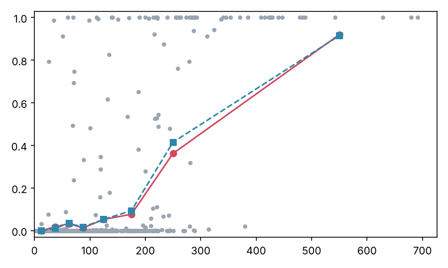

# ND1 · Sổ thử nghiệm

File này ghi các thử nghiệm lý thuyết của ND1. Nội dung ở đây **chưa chốt** và không thay đổi đề cương
(`research_notes/proposal/SIGDROP-PROPOSAL-vi.md`). Khi một kết quả ổn định, người dùng quyết định có đưa vào đề cương
hay không. Ngày 1–4 (mô hình, kiểm kênh, kiểm định lý A) ở `MODEL-vi.md`, cũng là bản thử nghiệm.

## Ngày 5a · Bổ đề L1 (độ khó)

**Phát biểu thử.** Bài toán quyết định sau là NP-khó: cho mạng (lưới cell, cụm, critical cell, dung lượng gateway), mô
hình kênh, UAV với bán kính quay ρ, và một số T. Câu hỏi: có quỹ đạo và kế hoạch phân phối nào cho T_bay + T_đất ≤ T
không? Bổ đề vẫn đúng khi giới hạn vào trường hợp đặc biệt: kênh dạng đĩa (p(d) = 1 khi d ≤ r, bằng 0 khi d > r) và
không có hợp tác mặt đất.

**Chứng minh (phác thảo).** Quy từ bài toán Dubins TSP (DTSP). DTSP hỏi có tour khép kín có bán kính cong không nhỏ hơn
ρ, đi qua n điểm cho trước, với độ dài không quá ℓ hay không. Bài toán này NP-khó [Le Ny, Feron, Frazzoli; cần kiểm tra
phiên bản và điều kiện]. Từ một instance DTSP, dựng một instance SigDrop như sau:
- mỗi điểm i thành một cụm chỉ có một cell, và cell đó là critical cell; trạm gốc đặt tại một điểm bất kỳ trong số đó;
- các cụm đặt xa nhau hơn tầm radio mặt đất, nên đồ thị cell không có cạnh giữa các cụm (không hợp tác);
- truy vấn có Q = 1 gói, kênh dạng đĩa bán kính r rất nhỏ, UAV bay tốc độ v cố định.

Khi đó critical cell i nhận đủ dữ liệu khi và chỉ khi UAV phát gói lúc ở trong đĩa bán kính r quanh i. Vì không có hợp
tác, T_đất = 0, và T_bay = (độ dài tour)/v. Như vậy có lời giải với T_bay + T_đất ≤ T khi và chỉ khi có tour Dubins đi
qua mọi đĩa với độ dài không quá vT. Đây là DTSP với lân cận (DTSP-N). Cho r → 0 (hoặc đặt r nhỏ hơn một nửa khoảng
cách nhỏ nhất giữa các điểm, rồi dùng tính liên tục của độ dài tour Dubins), DTSP-N trở về DTSP. Phép dựng có kích
thước đa thức, nên bài toán SigDrop NP-khó.

**Nhận xét.**
- Phần khó nằm ở lớp quỹ đạo, không ở lớp mặt đất. Bổ đề vì vậy chỉ biện minh cho việc dùng heuristic (CHORD, LM-Tour).
  Nó không nói gì về độ khó của bài toán phân phối khi quỹ đạo đã cho.
- Có một câu hỏi mở đáng giá hơn: khi quỹ đạo cố định, bài toán chọn Seg(a) và đường cell có giải được trong thời gian
  đa thức không? Nếu được thì có thể nói "River tối ưu cho quỹ đạo cho trước". Mệnh đề D đang đi theo hướng này.
- Nếu không muốn dựa vào DTSP, có thể quy từ TSP Euclid [Papadimitriou 1977]: kéo giãn tọa độ với hệ số λ lớn. Chênh lệch
  giữa tour Dubins và tour Euclid khi đó chỉ là O(nρ), nhỏ so với λ. Cách này dài hơn nhưng dựa trên kết quả kinh điển.

## Ngày 5b · Mệnh đề B (ngưỡng lệch của takeover)

**Cách thử.** Không chạy mô phỏng mới. Dùng lại các lượt bay gió của `logs/2026-11-01_0600-takeover`: bản đồ k8-s1, kênh
r100, σ = 50 m (3 seed), 100 m (3 seed), 200 m (1 seed), tổng 840 SPINE cell. Script `uav-l2/tools/theory/prop_b.py`, log
`logs/2026-11-10_1400-nd1-day5/`. Với mỗi SPINE cell a, script tính:
- e_a: độ lệch ngang lớn nhất của các điểm phát thật của Seg(a) so với quỹ đạo dự kiến;
- a có bị kích hoạt hay không, theo cùng quy tắc với `--takeover`: có gói của Seg(a) mà không node nào của a và các cell
  kề nghe được;
- xác suất kích hoạt theo mô hình kênh của ngày 2 (nhận ở mức cell, giả định A1);
- số hop cell từ a tới cell xa nhất đang giữ một gói thiếu.

**Kết quả.**

| e (m) | Số SPINE cell | Tỉ lệ kích hoạt đo | Tỉ lệ kích hoạt mô hình | Hop xa nhất đo |
|---|---|---|---|---|
| 0–25 | 170 | 0,00 | 0,00 | 0 |
| 25–50 | 163 | 0,02 | 0,01 | 0 |
| 50–75 | 150 | 0,03 | 0,03 | 0 |
| 75–100 | 79 | 0,01 | 0,02 | 0 |
| 100–150 | 132 | 0,05 | 0,05 | 2 |
| 150–200 | 52 | 0,08 | 0,09 | 2 |
| 200–300 | 69 | 0,36 | 0,42 | 3 |
| 300–800 | 25 | 0,92 | 0,91 | 4 |

| σ (m) | Kích hoạt đo | Trong đó có cell khác giữ gói | Gói không ai nghe | Tổng xác suất mô hình | Hop xa nhất |
|---|---|---|---|---|---|
| 50 | 3 | 0 | 3 | 2,0 | 0 |
| 100 | 17 | 9 | 8 | 18,2 | 3 |
| 200 | 48 | 42 | 6 | 51,7 | 4 |

**Nhận xét.**
- **Mô hình kênh dự đoán đúng số lần kích hoạt.** Tổng xác suất mô hình là 2,0 / 18,2 / 51,7, còn số đo là 3 / 17 / 48.
  Theo từng khoảng e, hai tỉ lệ lệch nhau không quá 0,06. Khi e > 300 m, gần như mọi SPINE cell đều bị kích hoạt.
- **Phần (i) của B, dạng ngưỡng cứng, không đúng.** Tỉ lệ kích hoạt tăng dần theo e chứ không nhảy ở một ngưỡng. Ngay cả
  khi e < 50 m vẫn có vài lần kích hoạt, nhưng đó đều là gói không node nào trong cụm nghe được (do fading). Với các gói
  này, takeover không làm được gì, và chỉ có thể sửa bằng cách phát lại.
- **Phần (i) nên phát biểu lại theo xác suất,** có tách hai loại sự kiện:
  - xác suất kích hoạt của a là P_a = 1 − ∏_{s∈Seg(a)} (1 − ∏_{u∈a∪N(a)} (1 − p(‖x_s − u‖))), trong đó x_s là điểm phát
    thật của gói s; P_a có thể chặn trên theo e_a và hình học của lưới;
  - "kích hoạt mà có người giữ" (takeover cần thiết và có ích) chỉ xuất hiện khi e ≥ 100 m, tức e ≳ R ≈ R50. Ở σ = 50 m
    không có lần nào, khớp với kết quả mô phỏng trước đây.
- **Phần (ii), chặn số hop, đúng trên dữ liệu.** Với R = 100 m (ước lượng từ tâm cell), chặn h ≤ ⌈e/(√3R)⌉ + 1 (lấy
  w = 0) đúng ở cả 51/51 SPINE cell có người giữ, và chặt (bằng nhau) ở 9/51. Đây mới là kiểm thực nghiệm. Muốn chứng
  minh, cần thêm một giả định: cell giữ gói nằm gần điểm phát. Lý do là theo hướng xấu nhất của lưới lục giác, mỗi hop
  chỉ đi được 1,5R thay vì √3R.
- **Bán kính hỏi 3 hop không đủ ở σ = 200 m.** Có một SPINE cell cần 4 hop. Đây mới là 1 seed, nhưng nó ủng hộ việc chọn
  bán kính hỏi theo h(ē) thay vì cố định 3.

**Việc tiếp theo cho B.**
- Viết chặn trên của P_a theo e_a.
- Tìm điều kiện hình học để chặn số hop có thể chứng minh được.
- Thêm seed σ = 200 m nếu người dùng đồng ý chạy (cần thảo luận trước khi chạy).
