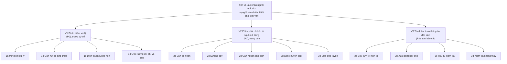

# J1 · Cây vấn đề và lý thuyết bám cho từng vấn đề

Ghi lại cây vấn đề đã bàn ở chatlog mục 427–437 và gắn mỗi nút với một định lý hay lý thuyết để bám vào (mục 438). Ba vấn đề chính tương
ứng với (P0), (P1), (P2) ở [PROBLEMS-vi.md](PROBLEMS-vi.md) và [STATEMENT-vi.md](STATEMENT-vi.md).

Nhãn nguồn:
- [repo] kết quả đã có trong repo hoặc bài đã ghi chú;
- [chung] kết quả quen biết trong lý thuyết, chưa đối chiếu nguồn, cần tra trước khi trích;
- [cần viết] chưa có, phải tự chứng minh.

## Phát biểu tổng quát (mục 437)

Dùng mạng thiết bị mặt đất năng lượng thấp làm cảm biến và UAV làm phương tiện chở truy vấn, để tìm và xác nhận vị trí một người mất
tích trong vùng không có hạ tầng liên lạc trong thời gian ngắn nhất.

## Cây vấn đề

## Lý thuyết bám cho từng nút

### Gốc

| Nội dung | Lý thuyết, định lý | Nguồn | Dùng để |
|---|---|---|---|
| Bài gộp cả ba pha là bài điều khiển tuần tự có thông tin không đầy đủ (POMDP) | lập kế hoạch POMDP hữu hạn bước là PSPACE-đầy đủ (Papadimitriou và Tsitsiklis 1987) | [chung] | lý do tách thành ba vấn đề |
| Mục tiêu phân vị 90 % | phân vị của tổng không bằng tổng phân vị; dạng ràng buộc xác suất | [chung]; dạng mục tiêu như Zeng 2018 multicast [repo] | lý do mỗi vấn đề có mục tiêu riêng |

### V1 Bố trí điểm xử lý

| Nút | Lý thuyết, định lý | Nguồn | Trạng thái |
|---|---|---|---|
| V1 chung | SSCFLP là NP-khó | Bakker và cộng sự 2025 [repo, FORMULATION-EXAMPLES] | **[cần viết]** mệnh đề NP-khó cho (P0) giữ đúng mục tiêu |
| 1a Mở điểm | phủ tập, p-center: NP-khó; chặn LP của bài phủ | [chung] | dùng làm chặn dưới số AI cell |
| 1b Gán có sức chứa | bài gán tổng quát (GAP): NP-khó, có xấp xỉ qua LP (Shmoys và Tardos 1993) | [chung] | thuật toán gán và chặn |
| 1c Luồng nền | định tuyến luồng nhiều hàng với nghẽn nhỏ nhất: LP rồi làm tròn ngẫu nhiên (Raghavan và Thompson 1987) | [chung] | kiểm ràng buộc nghẽn |
| 1d Chi phí về sau | mô hình thay thế học từ ns-3 | surrogate River, K9 [repo] | chưa có lý thuyết; chỉ có sai số khớp |

### V2 Phân phối dữ liệu từ nguồn di động (trung tâm)

| Nút | Lý thuyết, định lý | Nguồn | Trạng thái |
|---|---|---|---|
| V2 chung | Định lý 1: (P1) NP-khó, quy từ Exact Cover theo Le Ny 2012 | draft-v1 [repo] | **có** |
| V2 chung | Định lý 2: chặn phủ cho mọi cách không hợp tác, qua một LP phủ phân số; Mệnh đề 1 tính thêm quãng bay | draft-v1 [repo] | **có**; vẽ lại cho bản đồ rừng |
| 2a Bản đồ nhận | mô hình Rician và công thức xác suất cell nhận; khớp ns-3 sai số ≤ 0,003 | draft-v1 [repo] | **có** |
| 2b Đường bay | Dubins TSP NP-khó (Le Ny 2012); chặn theo mật độ điểm (Savla 2008); biến đổi GTSP sang ATSP (Noon và Bean 1993, Isaacs 2011) | [repo] | **có** (CHORD, LM-Tour) |
| 2c Gán nguồn cho đích | bài vận tải; nới lỏng LP tải lớn nhất cho chặn dưới của makespan | `river_lb.py --lp` [repo] | **có** số; **[cần viết]** phát biểu thành mệnh đề, và chặn cho mục tiêu $C_{90}$ |
| 2d Lịch chuyển tiếp | lập lịch phát thời gian nhỏ nhất (MLBS) NP-khó (Gandhi và cộng sự 2003 [chung]; You 2013 [repo]); Mệnh đề 2: chặn một radio | draft-v1 [repo] | **có** chặn; khoảng cách River so với chặn khoảng 5 lần |
| 2d Năng lượng | chặn năng lượng tối thiểu: mỗi AI cell cần ít nhất một số khung, quy ra năng lượng của các cell trên đường | — | **[cần viết]**, đề xuất ở OUTLINE VI.5 |
| 2e Sửa trực tuyến | Mệnh đề 3: xác suất kích hoạt takeover (dự đoán 2,0 / 18,2 / 51,7 %, đo 3 / 17 / 48 %) | draft-v1 [repo] | **có** |

### V3 Tìm kiếm theo thông tin đến dần

| Nút | Lý thuyết, định lý | Nguồn | Trạng thái |
|---|---|---|---|
| V3 chung | đường đi tìm kiếm tối ưu NP-khó (Trummel và Weisinger 1986) | [repo, đã trích ở draft-v2] | **[cần viết]** mệnh đề NP-khó cho bản tĩnh của (P2) |
| 3a Vị trí hiện tại | lý thuyết tìm kiếm tối ưu, cập nhật Bayes (Stone 1975); tìm mục tiêu di động rời rạc (Brown 1980) | [chung] | cần chọn mô hình di chuyển trước |
| 3b Xuất phát hay chờ | dừng tối ưu; giá trị của thông tin | [chung] | **[cần viết]**: điều kiện để chờ thêm một báo cáo có lợi |
| 3c Thứ tự kiểm tra | độ trễ nhỏ nhất có trọng số NP-khó trên cây (Sitters 2002) [repo]; xấp xỉ hằng số (Blum và cộng sự 1994) [chung]; quy tắc Smith khi không có quãng bay (Smith 1956) [chung]; tìm kiếm mở rộng (Hermans 2019) [repo] | | có chính sách tham lam; **[cần viết]** so với nghiệm đúng ở bài nhỏ |
| 3d Kiểm tra không thấy | cập nhật Bayes khi phát hiện sót: xác suất của nơi vừa kiểm giảm theo xác suất phát hiện (Stone 1975) | [chung] | chưa có |

## Nhận xét

- V2 có đủ định lý ở mọi nút; chỗ còn phải viết là chặn LP cho mục tiêu $C_{90}$ và chặn năng lượng.
- V1 và V3 bám được vào lý thuyết có sẵn (facility location, GAP, lý thuyết tìm kiếm), nhưng các mệnh đề cho đúng bài của mình đều phải
  tự viết: NP-khó của (P0), NP-khó của bản tĩnh (P2), điều kiện chờ ở 3b.
- Các nguồn [chung] cần tra và ghi chú trước khi trích. Nguồn nên ghi chú trước: Stone 1975, Brown 1980 (cho 3a, 3d), Gandhi 2003 (cho
  2d), Blum 1994 (cho 3c).
