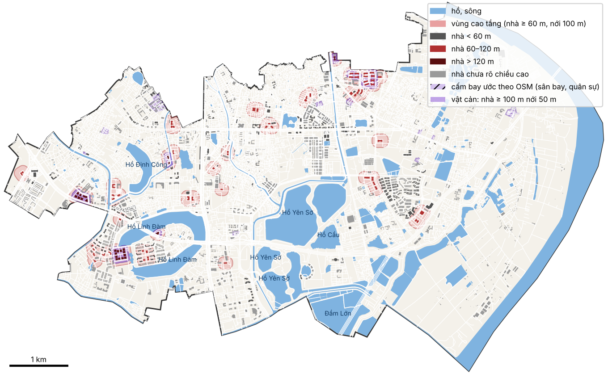
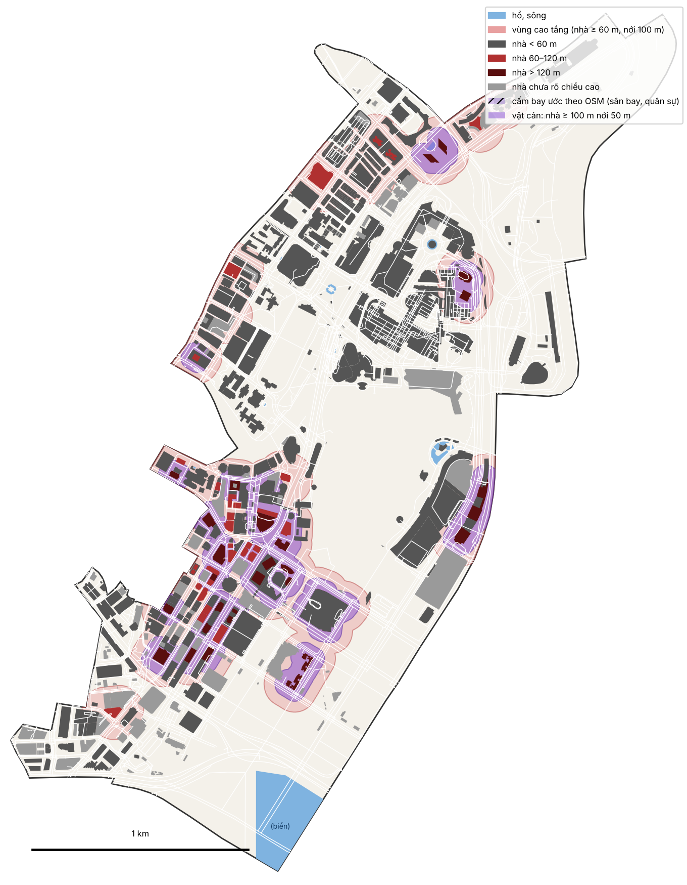
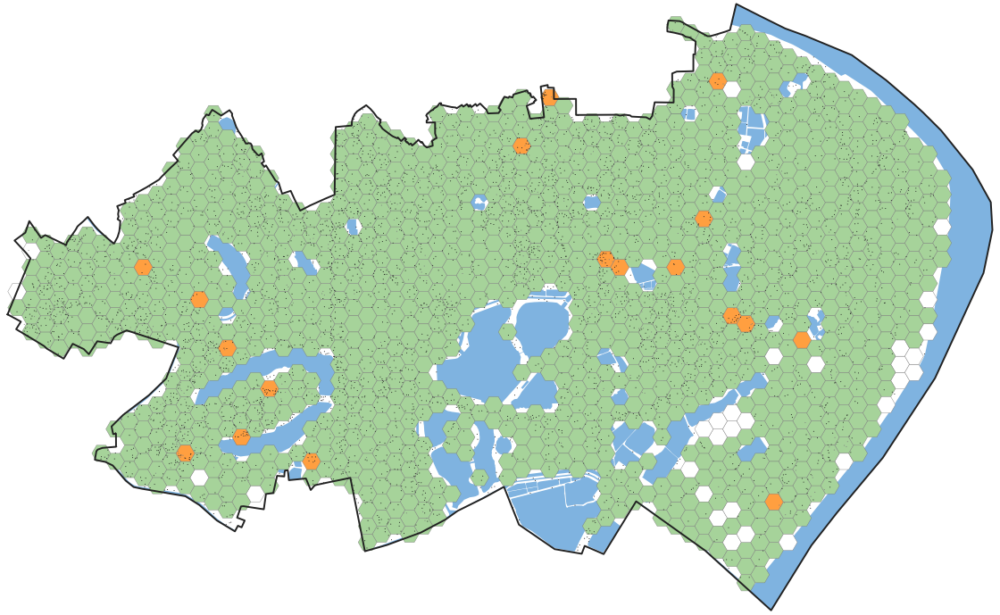
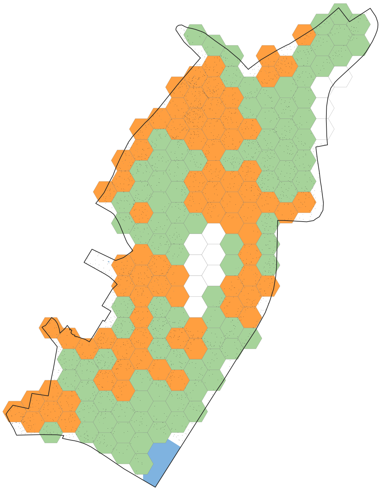
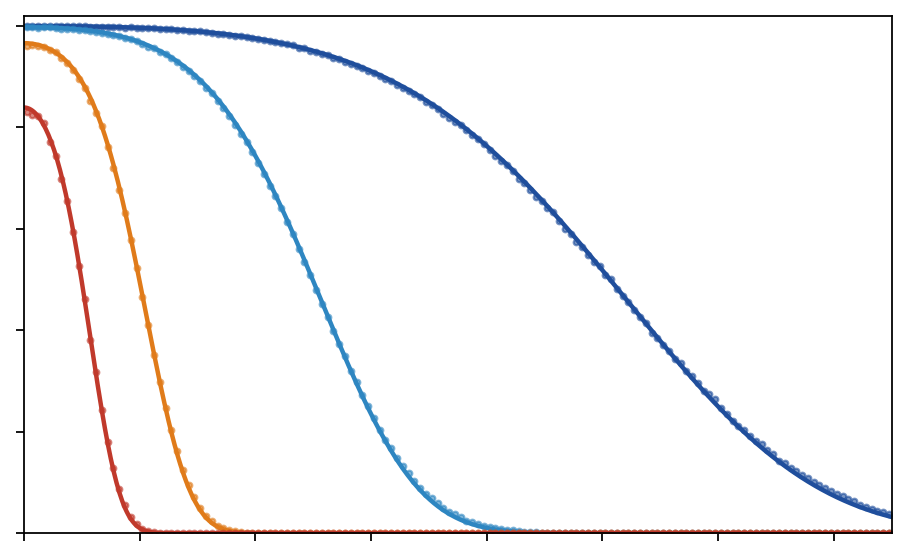
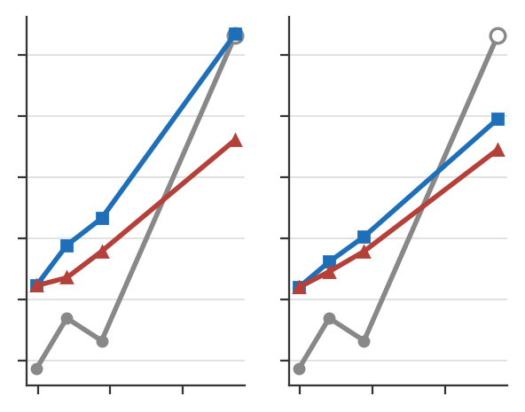
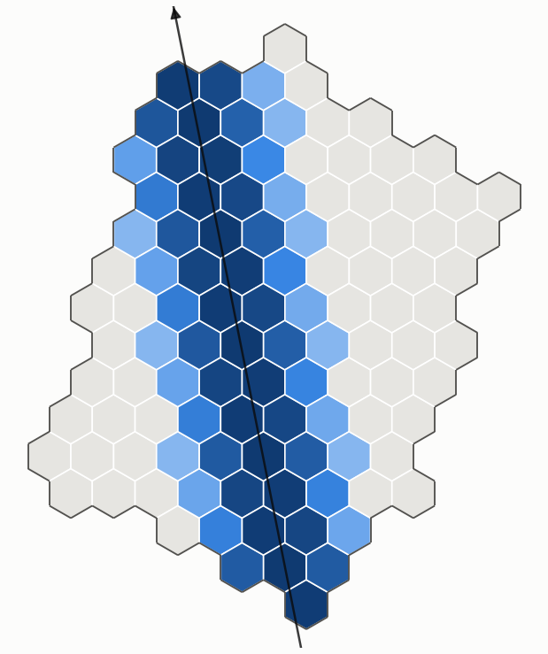
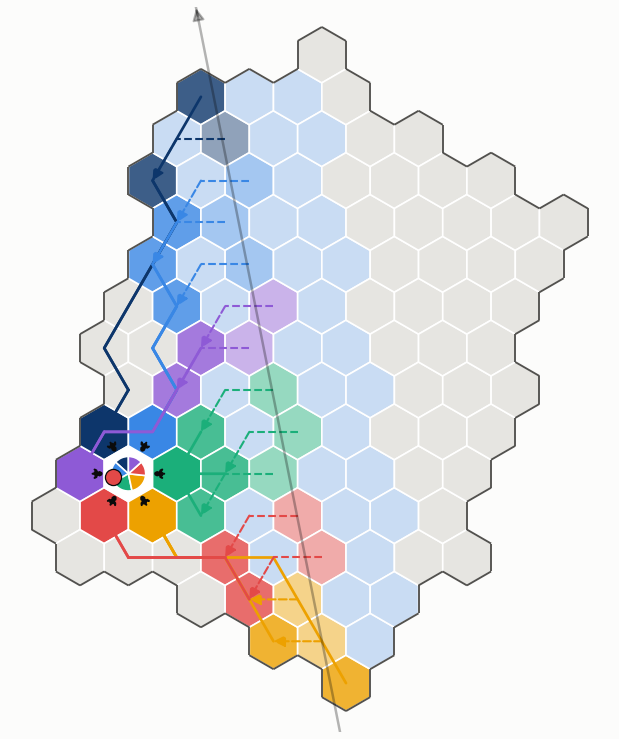
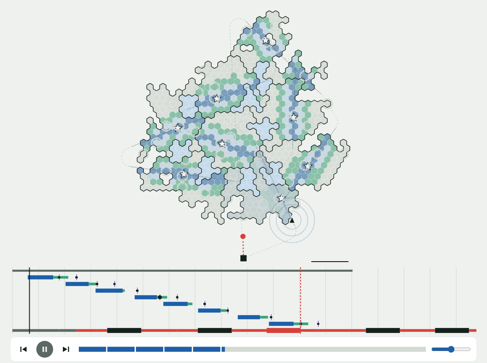
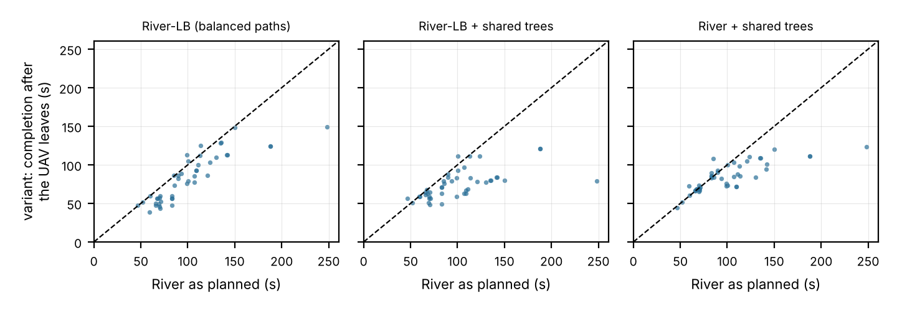

# J1 · Bối cảnh bài toán (bản tóm tắt)

> Phiên bản đô thị (urban-v1), đóng gói ngày 2026-11-26 khi bài chuyển sang kịch bản rừng và khu bảo tồn (chatlog mục 408). Xem [README](README.md).

Tóm tắt những gì đã chốt qua thảo luận (chatlog mục 323–389). Chi tiết, số liệu và nguồn ở [CONTEXT-vi.md](CONTEXT-vi.md); số
trong ngoặc là mục của file đó. Dòng có nhãn **[chờ]** là đề xuất chưa được xác nhận, **[giả định]** là số chưa có nguồn trích.
Hình chèn ở cuối mỗi mục lấy từ `figures/`, `draft-v1/figs/` và `uav-l2/docs/figures/`; mô tả đầy đủ ở `INDEX.md` của từng thư
mục.

## 1. Kịch bản

- Đô thị hiện đại: càng hiện đại thì mạng IoT càng dày, nhưng nhà cao tầng và hạ tầng làm kênh từ trên không xuống kém (mục 1).
- Mục tiêu điển hình là tìm người mất tích; nhiệm vụ không giới hạn thời gian, tìm tới khi thấy (mục 16).
- Không biết trước người đó ở đâu: tiên nghiệm đều trên cả quận; các mức có thông tin trước (nơi thấy lần cuối) để thảo luận
  (mục 32, chatlog mục 384).
- Vùng nhiệm vụ là một quận thật 5–60 km², vừa một chuyến bay của một UAV (mục 18–22).
- Một UAV ở pha 1. Nhiều UAV để sau, khi có cơ chế phối hợp thật; khi đó mục tiêu vẫn là min-max (mục 5).
- Tần suất: Singapore khoảng 1 300 báo cáo mất tích mỗi năm (khoảng 22 trên 100 000 dân); quy ra vài chục tới khoảng 150 vụ
  mỗi quận mỗi năm, một phần cần UAV (mục 23).

*Hình 1. Quận Hoàng Mai (ranh giới cũ, 40,2 km²) dựng từ OSM: hồ và sông xanh dương (17,9 % diện tích), vùng cao tầng đỏ
nhạt (nhà từ 60 m nới 100 m), cấm bay ước theo OSM tím gạch chéo, nhà xám tới nâu đỏ theo chiều cao (mục 18, 19).*

*Hình 2. Downtown Core, Singapore, cùng cách vẽ: khu nhà cao tầng dày, biển dựng từ đường bờ. Mười khu còn lại (Việt Nam và
nước ngoài) ở `figures/map-*-labelled.png` (mục 18).*

## 2. Vì sao cần UAV

- Node rẻ chỉ có radio 802.15.4, không nối Internet; dữ liệu ở lại thiết bị vì quyền riêng tư, chỉ điểm số vài byte rời node
  (mục 15).
- Gửi truy vấn 400 KB qua LoRa mất ít nhất 1,8 h (chu kỳ 10 %), 18 h (1 %) (mục 12).
- Qua mạng mặt đất từ trạm gốc: 50–95 chặng; giao thức CSMA mất 20 phút tới hơn một giờ; flood đồng bộ kiểu Pando 1,2–2,4 phút
  nếu giữ được tốc độ ở độ sâu đó (chưa có số đo). Lập luận đối đáp: không có sẵn đường mặt đất, flood khó bền ở độ sâu lớn,
  flood tốn năng lượng của mọi node (mục 12).
- Tiền lệ: Thread (802.15.4) trong nhà thông minh; Amazon Sidewalk là mạng dùng chung giữa thiết bị của nhiều chủ (mục 15).

## 3. Mạng và thiết bị

- Thiết bị cố định: chuông cửa, camera tường, camera cột, máy bán hàng; không xét camera hành trình (mục 20, 26).
- Mật độ chính 816 node/km² (hướng tới); 400 và 280 node/km² để xem độ nhạy (mục 4, 10).
- Đặt node: theo viền nhà mỗi 40 m, dọc phố mỗi 30 m, không trên nước (mục 20).
- Node pin: 45 % node trên nhà, 11–22 % tổng số; không chuyển tiếp, không là AI node, không tham gia pha 1 (mục 15, 25).
- Node chuyển tiếp trên cột đèn mỗi 35 m, chỉ ở cell cần (rỗng, đứt bên trong, thiếu gateway); node bị lạc làm node lá (mục 21).
- Sở hữu: mạng dùng chung kiểu Sidewalk; thành phố hoặc nhà cung cấp chạy pha 0 (mục 6, câu i).
- Lưới cell lục giác R = 100 m, mỗi cell một CL, mỗi cặp cell kề một cặp gateway, cụm tối đa 80 cell, CH có LoRa (mục 2).
- Giãn cách node tối đa để lưới còn liền khoảng 50–60 m; giới hạn do tầm G2G, không do R (mục 10).
- Trên bản đồ thật, lưới là một khối liền; lỗ hổng là cell nước (1–17 %) và cell không có node cắm điện (2–6 %) (mục 20).
- Vị trí node **[chờ]**: gán cell theo kết nối thật ở pha 0; nhãn ngoài trời/trong nhà; kế hoạch dùng toạ độ nhiễu σ = 10 m
  (mục 26).

*Hình 3. Hoàng Mai, 816 node/km² đất, kênh G2G trừ 15 dB mỗi toà nhà, thêm node chuyển tiếp trên cột đèn ở cell cần: cell
R = 100 m xanh lá là liên thông, cam là đứt bên trong cell, trắng là cell đất không có node cắm điện, xanh dương là nước
(mục 20, 21).*

*Hình 4. Downtown Core, cùng cách đặt node và kênh có tường, chưa thêm cột đèn: khu nhà dày đặc vỡ nhiều nhất (38 % cell đứt
bên trong; thêm cột đèn ở cell cần còn 29 %). Màu như Hình 3 (mục 20, 21).*

## 4. Kênh truyền

- A2G hiện tại: hai đoạn + suy hao môi trường cố định, Rician K = 2; R50 = 1016 / 498 / 199 / 99 m; về tầm phủ khớp dải ngoại ô
  tới cao tầng của Al-Hourani, lệch về hình dạng theo góc ngẩng (mục 9).
- G2G hiện tại: 3GPP UMi NLoS (n = 3,5, σ = 7,8 dB, Rayleigh) (mục 9).
- Làm phức tạp dần theo việc K1: K1a LoS A2G theo góc ngẩng hoặc hình học nhà thật; K1b fading tương quan theo thời gian; K1c
  G2G có LoS/NLoS theo nhà (bước đầu: 15 dB mỗi toà **[giả định]**); K1d nhiễu 2,4 GHz (mục 9, 20, 24).
- Thiết bị trong nhà: trừ 15–20 dB với A2G (mục 26).
- Nhiễu: lượt bay chuyển sang kênh 26; ba kênh sạch 15, 20, 25 cho môi trường bận nhất; kênh trùng WiFi có độ bận u = 0, 0,2, 0,5
  **[giả định]**; UAV điều khiển ngoài 2,4 GHz (mục 24).

*Hình 5. Xác suất node nhận được một gói A2G theo khoảng cách ngang từ UAV (0–1,5 km, độ cao 100 m), bốn chế độ kênh từ
R50 = 1016 m (phải nhất) tới 99 m; chấm đo trên lượt bay ns-3, đường là mô hình (mục 9).*

## 5. Truy vấn và dữ liệu

- Truy vấn là ảnh, khoảng 400 KB, Q = 4 041 gói; mã hoá cho AI node và ký bởi trạm gốc (mục 27).
- Báo thêm theo Q = 400 và 1 000: với truy vấn nhỏ, chặn dưới không hợp tác chỉ 150–320 s và lý thuyết không còn chứng nhận
  lợi thế của hợp tác (mục 27).
- Dữ liệu về AI node theo phương án lai: node có NPU gửi vector mô hình nhẹ (khoảng 0,5 KB mỗi người), node yếu gửi ảnh cắt nhỏ
  (khoảng 5 KB); mỗi AI node giữ K mô hình (K = 1, 3, 5); D0 làm đối chứng (mục 28, 29).
- Luồng nền mỗi AI node 1–2 KB/s (10–20 % thời gian kênh) **[giả định]**; đây là ràng buộc chính của bài chọn critical cell
  (mục 28).
- Không có chuẩn vector người dùng chung (MPEG CDVA loại trừ người và khuôn mặt); số mô hình trong một mạng biết được qua khai
  báo lúc tham gia (mục 29).
- Cửa sổ truy vấn mặc định 2 giờ (quét 1–24 giờ); cửa sổ dài không làm chậm việc tìm nhưng làm giảm độ phân biệt (một ảnh: 0,59
  ở 1 h, 0,38 ở 24 h) (mục 16).
- Bộ nhớ: thẻ SD không chật; giữ ảnh theo thời gian, ưu tiên khung có người; truy vấn được ghim tới khi nhiệm vụ xong (mục 14).
- Camera trả lời "thấy người trông giống mục tiêu": điểm giống kèm thời điểm thấy; trạm gốc xếp hạng theo độ giống và độ mới
  (mục 16).

## 6. Chọn critical cell

- J1 giải bài này: chọn AI node trong node mạnh và giao node thường cho AI node (mục 13).
- Ràng buộc: không quá H chặng, bộ nhớ, luồng nền; không dùng khoảng cách tối thiểu D_min (mục 13, 28).
- Mục tiêu: tối thiểu phân vị 0,9 của tổng thời gian pha 1 + pha 2 (trường hợp xấu nhất qua vị trí người cần tìm), báo kèm
  trung bình; khớp dạng 1 − δ của Định lý 2 (mục 13, 32, 33).
- Đánh đổi: ít critical cell thì pha 1 nhẹ nhưng luồng nền và đối sánh nặng; nhiều thì ngược lại (mục 13).

*Hình 6. Đánh đổi số critical cell (thử K9, 20 người/h, R50 = 99 m, một seed): thời gian từ cất cánh tới khi xác nhận đúng AI
cell theo số AI cell. Xám là lúc AI cell cuối nhận đủ truy vấn (rỗng là cận dưới), xanh là báo nhầm 0,1 mỗi AI cell, đỏ là
2,4 lần báo nhầm cho cả hệ thống; trái một vector mục tiêu, phải ba (mục 13, `draft-v1/tex/sec-eval.tex`).*

## 7. Pha 0

- Trạm gốc tính sẵn tập critical cell, tour và kế hoạch River ở pha 0, phát trước xuống mọi cell (mục 25).
- Chính sách cập nhật **[chờ]**: dựng đầy đủ một lần; cập nhật nhẹ mỗi đêm; điểm danh trước mỗi nhiệm vụ, chọn lại CL và gateway
  nếu node cũ vắng; mỗi cạnh một cặp gateway dự phòng (mục 23).
- Mạng thay đổi: lưới vẫn liền khi 30 % thiết bị vắng; chỗ yếu là vai trò gắn với node cụ thể (CL, gateway) (mục 23). Tỉ lệ vắng
  0, 10, 20 % là tham số **[giả định]**.

## 8. Pha 1

- Trạm gốc là đội chữa cháy và cứu nạn cứu hộ của khu vực, có sân cất hạ cánh và LoRa gateway (mục 22).
- Một UAV cánh bằng VTOL, 25–50 m/s, bay 100 m so với mặt đất, sức bền 1–3 h (mục 22).
- Vật cản: nhà từ 100 m nới 50 m là vùng cấm cho tour; địa hình cao (đồi) thì bay theo mặt đất (mục 22).
- Vùng cấm bay chính thức là dữ liệu mật; dùng vùng ước theo OSM (sân bay, đất quân sự); nhiệm vụ là bay công vụ (mục 19).
- Giấy phép **[chờ]**: đội cứu nạn có giấy phép thường trực, tiền lệ EU coi UAV cứu nạn là hoạt động nhà nước (mục 30).
- Khởi động: một bản tin LoRa vài byte (mã nhiệm vụ, giờ cất cánh); node cắm điện tự tính cửa sổ chuyển sang kênh 26 (10–15 s
  mỗi cell); đồng bộ đồng hồ mỗi đêm (mục 25).
- Kế hoạch pha 1 cố định khi có báo cáo; critical cell chưa đủ sau hạn T_fb được vá (đội 2 phát trực tiếp hoặc đội 1 bay
  lượt hai) (mục 33).
- Phân phối: CHORD hoặc LM-Tour + River; thêm cây dùng chung và lập kế hoạch cân tải (thử trên một seed: nhanh hơn 26 %) (bản
  thảo J1 mục 9, việc K11).

 

*Hình 7. Vai trò của River trên một cụm có đường bay thẳng. Trái: cell Spine dưới đường bay (xanh đậm), dải River (nhạt dần
ra mép) và Bank ở mép. Phải: vòng quanh một critical cell (chấm đỏ); mỗi node trợ giúp lấy một nhóm đoạn liên tiếp từ Bank
và chuyển tiếp một chặng (bản thảo J1, `draft-v1/tex/sec-river.tex`).*

*Hình 8. Khung chụp trang replay CHORD trên bản đồ k8-s1 (8 cụm) giữa lúc đội 1 phát qua một cụm: cell đậm dần theo phần dữ
liệu nghe được, tam giác là đội 1, chấm đỏ là đội 2, dải thời gian bên dưới.*

*Hình 9. Mỗi chấm một critical cell, thời gian xong sau khi UAV rời cụm: trục ngang là River theo kế hoạch gốc, trục dọc là
biến thể (trái cân tải, giữa cân tải + cây dùng chung, phải River + cây dùng chung); chấm dưới đường chéo là nhanh hơn (seed 1,
k8, r100; bản thảo J1 mục 9).*

## 9. Pha 2

- UAV cánh quay riêng (đội 2), xác minh theo V1: mang bộ tham chiếu R (1 MB) tới node nghi vấn, node đối sánh lại và chỉ báo điểm; lơ lửng gần
  đúng trên node (khu cao tầng: gói qua 0,87 khi lệch 0 m, 0,73 khi lệch 20 m) (mục 17).
- Thứ tự thăm theo xác suất từ pha 1, nên chất lượng pha 1 hiện ra trong thời gian pha 2 (mục 17).
- Pha 2 thích nghi: đội 2 cất cánh khi có báo cáo đầu tiên, chọn cell theo xác suất cập nhật (mục 33).
- Pha 2 kết thúc khi V1 xác nhận đúng lần thấy; V4 (UAV tới chỗ thấy lần cuối, nhìn bằng camera của nó) là bước sau (mục 17).

## 10. Ngoài phạm vi và giới hạn

- Nhiều sự cố cùng lúc; node gian lận hay báo sai (mục 6, câu q).
- Camera hành trình và thiết bị di động (mục 6, câu w).
- Thời tiết đưa vào làm cận trên: kịch bản xấu nhất về gió, mưa (mục 6, câu x).
- Nhiều UAV (mục 5).
- Các mức có thông tin trước về vị trí người cần tìm (nơi thấy lần cuối, nơi xuất phát, vị trí thô): để thảo luận (mục 32).
- Mở rộng **[chờ]**: tương quan giữa các camera sau lần thấy đầu tiên, mô hình năng lượng bay của UAV, hệ số K theo góc ngẩng
  (gộp vào K1a) (mục 31).

## 11. Giả định chưa có nguồn trích (cần kiểm trước khi vào bài)

- Luồng nền được dùng 10–20 % thời gian kênh.
- Cỡ ảnh cắt (5–15 KB) và lưu lượng người qua camera (khảo sát ở K12, `K9-PARAMS-vi.md`).
- Tỉ lệ camera có NPU; số mô hình K mỗi AI node.
- Suy hao 15 dB mỗi toà nhà cho G2G; 15–20 dB cho thiết bị trong nhà với A2G.
- Độ bận WiFi u; tỉ lệ thiết bị vắng.
- Sai số vị trí cột đèn; độ lệch đồng hồ thạch anh.
- Dân số Nam Từ Liêm (chưa có số 2019).
- Thời hạn cấp phép bay ở Việt Nam.

## 12. Còn chờ quyết

- Chính sách cập nhật pha 0 (người dùng đang cân nhắc).
- Giấy phép bay thường trực; cách xử lý vị trí node.
- Chạy B8 (phương án lai) của K9.
