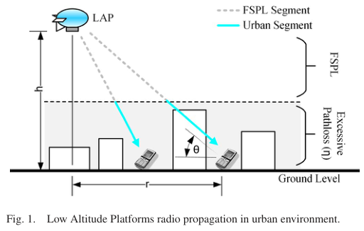
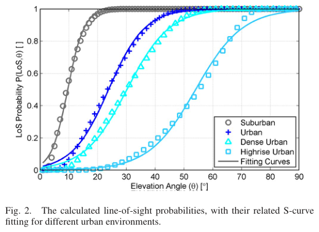
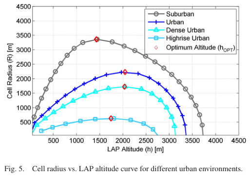

# Al-Hourani, Kandeepan, Lardner 2014 · Độ cao tối ưu của nền tảng bay thấp để phủ sóng lớn nhất

## Tóm tắt một dòng
Mô hình suy hao không–đất trung bình = FSPL + η theo nhóm LoS/NLoS, xác suất LoS theo góc ngẩng xấp xỉ bằng hàm S P(LoS, θ) = 1/(1 + a·exp(−b(θ − a))) với a, b khớp theo tham số đô thị ITU (α, β, γ); bán kính phủ R(h) có cực đại, góc ngẩng tối ưu θ_OPT không phụ thuộc PL_max.

## Vì sao đọc
Đây là mô hình kênh A2G chuẩn được dẫn nhiều nhất (mô hình "Al-Hourani") — cơ sở cho mô hình kênh [KÊNH] của SigDrop và
cho bán kính vùng nghe của cell.

## Bài toán và mô hình
- **[GĐ]** LAP (quadcopter, khinh khí cầu, trực thăng) gần như đứng yên làm trạm gốc; tối ưu độ cao để bán kính phủ lớn
  nhất (tr. 1).
- **[GĐ]** Tín hiệu lan trong không gian tự do tới lớp đô thị rồi chịu suy hao thêm (excessive pathloss) η; hai nhóm lan
  truyền ξ ∈ {LoS, NLoS}; η thực ra có phân bố Gauss nhưng bài chỉ dùng giá trị trung bình; bỏ qua fading nhanh (tr. 2).
- **[GĐ]** η phụ thuộc chủ yếu vào nhóm lan truyền, không vào góc ngẩng θ; xác suất nhóm phụ thuộc mạnh vào θ (tr. 2).
- **[GĐ]** Ăng-ten đẳng hướng ở cả hai đầu; h_RX bỏ qua vì nhỏ so với nhà và độ cao LAP (tr. 2–3).

## Định nghĩa và ký hiệu
| Ký hiệu | Nghĩa |
|---|---|
| θ | góc ngẩng từ máy thu lên LAP, θ = arctan(h/r) |
| h, r, d | độ cao LAP, khoảng cách mặt đất, khoảng cách thẳng d = √(h² + r²) |
| η_LoS, η_NLoS | suy hao thêm trung bình (dB) của mỗi nhóm |
| Λ | suy hao trung bình không gian tại góc θ, (2) |
| α | tỉ lệ diện tích xây dựng trên tổng diện tích |
| β | số toà nhà trung bình trên km² |
| γ | tham số thang của phân bố Rayleigh chiều cao nhà, f(H) = (H/γ²)exp(−H²/2γ²) |
| a, b | tham số đường S (khớp từ α, β, γ) |
| PL_max | suy hao tối đa cho phép; R là bán kính tại Λ = PL_max, (7) |
| A = η_LoS − η_NLoS, B = 20 log f + 20 log(4π/c) + η_NLoS | hằng trong (10) |

## Kết quả chính
- **[KQ] (1)–(3)** (tr. 2). PL_ξ = FSPL + η_ξ; Λ = Σ_ξ PL_ξ·P(ξ, θ); P(NLoS, θ) = 1 − P(LoS, θ).
- **[KQ] (4)** (tr. 2). Xác suất LoS hình học theo ITU: P(LoS) = Π_{n=0}^{m} [1 − exp(−(h_TX − (n + ½)(h_TX − h_RX)/(m + 1))²/(2γ²))],
  m = floor(r√(αβ) − 1). Không phụ thuộc tần số.
- **[KQ] (5)** (tr. 2). Xấp xỉ đường S: P(LoS, θ) = 1/(1 + a·exp(−b[θ − a])), θ tính bằng độ (theo trục Fig. 2).
- **[KQ] (6)** (tr. 2–3). a, b = Σ_{j=0}^{3} Σ_{i=0}^{3−j} C_ij (αβ)^i γ^j, hệ số C_ij ở Bảng I–II (giá trị trong bảng không trích được chữ).
- **[KQ] (8)–(10)** (tr. 3). PL_max = A/(1 + a·exp(−b[arctan(h/R) − a])) + 10 log(h² + R²) + B — phương trình ẩn giữa R và h;
  độ cao tối ưu thoả ∂R/∂h = 0, (11).
- **[KQ] (12)–(13)** (tr. 4). Viết theo θ: PL_max = A/(1 + a·exp(−b[θ − a])) + 20 log(R sec θ) + B; góc tối ưu thoả
  (π/(9 ln 10)) tan θ_OPT + abA·exp(−b[θ_OPT − a])/[a·exp(−b[θ_OPT − a]) + 1]² = 0 — không phụ thuộc PL_max, duy nhất với (a, b, A).
  Nên h_OPT/R = tan θ_OPT là hằng (đường thẳng ở Fig. 6).

## Thuật toán
Không có thuật toán riêng; tìm h_OPT bằng giải số (11) hoặc (13).

## Thực nghiệm và số liệu
- **[TS]** Bốn môi trường (α, β, γ): Suburban (0,1; 750; 8), Urban (0,3; 500; 15), Dense Urban (0,5; 300; 20),
  Highrise Urban (0,5; 300; 50) (tr. 2).
- **[TS]** (η_LoS, η_NLoS) dB: Suburban (0,1; 21), Urban (1,0; 20), Dense Urban (1,6; 23), Highrise (2,3; 34); f = 2000 MHz;
  PL_max chữ trích là "10 dB" cho Fig. 5 — **[NX]** gần như chắc là lỗi trích của 110 dB (Fig. 6 dùng 105–120 dB) (tr. 4).
- **[SỐ]** Fig. 5 (đọc từ hình): h_OPT ≈ 1450 m, R ≈ 3350 m (Suburban); ≈ 2050 m, 2200 m (Urban); ≈ 2050 m, 1700 m (Dense);
  ≈ 1750 m, 620 m (Highrise) (tr. 4).
- **[SỐ]** Fig. 6 (Urban): PL_max 105 → 120 dB cho R từ ~1,2 km tới ~7 km, các đỉnh nằm trên một đường thẳng (θ_OPT cố định) (tr. 4).
- **[SỐ]** Với PL_max lớn, h_OPT có thể vượt khí quyển — cần ràng buộc độ cao (tr. 4).

## Hình tiêu biểu

*Đọc hình:* mô hình hai nhóm: tia LoS và tia bị nhà che (phản xạ, nhiễu xạ) với suy hao thêm khác nhau.

*Đọc hình:* ngoại ô gần như LoS từ ~20°; nhà cao tầng cần > 60° mới có LoS — quyết định bán kính nghe hiệu dụng.

*Đọc hình:* R tăng rồi giảm theo h; độ cao tối ưu cỡ 1,5–2 km với PL_max ~110 dB.

## Trích nguyên văn
- **[TRÍCH]** "the optimal altitude is a function of the maximum allowed pathloss and of the statistical parameters of the urban environment" (tr. 1)
- **[TRÍCH]** "the solution of equation (13) is clearly independent of the maximum allowed pathloss" (tr. 4)

## Liên hệ SigDrop
- **[NX] [KÊNH]** Mô hình đường S + η theo nhóm là mô hình kênh A2G chuẩn cần trích khi định nghĩa xác suất nhận gói theo
  khoảng cách của SigDrop; ns-3 của repo có dùng biến thể tương tự (cần đối chiếu tham số a, b, η trong `params.yaml`).
- **[NX] [TOUR]** Góc ngẩng tối ưu cố định ⇒ bán kính vùng nghe tỉ lệ với độ cao bay: dùng để biện luận bán kính cell R
  và độ cao bay trong SigDrop (UAV cánh bằng bay thấp ~100 m thì vùng nghe nhỏ, khác LAP 1–2 km ở đây).
- **[NX]** Bài dùng giá trị trung bình, không fading, không shadowing ngẫu nhiên; khi tính xác suất nhận gói cần thêm
  phương sai shadowing (xem Gudmundson 1991, Matolak 2017).

## Hạn chế và câu hỏi mở
- Chỉ dùng suy hao trung bình; tác giả để fading lớn/nhỏ cho công việc sau (tr. 4).
- LAP đứng yên; không xét di chuyển, hướng ăng-ten, hay tần số khác 2 GHz trong ví dụ.
- Hệ số C_ij (Bảng I–II) không đọc được từ chữ trích; khi cần giá trị a, b cụ thể phải mở PDF.
