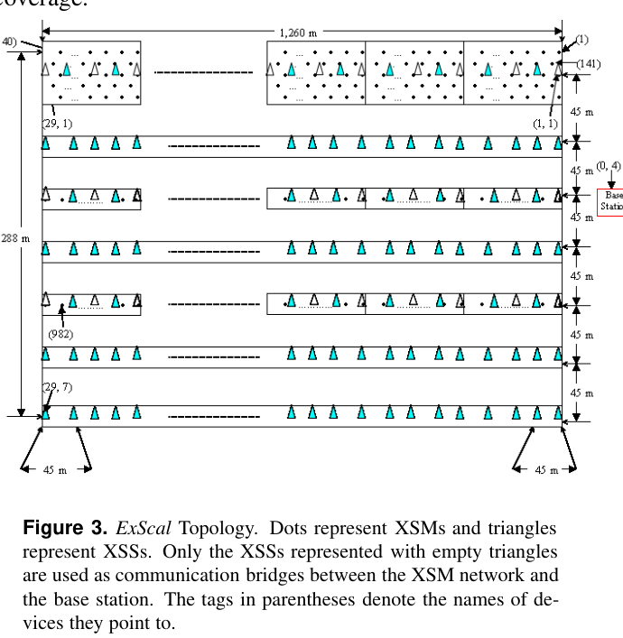
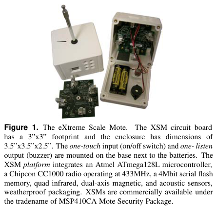

# Arora et al. 2005 · ExScal: mạng cảm biến không dây quy mô cực lớn

## Tóm tắt một dòng
Triển khai 983 mote XSM (433 MHz) và 203 Stargate XSS (802.11b) trên 1 260 m × 288 m ở Florida tháng 12/2004 để phát hiện xâm nhập: lưới phân cấp, mỗi XSS quản 20–50 XSM trong 5–6 chặng, yield định tuyến đầu cuối 85,27 %.

## Vì sao đọc
Là triển khai ngoài trời dày nhất có số liệu (khoảng 2 700 node/km²) và có kiến trúc phân cấp gần với cell/CL và cụm/CH của
SigDrop; dùng cho câu hỏi mật độ của J1 (CONTEXT mục 8, chatlog mục 329).

## Bài toán và mô hình
- **[GĐ]** Ứng dụng là "dây báo động" dày đặc dọc một vành đai dài: phát hiện, theo dõi, phân loại người, SUV, ATV; vòng đời
  nhiệm vụ 1–6 tháng; phản hồi trong vài giây (tr. 1).
- **[GĐ]** Ba tầng: tầng 1 lưới XSM, tầng 2 lưới XSS làm xương sống, tầng 3 một trạm điều khiển (tr. 1–2).
- **[GĐ]** Mục tiêu ban đầu 10 000 node trên 10 km × 1 km, đã sản xuất 10 000 XSM và 300 XSS; quy mô thật bị thu nhỏ do đổi
  chính sách an ninh của nhà tài trợ (tr. 2).
- **[GĐ]** Đặt node theo topo định trước (lưới đều, phân cấp), không rải ngẫu nhiên; đánh dấu vị trí bằng máy toàn đạc, sai
  số dưới 0,2 m (tr. 1, 4).

## Định nghĩa và ký hiệu
| Ký hiệu | Nghĩa |
|---|---|
| XSM | eXtreme Scale Mote: ATmega128L, radio CC1000 433 MHz, flash 4 Mbit, cảm biến hồng ngoại, từ, âm thanh; 2 pin AA (tr. 2) |
| XSS | eXtreme Scale Stargate: XScale 400 MHz, 64 MB SDRAM, GPS, card 802.11b công suất cao, ăng-ten 9 dBi; ắc quy chì 6 V 105 Ah (tr. 2–3) |
| thick line / thin line | vành ngoài 5 hàng XSM so le (phủ hàng rào 5 lớp) / các hàng đơn bên trong (tr. 3) |
| section | nhóm 20–50 XSM gắn với một XSS làm cầu nối (tr. 2–3) |
| yield | tỉ lệ gói phát hiện tới được đích (tr. 7) |

## Kết quả chính
- **[KQ]** Không cách đặt 1 000 node trên 1,3 km × 300 m nào phủ được mọi điểm với tầm cảm biến nhỏ nhất 7 m, nên bài dùng phủ
  hàng rào (barrier coverage) ở vành ngoài và hàng thưa bên trong (tr. 3).
- **[KQ]** Mạng đạt yêu cầu ở quy mô hơn 1 000 node; các lỗi triển khai, định vị, nạp lại chương trình phân bố đều trên vùng,
  nên độ dư phủ và kết nối của topo định trước đủ bù (tr. 7).

## Thuật toán
- **[TT] Chia mạng tầng 1** (tr. 3). Vì độ tin cậy đa chặng tầng 1 kém sau 5–6 chặng, chia thành section 20–50 XSM, mỗi section
  một XSS cầu nối; XSS cách nhau 90 m, mỗi XSM tới được hai XSS trong 5–6 chặng; cần 45 XSS cầu nối.
- **[TT] LGR + RBC** (tr. 6). LGR ánh xạ tầng 1 lên lưới logic, chỉ dùng link tin cậy khi có convergecast dồn cục, chia tải đều
  cho các parent tiềm năng; RBC dùng ACK khối không cửa sổ và điều khiển tranh chấp phân biệt.
- **[TT] Tầng 2** (tr. 6). Initd (khuếch tán có điều khiển để dựng cây một lần), LOF (cây đường ngắn nhất theo vị trí địa lý và
  chất lượng link đo bằng lưu lượng dữ liệu), Sprinkler (phát dữ liệu lớn tới 200 KB qua tập trội liên thông nhỏ nhất, có lịch
  phát tránh hidden terminal).
- **[TT] Snap to grid** (tr. 4–5). Khớp toạ độ GPS (sai 4 m trở lên) vào nhãn lưới 9 m bằng xoay, tịnh tiến hộp bao và hồi quy.
- **[TT] Nucleus** (tr. 4). Chương trình gốc trên XSM: bootloader, Deluge để phát chương trình, SNMS để hỏi trạng thái, đánh
  thức cả section bằng bản tin preamble dài, grenade timer buộc reset định kỳ.

## Thực nghiệm và số liệu
- **[TS]** Hiện trường: khoảng trống trong rừng ở Florida, 1 260 m × 288 m theo Fig. 3 (tóm tắt ghi 1,3 km × 300 m, mục 1 ghi
  1 km × 300 m); hai tuần, tháng 12/2004 (tr. 1–3).
- **[SỐ]** 983 XSM và 203 XSS được đánh dấu vị trí trong 27 giờ công với 8 người; đặt thiết bị mất khoảng 24 giờ công với 14
  người (tr. 4).
- **[SỐ]** XSM cách nhau 9 m trong một hàng, các dải XSS cách nhau 45 m; topo vẫn đủ phủ và kết nối nếu khoảng cách lệch 5 m
  (14 m thay vì 9 m) (tr. 4, Fig. 3).
- **[SỐ]** Tầm liên lạc tin cậy giữa XSM đặt trên đất thường hơn 30 m; mỗi XSM nghe được 10–32 XSM khác ở vành dày, 3–6 ở hàng
  thưa (tr. 2–3).
- **[SỐ]** XSS: liên lạc tin cậy hơn 700 m ở công suất tối đa; lưới 203 XSS (7 × 29), mỗi XSS nghe được 109–202 XSS khác; dòng
  440 mA khi thu và 810 mA khi phát 802.11b (tr. 3–4).
- **[SỐ]** Tầm cảm biến: từ kế 7 m với SUV; hồng ngoại 30 m với SUV, 12 m với người; âm thanh 50 m với ATV (Bảng 1, tr. 2). XSM
  chạy gần 1 000 giờ liên tục bằng 2 pin AA (tr. 2).
- **[SỐ]** Định tuyến distance-vector mặc định của TinyOS chỉ đưa 33,7 % gói từ XSM tới XSS; LGR lên tới 81 %; LGR + RBC trung
  bình 99 % trên testbed (tr. 6).
- **[SỐ]** Yield định tuyến đầu cuối 85,27 % (tầng 1 86,72 %, tầng 2 98,32 %); lỗi triển khai 5,37 %, lỗi định vị 11,4 %, lỗi
  nạp lại 5,5 %; độ tin cậy tổng của cảm biến nối mạng qua tầng 1–2 là 73 % (tr. 7). Hai con số 85,27 % và 73 % là ảnh công thức,
  đọc bằng mắt trên trang.
- **[SỐ]** Phân loại kẻ xâm nhập đầu cuối trong vòng 5 s (tr. 6).

## Hình tiêu biểu

*Đọc hình:* mạng là lưới định trước, không ngẫu nhiên; XSS rỗng là cầu nối của từng section XSM về trạm gốc, tương tự cách
SigDrop gom cell về CH.

*Đọc hình:* node cảm biến cỡ bàn tay, ăng-ten 433 MHz dựng đứng, đặt trực tiếp trên mặt đất.

## Trích nguyên văn
- **[TRÍCH]** "since multi-hop reliability in the bandwidth-constrained Tier 1 network can be insufficient after 5-6 hops, we partition the Tier 1 topology into sections of 20 to 50 XSMs each" (tr. 3)
- **[TRÍCH]** "Project ExScal (for Extreme Scale) fielded a 1000+ node wireless sensor network and a 200+ node peer-to-peer ad hoc network of 802.11 devices in a 1.3km by 300m remote area" (tr. 1)

## Liên hệ SigDrop
- **[NX] [ĐV]** Mật độ cho CONTEXT mục 8 (người ghi tính): 983 XSM trên 1,26 × 0,288 = 0,363 km² là khoảng 2 700 XSM/km², tính cả
  XSS khoảng 3 270 node/km². Số trong CONTEXT (khoảng 2 600, dùng 1,3 km × 0,3 km) cùng cỡ. Đây là thử nghiệm quân sự hai tuần trên
  dải hẹp, không phải triển khai dài hạn.
- **[NX] [ĐV]** Section 20–50 XSM quanh một XSS, giới hạn 5–6 chặng, là bằng chứng thực địa cho cỡ "vùng một gateway phục vụ".
  Cell của SigDrop khoảng 21 node, nằm trong khoảng này.
- **[NX] [D]** Chỉ 33,7 % gói tới đích với định tuyến mặc định khi convergecast dồn cục, và phải có lịch kiểu LGR/RBC mới lên 99 %.
  Đây là chứng cứ cho việc lập kế hoạch truyền trước thay vì để giao thức tự tranh chấp, giống lập luận của River [C].
- **[NX] [D]** Sprinkler phát dữ liệu lớn qua tập trội liên thông nhỏ nhất với lịch tránh hidden terminal: là một tiền lệ của
  phổ biến có lập lịch trước, nên đặt cạnh Deluge và Typhoon khi so sánh với River ở phần liên quan.

## Hạn chế và câu hỏi mở
- Bài 7 trang mang tính tổng quan; chi tiết LGR, RBC, LOF, Sprinkler ở các báo cáo kỹ thuật riêng (tài liệu tham khảo [10]–[13]).
- Kích thước vùng ghi không thống nhất trong bài (1,3 km, 1 km, 1 260 m); ghi chú dùng 1 260 m × 288 m của Fig. 3.
- Không có số liệu dài hạn; hiện trường chỉ chạy hai tuần.
