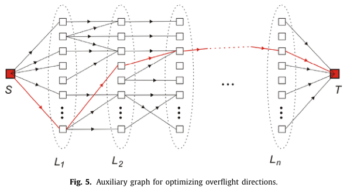
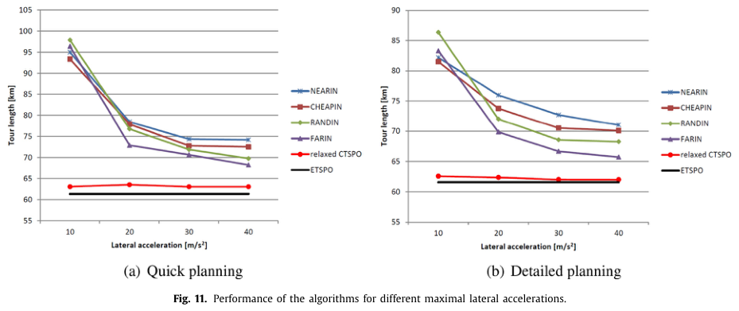
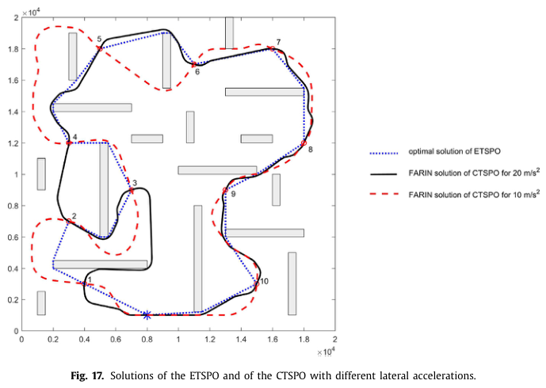

# Babel 2017 · Tour TSP có ràng buộc độ cong cho giám sát trên không khi có chướng ngại

## Tóm tắt một dòng
Đặt bài toán CTSPO (DTSP + tránh chướng ngại), dùng mạng "Mikado" (đường thẳng ngẫu nhiên nối bằng clothoid) để tìm đường bay được, tối ưu hướng bay qua bằng đồ thị phụ p hướng/điểm và đường ngắn nhất, dựng tour bằng chèn dần (NEARIN, FARIN, RANDIN, CHEAPIN); kèm câu "DTSP-N NP-khó vì khi vùng co về điểm thì về DTSP".

## Vì sao đọc
Được dẫn cho bổ đề L1 vì câu lập luận NP-khó của DTSP-N (tr. 2). Ngoài ra đồ thị phụ tối ưu hướng cho thứ tự cố định
(Fig. 5) là công cụ đơn giản để tính lại hướng bay cho tour CHORD/LM-Tour.

## Bài toán và mô hình
- **[GĐ]** Mặt phẳng ngang, điểm xuất phát và đích có hướng cho trước (tour kín hoặc hở); tìm tour ngắn nhất đi qua các
  landmark, tránh chướng ngại đa giác, bay được (feasible và flyable) (tr. 1).
- **[GĐ]** Tốc độ không đổi; độ nhanh nhẹn đặc trưng bởi gia tốc ngang tối đa a; độ cong κ = 1/R = a/v², (3) (tr. 7).
- **[GĐ]** Có thể không tồn tại tour qua mọi landmark; khi đó mục tiêu là tour qua nhiều landmark nhất (tr. 2).
- **[GĐ]** Chuyển giữa hai đường thẳng bằng clothoid – cung tròn – clothoid nên độ cong liên tục (khác đường Dubins có
  độ cong nhảy bậc) (tr. 2–3, Fig. 1).

## Định nghĩa và ký hiệu
| Ký hiệu | Nghĩa |
|---|---|
| CTSPO | curvature-constrained TSP with obstacles |
| ETSPO | TSP Euclid có chướng ngại (nới bỏ độ cong) — cận dưới |
| relaxed CTSPO | bỏ ràng buộc độ cong chỉ tại landmark — tham chiếu (không chắc là cận dưới thật) |
| p | số hướng bay qua rời rạc mỗi landmark |
| length(L_i, α_i, L_j, α_j) | độ dài đường ngắn nhất với hướng ra α_i và hướng vào α_j |
| dist(L_i, L_j) = min_{α_i, α_j} length(…) | khoảng cách không cố định hướng, (1) |
| Δ(L_k, L, L_{k+1}) | độ tăng khi chèn L giữa L_k và L_{k+1}, (2) |

## Kết quả chính
- **[KQ] Độ khó (trích tổng quan)** (tr. 2). ETSP NP-khó (Papadimitriou 1977), nên TSPN, ETSPN cũng vậy; DTSP NP-khó (Le Ny
  et al. 2012); "khi diện tích các vùng tiến về 0, DTSPN trở về DTSP, nên DTSPN cũng NP-khó".
- **[KQ]** Đường ngắn nhất tránh chướng ngại Euclid tính được O(n log n) với n đỉnh đa giác (Hershberger–Suri), còn bản Dubins
  là NP-khó theo n (Reif–Wang 1998) (tr. 2).
- **[KQ] Phân loại heuristic DTSP** (tr. 2): (A) thứ tự trước, hướng sau (Savla 2008, Rathinam 2007, Ma 2006, Macharet 2014);
  (B) hướng trước, thứ tự sau (Tang–Özgüner 2005, Le Ny 2007); (C) trộn (Le Ny 2012, Cohen 2017).
- **[KQ]** Bài không có định lý hay cận hiệu năng; tác giả để phân tích lý thuyết cho tương lai (tr. 11).

## Thuật toán
- **[TT] Mạng Mikado** (tr. 3). Ném ngẫu nhiên các đường thẳng có hướng; mỗi giao điểm sinh hai đỉnh; cạnh là đoạn bay
  (đi thẳng hoặc rẽ sang đường kia bằng clothoid); nhiều mức độ rẽ (độ cong khác nhau) cho mỗi chuyển tiếp; bỏ cạnh xuyên
  chướng ngại; tìm đường bằng Dijkstra/A*. Mỗi landmark thêm p đường qua nó (p hướng) (Fig. 2–4).
- **[TT] Tối ưu hướng cho thứ tự cố định** (tr. 5). Đồ thị phụ: mỗi landmark p đỉnh; cạnh chỉ giữa landmark liên tiếp, trọng
  số length(L_k, α_i, L_{k+1}, α_j); thêm S và T; đường ngắn nhất S → T cho tour tối ưu với thứ tự đã cho (Fig. 5). Lặp k
  vòng bằng k bản sao đồ thị; cấm hướng bằng cách bỏ đỉnh (Fig. 6).
- **[TT] Chèn dần** (tr. 5–7). Tour khởi đầu S → T; mỗi bước lấy landmark theo NEAREST/FARTHEST/RANDOM, chèn vào vị trí có
  Δ nhỏ nhất, tối ưu lại hướng; không chèn được thì đưa lại vào ngăn xếp. CHEAPIN: sắp mọi cặp (L, k) theo Δ, thử lần lượt.
  Có thể dừng sớm khi tour vượt giới hạn quãng bay (tr. 5–6).

## Thực nghiệm và số liệu
- **[TS]** Vùng 20 km × 20 km, 10 landmark cách nhau ≥ 4 km, chướng ngại đa giác trong đường tròn đường kính 4 km, v = 100 m/s,
  a = 10–40 m/s² (R = v²/a = 1000–250 m); 25 kịch bản ngẫu nhiên mỗi điểm; MATLAB, Xeon 3,5 GHz (tr. 7).
- **[TS]** Quick planning: 300 đường Mikado, ~110 000 đỉnh, hướng mỗi 15°, ~7 phút; detailed: 450 đường, ~250 000 đỉnh,
  hướng mỗi 10°, ~55 phút (tr. 8).
- **[SỐ]** Khi a nhỏ, khoảng cách tới cận ETSPO lớn; a vừa: CHEAPIN và NEARIN tốt nhất; a lớn: FARIN tốt nhất; detailed tốt hơn
  quick tới 5 % (Fig. 11, tr. 8).
- **[SỐ]** Với > 14 chướng ngại (a = 20 m/s²) thường không tìm được tour đủ landmark (Fig. 13, tr. 9).
- **[SỐ]** Kịch bản Fig. 17: ETSPO tối ưu 68 022 m; FARIN 83 177 m (a = 10) và 74 294 m (a = 20), tức +22 % và +9 % (tr. 10).

## Hình tiêu biểu

*Đọc hình:* với thứ tự cố định, chọn hướng tối ưu là bài toán đường ngắn nhất trên đồ thị nhiều tầng, đa thức theo n·p².

*Đọc hình:* UAV càng kém linh hoạt (a nhỏ) thì tour càng dài so với cận Euclid; chênh lệch giữa heuristic chỉ vài phần trăm.

*Đọc hình:* ràng buộc độ cong làm tour vòng rộng quanh landmark; bán kính quay lớn tăng độ dài 22 %.

## Trích nguyên văn
- **[TRÍCH]** "As the area of the regions goes to zero, the DTSPN reduces to the DTSP, hence the DTSPN is also NP-hard." (tr. 2)
- **[TRÍCH]** "While there is always a solution for the DTSP, this is not guaranteed for the CTSPO." (tr. 2)

## Liên hệ SigDrop
- **[NX] [L1]** Câu trích tr. 2 là lập luận co vùng: dùng để nói bản có lân cận (UAV chỉ cần vào vùng nghe của cell) cũng
  NP-khó. Lưu ý đây là một câu tổng quan, không phải chứng minh chặt; trong bài J1 nên tự viết phép quy (vùng bán kính
  r → 0 hoặc vùng rất nhỏ so với khoảng cách) và trích Babel làm tiền lệ.
- **[NX] [TOUR]** Đồ thị phụ Fig. 5 (p hướng mỗi điểm, đường ngắn nhất theo thứ tự) là cách rẻ để tối ưu lại hướng bay cho
  thứ tự cell của CHORD; với lân cận có thể thêm chiều vị trí (lấy mẫu điểm trong đĩa) như Isaacs 2011.
- **[NX] [GIÓ]** Dùng clothoid thay cung tròn để độ cong liên tục: quỹ đạo thực của UAV cánh bằng lệch khỏi đường Dubins
  lý tưởng — cùng chiều với lập luận lệch quỹ đạo trong SigDrop.

## Hạn chế và câu hỏi mở
- Chỉ là heuristic, không có cận hiệu năng; relaxed CTSPO không chắc là cận dưới thật (tr. 8).
- Thời gian tính lớn (7–55 phút), chỉ hợp lập kế hoạch offline (tr. 11).
- Tác giả nêu hướng mở: phân tích cận, bản online nhanh hơn, nhiều UAV (tr. 11).
- Mức ★★ (hạ từ ★★★ đề xuất): chỉ một câu dùng cho L1, phần còn lại là công cụ.
