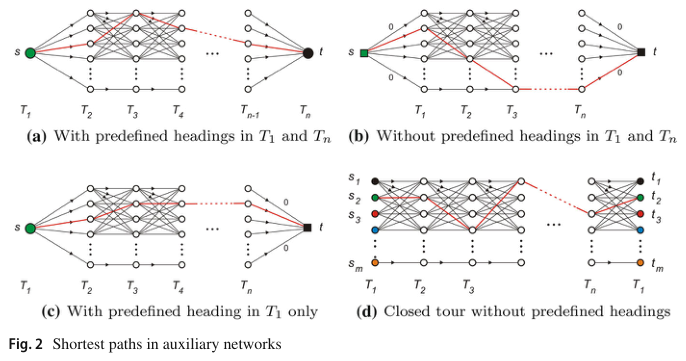
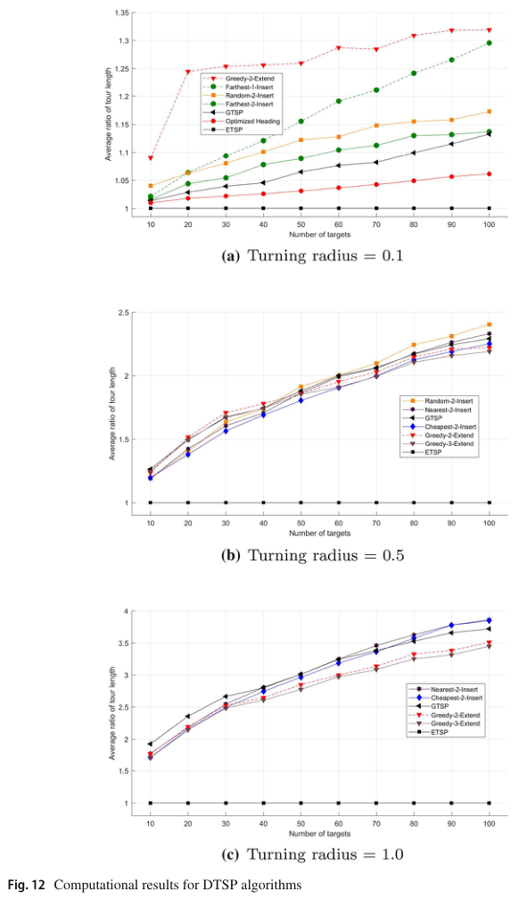

# Babel 2020 · Heuristic mới cho Dubins TSP

## Tóm tắt một dòng
Tối ưu hướng cho một chuỗi điểm có thứ tự bằng rời rạc hoá hướng + đường ngắn nhất trên mạng phụ (DSPP), rồi dựng thứ tự bằng ETSP (Optimized Headings), mở rộng tour mở (Greedy-k-extend) hoặc chèn vào tour đóng (Nearest/Farthest/Cheapest/Random-k-insert); chất lượng ngang thuật toán GTSP của Le Ny 2012 nhưng nhanh hơn nhiều, chạy được hàng nghìn điểm.

## Vì sao đọc
Là bộ heuristic đối chứng thực dụng để tính tour tham chiếu cho CHORD/LM-Tour [TOUR] khi số cell lớn, và cho số liệu "điểm dày làm tour Dubins dài hơn ETSP bao nhiêu".

## Bài toán và mô hình
- **[GĐ]** DTSP tour kín, xe Dubins bán kính r; khó ở chỗ phải chọn đồng thời thứ tự và hướng (tr. 1).
- **[GĐ]** Rời rạc hướng thành h giá trị mỗi điểm; với thứ tự cố định, tìm hướng tối ưu là đường ngắn nhất trên mạng nhiều tầng (Fig. 2) (tr. 5–6).

## Định nghĩa và ký hiệu
| Ký hiệu | Nghĩa |
|---|---|
| DSPP | Dubins shortest path problem: đường Dubins qua dãy điểm có thứ tự |
| h | số hướng rời rạc mỗi điểm |
| GTSP | cách của Le Ny 2012: m hướng/điểm, GTSP bất đối xứng → ATSP n·m đỉnh |
| k-extend / k-insert | mỗi bước tối ưu lại k hướng gần chỗ thêm điểm |

## Kết quả chính
- **[KQ] Mạng phụ** (Fig. 2, tr. 6). Bốn biến thể: hướng đầu và cuối cố định / tự do / chỉ đầu cố định / tour kín không cố định (thêm m nguồn
  s₁…s_m và đích t₁…t_m).
- **[KQ] Mức rời rạc** (Bảng 1, tr. 7). Trung bình 100 instance mỗi tổ hợp (n, r): rời rạc càng mịn tour càng ngắn; với một số r, bước 10° là đủ.
  Ví dụ tour 10 điểm mất ~1 s với bước 5°, ~25 s với bước 1° (tr. 8).
- **[SỐ]** Optimized Headings (thứ tự ETSP + tối ưu hướng, bước 5°): tour ngắn hơn Alternating Algorithm ~25 % (10 điểm) tới ~20 % (100 điểm)
  với r = 0,5; với r = 1,0: > 30 % (10 điểm) và ~10 % (100 điểm) (tr. 9–10).
- **[SỐ] So sánh tổng** (Fig. 12, tr. 21). Tỉ số độ dài tour / ETSP tăng theo n: r = 0,1 khoảng 1,0–1,3; r = 0,5 khoảng 1,2–2,4; r = 1,0 khoảng
  1,8–3,9 (50 instance mỗi điểm). Với r nhỏ Optimized Headings tốt nhất (vượt GTSP); với r lớn các thuật toán extend/insert tốt nhất.
- **[SỐ]** Thời gian: Greedy-2-extend vượt GTSP về thời gian chỉ khi < 80 điểm, đảo ngược khi lớn hơn; GTSP đạt chất lượng tương đương cần
  "nhiều giờ" (tr. 21–22).

## Thuật toán
- **[TT] Optimized Headings** (mục 3). ETSP tối ưu (thứ tự) → DSPP tour kín trên mạng phụ.
- **[TT] Greedy-k-extend** (mục 4). Mở rộng tour mở bằng điểm gần nhất, tối ưu lại k hướng cuối; đóng tour khi đủ.
- **[TT] k-insert** (mục 5). Bắt đầu tour đóng vài điểm; chèn điểm theo quy tắc nearest/farthest/cheapest/random; tối ưu k hướng quanh chỗ chèn.

## Thực nghiệm và số liệu
- **[TS]** Điểm đều ngẫu nhiên trong vùng [−2,5; 2,5]² (chữ trích bị cắt; gần như chắc là vậy), n = 10–100, r ∈ {0,1; 0,5; 1,0}; chuẩn hoá theo ETSP (tr. 8–11).

## Hình tiêu biểu

*Đọc hình:* mỗi cột là một điểm với h hướng; đường đỏ là lời giải đường ngắn nhất.

*Đọc hình:* bán kính quay càng lớn so với khoảng cách điểm thì tour Dubins càng dài hơn ETSP (tới gần 4 lần với 100 điểm, r = 1).

## Trích nguyên văn
- **[TRÍCH]** "The difficulty of the DTSP is to simultaneously find an order of the targets and suitable headings (orientation angles) of the vehicle when passing the targets." (tr. 1)

## Liên hệ SigDrop
- **[NX] [TOUR]** Dùng Optimized Headings (ETSP + tối ưu hướng) làm cách tính tour tham chiếu rẻ cho CHORD; dùng Greedy-2-extend khi ρ lớn so
  với khoảng cách cell. Bước hướng 5–10° là đủ theo Bảng 1.
- **[NX] [A]** Fig. 12 cho bậc độ lớn: khi ρ/khoảng cách ~0,5 thì tour Dubins dài 1,2–2,4 lần ETSP — dùng để chặn T_tour trong định lý A.

## Hạn chế và câu hỏi mở
- Đọc partial: bỏ mô tả chi tiết các biến thể k và các hình ví dụ tour (mục 4–5).
- Heuristic xây dựng, không có cận; tác giả để tìm kiếm cục bộ (2-opt, metaheuristic) cho sau (tr. 26).
