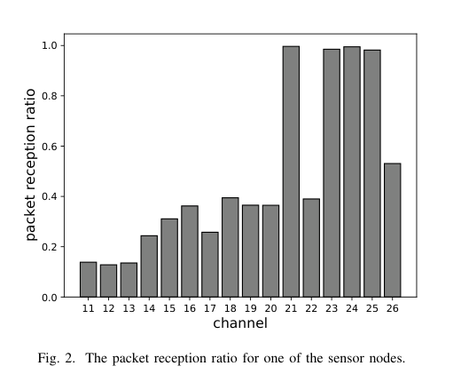
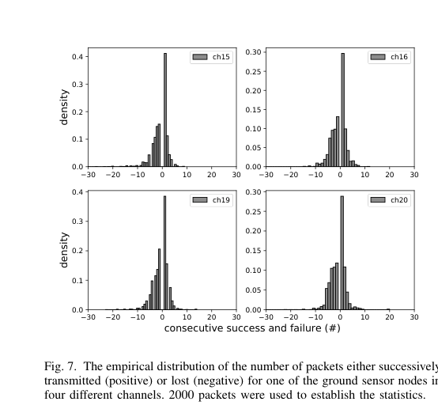

# Dargie, Wen 2021 · Mô hình ước lượng chất lượng liên kết khi triển khai chung UAV và WSN

## Tóm tắt một dòng
Đo liên kết 802.15.4 giữa nút do drone DJI Mavic 2 mang (treo ở nhiều độ cao) và 9 nút mặt đất trên 16 kênh: PRR rất khác theo kênh (0,13–1,0) do nhiễu chéo công nghệ (CTI) từ điều khiển drone; mô hình số gói nhận theo thời gian là quá trình Poisson P(x(t) = k) = (λt)^k e^{−λt}/k!, kèm thống kê chuỗi thành công/thất bại liên tiếp cho độ ổn định ngắn hạn.

## Vì sao đọc
Cho bằng chứng thực nghiệm rằng UAV tự gây nhiễu băng 2,4 GHz cho WSN và mất gói A2G có tính "bùng" (bursty) theo kênh —
ảnh hưởng giả định mất gói độc lập trong mô hình kênh [KÊNH] và baseline FC của SigDrop.

## Bài toán và mô hình
- **[GĐ]** UAV và WSN dùng chung băng ISM; drone điều khiển từ xa gây CTI; khi treo cũng bị gió và rung (tr. 2).
- **[GĐ]** Thí nghiệm: 9 nút lưới (cách 5 m theo hàng, 10 m theo cột) ở bãi trống cạnh rừng; drone mang hai nút treo ở nhiều độ cao;
  mỗi kênh phát 2000 gói liên tục, ipi tương ứng 8 Hz, 7 dBm (tr. 2–3).
- **[GĐ]** Mô hình: liên kết là quá trình ngẫu nhiên theo thời gian; tốc độ thành công dài hạn μ = n/T (tr. 4).

## Định nghĩa và ký hiệu
| Ký hiệu | Nghĩa |
|---|---|
| τ, ipi | thời gian phát một gói lý tưởng; khoảng giữa hai gói |
| W ≈ T/(τ + ipi) | số gói phát được trong T, (1) |
| n = μT | số gói thành công |
| p = ΔT/T | xác suất một gói rơi vào cửa sổ ΔT, (2) |
| λ = np | tham số Poisson |
| x(t) | số gói UAV thu được trên một liên kết trong [0, t] |
| s(t) | quá trình độ ổn định ngắn hạn (chuỗi thành công liên tiếp) |

## Kết quả chính
- **[KQ] (3)–(11)** (tr. 4). Từ nhị thức với n → ∞ suy ra Poisson; với cửa sổ t bất kỳ P(x(t) = k) = (λt)^k e^{−λt}/k!; E[x(t)] = λt
  là goodput theo thời gian, phương sai đo độ bùng (tr. 4).
- **[KQ] Ước lượng thời gian nhiệm vụ** (tr. 6). Cần thu N gói thì thời gian kỳ vọng ≈ N/λ; ngược lại trong t thu λt gói.
- **[KQ] Ổn định ngắn hạn** (tr. 5). Phân bố số gói thành công (dương) / thất bại (âm) liên tiếp: > 30 % trường hợp một gói thành công
  bị theo ngay bởi một gói mất — dấu hiệu CTI mạnh khi drone điều khiển từ xa ở gần (Fig. 7).
- **[KQ] Gợi ý MAC** (tr. 2, 6). TDMA + nhảy tần có thống kê nhiễu, UAV điều phối khe cho gateway; độ dài khe/burst lấy từ thống kê
  chuỗi thành công.

## Thuật toán
Không có thuật toán; mô hình thống kê và cách chọn kích thước burst/khe (tr. 5–6).

## Thực nghiệm và số liệu
- **[SỐ]** PRR theo kênh cho một nút: kênh 11–13 ~0,13; 14–20 ~0,25–0,4; 21, 23–25 ~0,98–1,0; 22 ~0,39; 26 ~0,53 (Fig. 2, tr. 3).
- **[SỐ]** Phân bố chuỗi liên tiếp trên kênh 15, 16, 19, 20 tập trung quanh ±1–5 gói (Fig. 7, tr. 5).
- Phần đánh giá định lượng mô hình (mục IV) chỉ đọc lướt.

## Hình tiêu biểu

*Đọc hình:* các kênh thấp gần như hỏng (nhiễu từ liên kết điều khiển và Wi-Fi), vài kênh cao gần hoàn hảo — chọn kênh quan trọng hơn công suất.

*Đọc hình:* chuỗi thường rất ngắn — mất gói xen kẽ dày, không phải vài đợt mất dài.

## Trích nguyên văn
- **[TRÍCH]** "more than 30 % of the time, the successful transmission of a single packet was always followed by the loss of another packet in almost all the cases, thus emphasizing the strong effect of CTI when a remotely controlled UAV operates near a WSN." (tr. 5)

## Liên hệ SigDrop
- **[NX] [KÊNH]** CTI do chính UAV gây ra là yếu tố mô hình kênh SigDrop chưa có; nên nêu trong phần giới hạn mô hình, hoặc giả định
  UAV cánh bằng tự hành không có liên kết điều khiển 2,4 GHz liên tục.
- **[NX] [FC]** Mất gói xen kẽ dày (chuỗi ngắn) gần với giả định Bernoulli độc lập; điều này ủng hộ phân tích kiểu Ghaderi 2008 cho FC,
  nhưng p khác rất mạnh theo kênh.
- **[NX]** Mô hình Poisson ở đây chỉ là xấp xỉ đếm với tốc độ không đổi; không mô tả phụ thuộc khoảng cách như cần cho SigDrop.

## Hạn chế và câu hỏi mở
- Drone treo, không bay ngang; khoảng cách nhỏ (lưới 10–20 m); một địa điểm.
- Phép suy ra Poisson từ nhị thức là chuẩn, không chứa thông tin kênh mới; phần thẩm định mô hình chưa đọc kỹ.
