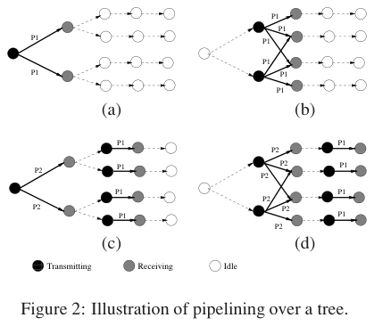
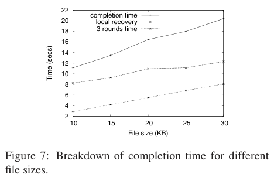

# Doddavenkatappa, Chan, Leong 2013 · Splash: phổ biến dữ liệu nhanh bằng giao thoa xây dựng

## Tóm tắt một dòng
Splash bỏ hẳn tranh chấp kênh bằng "tree pipelining": mỗi tầng của cây thu thập phát đồng thời cùng gói (giao thoa xây dựng) trên kênh riêng; ba vòng phát (đổi mật độ người phát, đổi kênh, vòng 3 là gói XOR) rồi khôi phục cục bộ; 32 KB trong ~25 s trên 139 nút, nhanh hơn DelugeT2 trung bình 21×.

## Vì sao đọc
Là bước trung gian giữa Deluge và Pando (Du 2017): cho số liệu về "đuôi dài" của phát lặp có cấu trúc và cho thấy độ tin cậy
giao thoa xây dựng giảm khi nhiều người phát — cơ sở cho baseline [FC] và cho các giả định kênh mặt đất.

## Bài toán và mô hình
- **[GĐ]** Phổ biến đối tượng lớn tới mọi nút, tin cậy 100 %; dựa trên Glossy (lệch < 0,5 μs) và PIP (pipeline đa kênh) (tr. 1–2).
- **[GĐ]** Cây phổ biến lấy từ CTP; > 50 % nút là lá ngay cả ở công suất phát thấp nhất, nên số người phát đồng thời giảm (tr. 3).
- **[GĐ]** Gói lớn (≥ 64 byte) để hiệu quả, dù gói lớn làm giao thoa xây dựng kém tin cậy hơn (tr. 1).

## Định nghĩa và ký hiệu
| Ký hiệu | Nghĩa |
|---|---|
| tree pipelining | mỗi tầng cây là một tầng pipeline, tầng khác nhau dùng kênh khác nhau |
| transmission density diversity | đổi số người phát giữa các vòng (vòng 2 lá không phát) |
| opportunistic overhearing | phát hiện gói hỏng sớm, đổi kênh nghe lại từ nút cùng tầng |
| R1, R2, R3, NR3−100% | độ tin cậy sau vòng 1, 2, 3; tỉ lệ nút đủ 100 % sau vòng 3 |

## Kết quả chính
- **[KQ] Đo giao thoa xây dựng** (tr. 3–4, Fig. 1). Gói 128 byte: độ tin cậy nhận giảm khi số người phát đồng thời tăng (ví dụ tầng 1:
  ~100 % với 1–2 người phát, ~40 % với 3–5); nhưng có trường hợp thêm người thứ sáu làm tăng từ ~37 % lên 100 % (hiệu ứng capture).
- **[KQ] Bốn kỹ thuật tin cậy** (tr. 2). Đổi mật độ người phát, nghe lén cơ hội, xoay kênh giữa các vòng, XOR coding ở vòng 3.
- **[KQ] XOR** (mục 4.4). Sau hai vòng ~50 % nút có gần đủ nhưng chưa đủ gói; vòng 3 phát gói XOR (sau Pando cho thấy 97,8 % gói
  XOR này vô ích — xem du2017-pando).
- **[KQ] Khôi phục cục bộ** (mục 4.5). Sau ba vòng ~90 % nút có đủ đối tượng; phần còn lại xin gói qua CSMA.

## Thuật toán
- **[TT] Splash** (mục 4). Vòng 1: mọi nút phát; vòng 2: lá không phát (đổi mật độ), đổi kênh; vòng 3: gói XOR; rồi local recovery.
  Gói thiếu thì chuyển kênh nghe nút cùng tầng ngay trong khe.

## Thực nghiệm và số liệu
- **[TS]** Indriya 139 nút (tới 9 chặng), Twist 90 nút; Contiki 2.5; đối tượng 32 KB; so Deluge Contiki và DelugeT2 TinyOS (tr. 2).
- **[SỐ]** 32 KB trong ~25 s trên cả hai testbed; nhanh hơn DelugeT2 trung bình 21×, tốt nhất 57,8×; MT-Deluge chỉ 2,42× (tr. 2).
- **[SỐ]** Goodput toàn mạng 10,1 kbit/s mỗi nút với 139 nút, 9 chặng (Burst Forwarding một luồng đạt 16 kbit/s) (tr. 2).
- **[SỐ]** Ít hơn DelugeT2 9,63 KB ROM và 0,68 KB RAM (tr. 2).
- **[SỐ]** Phân rã thời gian theo kích thước tệp 10–30 KB: ba vòng 3–8 s, khôi phục cục bộ 8–12 s, tổng 11–20 s — khôi phục cục bộ
  chiếm phần lớn (Fig. 7, tr. 13).

## Hình tiêu biểu

*Đọc hình:* mỗi khe một tầng phát, tầng kế nhận; nhiều nút cùng tầng phát cùng gói nhờ giao thoa xây dựng.

*Đọc hình:* phần đuôi (khôi phục cục bộ qua CSMA) dài hơn cả ba vòng pipeline — đây là "đuôi dài" mà Pando xử lý bằng fountain code.

## Trích nguyên văn
- **[TRÍCH]** "the time taken for disseminating a large data object over a wireless sensor network is dominated by the overhead of resolving the contention for the underlying wireless channel." (tr. 1)

## Liên hệ SigDrop
- **[NX] [FC]** Fig. 7 là bằng chứng định lượng rằng phát lặp + sửa cục bộ để đuôi dài; dùng cùng Pando để biện luận khi nào FC vượt
  phát lặp có cấu trúc.
- **[NX] [KÊNH]** Fig. 1: tăng người phát đồng thời có thể làm giảm hoặc tăng độ tin cậy (capture) — mặt đất hợp tác đồng thời trong
  SigDrop không nên mô hình như cộng công suất đơn giản.

## Hạn chế và câu hỏi mở
- Đọc partial: bỏ chi tiết mục 4 (định dạng gói, gán kênh) và phần lớn mục 5 (bảng chi tiết).
- Phụ thuộc phần cứng hỗ trợ giao thoa xây dựng; cây cố định từ CTP.
- Phân loại trong WORKLIST ("2011-chandiv", chủ đề kênh A2G) là đoán sai từ Crossref; đã sửa khoá và chủ đề.
