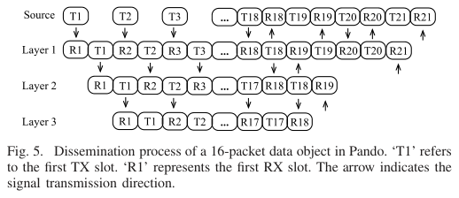
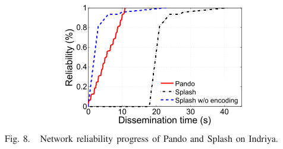
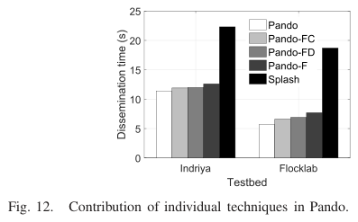

# Du, Liando, Zhang, Li 2017 · Pando: phổ biến dữ liệu bằng fountain code trên pipeline giao thoa xây dựng

## Tóm tắt một dòng
Pando phát luồng gói LT (fountain) liên tục qua cây pipeline dùng giao thoa xây dựng (Glossy) và đa kênh (PIP), giải mã xen trong khoảng rỗi CPU, dừng bằng phản hồi "im lặng" RSSI; đạt tin cậy 100 % và nhanh hơn Splash 3,5× (Indriya), nhanh hơn Deluge ~32,7×.

## Vì sao đọc
Đây là đại diện mạnh nhất của baseline fountain code [FC] cho phổ biến mặt đất: cho thấy FC xoá được "đuôi dài" (long
tail) của các vòng phát lặp, và cho số liệu thực nghiệm (thời gian, hiệu suất mã, chi phí phản hồi) để so với River/Manifest.

## Bài toán và mô hình
- **[GĐ]** Phổ biến một đối tượng dữ liệu (32 KB = 500 gói × 64 byte payload) từ một nguồn tới mọi nút WSN, tin cậy
  100 % (tr. 1, 3).
- **[GĐ]** Cây nhiều tầng lấy từ giao thức thu thập (Contiki Collect); mỗi nút chỉ cần biết số chặng, cha, con (tr. 4).
- **[GĐ]** Mọi nút cùng tầng phát đồng thời cùng một gói (giao thoa xây dựng, lệch đồng bộ < 0,5 μs); các tầng khác nhau
  phát song song trên kênh khác nhau (pipeline) (tr. 2).
- **[GĐ]** Trong lúc phổ biến, các hoạt động khác tạm dừng, radio và CPU luôn bật (tr. 4).

## Định nghĩa và ký hiệu
| Ký hiệu | Nghĩa |
|---|---|
| k, m | số gói gốc; số gói mã cần nhận (m ≥ k); hiệu suất mã k/m (tr. 4) |
| ρ(d) | phân bố bậc LT; Pando dùng phân bố tối ưu của SYNAPSE++ thay vì robust Soliton (tr. 5) |
| AGE | Accumulative Gaussian Elimination: giải mã tăng dần (tr. 5–6) |
| RSSI_threshold = (RSSI_silence + RSSI_rx)/2 | ngưỡng phát hiện kênh im lặng (tr. 7) |
| M | số khe im lặng liên tiếp để kết luận con đã giải xong (M = 3) (tr. 7) |
| network reliability | trung bình tỉ lệ dữ liệu nhận được trên mọi nút (tr. 3) |

## Kết quả chính
- **[KQ] Đuôi dài của Splash** (tr. 3). Vòng 1 đạt 85 %, vòng 2 lên 96,8 %, vòng 3 (500 gói XOR, mỗi gói XOR của 20 gói)
  lên 99 %; 76,2 % gói nhận ở mỗi nút là trùng; 97,8 % gói XOR vô ích; thời gian để đạt 100 % lớn hơn 10× thời gian đạt
  75,9 % ở vòng 1; mã hoá XOR mất ~18 s (915 μs/gói), khôi phục cục bộ CSMA ~13 s (Fig. 2–3).
- **[KQ] Ước lượng lợi ích FC** (tr. 4). Thay gói trong cùng vết bằng gói fountain: 1132 gói mã là đủ đạt 100 %, giảm thời
  gian Splash 7,2×.
- **[KQ] Mã hoá theo radio** (tr. 5–6). Đọc/ghi 1 byte qua SPI 5,75 μs ≪ 32 μs phát 1 byte, nên CPU có khoảng rỗi cố định
  1688 μs mỗi gói để giải mã; lưu ngữ cảnh ≤ 64 μs < khoảng bảo vệ 256 μs. Gói 73 byte, phát 65 byte đầu mất 2080 μs,
  đọc mất 392 μs. Giải mã AGE đạt hiệu suất 89 % với 16 gói gốc (tr. 5–6).
- **[KQ] Phản hồi im lặng** (tr. 6–7). Nút lá giải xong thì ngừng phát; nút chuyển tiếp thấy mọi con im (RSSI < ngưỡng,
  M = 3 khe) thì ngừng; im lặng gộp dần về nguồn. Ví dụ 3 tầng, 16 gói: mỗi nút cần 17 gói mã; phản hồi về nguồn sau 5 khe
  (13,6 ms) kể từ khi lá cuối giải xong (Fig. 5).
- **[KQ] Thích nghi theo gói** (tr. 7–8). Mỗi gói một kênh (15, 20, 25, 26 xoay vòng; hai gói cùng kênh cách ≥ 8 chặng);
  nút lá chỉ phát gói số chẵn để đổi mật độ người phát đồng thời theo từng gói.

## Thuật toán
- **[TT] Pando** (tr. 4–9). Đánh thức: nguồn phát lệnh bắt đầu 4 byte 20 lần trên kênh 26, chờ 10 khe đo nhiễu. Chia đối
  tượng thành trang 2 KB (32 gói) do RAM 10 KB; trang kế tiếp bắt đầu khi phản hồi im lặng của trang trước về tới nguồn.
  Nút đã giải xong tự sinh gói mã mới cho con. Máy trạng thái ở Fig. 7; mất gói thì ở lại kênh để nghe lén nút cùng tầng.

## Thực nghiệm và số liệu
- **[TS]** Indriya 99 TelosB (dày, trong nhà), FlockLab 31 Tmote Sky (thưa, một số ngoài trời), 2,4 GHz; 32 KB = 500 gói ×
  64 byte; mỗi giao thức 5 lần với vị trí nguồn khác nhau; so Deluge (Contiki) và Splash (tr. 9).
- **[SỐ]** Pando: 11,4 s (Indriya), 5,7 s (FlockLab); Splash: 40,1 s và 36,5 s → giảm 3,5× và 6,4×; không tính thời gian
  mã hoá của Splash: 2,0× và 3,3× (Bảng I–II, tr. 10). Mọi giao thức đều đạt 100 %.
- **[SỐ]** Deluge Contiki trên FlockLab: 476,6 s cho 2 KB (≈ 7625,6 s cho 32 KB); quy đổi DelugeT2 trên Indriya ≈ 373,2 s;
  Splash và Pando nhanh hơn DelugeT2 9,3× và 32,7× (tr. 10).
- **[SỐ]** Số nút tăng > 2× (FlockLab → Indriya) mà thời gian tăng < 1× (tr. 10).
- **[SỐ]** Năng lượng giảm theo đúng tỉ lệ thời gian (2,0× và 3,3×); cho Splash ngủ CPU khi rỗi chỉ tiết kiệm 5,2 %;
  radio 69 mW ≫ CPU 5,4 mW (Fig. 10, tr. 11).
- **[SỐ]** Bộ nhớ: 6,24 KB RAM, 32 KB flash dữ liệu, 31,49 KB ROM (tr. 11).
- **[SỐ] Đóng góp từng kỹ thuật** (Fig. 12, tr. 12). Chỉ fountain (Pando-F): nhanh hơn Splash 1,8× (Indriya), 2,6×
  (FlockLab); thêm thích nghi kênh: +5,6 % và +14,3 %; thêm thích nghi mật độ: +4,8 % và +10,4 %; cả hai: +9,5 % và +26,0 %.
- **[SỐ]** Các giao thức CSMA trước Splash chỉ nhanh hơn Deluge ~1,6× (tối đa 2,4×) (Bảng III, tr. 11).

## Hình tiêu biểu

*Đọc hình:* các tầng phát song song lệch một khe; sau gói thứ 17 lá ngừng phát, sự im lặng truyền ngược lên nguồn trong vài khe.

*Đọc hình:* Splash lên nhanh tới ~95 % rồi có đuôi dài; Pando tăng đều và xong ở ~11 s.

*Đọc hình:* phần lớn lợi ích đến từ fountain code; thích nghi kênh và mật độ thêm 10–26 %.

## Trích nguyên văn
- **[TRÍCH]** "Since every encoded packet contains innovative information to the original data object, Pando avoids duplicate retransmissions and fully exploits the wireless broadcast effect in data dissemination." (tr. 1)
- **[TRÍCH]** "Splash suffers from the long tail problem, where the dissemination time for achieving 100% reliability is orders of magnitude longer than the time needed for 80% reliability." (tr. 1)

## Liên hệ SigDrop
- **[NX] [FC]** Pando là bằng chứng thực nghiệm mạnh nhất cho baseline FC: đuôi dài của phát lặp/XOR biến mất khi mọi gói
  đều "mới". Khi so SigDrop với FC cần nêu: lợi thế FC đến từ việc không cần biết nút thiếu gì; SigDrop bù lại bằng kế
  hoạch biết trước và hợp tác mặt đất có cấu trúc.
- **[NX] [C]** Phản hồi im lặng (dừng khi mọi nút xong) là giải pháp chi phí điều khiển gần 0 cho điều kiện dừng; UAV
  không dùng được trực tiếp vì UAV không ở lại nghe — đây là điểm khác cần nêu trong định vị [ĐV].
- **[NX] [KÊNH]** Kết quả "kênh tốt khác nhau theo vị trí" (Fig. 13) và "giao thoa xây dựng kém khi nhiều người phát"
  ủng hộ giả định mất gói không đồng nhất giữa các nút trong mô hình SigDrop.
- **[NX]** Hiệu suất LT 89 % với 16 gói (tr. 6) và 1 gói dư cho 16 gói trong ví dụ là số liệu tham chiếu cho tham số ε
  của baseline FC.

## Hạn chế và câu hỏi mở
- Cần đồng bộ chặt (< 0,5 μs) và cây cố định; không có nguồn di động.
- Trang 32 gói vì RAM; phản hồi theo từng trang làm chậm vòng đầu (tr. 10, 12).
- Tác giả nêu việc phân tích lý thuyết hiệu năng và đo tỉ lệ nhận gói tệ nhất là hướng mở (tr. 13).
