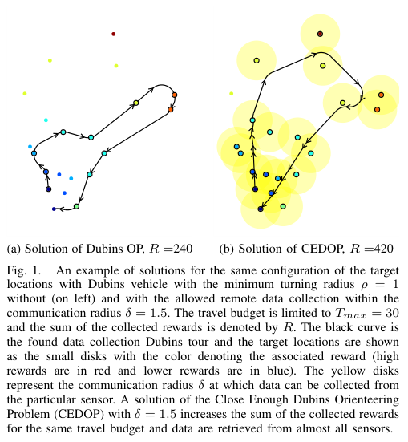

# Faigl, Pěnička 2017 · Bài toán orienteering "đủ gần" với xe Dubins (CEDOP)

## Tóm tắt một dòng
CEDOP (cùng bài toán với DOPN: chọn điểm, thứ tự, waypoint trong đĩa bán kính δ và hướng sao cho đường Dubins ≤ T_max và tổng thưởng lớn nhất) được giải bằng bản đồ tự tổ chức (SOM); kết quả kém VNS một chút, nhất là trên lưới đều (Set 64, 66), nhưng nhẹ tính hơn nhiều.

## Vì sao đọc
Chỉ để biết: phương án học không giám sát cho cùng bài toán với penicka2017-dopn / penicka2019-datacoll; minh hoạ rõ lợi ích của bán kính liên lạc khác 0 (Fig. 1).

## Bài toán và mô hình
- **[GĐ]** Như DOPN: thưởng thu được khi vào đĩa bán kính δ (bán kính liên lạc); đường Dubins ρ; ngân sách T_max; động cơ là chụp ảnh và lấy dữ liệu từ mạng cảm biến (tr. 1).

## Định nghĩa và ký hiệu
| Ký hiệu | Nghĩa |
|---|---|
| CEDOP | Close Enough Dubins Orienteering Problem |
| SOM | self-organizing map; nơ-ron dọc đường được kéo về các điểm, chọn "nơ-ron thắng" (Fig. 4) |
| δ, ρ, T_max, R | bán kính liên lạc, bán kính quay, ngân sách, tổng thưởng |

## Kết quả chính
- **[SỐ]** Ví dụ Fig. 1: cùng cấu hình, ρ = 1, T_max = 30: DOP (δ = 0) thu R = 240; CEDOP (δ = 1,5) thu R = 420 (tr. 1).
- **[KQ]** SOM ngang VNS ở bài điểm thưa (Set 3), kém hơn ở bài lưới (Set 64, 66) do luật cục bộ đơn giản khi bỏ nơ-ron để giữ ngân sách; nhanh hơn VNS (tr. 6).
- **[SỐ]** Ví dụ Fig. 7: Set 66, T_max = 66, ρ = 1: R = 810 với δ = 0,25; R = 1185 với δ = 1,25 (tr. 7).

## Thuật toán
- **[TT] SOM–CEDOP** (mục IV, chỉ đọc lướt chú thích hình). Lặp: chọn điểm, tìm nơ-ron thắng trên đường hiện tại, kéo nơ-ron và láng giềng về phía đĩa của điểm, tính lại đường Dubins, bỏ điểm nếu vượt ngân sách.

## Thực nghiệm và số liệu
Không đọc chi tiết (mức abstract).

## Hình tiêu biểu

*Đọc hình:* cho phép thu từ xa δ, đường cùng ngân sách đi qua vùng của gần như mọi điểm.

## Trích nguyên văn
- **[TRÍCH]** "the saved travel cost by collecting rewards at the non zero distance from the targets allows to collect more rewards." (tr. 1)

## Liên hệ SigDrop
- **[NX] [TOUR]** Fig. 1 là minh hoạ trực quan tốt cho lập luận "vùng nghe làm tour ngắn đi nhiều" — lợi ích LM-Tour so với tour qua tâm cell.

## Hạn chế và câu hỏi mở
- Chỉ đọc abstract, mở đầu, kết luận và chú thích hình.
