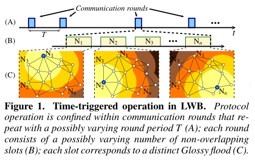

# Ferrari, Zimmerling, Mottola, Thiele 2012 · LWB: bus không dây công suất thấp

## Tóm tắt một dòng
LWB biến mạng đa chặng thành "bus chung": mọi trao đổi là một lần flood Glossy, các flood được lập lịch toàn cục theo vòng do một nút host tính và phát; không giữ trạng thái topo nên chịu được nhiễu, hỏng nút và nút di động; hỗ trợ 1–nhiều, nhiều–1, nhiều–nhiều với >99 % gói và duty cycle thấp.

## Vì sao đọc
LWB là ví dụ rõ nhất của "lịch phát biết trước, phát tán bằng một bản tin lịch đầu vòng" — gần với Manifest của SigDrop.
Cho số liệu về chi phí điều khiển của cách lập lịch tập trung [C] và cách xử lý nút di động [ĐV].

## Bài toán và mô hình
- **[GĐ]** Mạng công suất thấp có nhiều kiểu lưu lượng và nút di động lẫn trong hạ tầng tĩnh (tr. 1).
- **[GĐ]** Lưu lượng chủ yếu định kỳ, khai báo dưới dạng luồng (IPI, thời điểm bắt đầu) (tr. 3).
- **[GĐ]** Dựa trên Glossy: flood nhanh, tin cậy cao, đồng bộ thời gian toàn cục miễn phí, không trạng thái topo (tr. 1).

## Định nghĩa và ký hiệu
| Ký hiệu | Nghĩa |
|---|---|
| round, T | vòng truyền thông, chu kỳ vòng (host điều chỉnh, ví dụ 1 s → 30 s) |
| slot | khe trong vòng; mỗi khe một flood Glossy; khe lịch T_s = 15 ms, khe dữ liệu T_d = 10 ms (Bảng 1) |
| host | nút tính lịch toàn cục và phát lịch đầu mỗi vòng |
| stream, IPI | luồng gói định kỳ, khoảng giữa hai gói |
| contention slot | khe tranh chấp để nút báo nhu cầu mới |

## Kết quả chính
- **[KQ] Thiết kế ba trụ** (tr. 1). (1) chỉ dùng flood; (2) truy cập bus theo thời gian (time-triggered) theo lịch toàn cục;
  (3) lịch tính tập trung tại host và phát định kỳ cho mọi nút.
- **[KQ] Cấu trúc vòng** (Fig. 1–2, tr. 2–3). Khe lịch của host → các khe dữ liệu đã gán → một khe tranh chấp → host tính lịch
  mới và phát ở cuối vòng. Radio tắt giữa hai vòng.
- **[KQ] Tự điều chỉnh chu kỳ** (tr. 4). Ví dụ 6 nút nguồn mỗi nút 1 gói/6 s: khi không còn yêu cầu luồng mới, host nâng T từ 1 s lên 30 s
  và gán 5 khe dữ liệu mỗi nguồn mỗi vòng.
- **[KQ] Khả năng mở rộng** (tr. 10–11). Thời gian tính lịch xấu nhất 49 ms với 259 luồng; bộ nhớ 13 byte mỗi luồng; băng thông
  tăng tuyến tính theo số luồng; hiệu quả giảm với topo tuyến tính hàng chục chặng và lưu lượng không định kỳ (tr. 2).

## Thuật toán
- **[TT] Lập lịch** (mục 4, chỉ đọc lướt). Host phân bổ khe công bằng giữa các luồng, tính chu kỳ vòng theo nhu cầu; có cơ chế
  nút tham gia/rời và khôi phục khi host hỏng.

## Thực nghiệm và số liệu
- **[TS]** Bốn testbed: TWIST 90 nút (−7 dBm, 3 chặng), KANSEI 260 (−20 dBm, 4 chặng), CONETIT 26 nút (5 di động trên robot, −25 dBm,
  3 chặng), FlockLab 55 (0 dBm, 5 chặng); 256 lần chạy, 838 giờ; so 7 tổ hợp (BCP, CTP, Muster, Dozer trên CSMA/LPL/A-MAC) (tr. 2, Bảng 3).
- **[SỐ]** Nhiều–1: 259 nguồn mỗi nguồn 5 gói/s (tức tổng tải) với data yield gần 100 % khi CTP+LPL sụp; tải tăng đột ngột 54 → 460 gói/phút
  vẫn giữ ~100 % (tr. 2).
- **[SỐ]** Nút di động (nguồn, đích hoặc cả hai): > 99 % gói, duty cycle rất thấp, hơn BCP và CTP (tr. 2).
- **[SỐ]** Mã: LWB 22 kB so với CTP 26–28 kB, Dozer 38 kB, Muster 35–37 kB (Bảng 2).

## Hình tiêu biểu

*Đọc hình:* mỗi khe một nút khởi phát flood và cả mạng chuyển tiếp; lịch đầu vòng cho mọi nút biết ai phát khi nào.

## Trích nguyên văn
- **[TRÍCH]** "LWB turns a multi-hop low-power wireless network into an infrastructure similar to a shared bus, where all nodes are potential receivers of all data." (tr. 1)
- **[TRÍCH]** "the network state kept at a LWB node is independent of the network topology and thus resilient to any such change." (tr. 2)

## Liên hệ SigDrop
- **[NX] [C]** Bản tin lịch đầu vòng của LWB là tiền lệ thực nghiệm cho "kế hoạch phát" (Manifest): một bản tin nhỏ, phát flood,
  thay cho thương lượng từng cặp; chi phí điều khiển chỉ là 1 khe lịch + 1 khe tranh chấp mỗi vòng.
- **[NX] [ĐV]** LWB hỗ trợ nút di động bằng cách không giữ trạng thái topo; SigDrop có nguồn di động là UAV — khác ở chỗ UAV không
  tham gia flood suốt vòng mà chỉ đi qua.
- **[NX]** Hạn chế "kém với topo tuyến tính nhiều chặng" (tr. 2) liên quan pha hợp tác mặt đất của SigDrop khi cell dài.

## Hạn chế và câu hỏi mở
- Đọc partial: bỏ mục 3–4 chi tiết lập lịch, mục 5–10 thí nghiệm chi tiết, mục 11.2–11.3.
- Cần host tập trung; phụ thuộc Glossy (đồng bộ chặt, phần cứng hỗ trợ giao thoa xây dựng).
