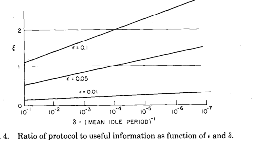
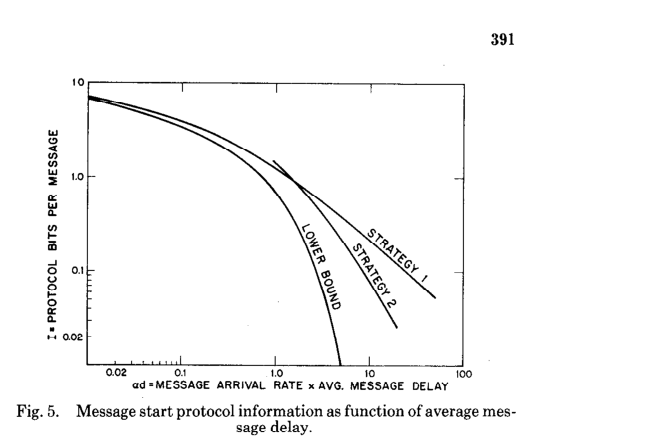

# Gallager 1976 · Giới hạn cơ bản của thông tin giao thức trong mạng dữ liệu

## Tóm tắt một dòng
Dùng lý thuyết rate–distortion chứng minh mỗi thông điệp cần ít nhất H(M) − log₂(1 − e^{−αd}) bit giao thức (thông tin độ dài + thông tin thời điểm bắt đầu, phụ thuộc chỉ vào tích αd), địa chỉ chỉ là một cách mã hoá thông tin thời điểm; hai chiến lược gom hàng đợi đạt gần cận khi số cặp nguồn–đích lớn.

## Vì sao đọc
Là nguồn kinh điển để phát biểu "chi phí điều khiển có cận dưới thông tin học" và đánh đổi giữa trễ và bit điều khiển.
Dùng cho phần lập luận giá trị thông tin của kế hoạch [C] và chi phí điều khiển của Manifest trong SigDrop.

## Bài toán và mô hình
- **[GĐ]** Mạng gồm nút, liên kết hai chiều không lỗi, các cặp nguồn–đích; mỗi nguồn gửi thông điệp nhị phân độ dài
  ngẫu nhiên vào thời điểm ngẫu nhiên tới đích của nó (tr. 1, Fig. 1).
- **[GĐ]** Bỏ qua giao thức tầng cao (kết nối, định tuyến động, kiểm soát luồng), lỗi liên kết (xử lý riêng bằng ARQ);
  một nguồn gửi nhiều đích được coi là nhiều nguồn ảo (tr. 2, 6).
- **[GĐ] Mục III** (tr. 2–3): một liên kết, K nguồn đồng bộ, nguồn Markov hai trạng thái bận/rỗi (Fig. 2); độ dài thông
  điệp hình học trung bình 1/ε, khoảng rỗi hình học trung bình 1/δ; mỗi bit phải tới đích với trễ cố định.
- **[GĐ] Mục IV** (tr. 6): thông điệp đến theo Poisson tốc độ α cho mỗi cặp, cả thông điệp đến một lúc, độ dài có phân
  bố P_M với entropy H(M); thông điệp phải giữ ranh giới; trễ trung bình bị chặn bởi d.

## Định nghĩa và ký hiệu
| Ký hiệu | Nghĩa |
|---|---|
| ε, δ | xác suất kết thúc thông điệp mỗi đơn vị thời gian (độ dài TB 1/ε); xác suất bắt đầu khi rỗi (khoảng rỗi TB 1/δ) |
| ℋ(x) | entropy nhị phân −x log₂x − (1−x) log₂(1−x) |
| H_∞(U) | entropy nguồn Markov mỗi đơn vị thời gian, (2) |
| η | tỉ lệ thông tin giao thức trên thông tin thông điệp, (4) |
| α, d | tốc độ đến Poisson của một cặp; trễ trung bình do giao thức gây ra (không tính trễ lan truyền) |
| X_i, Y_i, D_i | thời điểm đến, thời điểm giao, trễ D_i = Y_i − X_i ≥ 0 |
| R_N(d), R(d) | hàm rate–distortion bậc N và giới hạn, (8)–(9): min thông tin tương hỗ I(X^N; Y^N) với trễ TB ≤ d |
| H(M) | entropy độ dài thông điệp |

## Kết quả chính
- **[KQ] (1), (4)** (tr. 2, 4). Với nguồn Markov, thông tin giao thức trung bình mỗi thông điệp là ℋ(ε)/ε + ℋ(δ)/δ bit;
  tỉ lệ η = ℋ(ε) + (ε/δ)ℋ(δ). (Chữ trích của (1) và (5) bị vỡ; dạng trên dựng lại từ (2) và (4) [NX].)
  Fig. 4: giao thức chiếm phần lớn dung lượng khi thông điệp ngắn (ε lớn) hoặc khoảng rỗi dài (δ nhỏ) (tr. 4).
- **[KQ] Định lý 1** (tr. 4). K nguồn độc lập theo Fig. 2, truyền với trễ cố định qua một kênh chung: cần C ≥ K·H_∞(U).
  *Ý chứng minh:* đích phải dựng lại được cả ký hiệu rỗi, nên thông tin tương hỗ = entropy nguồn; dùng đảo của định lý mã hoá kênh.
- **[KQ] Chiến lược danh sách bận** (tr. 4). Hai bên giữ danh sách nguồn đang bận; mỗi đơn vị thời gian mã hoá tập nguồn
  vừa chuyển bận→rỗi, rồi rỗi→bận (mã tiền tố), rồi bit dữ liệu theo thứ tự nguồn; độ dài kỳ vọng K·H_∞(U) + 2, (6).
- **[KQ] Định lý 2** (tr. 5, chứng minh ở Phụ lục A). Nếu mỗi đơn vị thời gian truyền được K·H_∞(U) + f(K) bit với f(K)
  thoả điều kiện tăng (công thức không đọc được ở tr. 5), hàng đợi FIFO, thì xác suất một từ mã không truyền xong trong
  đơn vị thời gian của nó → 0 khi K → ∞.
- **[KQ] Tính cực trị** (tr. 5). Với cùng độ dài TB thông điệp và khoảng rỗi, phân bố hình học (mô hình Fig. 2) sinh nhiều
  thông tin giao thức nhất; thông điệp độ dài cố định thì bỏ được phần thông tin kết thúc.
- **[KQ] Định lý 3** (tr. 7, chứng minh ở Phụ lục B). R₁(d) là cận dưới của R_N(d), R(d) và của thông tin giao thức về
  thời điểm đến mỗi thông điệp, với Poisson tốc độ α và trễ TB d:
  **R₁(d) = −log₂(1 − e^{−αd}) bit/thông điệp**, (10). Phân bố đạt cận: Y₁ = max(X₁, d) + Z, Z mũ tham số α + μ,
  μ = αe^{−αd}/(1 − e^{−αd}), (11)–(12). Tiệm cận: R₁ ≈ −log₂(αd) khi αd ≪ 1; ≈ e^{−αd} log₂e khi αd ≫ 1, (13)–(14).
- **[KQ] (15)–(16)** (tr. 7). Tổng thông tin mỗi thông điệp I ≥ H(M) − log₂(1 − e^{−αd}) + 1/ε; với độ dài hình học
  I ≥ ℋ(ε)/ε − log₂(1 − e^{−αd}) + 1/ε. Hai số hạng đầu là giao thức. Cận này độc lập với topo mạng; khi các cặp độc lập,
  thêm vào ràng buộc luồng đa hàng hoá cho dung lượng liên kết (tr. 7).
- **[KQ] Chiến lược 1** (tr. 8–9). Lấy mẫu mỗi hàng đợi chu kỳ 2d, mã số thông điệp, độ dài, rồi nội dung; số bit thời
  điểm mỗi thông điệp H(P_{2αd})/(2αd), (20); khi αd nhỏ → log₂(e/(2αd)), hơn cận log₂(e/2) ≈ 0,44 bit. Trễ tối đa 2d,
  nên cũng là cận trên cho bài toán trễ tối đa.
- **[KQ] Địa chỉ là một điểm của đánh đổi** (tr. 9). Gắn địa chỉ log₂K bit cho mỗi thông điệp = trễ giao thức bằng 0,
  thông tin giao thức cao; địa chỉ có lợi khi 2αd > K/e (chữ trích "2ad > Ke", đọc theo ngữ cảnh [NX]).
- **[KQ] Chiến lược 2** (tr. 9–10, Phụ lục C). Lấy mẫu với tốc độ α, mỗi lần lấy một thông điệp; hàng rỗng thì nghỉ N lần
  lấy mẫu; quá 2N thông điệp thì lấy N + 1 (Fig. 7). Bit thời điểm mỗi thông điệp giảm cỡ (αd)^{−2}, (21); trễ TB theo
  (22). Tác giả phỏng đoán cận R₁ không chặt khi αd lớn, R(d) giảm cỡ (αd)^{−2} (tr. 7, 10).
- **[SỐ]** Fig. 5: chênh lệch giữa hai chiến lược và cận dưới luôn < 0,6 bit; tỉ số → 1 khi αd nhỏ (tr. 7).

## Thuật toán
- **[TT]** Chiến lược danh sách bận (mục III), chiến lược 1 (lấy mẫu chu kỳ 2d), chiến lược 2 (lấy một mỗi chu kỳ 1/α
  với hai ngoại lệ, Fig. 7). Xem mục Kết quả chính.

## Thực nghiệm và số liệu
Không có (bài lý thuyết). Phụ lục A–C (tr. 10–14) chưa đọc chi tiết, chỉ đọc phần chứng minh mở đầu của Phụ lục A.

## Hình tiêu biểu

*Đọc hình:* khi khoảng rỗi dài ra (δ nhỏ) và thông điệp ngắn (ε lớn), bit giao thức có thể vượt bit dữ liệu.

*Đọc hình:* chấp nhận trễ lớn hơn (αd tăng) thì cần ít bit điều khiển hơn; cận dưới tụt nhanh theo e^{−αd}, các chiến lược
giảm chậm hơn.

## Trích nguyên văn
- **[TRÍCH]** "To an information theorist, then, a protocol is a source code for representing control information." (tr. 1)
- **[TRÍCH]** "this information is related solely to the starting and stopping of messages and has nothing to do with addressing." (tr. 1)

## Liên hệ SigDrop
- **[NX] [C]** Khung rate–distortion của Gallager là cách chuẩn để nói "kế hoạch phát (Manifest) chứa bao nhiêu bit thông
  tin cần thiết": thông tin điều khiển là mã nguồn của sự bất định về thời điểm/độ dài, và giảm được khi cho phép trễ.
  Định lý giá trị thông tin của kế hoạch [C] có thể dựng tương tự: nút mặt đất đã biết lịch phát thì bit điều khiển cần
  gửi giảm.
- **[NX] [ĐV]** Câu "địa chỉ là một điểm của đánh đổi trễ–giao thức" hữu ích để định vị: SigDrop chọn điểm "lịch biết
  trước" (trễ giao thức lớn, bit giao thức nhỏ) thay vì gắn thông tin điều khiển vào từng gói.
- **[NX]** Cận độc lập topo và chỉ dựa vào αd; với SigDrop (một UAV phát đa hướng, nhận thụ động), cần mô hình khác
  (quảng bá, không có cặp nguồn–đích độc lập), nên chỉ dùng làm nguồn ý tưởng, không áp thẳng.

## Hạn chế và câu hỏi mở
- Giả định số cặp nguồn–đích rất lớn để bỏ qua trễ hàng đợi; kênh không lỗi; Poisson (chưa chứng minh là trường hợp xấu nhất).
- Cận R₁ có thể không chặt khi αd lớn (phỏng đoán của tác giả, tr. 10).
- Bản quét: một số công thức ((1), (5), điều kiện f(K) ở Định lý 2, (21)–(22)) trích chữ không đọc được đầy đủ.
