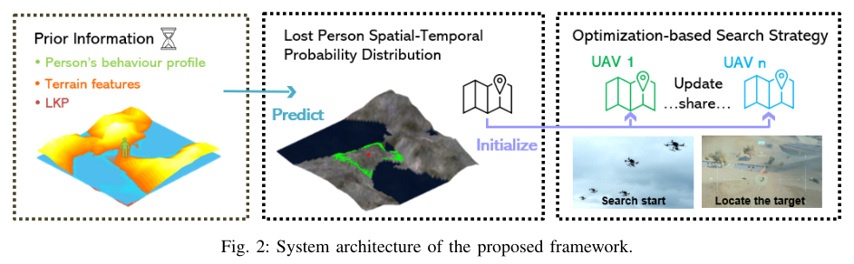
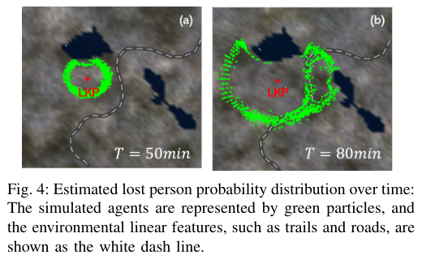
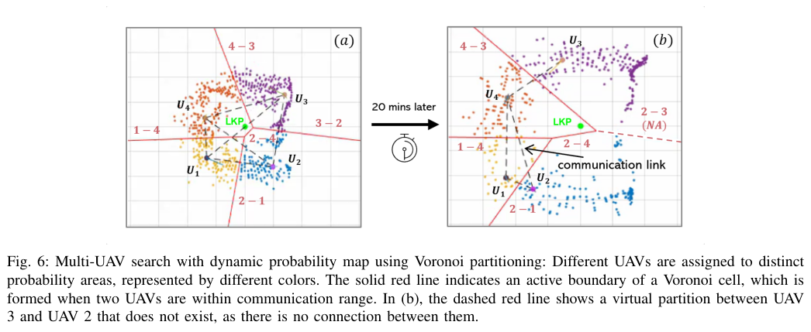
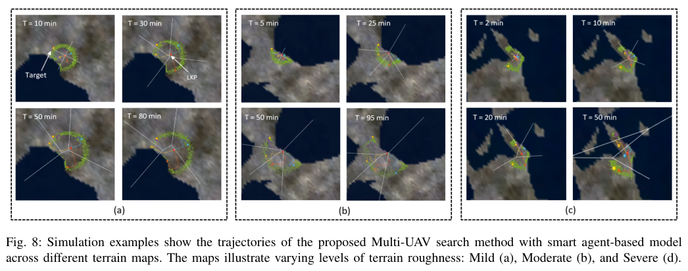

# Ge, Jiang, Coombes 2024 · Nhiều UAV tìm người lạc ở vùng hoang dã bằng mô hình xác suất theo tác tử

## Tóm tắt một dòng
Mô phỏng Monte Carlo 1 080 tác tử xuất phát từ vị trí biết cuối (LKP), mỗi tác tử chọn hành vi người lạc (đi ngẫu nhiên, đi thẳng một hướng, theo đường, đứng yên, lên cao, quay lại) và chịu ảnh hưởng địa hình, ra bản đồ mật độ xác suất theo thời gian; bốn UAV tìm phân tán bằng tối ưu tầm nhìn trượt có chia vùng Voronoi động, thành công 46–58 % trong 2 giờ, hơn phương pháp đường đồng xác suất tới 81 % ở địa hình gồ ghề.

## Vì sao đọc
Cho khoảng trống 1 trong [CONTEXT](../../../paper/j1/CONTEXT-vi.md) mục 31–32: cách dựng bản đồ xác suất vị trí người cần tìm từ nơi
thấy lần cuối và thời gian đã trôi qua, và cách nhiều UAV tìm theo bản đồ đó.

## Bài toán và mô hình
- **[GĐ]** Tìm kiếm cứu nạn vùng hoang dã (WiSAR): người lạc di chuyển, vùng tìm nở ra theo thời gian; tỉ lệ sống của người đi bộ
  đường dài và trẻ 4–6 tuổi giảm nhanh sau 24 giờ đầu (tr. 1).
- **[GĐ]** Người lạc là tác tử tự hành theo thời gian rời rạc, xuất phát từ LKP; mỗi bước chọn một hành vi theo hàm khối m trên tập
  Λ = {RM, DT, RT, SP, VE, BT}, Σ m(s) = 1 (1) (tr. 3). Mở rộng mô hình lưới 8 ô của Hashimoto 2022 sang không gian liên tục (tr. 3).
- **[GĐ]** Bản đồ địa hình biết trước dưới dạng hàm độ cao Terrain(z | x, y); sông hồ là vùng có độ cao dưới z_0 (tr. 4).
- **[GĐ]** Cảm biến UAV không bao giờ sót: POD = 1, nên xác suất thành công POS = POA × POD (5) bằng POA, tổng xác suất trong trường
  nhìn hình tròn (tr. 6).
- **[GĐ]** UAV liên lạc bằng LoRa, chỉ trao đổi khi trong tầm; không giữ liên thông cả đội, chỉ giữ khoảng cách với UAV gần nhất (tr. 2,
  6–7).

## Định nghĩa và ký hiệu
| Ký hiệu | Nghĩa |
|---|---|
| LKP | vị trí biết cuối: nơi cuối cùng người lạc được xác nhận có mặt (tr. 3) |
| RM, DT, RT, SP, VE, BT | đi ngẫu nhiên, đi thẳng một hướng, theo tuyến (đường mòn, đường, sống núi), đứng yên, lên chỗ cao để nhìn, quay lại đường cũ (tr. 3) |
| m(s) | xác suất chọn hành vi s mỗi bước (tr. 3) |
| r_j(t) = r_0 + t·d_j | tia dẫn hướng thứ j từ LKP, rời rạc mỗi 1°, hướng theo gradient của trường thế nhân tạo U = U_rep + U_att (2) (tr. 3–4) |
| q(γ) | hệ số nhân tốc độ theo độ dốc trung bình γ: 1 − γ/γ_min khi dốc xuống, 1 − γ/γ_max khi dốc lên; bằng 0 ở giới hạn dốc (4) (tr. 4–5) |
| POA, POD, POS | xác suất mục tiêu ở trong vùng, xác suất cảm biến phát hiện, xác suất thành công (tr. 6) |
| n_l | số waypoint trong tầm nhìn trượt (tr. 6) |
| f(d_ij) | hàm phạt khoảng cách giữa UAV i và UAV gần nhất j, tăng mạnh gần d_min và d_max (9) (tr. 7) |
| φ_ij(t) | dấu "pheromone": UAV i đã phát hiện tác tử j lúc t (tr. 7) |
| Te, Ve | mức giảm thời gian tìm trung bình (T_ben − T_s)/T_ben và mức tăng tỉ lệ thành công (V_s − V_ben)/V_ben (11) (tr. 9) |

## Kết quả chính
- **[KQ]** Bài không có định lý. Kết quả là mô phỏng (Bảng I, tr. 9): phương pháp đề xuất (RHS) hơn cả hai baseline ở ba mức địa hình,
  chênh lệch lớn nhất ở địa hình gồ ghề nhất (tr. 10).
- **[KQ]** Ở địa hình không có sông hay dốc lớn, mô hình tác tử và đường đồng xác suất cho phân bố tổng thể gần nhau; mô hình tác tử
  chi tiết hơn bên trong mỗi đường (ví dụ dồn về điểm cao do hành vi VE). Khác biệt rõ khi có dốc hay sông: đường đồng xác suất dừng
  nở ở dốc quá cao, còn tác tử tìm đường vòng (tr. 9–10, Fig. 7).
- **[KQ]** RHS và TPS (cùng bản đồ tác tử) thường tìm thấy trong 90 phút đầu vì ưu tiên vùng xác suất cao; ISO rải UAV đều trên các đường
  đồng xác suất nên tỉ lệ thành công thấp hơn khi vùng đã nở rộng (tr. 10).

## Thuật toán
- **[TT] Mô hình xác suất theo tác tử, Algorithm 1** (tr. 5). Đầu vào: LKP, hàm địa hình, thời gian tìm t_s, số tác tử n_a, tốc độ, tập
  hành vi Λ. Sinh tia dẫn hướng; mỗi bước, mỗi tác tử chọn hành vi, tính tốc độ theo dốc, di chuyển, lưu vị trí. Đầu ra là phân bố tác
  tử D ∈ R^{n_a × 2 × t_s}.
- **[TT] Hiệu ứng địa hình** (tr. 4–5). Tốc độ v_u ~ N(v_m q(γ), σ²) (3), với γ là độ dốc lấy từ hồi quy tuyến tính trên độ cao dọc đoạn
  định đi. Tác tử bám một điểm đích ảo trên tia bằng điều khiển PID; tia bị chặn (sông, dốc quá giới hạn) thì nhảy ngẫu nhiên sang tia
  kề trái hoặc phải, nên khi mọi tia đều chặn ở bờ sông, tác tử đi dọc bờ (tr. 5, Fig. 3).
- **[TT] Bản đồ mật độ** (tr. 6). Từ vị trí hạt dùng ước lượng mật độ nhân (KDE) (7) với băng thông không gian h_s.
- **[TT] Tìm kiếm tầm nhìn trượt** (tr. 6). Mỗi UAV chọn n_l waypoint cách nhau v_u Δt để cực đại Σ α·POA_j(wp_j, R) (6), chỉ bay tới
  waypoint kế tiếp rồi tính lại; ràng buộc góc quay ≤ θ_max (8).
- **[TT] Giữ liên lạc mềm** (tr. 6–7). Chỉ phạt khoảng cách với UAV gần nhất bằng f(d_ij) = k1/(d_ij − d_min)^ξ + k2/(d_max − d_ij)^ξ (9),
  trọng số 0 < ε < 1 nhỏ so với α nên ít cản việc tìm.
- **[TT] Cập nhật bản đồ** (tr. 7). UAV phát hiện tác tử nào thì đánh dấu; gặp UAV khác trong tầm thì trao danh sách, mỗi UAV bỏ các tác
  tử đã quét khỏi phân bố của mình: D_i(t+1) = D_i(t) − {j | φ_ij(t) = 1}.
- **[TT] Chia vùng Voronoi động** (tr. 7–8). Mỗi UAV chỉ tìm trong ô Voronoi của mình, giới hạn bởi trung trực với các UAV đang liên lạc
  được (10); ô đổi theo vị trí UAV và liên kết. Mục đích là không để các UAV dồn về cùng một vùng xác suất cao khi bản đồ không lồi.
- **[TT] Giải** bằng CasADi (tr. 8).

## Thực nghiệm và số liệu
- **[TS]** Địa hình sinh bằng gói MATLAB Automatic Terrain Generation, tham số [n_e, e_l, r_0, r_r]; ba mức: nhẹ (8, 6, 10), vừa (8, 11,
  18), nặng (5, 18, 8) cho (e_l, r_0, r_r) (tr. 8, Bảng II tr. 10).
- **[TS]** Người lạc theo hồ sơ người đi bộ đường dài có kinh nghiệm của Hashimoto 2022; tốc độ đi N(0,75 m/s; 0,25 m/s) theo Koester
  (tr. 8; bản arXiv viết nhầm "hacker").
- **[TS]** Vùng 65 km × 65 km, LKP ở [30 km, 30 km]; 4 UAV bay 5 m/s, bắt đầu 30 phút sau khi có báo cáo; LoRa tầm 15 km; trường nhìn tròn
  bán kính 50 m, bỏ qua độ cao; giới hạn 2 giờ, quá thì coi là thất bại; 1 080 tác tử (tr. 5, 8).
- **[TS]** Baseline: TPS là phương pháp phân tán của Zheng 2023 dùng cùng bản đồ tác tử nhưng không chia vùng; ISO là tìm theo đường đồng
  xác suất của Kashino 2019 (tr. 9). Máy Intel i5-11500, 16 GB (tr. 8). Bài không nêu số lần chạy mỗi cấu hình.
- **[SỐ]** Tỉ lệ thành công / thời gian tìm trung bình (Bảng I, tr. 9):

  | Phương pháp | Nhẹ | Vừa | Nặng |
  |---|---|---|---|
  | RHS (đề xuất) | 46 % / 57,65 phút | 50 % / 52,96 phút | 58 % / 40,85 phút |
  | ISO | 42 % / 78,03 phút | 36 % / 81,61 phút | 32 % / 79,52 phút |
  | TPS | 40 % / 63,70 phút | 48 % / 61,77 phút | 52 % / 60,21 phút |

- **[SỐ]** So với ISO: tỉ lệ thành công tăng 9,52 / 38,89 / 81,25 %, thời gian giảm 26,12 / 35,11 / 48,63 %; so với TPS: tăng 15,00 / 4,17 /
  11,54 %, giảm 9,50 / 14,26 / 32,15 % (nhẹ / vừa / nặng) (Bảng I, tr. 9–10).
- **[SỐ]** Số liệu bối cảnh bài dẫn: Queensland 2019 hỗ trợ 1 648 người, 8 733 giờ công cảnh sát, hơn 34 000 giờ tình nguyện; Mỹ hơn 600 000
  người mất tích mỗi năm, Anh 70 000 (tr. 1); vùng tìm nở 82 km² mỗi giờ (dẫn Doherty 2014); LoRa tầm 10–20 km (tr. 2).

## Hình tiêu biểu

*Đọc hình:* bản đồ xác suất tính trước từ thông tin ban đầu rồi nạp cho mọi UAV; các UAV cập nhật và chia sẻ khi gặp nhau.

*Đọc hình:* phân bố có dạng vành nở dần từ LKP, không phải đĩa đặc; vành bị méo bởi hồ và đường mòn.

*Đọc hình:* mỗi màu là phần hạt một UAV phụ trách; biên chỉ có giữa hai UAV đang liên lạc được, cặp mất liên lạc (2–3) không có biên thật.

*Đọc hình:* ở địa hình nặng, đất đi được hẹp nên hạt dồn vào một dải và UAV tìm thấy sớm (50 phút); chú thích gọi hình (c) là "(d)".

## Trích nguyên văn
- **[TRÍCH]** "Long search duration result in a larger area to cover, reducing the likelihood of finding the target." (tr. 1)
- **[TRÍCH]** "While historical data for analyzing numbers of lost persons in specific locations and terrains is unavailable, making theoretical proof of the accuracy of our model and the ISO-probability curves impossible" (tr. 9)

## Liên hệ SigDrop
- **[NX] [C]** Đây là một cách dựng bản đồ xác suất cho đề xuất ở CONTEXT mục 32: hạt xuất phát từ nơi thấy lần cuối, đi theo hành vi và
  chỉ trên đất đi được, KDE ra mật độ theo thời gian. Ở đô thị, hành vi RT (theo tuyến) gần như là tất cả, nên có thể cho hạt đi trên đồ
  thị đường và vỉa hè OSM đã cắt (CONTEXT mục 18), tốc độ theo nhóm người của Koester; bỏ phần địa hình, sông, trường thế. Cộng mật
  độ theo cell ra tiên nghiệm cho `uav-l2/tools/l1_rank.py` thay cho tiên nghiệm đều.
- **[NX] [C]** Phép cập nhật "bỏ hạt đã quét" (tr. 7) ứng với cập nhật âm trong mạng camera: AI node báo điểm thấp cho cửa sổ thời gian
  của nó, hay V1 xác minh một cell là sai, thì bỏ các hạt đi qua camera đó trong cửa sổ đó (có tính xác suất bỏ sót của camera, vì bài giả
  định POD = 1 còn camera thì không). Cùng ý với P_{c,w} của ReXCam (`jain2019-rexcam`), nhưng ReXCam học chuyển tiếp từ lưu lượng
  thường ngày, còn bài này sinh từ mô hình hành vi.
- **[NX] [ĐV]** Kết quả "ưu tiên vùng xác suất cao từ sớm thì thắng phủ đều" (tr. 10) ủng hộ việc đổi mục tiêu sang thời gian kỳ vọng tới
  khi xác minh đúng, có thứ tự cụm theo xác suất (CONTEXT mục 32). Lưu ý số thành công chỉ 32–58 % trong 2 giờ và không có số lần chạy,
  nên chỉ dẫn được xu hướng.
- **[NX] [ĐV]** Khác biệt cần nêu khi định vị J1: ở đây UAV là cảm biến (nhìn người, trường nhìn 50 m), vùng 65 × 65 km hoang dã, không có hạ
  tầng mặt đất. Trong J1 cảm biến là mạng camera có sẵn, UAV đội 1 chỉ mang truy vấn tới AI node, đội 2 xác minh. Hai bài cùng dùng bản
  đồ xác suất nhưng bản đồ ấy quyết định thứ tự giao truy vấn và thứ tự xác minh, không quyết định đường quét.
- **[NX] [TOUR]** Chia vùng Voronoi theo liên kết liên lạc là một cách phối hợp nhiều UAV không cần liên thông cả đội; nếu sau này pha 2
  có nhiều UAV cánh quay, đây là baseline hợp lý cho việc chia nghi vấn. Pha 1 một UAV không dùng tới.
- **[NX]** Tốc độ đi 0,75 ± 0,25 m/s của người đi bộ đường dài trên địa hình (tr. 8) thấp hơn tốc độ đi bộ đô thị; cửa sổ truy vấn tính
  từ thời gian trôi qua (CONTEXT mục 32) nên lấy tốc độ đô thị, không lấy số này.

## Hạn chế và câu hỏi mở
- Không kiểm chứng trên dữ liệu thật; bài tự nói không có dữ liệu lịch sử để chứng minh độ đúng của mô hình (tr. 9). Địa hình là địa hình sinh
  ngẫu nhiên.
- Không nêu giá trị m(s) đã dùng, số lần chạy mỗi cấu hình, tham số k1, k2, ξ, n_l, θ_max, h_s.
- POD = 1 và bỏ độ cao; bài để POD theo thảm phủ và tìm kiếm 3D cho việc sau (tr. 10).
- Tỉ lệ thành công tốt nhất chỉ 58 % trong 2 giờ, nên chưa rõ cách so sánh có nhạy với giới hạn thời gian hay không.
