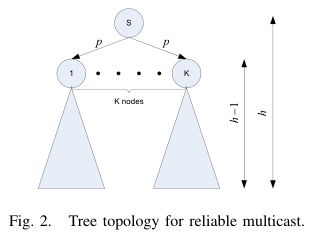

# Ghaderi, Towsley, Kurose 2008 · Lợi ích độ tin cậy của network coding trong mạng không dây mất gói

## Tóm tắt một dòng
Một điểm truy cập phát cho K máy thu mất gói Bernoulli(p) độc lập: ARQ cần E[N] = Θ(log K) lần phát mỗi gói, NC với khối lớn chỉ cần 1/(1 − p) = Θ(1), nên lợi ích là Θ(log K); trên cây cao h: so với ARQ từng chặng Θ(log K), ARQ đầu–cuối Θ(c^{h−1} log K), FEC đầu–cuối Θ(c^h), c = 1/(1 − p).

## Vì sao đọc
Cho công thức gọn cho số lần phát cần để K nút đều nhận đủ — dùng trực tiếp trong chặn dưới thời gian của baseline FC và
lặp lại trong định lý A của SigDrop; bổ sung cho Stojanovic 2009 (cùng mô hình kênh on/off).

## Bài toán và mô hình
- **[GĐ]** AP phát quảng bá cho K máy thu; mất gói độc lập, đồng nhất, Bernoulli tham số p (tr. 2, Fig. 1).
- **[GĐ]** NC dùng khối B gói, tổ hợp tuyến tính ngẫu nhiên; nút cần B tổ hợp độc lập; phản hồi tin cậy và không tính chi phí
  phản hồi (tr. 2).
- **[GĐ]** Phân tích tiệm cận K → ∞; với NC xét B → ∞ (B = Ω(K)) (tr. 2).
- **[GĐ]** Cây đa hướng chiều cao h, mỗi nút K con, mỗi liên kết mất p (Fig. 2, tr. 4).

## Định nghĩa và ký hiệu
| Ký hiệu | Nghĩa |
|---|---|
| K, p, B | số máy thu, xác suất mất, kích thước khối mã |
| N, N_k | số lần phát tới khi mọi nút / nút k nhận đủ |
| H(K) | số điều hoà thứ K, → ln K + γ |
| reliability gain | E[N_ARQ]/E[N_NC], (19) |
| F_r(n) | P{N_r ≤ n} cho cây con chiều cao r, (20) |

## Kết quả chính
- **[KQ] (1)–(2)** (tr. 2). ARQ: P{N ≤ n} = (1 − pⁿ)^K. NC: P{N ≤ n} = (Σ_{i=B}^{n} C(n, i)(1 − p)^i p^{n−i})^K, n ≥ B.
- **[KQ] (7)–(10) ARQ tiệm cận** (tr. 2–3). Xấp xỉ hình học bằng mũ tham số μ = −ln p, sai số ε = 1/(1 − p) + 1/ln p;
  E[N] → (ln K + γ)/(−ln p) + 1/(1 − p) + 1/ln p, tức E[N] = Θ(log_{1/p} K).
- **[KQ] (12)–(18) NC tiệm cận** (tr. 3). N_k là tổng B biến hình học; theo luật số lớn E[N]/B → 1/(1 − p) = Θ(1) khi B → ∞.
- **[KQ] (19)** (tr. 3). Lợi ích NC so với ARQ ở mô hình AP là Θ(log K).
- **[KQ] (22)–(25) Cây** (tr. 4). Đệ quy F_r(n) = Σ_i C(n, i)(1 − p)^i p^{n−i} F_{r−1}(i)^K; tổng số lần phát với cơ chế từng chặng
  E[T] = E[N](K^h − 1)/(K − 1).
- **[KQ] Bảng I** (tr. 5). Lợi ích NC trên cây chiều cao h: so ARQ từng chặng Θ(log K); ARQ đầu–cuối Θ(c^{h−1} log K); FEC
  (rateless) đầu–cuối Θ(c^h), c = 1/(1 − p). Rateless đạt tiệm cận như NC ở mô hình AP (tóm tắt, tr. 1).

## Thuật toán
Không có thuật toán mới; so bốn cơ chế: ARQ/FEC đầu–cuối, ARQ/NC từng chặng (tr. 3–4).

## Thực nghiệm và số liệu
Phần số liệu (đường E[N] theo K, p) không đọc trong bản partial; bài nói có kết quả số cho nhóm hữu hạn (tr. 1).

## Hình tiêu biểu

*Đọc hình:* mô hình AP được lặp lại ở mỗi tầng; lỗi tích luỹ theo chiều cao làm cơ chế đầu–cuối tốn theo c^h.

## Trích nguyên văn
- **[TRÍCH]** "the expected number of transmissions using ARQ, compared to network coding, scales as Θ(log K) as the number of receivers becomes large." (tr. 1)
- **[TRÍCH]** "rateless coding achieves asymptotic performance results similar to that of network coding." (tr. 1)

## Liên hệ SigDrop
- **[NX] [FC]** (10) cho số lần UAV phải phát lặp mỗi gói để K nút trong vùng nghe đều nhận: ~log_{1/p}K; với FC/khối lớn chỉ
  ~1/(1 − p) mỗi gói — đây là công thức chuẩn để so FC với lặp lại trong định lý A.
- **[NX] [A]** Bảng I cho thấy chuyển tiếp từng chặng (link-by-link) tránh được tích luỹ c^h; tương ứng việc mặt đất hợp tác
  từng chặng trong SigDrop thay vì UAV phát đầu–cuối.
- **[NX]** Bài nhắc "mô hình AP mở rộng cho phép máy thu trao đổi cục bộ để khôi phục" (tr. 1, chi tiết ở [8]) — rất gần SigDrop;
  nên tìm tài liệu [8] (báo cáo kỹ thuật của nhóm) để kiểm trùng lặp.

## Hạn chế và câu hỏi mở
- Mất gói đồng nhất, độc lập; phản hồi miễn phí; khối mã vô hạn.
- Đọc partial: phần cuối mục III (tiệm cận cho cây, số liệu) chỉ đọc qua Bảng I.
