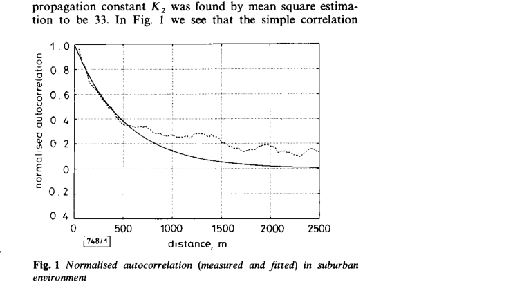

# Gudmundson 1991 · Mô hình tương quan cho shadow fading

## Tóm tắt một dòng
Shadow fading (dB) mô hình Gauss quanh trung bình K₁ − K₂ log d với tự tương quan mũ theo khoảng cách R(k) = σ²a^{|k|}, a = ε_D^{vT/D}; khớp tốt ở ngoại ô (σ = 7,5 dB, tương quan 0,82 ở 100 m) nhưng kém ở vi tế bào đô thị (σ = 4,3 dB, tương quan 0,3 ở 10 m).

## Vì sao đọc
Là nguồn chuẩn khi mô phỏng shadowing có tương quan không gian (bộ lọc AR(1)) — cần nếu mô hình kênh của SigDrop muốn nút gần nhau
có mất gói tương quan [KÊNH], thay vì độc lập.

## Bài toán và mô hình
- **[GĐ]** Log cường độ thu A(n), lấy mẫu mỗi T giây, Gauss với trung bình phụ thuộc khoảng cách a = K₁ − K₂ log(d), (1); K₁ theo công
  suất phát, K₂ từ 20 (LoS) tới 60 (mô hình Okumura) (tr. 1).
- **[GĐ]** Thiết bị di động tốc độ v; fading nhanh đã được lấy trung bình bỏ đi (tr. 1).

## Định nghĩa và ký hiệu
| Ký hiệu | Nghĩa |
|---|---|
| A(n) | log cường độ tín hiệu thu ở mẫu n |
| K₁, K₂ | hằng công suất và hằng lan truyền trong (1) |
| σ² | phương sai shadowing, thường 3–10 dB |
| ε_D | hệ số tương quan giữa hai điểm cách nhau D |
| a = ε_D^{vT/D} | hệ số tương quan giữa hai mẫu liên tiếp, (3) |

## Kết quả chính
- **[KQ] (2)–(3)** (tr. 1). R_A(k) = σ²a^{|k|}, a = ε_D^{vT/D}: tự tương quan giảm mũ theo quãng đường đi được. Sinh được bằng nhiễu trắng
  Gauss qua bộ lọc bậc một có cực tại a (AR(1)).
- **[KQ] Kiểm chứng ngoại ô** (Fig. 1, tr. 1). 900 MHz, vùng 15 × 15 km², trạm ở giữa, trung bình hoá trên ~27 m: K₂ = 33; σ = 7,5 dB;
  tương quan ở 100 m là 0,82; mô hình khớp "thoả đáng" tới ~500 m.
- **[KQ] Kiểm chứng đô thị vi tế bào** (Fig. 2, tr. 2). 1700 MHz, phố NLoS, khoảng cách 100–600 m, trung bình hoá 1,5 m: K₂ ≈ 50;
  σ = 4,3 dB; tương quan ở 10 m là 0,3; khi lấy trung bình dài hơn thì mô hình khớp kém (tín hiệu lẫn fading nhanh).
- **[KQ] Hệ quả** (tr. 2). Với v = 50 km/h, T = 0,5 s (GSM), ở ngoại ô a gần 1 (mẫu sau gần bằng mẫu trước); ở vi tế bào a ≪ 1.

## Thuật toán
- **[TT] Sinh shadowing** (tr. 1). x_{n+1} = a·x_n + σ√(1 − a²)·w_n, w_n Gauss chuẩn (dạng AR(1) suy từ mô tả bộ lọc bậc một; công thức cụ thể là [NX]).

## Thực nghiệm và số liệu
Xem Kết quả chính (hai bộ đo ngoại ô và đô thị).

## Hình tiêu biểu

*Đọc hình:* đường mũ khớp tốt tới ~500 m; xa hơn số đo giữ tương quan cao hơn mô hình.

## Trích nguyên văn
- **[TRÍCH]** "a white Gaussian noise process, filtered through a first degree filter with a pole at a, will produce a log-envelope signal with the required properties." (tr. 1)

## Liên hệ SigDrop
- **[NX] [KÊNH]** Khoảng cách tương quan cỡ 100 m (ngoại ô) tương đương bán kính cell 100 m: các nút trong một cell có shadowing tương
  quan mạnh, nên mất gói giữa chúng không độc lập — ảnh hưởng tới lợi ích hợp tác mặt đất (nút cạnh nhau cùng mất).
- **[NX] [KÊNH]** Lưu ý mô hình đo cho kênh mặt đất (trạm cao – di động); với A2G có LoS mạnh (Matolak 2017) σ chỉ ~3 dB.

## Hạn chế và câu hỏi mở
- Chỉ tương quan theo một chiều chuyển động; không mô tả tương quan giữa hai máy thu khác vị trí (tương quan chéo).
- Bản quét chất lượng thấp; ký hiệu trong (1)–(3) đọc theo ngữ cảnh.
- DOI đối chiếu bằng Crossref theo tên bài (WORKLIST ghi DOI tự động bị sai).
