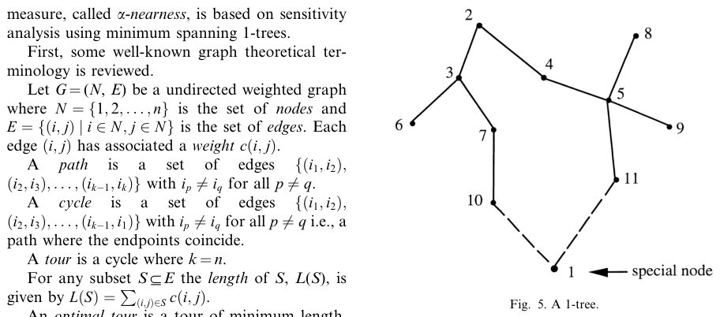

# Helsgaun 2000 · LKH: cài đặt hiệu quả heuristic Lin–Kernighan

## Tóm tắt một dòng
LKH dùng bước cơ bản 5-opt tuần tự, tập ứng viên thu hẹp bằng độ đo α-nearness (phân tích độ nhạy trên 1-tree nhỏ nhất, cải thiện bằng tối ưu subgradient), chỉ cần 5 cạnh α-gần nhất mỗi nút; tìm được tối ưu cho mọi bài đã giải (tới 13 509 thành phố), bài 100 thành phố < 1 s, 1000 thành phố < 1 phút (2000); ATSP được giải qua biến đổi Jonker–Volgenant n → 2n nút.

## Vì sao đọc
LKH là bộ giải dùng trong quy trình tour tham chiếu (GTSP → ATSP → LKH) của Le Ny 2012 và Isaacs 2011; trích khi mô tả cách tính tour tối ưu
gần đúng để đo khoảng cách tối ưu của CHORD/LM-Tour [TOUR].

## Bài toán và mô hình
- **[GĐ]** TSP đối xứng (c_ij = c_ji); bài bất đối xứng biến thành đối xứng 2n nút (Jonker–Volgenant) rồi giải bằng cùng thuật toán (tr. 3).

## Định nghĩa và ký hiệu
| Ký hiệu | Nghĩa |
|---|---|
| 1-tree | cây khung trên N \ {1} cộng hai cạnh nối nút 1 (Fig. 5) |
| α(i, j) | α-nearness: L(T⁺(i, j)) − L(T), độ tăng độ dài khi bắt 1-tree nhỏ nhất chứa cạnh (i, j) |
| π | vector phạt nút; w(π) = L(T_π) − 2Σπ_i là cận dưới, tối đa hoá bằng subgradient |
| k-opt | bỏ k cạnh và nối lại k cạnh |

## Kết quả chính
- **[KQ] 1-tree** (tr. 7). Tour tối ưu là 1-tree nhỏ nhất mà mọi nút bậc 2; nếu 1-tree nhỏ nhất là tour thì tour đó tối ưu. Tour tối ưu thường
  chứa 70–80 % cạnh của 1-tree nhỏ nhất.
- **[KQ] Tập ứng viên** (tr. 7–9, 19). Dùng α-nearness thay khoảng cách: trong mọi bài thử, chỉ cần 5 cạnh α-gần nhất mỗi nút là tìm được tour
  tối ưu (ví dụ bài 532 thành phố: mọi cạnh của tour tối ưu nằm trong 5 α-gần nhất của ít nhất một đầu).
- **[KQ] Bước 5-opt** (tr. 10–11). Bước cơ bản là 5-opt tuần tự (k ≤ 4 khi có cải thiện ngay); mọi 5-opt tương đương tối đa năm 2-opt;
  thêm luật tỉa: cạnh cuối bị bỏ trong bước không lợi không được thuộc tour tốt nhất hiện có.
- **[KQ]** Thời gian chạy của cả LK gốc và bản mới tăng ~n^{2,2}; LK gốc tìm tối ưu xác suất ~100 % với ≤ 50 thành phố, 20–30 % với 100 thành
  phố mỗi lần chạy (tr. 1, 5).

## Thuật toán
- **[TT] LKH** (mục 4–5). Tính π bằng subgradient → tính α cho mọi cạnh (O(n²) bộ nhớ hiệu quả, Fig. 6–8) → tập ứng viên 5 cạnh → lặp các
  lượt (trial) LK với bước 5-opt từ tour khởi đầu, giữ tour tốt nhất.

## Thực nghiệm và số liệu
- **[SỐ]** Tối ưu cho mọi bài đã biết lời giải, kể cả 13 509 thành phố; cải thiện lời giải tốt nhất đã biết của nhiều bài lớn, gồm bài 85 900
  thành phố (tr. 2).
- **[SỐ]** Bài 100 thành phố điển hình: tối ưu < 1 s; 1000 thành phố: < 1 phút (Power Mac G3 300 MHz) (tr. 1).
- Bảng kết quả chi tiết (TSPLIB, bài ngẫu nhiên, leaper/knight tour) mục 6 chỉ đọc lướt.

## Hình tiêu biểu

*Đọc hình:* 1-tree là nới lỏng của tour; khi mọi nút có bậc 2 thì nó chính là tour.

## Trích nguyên văn
- **[TRÍCH]** "in all test problems the algorithm was able to find optimal tours using as candidate edges the 5 α-nearest edges incident to each node." (tr. 19)

## Liên hệ SigDrop
- **[NX] [TOUR]** Bài toán tham chiếu của SigDrop sau Noon–Bean là ATSP n·m nút (n cell × m mẫu vị trí/hướng); LKH biến thành bài đối xứng 2nm nút.
  Với n ~ 30–50 cell, m ~ 36–72 mẫu: ~2000–7000 nút — trong tầm LKH (vài phút).
- **[NX]** LKH là heuristic: kết quả là cận trên của tour tối ưu; để nói "CHORD cách tối ưu ≤ x %" cần kèm cận dưới (ví dụ cận 1-tree/Held–Karp
  mà LKH cũng tính ra).

## Hạn chế và câu hỏi mở
- Đọc partial: bỏ chi tiết cài đặt (mục 5) và phần lớn bảng mục 6.
- Hiệu năng với ATSP biến đổi từ GTSP (hằng β lớn) không được thử trong bài.
