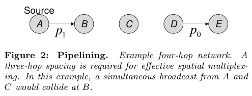
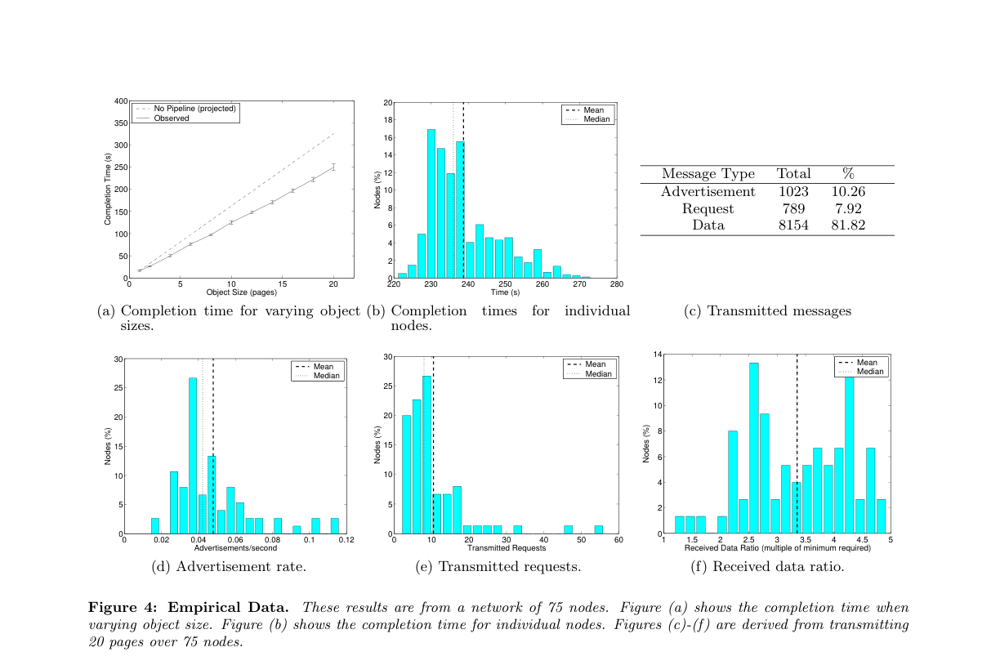
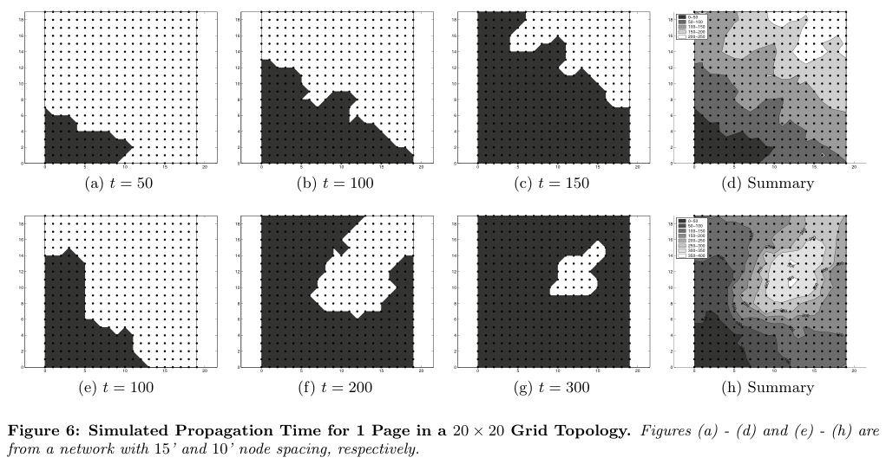

# Hui, Culler 2004 · Deluge: phổ biến dữ liệu lớn trong WSN đa chặng

## Tóm tắt một dòng
Deluge phổ biến đối tượng dữ liệu lớn (ảnh chương trình) tới mọi nút WSN đa chặng bằng quảng bá kiểu Trickle, chia trang để pipeline, NACK chọn lọc; đạt ~90 B/s (1/9 tốc độ radio) trên 75 nút, gói điều khiển 18 %, và cho mô hình thời gian E[T_obj] = min(dn, d+3(n−1))·(E[T_page]+D).

## Vì sao đọc
Deluge là chuẩn so sánh kinh điển cho phổ biến dữ liệu mặt đất (bước hợp tác sau khi UAV phát) và cung cấp con số chi
phí điều khiển (18 %), độ dư thu (3,35×), giới hạn 1/3 do pipeline ba chặng. Câu hỏi mở về cận dưới tốc độ phổ biến
liên quan trực tiếp đến cận min-cut [D] của SigDrop.

## Bài toán và mô hình
- **[GĐ]** Một hoặc vài nút nguồn, đối tượng lớn hơn RAM (128 KB chương trình, 4 KB RAM, gói 36 byte), mạng đa chặng
  không dây có mật độ thay đổi tới hàng nghìn lần, yêu cầu tin cậy 100 % (tr. 1).
- **[GĐ]** Thành viên mạng thay đổi (nút rời, vào lại), nên phổ biến là nỗ lực liên tục, kiểu dịch tễ (epidemic) (tr. 1).
- **[GĐ]** Cập nhật được tuần tự hoá bằng số phiên bản tăng đơn điệu; nút chỉ cần lấy các trang đã đổi (tr. 3).
- **[GĐ]** Thứ tự ưu tiên chỉ số: tin cậy tuyệt đối > thời gian hoàn tất > RAM > năng lượng (tr. 6).

## Định nghĩa và ký hiệu
| Ký hiệu | Nghĩa |
|---|---|
| S_obj, S_page = N·S_pkt | kích thước đối tượng, trang (N gói), gói |
| P | số trang |
| (v, a) | object profile: phiên bản v và vector tuổi a = ⟨a₀,…,a_{P−1}⟩, trang i đổi lần cuối ở phiên bản v − aᵢ (tr. 3) |
| {v, γ} | tóm tắt quảng bá: phiên bản và chỉ số trang lớn nhất "available" (tr. 4) |
| τ_l, τ_h, τ_{m,i} | chu kỳ Trickle nhỏ nhất, lớn nhất, của vòng i |
| k | ngưỡng chặn quảng bá: không gửi nếu đã nghe ≥ k quảng bá giống mình (tr. 4) |
| τ_r, λ, ω, α | cửa sổ backoff yêu cầu, số yêu cầu tối đa, số thời gian gói im lặng trước khi yêu cầu lại, ngưỡng tốc độ tiến (tr. 5) |
| MAINTAIN, RX, TX | ba trạng thái của nút |

- **[ĐN]** Trang *complete* khi nhận đủ mọi gói; *available* khi complete và mọi trang [0, i) cũng complete (tr. 3–4).

## Kết quả chính
- **[KQ] Pipeline** (tr. 4). Không có spatial multiplexing, d chặng cần d lần truyền cả đối tượng, thời gian O(d·S_obj);
  có pipeline theo trang tiến tới O(d + S_obj).
- **[KQ] Giới hạn 1/3** (tr. 12, 13). Cần cách nhau ba chặng để hai phát đồng thời không va chạm (Fig. 2), nên mọi giao
  thức đa chặng một kênh chỉ đạt tối đa 33 % tốc độ radio; với độ dư thu 4–5 lần trong triển khai thật, giới hạn còn
  1/4–1/5 (tr. 14).
- **[KQ] Mô hình thời gian, (1)–(6)** (tr. 12). Đối tượng n trang qua d chặng:
  E[T_obj] = min(d·n, d + 3(n−1)) · (E[T_tPage] + D_newReq), với
  E[T_tPage] = E[T_rAdv] + E[T_tx] + E[T_req] + E[T_tGiveUp];
  E[N_tPkt] = 1/(1 − r_l); E[T_tx] = E[N_tPkt]·T_tPkt·N; E[T_req] = E[N_tPkt]·E[N_reqs]·τ_r/2;
  E[T_rAdv] = E[N_tPkt]·(τ_l/2)·(1 + E[N_Supp]); E[T_tGiveUp] = E[N_tPkt]·(E[N_reqs]/λ − 1)·E[T_rAdv].
- **[KQ] Bảng 1** (tr. 13). Phần mất so với tốc độ radio tối đa: pipeline 66 %, E[T_req] 14 %, E[T_tGiveUp] 11 %,
  E[T_rAdv] 5 %, E[T_tx] 4 %. Khoảng 30 % do trễ và backoff phục vụ việc chặn (suppression).
- **[KQ] Câu hỏi mở** (tr. 13): cận chặt cho tốc độ phổ biến trong mạng không dây là bao nhiêu; bài lập luận phổ biến
  vốn chậm hơn định tuyến một đường.

## Thuật toán
- **[TT] Quy tắc MAINTAIN** (tr. 4). M.1 vòng i: phát quảng bá tại tᵢ + rᵢ, rᵢ ∈ [τ_{m,i}/2, τ_{m,i}], chỉ khi nghe < k
  quảng bá trùng. M.2 nghe bất nhất (quảng bá khác, yêu cầu, dữ liệu) → τ_{m,i} = τ_l, vòng mới. M.3 không bất nhất →
  τ_{m,i} = min(2τ_{m,i−1}, τ_h). M.4 thấy hàng xóm cũ hơn → phát object profile (lũ có kiểm soát). M.5 nghe quảng bá
  cùng v và γ′ > γ → sang RX, trừ khi gần đây đã nghe yêu cầu hoặc dữ liệu cho trang ≤ γ (+1). M.6 nhận yêu cầu → TX.
- **[TT] RX** (tr. 5). Yêu cầu là SNACK (bit-vector các gói thiếu) unicast tới nút vừa quảng bá; backoff ngẫu nhiên và
  chặn khi nghe yêu cầu/dữ liệu khác; sau λ yêu cầu mà tốc độ nhận < α thì bỏ, quay lại MAINTAIN (chống liên kết bất đối
  xứng). Trang xin theo thứ tự tăng dần; trang nhỏ hơn được ưu tiên.
- **[TT] TX** (tr. 5). Gộp mọi yêu cầu cho trang p, phát quảng bá các gói theo vòng tròn tới khi tập yêu cầu rỗng.
- **[TT] Không gian thiết kế đã thử** (tr. 5–6). Bỏ chặn: mô phỏng không xong sau nhiều ngày. Chỉ chặn yêu cầu (≈ SPIN-RL):
  kém. Chặn gói dữ liệu: làm giảm hiệu năng. Chọn nguồn theo số chặng: không khác biệt. **FEC giúp ở mạng thưa nhưng làm
  hại ở mạng dày** vì chất lượng liên kết biến thiên mạnh (tr. 6).

## Thực nghiệm và số liệu
- **[TS]** Testbed 75 Mica2-dot (433 MHz, 19,2 kbit/s, ~37 gói/s lý tưởng), văn phòng 150′ × 100′, nguồn ở góc, đường
  kính ~5 chặng; trang 1104 byte = 48 gói × 23 byte; τ_l = 2 s, τ_h = 60 s, k = 1, τ_r = 0,5 s, λ = 2, ω = 8 (tr. 6–7).
- **[SỐ]** Tốc độ trung bình 88,4 B/s; không pipeline thì thời gian tăng 31 % (Fig. 4a, tr. 7–8). Mọi nút xong trong
  220–275 s với đối tượng 20 trang; độ trải mỗi lần chạy 18,6 ± 2,6 s (Fig. 4b, tr. 8).
- **[SỐ]** Tỉ lệ gói: quảng bá 10,26 %, yêu cầu 7,92 %, dữ liệu 81,82 % (Fig. 4c, tr. 8). Tốc độ quảng bá trung bình
  0,048 gói/s (không chặn sẽ là 0,5 gói/s); yêu cầu trung bình 10,52 gói mỗi nút cho 20 trang (tr. 7).
- **[SỐ]** Mỗi nút nhận trung bình 3,35 lần số gói dữ liệu tối thiểu, không nút nào quá 5 lần (Fig. 4f, tr. 7–8).
- **[TS]** TOSSIM mô phỏng mức bit, đồ thị BER theo khoảng cách, nhiễu trong bán kính 50′; trang 24 gói (tr. 6–8).
- **[SỐ]** Lưới 20 × 20 dày (cách 10′): tốc độ lan theo đường chéo tụt còn ~20 % so với theo cạnh từ nút (5, 5), do
  hidden terminal; lan dọc biên rồi lấp giữa (Fig. 6, 8a, tr. 9–10). τ_r = 1 s làm tốc độ chéo tăng 2,7 lần (tr. 11).
- **[SỐ]** Nguồn ở tâm lưới 21 × 21: giảm 40 % (thưa) và chỉ 25 % (dày) thay vì 50 % kỳ vọng (tr. 11–12).
- **[SỐ]** Mạng tuyến tính 2 × N: ~40 s mỗi trang cho 152 nút qua 15 chặng, chỉ ~4 % tốc độ liên kết 32 gói/s; ở đây mật
  độ tăng lại giúp (Fig. 11, tr. 12). Mô hình (1)–(6) khớp mô phỏng với r_l = 0,1, E[N_reqs] = 5,4 (Fig. 12, tr. 13).
- **[SỐ]** Bán kính nhiễu 20′ thay vì 50′: hết hiệu ứng biên, giảm 70 % thời gian (tr. 14). Bản cài đặt dùng 84 byte RAM (tr. 13).

## Hình tiêu biểu

*Đọc hình:* nếu A và C cùng phát thì va chạm tại B; vì vậy hai trang chỉ chạy song song khi cách nhau ba chặng, dẫn tới
giới hạn 1/3 tốc độ radio.

*Đọc hình:* thời gian tăng tuyến tính theo số trang; gói điều khiển chỉ ~18 %; mỗi nút nghe lại dữ liệu 2–5 lần.

*Đọc hình:* ở mạng thưa sóng lan đều theo đường chéo; ở mạng dày sóng chạy dọc biên trước rồi mới lấp tâm, do va chạm
hidden terminal ở vùng giữa.

## Trích nguyên văn
- **[TRÍCH]** "Control messages are limited to 18% of all transmissions." (tr. 1)
- **[TRÍCH]** "What is the true limit on the rate of dissemination in wireless networks? It is clear that this bound is much lower than simply routing a single message across the network." (tr. 13)
- **[TRÍCH]** "FEC improved performance in sparse networks while harming performance in dense networks." (tr. 6)

## Liên hệ SigDrop
- **[NX] [D]** Câu hỏi mở về cận dưới tốc độ phổ biến (tr. 13) là chỗ để định vị cận min-cut của SigDrop: bài chỉ có giới
  hạn 1/3 do không gian và mô hình kỳ vọng, không có cận dưới theo topo.
- **[NX] [FC]** Kết quả "FEC giúp ở mạng thưa, hại ở mạng dày" (tr. 6) là lập luận cho việc so baseline fountain code
  cẩn thận: lợi thế FC phụ thuộc phương sai mất gói; khác biệt của SigDrop là kênh A2G có cấu trúc theo khoảng cách.
- **[NX] [ĐV]** Pha hợp tác mặt đất của SigDrop thực chất là một bài toán phổ biến cục bộ; con số 18 % điều khiển và
  độ dư 3,35× là mốc để so chi phí điều khiển của Manifest/River.
- **[NX] [B]** Mô hình (1) cho thời gian theo số chặng d: dùng được để ước lượng thời gian phổ biến mặt đất nếu UAV
  chỉ phát cho một tập nút gốc rồi để mạng tự lan (so với takeover).

## Hạn chế và câu hỏi mở
- Mô phỏng TOSSIM đơn giản hoá (cường độ phát đều trong 50′), có thể phóng đại hidden terminal (tr. 14).
- Mô hình (1)–(6) chỉ khớp cho mạng tuyến tính và cần E[N_reqs] lấy từ mô phỏng.
- Không xét năng lượng chi tiết (radio luôn bật), không có nguồn di động.
