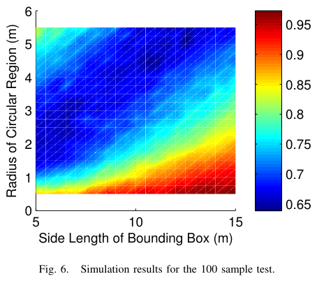

# Isaacs, Klein, Hespanha 2011 · Algorithms for the TSP with neighborhoods involving a Dubins vehicle

## Tóm tắt một dòng
Hai thuật toán cho Dubins TSP với lân cận (DTSPN): vùng rời nhau thì lấy một mẫu mỗi vùng cho hệ số xấp xỉ không phụ thuộc số vùng; vùng chồng nhau thì lấy mẫu rồi biến GTSP có nhóm chồng nhau sang ATSP (Noon–Bean), tour ngắn tới gần một nửa so với RCM.

## Vì sao đọc
Đây là quy trình chuẩn để tính tour tham chiếu cho bài toán có lân cận, tức đúng loại bài toán của CHORD/LM-Tour (đi qua
vùng nghe của critical cell) và của baseline DN. Bài cũng cho cận Dubins ≤ Euclid + κπρ ở dạng tường minh.

## Bài toán và mô hình
- **[GĐ]** Xe Dubins bán kính quay ρ; n vùng Rᵢ trong mặt phẳng; tìm tour khép kín ngắn nhất đi vào mọi vùng (tr. 1).
- **[GĐ]** Vùng đại diện cho tầm liên lạc hoặc vùng cảm biến; xe chỉ cần đi vào vùng (tr. 1).
- **[GĐ]** Thuật toán 1 cần các vùng rời nhau, cách nhau ít nhất ε > 0 (tr. 3).

## Định nghĩa và ký hiệu
| Ký hiệu | Nghĩa |
|---|---|
| dᵢ, d | đường kính vùng Rᵢ (khoảng cách Euclid lớn nhất giữa hai điểm của vùng), d = max dᵢ (6)–(7) |
| ε | khoảng cách nhỏ nhất giữa hai vùng |
| μ | tham số khoảng cách trong (8), được định nghĩa ở tr. 2 (trang không trích được chữ) |
| C_ρ(P, P′) | độ dài đường Dubins ngắn nhất giữa hai cấu hình |
| κ | hằng trong [2,657; 2,658] |
| RCM | phương pháp roadmap lấy mẫu của Obermeyer (đầy đủ theo độ phân giải), so sánh với Thuật toán 2 |

## Kết quả chính
- **[KQ] Cận Dubins–Euclid** (11) (tr. 3, trích Savla et al. Định lý 3.4): C_ρ(P, P′) ≤ ‖P(P) − P(P′)‖ + κπρ, κ ∈ [2,657; 2,658].
- **[KQ] Định lý 3.1** (tr. 3). Với n ≥ 2 vùng rời nhau, đường kính lớn nhất d, cách nhau ít nhất ε, Thuật toán 1 cho tour
  DTSPN trong hệ số λ = (2d + μ + κπρ)/ε lần tối ưu nếu giải ATSP chính xác (8); nếu dùng Christofides cải biên thì
  λ·min{log n, (3/2)γ} với γ = 1 + κπρ/ε (9)–(10).
  *Ý chứng minh:* hai cấu hình bất kỳ cách nhau Euclid ≤ 2d + μ nên mỗi chặng Dubins ≤ 2d + μ + κπρ; mỗi chặng của tour
  tối ưu ≥ ε; cộng theo chặng (tr. 3).
- **[KQ]** Hệ số không phụ thuộc số vùng n (khi giải ATSP chính xác) (tr. 1, tr. 6).
- **[KQ]** Với cùng tập mẫu, Thuật toán 2 cho tour không dài hơn RCM (tr. 1, tr. 6).
- **[KQ]** Độ phức tạp Thuật toán 1: dựng ma trận O(n²), giải ATSP bằng Christofides cải biên O(n³) (tr. 3).

## Thuật toán
- **[TT] Thuật toán 1 (vùng rời nhau)** (tr. 2–3). Lấy một cấu hình (vị trí và hướng) trong mỗi vùng → ATSP trên n nút
  với trọng số là khoảng cách Dubins → giải ATSP. (Chi tiết cách chọn mẫu ở tr. 2, không trích được chữ.)
- **[TT] Thuật toán 2 (vùng chồng nhau)** (tr. 3). Lấy m cấu hình mẫu; nhóm Sₖ gồm các mẫu nằm trong vùng Rₖ, nên một mẫu
  có thể thuộc nhiều nhóm; tìm chu trình qua mỗi nhóm đúng một lần (GTSP có nhóm chồng nhau); biến sang ATSP bằng Noon–Bean
  tổng quát; giải bằng bộ giải ATSP.
- **[TT] Biến đổi Noon–Bean ba bước** (tr. 3). (1) Bỏ cung không vào nhóm mới; cộng chi phí lớn α ≥ Σc cho mỗi nhóm mới
  mà cung đi vào; nhân bản nút thuộc nhiều nhóm, nối các bản sao bằng cung chi phí 0 (α lớn buộc các bản sao được thăm
  liên tiếp). (2) Bỏ cung trong cùng nhóm (dạng chính tắc). (3) Đưa về TSP "theo cụm" rồi ATSP chuẩn.

## Thực nghiệm và số liệu
- **[TS]** Vùng tròn bán kính 0–6 m trong hộp cạnh 5–15 m; mỗi vùng 100 mẫu (Fig. 6, tr. 6). Các thông số khác ở tr. 4–5
  (không trích được chữ).
- **[SỐ]** Khi vùng nhỏ và hộp lớn (ít chồng nhau) hai thuật toán tương đương; khi vùng lớn và hộp nhỏ (chồng nhiều),
  Thuật toán 2 cho tour trung bình gần một nửa độ dài của RCM (Fig. 6, tr. 6).

## Hình tiêu biểu

*Đọc hình:* góc dưới phải (vùng nhỏ, hộp lớn) màu đỏ, tỉ số gần 1; góc trên trái (vùng lớn, hộp nhỏ) màu xanh đậm, tỉ số
khoảng 0,65–0,7.

## Trích nguyên văn
- **[TRÍCH]** "for the case of disjoint regions, the first algorithm needs only to sample each region once to produce a tour within a factor of the length of the optimal tour that is independent of the number of regions." (tr. 1)
- **[TRÍCH]** "The Dubins Traveling Salesman Problem with Neighborhoods (DTSPN) combines the problem of path planning with trajectory planning while using neighborhoods to represent communication ranges or sensor footprints." (tr. 1)

## Liên hệ SigDrop
- **[NX] [TOUR]** Thuật toán 2 là cách tính tour tham chiếu cho CHORD và LM-Tour: vùng là đĩa nghe (bán kính cỡ R50)
  quanh mỗi critical cell, các vùng chồng nhau nhiều vì cell dày. Kết quả "Thuật toán 2 ngắn tới gần một nửa RCM khi vùng
  chồng nhau" cho thấy phải khai thác chồng vùng; nếu CHORD không làm vậy thì có thể còn dư nhiều.
- **[NX] [A]** Định lý 3.1 và cận (11) cho chặn trên tường minh của tour lượn trong FC (các nhóm critical cell là vùng),
  dùng được khi chặn T_tour.
- **[NX] [L1]** Bài không chứng minh độ khó; nó trích độ khó của DTSP. Dùng cùng Le Ny 2012 và Babel 2017.
- **[NX]** Bài toán của SigDrop khác ở chỗ còn có thời gian lưu lại (số gói cần nhận) và hợp tác mặt đất; DTSPN thuần chỉ
  là trường hợp Q rất nhỏ.

## Hạn chế và câu hỏi mở
- Ba trang không có lớp chữ (tr. 2, 4, 5): thiếu định nghĩa μ, mô tả đầy đủ Thuật toán 1 và thiết lập thí nghiệm. Cần mở
  PDF để bổ sung nếu dùng chi tiết.
- Hệ số của Thuật toán 1 chứa 1/ε, xấu khi các vùng sát nhau; không áp cho vùng chồng nhau.
- Tác giả nêu hướng mở: lấy mẫu tất định, bảo đảm mỗi vùng con có mẫu khi chồng nhiều (tr. 6).
