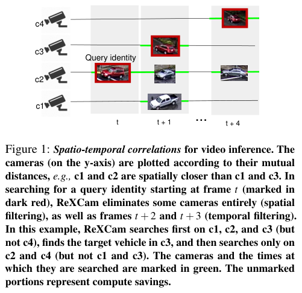
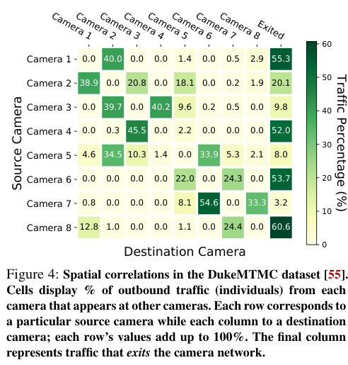
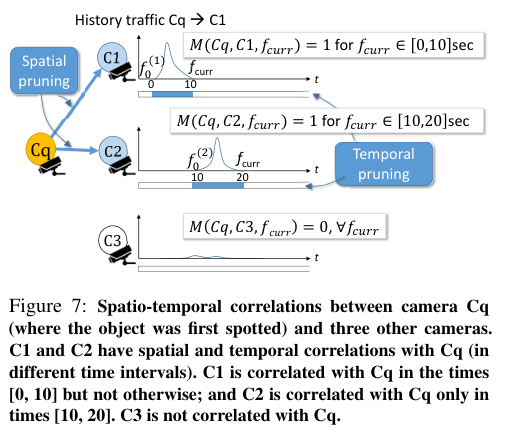
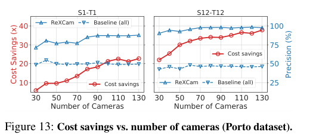

# Jain et al. 2019 · ReXCam: phân tích video qua nhiều camera tiết kiệm tài nguyên

## Tóm tắt một dòng
Học từ video cũ xác suất người rời camera này sẽ tới camera kia (không gian) và sau bao lâu (thời gian), rồi khi theo vết một người chỉ chạy phát hiện và re-ID trên camera và khung giờ có tương quan, tìm lại trên video vừa bỏ qua nếu sót; giảm tính toán 8,3 lần trên 8 camera Duke, 23–38 lần trên 130 camera mô phỏng, độ chính xác tăng từ khoảng 51 % lên 90 %.

## Vì sao đọc
Là bài gốc cho khoảng trống 2 trong [CONTEXT](../../../paper/j1/CONTEXT-vi.md) mục 31: dùng tương quan giữa các camera để thu hẹp
tập camera và khung giờ cần tìm khi truy vấn ảnh người tới AI node.

## Bài toán và mô hình
- **[GĐ]** Ứng dụng: tìm và theo vết một người hay xe qua mạng camera lớn trên video trực tiếp (nghi phạm, trẻ lạc, xe trong
  cảnh báo AMBER); đối tượng cần tìm chỉ xuất hiện ở rất ít camera tại mỗi thời điểm (tr. 1–2).
- **[GĐ]** Đường ống: phát hiện đối tượng trên từng khung, rồi re-ID xếp hạng ảnh trong gallery theo khoảng cách đặc trưng tới
  ảnh truy vấn; đặc trưng là lớp trung gian của mạng nơ-ron (tr. 3, Fig. 2).
- **[GĐ]** Tính toán ở biên: mọi camera nối mạng LAN tốc độ cao tới một hộp tính toán biên (ví dụ Azure Data Box Edge); video
  truyền liên tục về đó. Cũng áp dụng được cho mạng camera AI tự xử lý (tr. 3).
- **[GĐ]** Chi phí đo bằng số khung phải chạy phát hiện và re-ID; không xét băng thông hay năng lượng (tr. 3, 9).
- **[GĐ]** Camera tĩnh nên khoảng cách giữa hai camera cố định, thời gian đi giữa chúng tập trung quanh một giá trị (tr. 4).

## Định nghĩa và ký hiệu
| Ký hiệu | Nghĩa |
|---|---|
| n(c_s, c_d) | số người rời camera nguồn c_s và được thấy tiếp theo ở camera đích c_d (đi qua c_e thì tính cho c_s → c_e) (tr. 3–5) |
| S(c_s, c_d) | tương quan không gian = n(c_s, c_d) / Σ_i n(c_s, c_i); không đối xứng (tr. 5) |
| T(c_s, c_d, [t1, t2]) | tương quan thời gian = n(c_s, c_d, [t1, t2]) / n(c_s, c_d), tỉ lệ người tới c_d trong khoảng thời gian đi [t1, t2] (tr. 5) |
| s_thresh, t_thresh | ngưỡng lọc: tìm ở camera nhận ít nhất s_thresh lưu lượng từ c_s, trong cửa sổ chứa 1 − t_thresh lưu lượng đầu (ví dụ 5 % và 98 %) (tr. 5–6) |
| f_0 | khung của lần tới c_d sớm nhất trong lịch sử, từ c_s (tr. 6) |
| M(c_s, c_d, f_curr) | mô hình lọc, (1): bằng 1 khi S ≥ s_thresh và T(c_s, c_d, [f_0, f_curr]) ≤ 1 − t_thresh, với f_curr ≥ f_0 (tr. 6) |
| Ss-Tt | phiên bản lọc với s = ngưỡng không gian (%), t = ngưỡng thời gian (%); không có t là chỉ lọc không gian (tr. 9–10) |
| P_{c,w} | xác suất một người "chưa quét" xuất hiện ở camera c trong cửa sổ w (bài toán phát hiện, mục 5.4) (tr. 7) |
| P*_c | xác suất một người đi vào mạng ở camera c, ước từ lịch sử (tr. 7) |

## Kết quả chính
- **[KQ]** Trên Duke, người rời một camera chỉ đi tiếp tới trung bình 1,9 trong 7 camera khác với mức ít nhất 5 % lưu lượng;
  chỉ tìm ở các camera này giảm tính toán 3,7 lần mà vẫn giữ 95 % số lần phát hiện (tr. 4).
- **[KQ]** Gần về địa lý không phải bộ lọc tốt: từ camera 5, người đi nhiều sang camera 2 và 6, không sang 7 và 8 dù cũng gần;
  lưu lượng không đối xứng, hơn 50 % từ camera 7 sang 6 nhưng dưới 25 % chiều ngược lại (tr. 4, Fig. 4).
- **[KQ]** Thời gian đi giữa hai camera tập trung: trung bình 44,2 s, độ lệch chuẩn 10,3 s (23 % trung bình); chỉ lọc thời gian
  (cửa sổ chứa 98 % lượt tới) đã giảm tính toán 7,5 lần (tr. 4, Fig. 5).
- **[KQ]** Ghép hai bộ lọc với tương quan biết đúng: tiềm năng giảm 9,4 lần; ReXCam đạt 8,3 lần, khoảng 90 % tiềm năng; độ
  chính xác từ 51 % lên 90 % (tr. 4–5).
- **[KQ]** Lọc không gian–thời gian làm tăng độ chính xác vì bớt camera và khung không liên quan, nên ít khớp nhầm; bài gọi đây là
  tác dụng như bộ lọc thông thấp (tr. 2, 10).

## Thuật toán
- **[TT] Theo vết qua camera, Algorithm 1** (tr. 6–7). Đầu vào: ảnh truy vấn q, thấy lần cuối ở khung f_q trên camera c_q. Mỗi
  bước khung: lọc lấy V_corr là các camera có M = 1 với c_q tại f_curr; phát hiện người trên các khung đó, xếp hạng re-ID; nếu
  khoảng cách nhỏ nhất dưới `match_thresh` thì ghi nhận, cập nhật đặc trưng truy vấn, đặt c_q, f_q mới. Quá `exit_t` mà không
  thấy thì coi như đã rời mạng.
- **[TT] Tìm lại (replay)** (tr. 7). Khi pha một không thấy q, quay lại f_q + 1 và tìm trên video đã bỏ qua với s_thresh và t_thresh
  giảm 10 lần; vẫn không thấy thì tìm cả mạng tới `exit_t`. Chỉ cần giữ video vài phút gần nhất (vài trăm MB kể cả HD). Tăng tốc
  bằng bỏ bớt khung và giảm độ phân giải, hoặc chia việc cho camera và máy rảnh.
- **[TT] Phát hiện danh tính trên nhiều camera, mục 5.4** (tr. 7–8). Tìm người (trẻ lạc, nghi phạm) khi chưa biết camera xuất
  phát. P_{c,0} = P*_c; P_{c,w} = P*_c + Σ_{w_j ≤ w, c_i} I_{c_i,w_j} · P_{c_i,w_j} · S(c_i, c) · T(c_i, c, w), với I = 1 nếu camera c_i ở
  cửa sổ w_j chưa được tìm. Mỗi lúc tìm cặp (c, w) có P_{c,w} > θ; không thấy thì đặt I = 0 và cập nhật các P khác.
- **[TT] Lập hồ sơ tương quan** (tr. 8). Chạy bộ theo vết nhiều đối tượng nhiều camera (MTMC) trên video cũ, đếm
  n(c_s, c_d, [t1, t2]). Để rẻ, chỉ gán nhãn một phần khung. Khi lỗi lọc tăng vọt (người bị sót ở pha lọc mà replay tìm thấy) thì
  lập lại hồ sơ cho cặp camera đó.
- **[TT] Triển khai** (tr. 8). 1 500 dòng Python trên 5 camera AWS DeepLens (Intel Atom, GPU Intel Gen9, 8 GB RAM, 16 GB nhớ)
  nối Wi-Fi; một laptop làm bộ điều khiển giữ mô hình tương quan. Giữa bộ điều khiển và camera chỉ có bản tin điều khiển: "trigger"
  bảo camera bắt đầu hay dừng tìm một danh tính trong một khoảng thời gian (kể cả tìm trên video cũ), "feedback" báo đã thấy hay
  người đã rời khung; camera gửi heartbeat vài giây một lần.

## Thực nghiệm và số liệu
- **[TS]** Duke (DukeMTMC): 8 camera trong khuôn viên đại học, trường nhìn gần như không chồng nhau, 85 phút video 1080p 60 fps
  mỗi camera, hơn 2 700 danh tính, hơn 4 triệu lần phát hiện người có nhãn (tr. 3, 9).
- **[TS]** AnonCampus: 5 camera DeepLens trong một toà nhà trường, 35 phút 1080p 24 fps, gán nhãn tay (tr. 9).
- **[TS]** Porto: 1 710 671 quỹ đạo GPS của 442 taxi (1/2013–6/2014), lấy mẫu 15 s; đặt tay 130 camera ở giao lộ (toạ độ từ
  Google Maps), trường nhìn là ô vuông cạnh l = 100 m; độ chính xác phát hiện và re-ID lấy bằng số của DukeMTMC-reID (tr. 9).
- **[TS]** Re-ID ResNet-50 (deep-person-reid, PyTorch) cho Duke và Porto, person-reidentification-retail-0076 (OpenVINO) cho
  DeepLens; tương quan học từ 16 352 khung gán nhãn bằng bộ MTMC; 100 truy vấn (20 cho AnonCampus); GPU K80 (tr. 9).
- **[TS]** Baseline (all) tìm mọi camera mỗi bước; Baseline (GP) chỉ tìm camera gần về địa lý (Duke: cặp kề chọn tay; Porto: trong
  4l = 400 m) (tr. 9).
- **[SỐ]** Baseline (all) xử lý 98 760 khung cho 20 truy vấn (AnonCampus), 45 638 và 85 890 khung cho 100 truy vấn (Duke, Porto)
  (tr. 10).
- **[SỐ]** Phiên bản tốt nhất (ReXCam-O) khác nhau theo dữ liệu, phải chỉnh: S30-T1 (AnonCampus), S5-T2 (Duke), S1-T1 (Porto);
  xử lý 28 680 / 5 500 / 3 776 khung, giảm 3,4 / 8,3 / 23 lần so với Baseline (all) (tr. 10, Fig. 10–12).
- **[SỐ]** Độ phủ (recall) Duke: Baseline (all) 81,3 %, chỉ lọc không gian 79,3 %, ReXCam-O 79,7 %; giảm 2,2 / 1,6 / 6,5 điểm trên
  ba bộ dữ liệu; trễ tích luỹ trung bình khoảng 3,2 s (tr. 10–11).
- **[SỐ]** Độ chính xác (precision) Baseline (all) 50,4 / 51,1 / 49,6 %, ReXCam-O 71,7 / 90,4 / 85,8 % (tr. 10).
- **[SỐ]** Lọc mạnh nhất S10-T10 trên Duke chỉ xử lý 3 513 khung, giảm 13 lần; trên Porto S12-T12 giảm tới 38 lần với 130 camera,
  mức giảm tăng dần theo số camera, độ chính xác giữ hơn baseline khoảng 34,5 điểm (tr. 10–11, Fig. 13).
- **[SỐ]** Bỏ khung (1/3, 1/4) độc lập với lọc tương quan: mức giảm vẫn 8,6 và 8,4 lần (tr. 11, Fig. 14).
- **[SỐ]** Replay thường trễ 2,6 s; bỏ một nửa khung còn 1,8 s (recall 78,0 %), xử lý nhanh gấp đôi còn 1,3 s (tr. 11, Fig. 15).
- **[SỐ]** Hồ sơ tương quan học từ 37,1 phút video mỗi camera cho recall cao nhất 80,1 %; ít hơn thì thiếu dữ liệu, nhiều hơn thì quá
  khớp; tính cả chi phí lập hồ sơ thì hoà vốn sau 34 truy vấn (tr. 11–12, Fig. 16).
- **[SỐ]** Phát hiện danh tính trên Duke: giảm 7,6 lần với θ = 0,95; θ = 0,75 không giảm recall, precision tăng 28 điểm, giảm 6,6
  lần (tr. 12, Fig. 17).

## Hình tiêu biểu

*Đọc hình:* sau khi thấy xe ở c2, chỉ tìm c1, c2, c3 và bỏ c4; thấy ở c3 thì bước sau chỉ tìm c2, c4. Phần không tô là phần tiết kiệm.

*Đọc hình:* mỗi hàng chỉ có hai ba ô lớn; nhiều ô bằng 0 dù hai camera gần nhau; ma trận không đối xứng (7 → 6 là 54,6 %, 6 → 7 là
24,3 %); cột "Exited" lớn cho biết nhiều người rời mạng.

*Đọc hình:* mỗi camera đích có một phân bố thời gian đi riêng, bắt đầu từ f_0; chỉ tìm trong phần dày của phân bố.

*Đọc hình:* mức giảm tăng gần tuyến tính theo số camera (khoảng 6 lên 22 lần với S1-T1, 22 lên 38 lần với S12-T12), độ chính xác của
ReXCam giữ quanh 90 % còn baseline quanh 50 %.

## Trích nguyên văn
- **[TRÍCH]** "A key property of cross-camera applications is that objects of interest appear only in a small number of cameras at any time, even in large camera deployments." (tr. 2)
- **[TRÍCH]** "geographical proximity is not necessarily a good spatial filter." (tr. 4)
- **[TRÍCH]** "the model allows to prune the cameras and time windows in which q is unlikely to be found based on when and where q was not found earlier." (tr. 7)

## Liên hệ SigDrop
- **[NX] [L1]** Trùng với phát hiện ở CONTEXT mục 16: kho người lạ càng lớn thì người lạ giống nhất càng giống, xác suất bắt được
  mục tiêu giảm. ReXCam cho thấy chiều ngược lại trên dữ liệu thật: bỏ bớt camera và khung không liên quan thì precision từ khoảng
  50 % lên 86–90 % mà recall chỉ mất 1,6–6,5 điểm. Với D3 (vector kèm thời điểm và vị trí), AI node lọc kho M theo nơi thấy lần cuối
  và thời gian trôi qua trước khi so, tức thu nhỏ M hiệu dụng, nên có thể hạ ngưỡng mà giữ tỉ lệ báo nhầm. Đây là một lý do để
  vector D3 luôn mang thời điểm và mã camera.
- **[NX] [ĐV]** Khác biệt về điểm nghẽn: ReXCam tiết kiệm tính toán ở hộp biên có LAN tốc độ cao và video truyền liên tục; mạng của
  J1 nghẽn ở luồng nền G2G 1–2 KB/s mỗi AI node (PLAN-K9-DATA mục 2), còn tính toán đối sánh chỉ vài ms tới vài chục ms (CONTEXT
  mục 16). Vì vậy không thể dẫn ReXCam như lời giải cho thời gian pha 1; dẫn được cho chất lượng báo cáo (ít báo nhầm hơn thì pha 2
  ít chuyến xác minh vô ích hơn).
- **[NX] [ĐV]** Kiến trúc triển khai của ReXCam gần với hướng giữ dữ liệu tại chỗ của J1: bộ điều khiển chỉ gửi "trigger" (tìm danh
  tính này trong khoảng thời gian này) và nhận "feedback" (đã thấy), video không rời camera (tr. 8). Có thể dẫn làm tiền lệ cho kiểu
  truy vấn ra, điểm số về.
- **[NX] [C]** Bài toán phát hiện ở mục 5.4 là tìm kiếm Bayes trên cặp (camera, cửa sổ): P_{c,w} cập nhật sau mỗi lần tìm không thấy.
  Cùng khung với mô hình pha 2 trong repo (`uav-l2/tools/l1_rank.py` tính P(cell thật) và cho đội 2 thăm theo P / thời gian). Khi V1
  xác minh một cell là sai, có thể chuyển xác suất sang các cell kề theo S·T thay vì chỉ chuẩn hoá lại; cần ma trận S, T ở mức AI
  node hay cell.
- **[NX] [C]** Ma trận S, T học được từ chính luồng nền D3: AI node nhận vector có thời điểm và mã camera của mọi người đi qua các
  camera nó phụ trách, nên tự đếm được n(c_s, c_d, [t1, t2]) trong vùng của mình mà không cần nhãn. Chuyển tiếp giữa các AI node khác
  nhau thì cần trạm gốc ghép, việc này chưa ai trong J1 bàn.
- **[NX] [ĐV]** Số để tham khảo cho kịch bản đô thị: Porto đặt camera ở giao lộ với trường nhìn 100 m, lọc gần địa lý dùng 400 m
  (tr. 9); thời gian đi giữa camera trong khuôn viên trung bình 44 s (tr. 4). Hai số này cho cỡ cửa sổ thời gian khi nối các lần thấy
  thành đường đi.
- **[NX]** Cần sửa CONTEXT mục 31: dòng đó ghi "ReXCam giảm tính toán 4,6–38 lần" và dẫn bản v2. Bản v4 ghi 3,4 lần (5 camera thật),
  8,3 lần (Duke), 23–38 lần (Porto 130 camera mô phỏng) (tr. 1, 10–11). Tôi chưa mở bản v2 để kiểm số 4,6.

## Hạn chế và câu hỏi mở
- Chỉ có tương quan theo cặp camera kế tiếp (Markov bậc một); không dùng hướng đi hay vận tốc của người trong khung.
- Dữ liệu 130 camera là mô phỏng từ quỹ đạo taxi, không phải video; độ chính xác re-ID giả định bằng số của DukeMTMC-reID (tr. 9, 11).
- Ngưỡng tốt nhất khác nhau theo bộ dữ liệu và phải chỉnh tay (tr. 10).
- Người lạc hay mất tích có thể không đi theo lưu lượng thường ngày mà hồ sơ tương quan học được; bài không xét trường hợp này.
- Không đo băng thông, năng lượng, độ trễ mạng; mọi chi phí là số khung xử lý.
