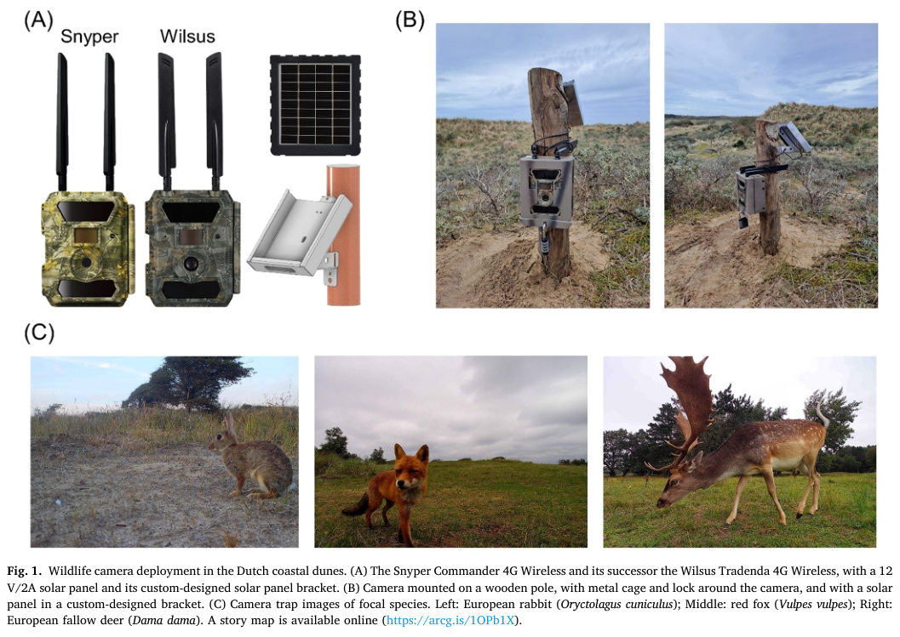
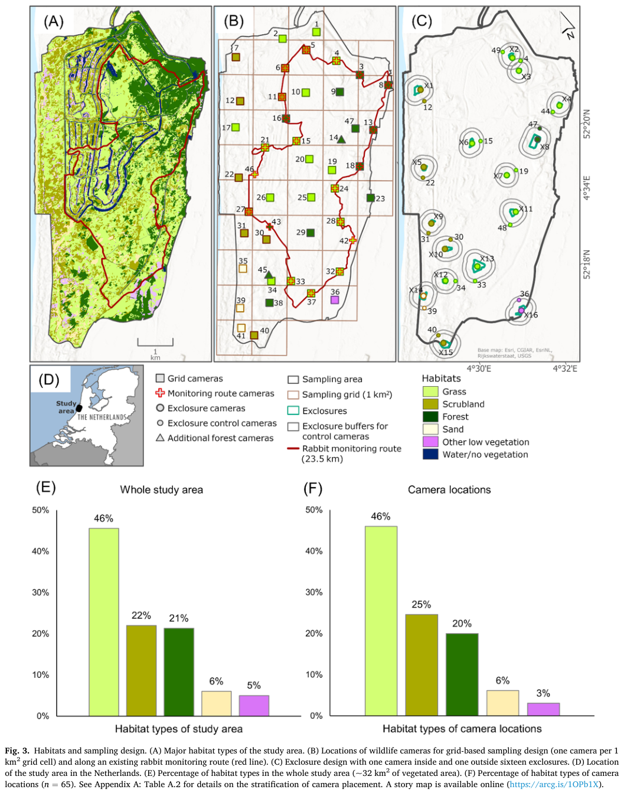
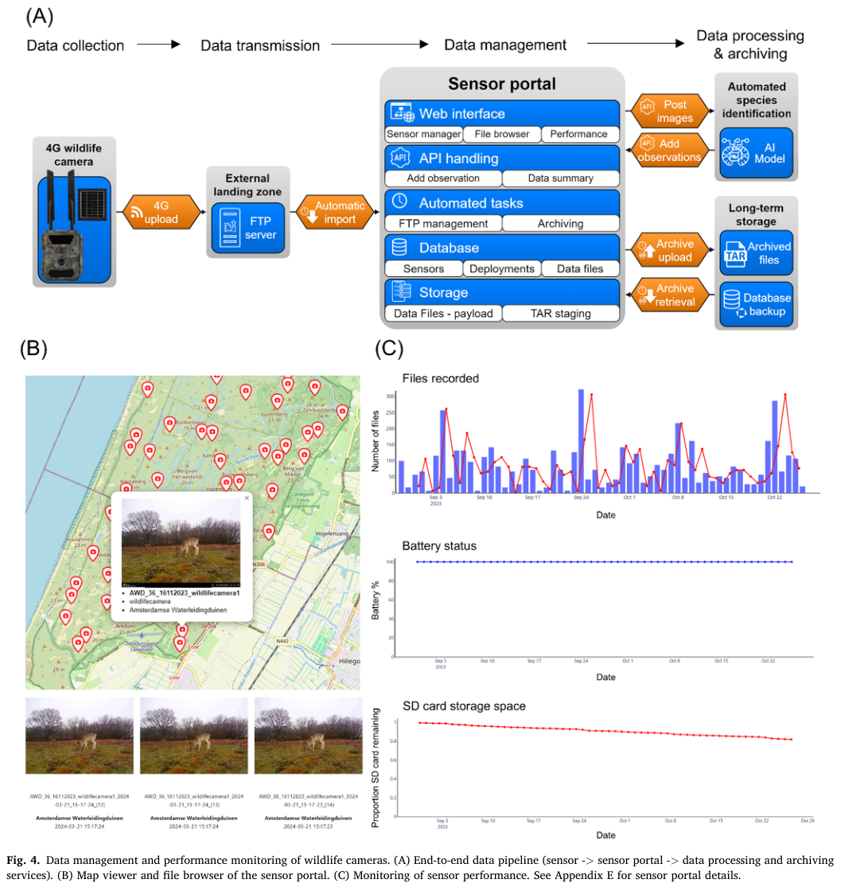

# Kissling et al. 2024 · Mạng camera động vật hoang dã tự động, chi phí thấp ở một khu Natura 2000

## Tóm tắt một dòng
Lắp 65 camera bẫy ảnh 4G chạy pin mặt trời trên 34 km² đụn cát ven biển Hà Lan (lưới 1 camera mỗi km², thêm tuyến khảo sát và cặp trong/ngoài rào), ảnh tự gửi về cổng dữ liệu rồi qua AI nhận loài; tổng chi phí 10 năm thấp hơn bẫy ảnh truyền thống 43 %.

## Vì sao đọc
Là mạng camera hiện trường có nối mạng, có số liệu thật về mật độ, khoảng cách camera, kích thước và tần suất ảnh, chi phí
vận hành. Dùng cho câu hỏi bối cảnh J1 về mật độ và cỡ vùng (CONTEXT mục 7–8, chatlog mục 327, 329).

## Bài toán và mô hình
- **[GĐ]** Vùng nghiên cứu: Amsterdam Water Supply Dunes, 34 km² đụn cát, dài 8 km dọc bờ Biển Bắc, rộng 1,5–5 km; khoảng
  32 km² có thảm thực vật (tr. 2, Fig. 3 tr. 7).
- **[GĐ]** Thảm phủ: cỏ 46 %, cây bụi 22 %, rừng 21 %, cát 6 %, thực vật thấp khác 5 % (tr. 2, Fig. 3E).
- **[GĐ]** Khu giải trí hơn 1 triệu lượt khách mỗi năm, nên cần chống trộm: lồng thép có khoá, cột gỗ đóng sâu tới 1 m, mật
  khẩu trên camera, nhãn dán có mã QR (tr. 10).
- **[GĐ]** Mỗi camera tự gửi ảnh qua mạng di động 4G (nhà mạng KPN), không có mesh hay chuyển tiếp giữa camera; điều kiện là
  có sóng 4G và đủ nắng (tr. 1, 4, 11).
- **[GĐ]** Camera kích hoạt bằng cảm biến hồng ngoại thụ động (PIR), đèn hồng ngoại ban đêm; gắn cao 30–50 cm (bản chính
  thức khoảng 35 cm), quay hướng bắc, không mồi, tránh lối đi (tr. 3, 5).

## Định nghĩa và ký hiệu
| Ký hiệu | Nghĩa |
|---|---|
| grid camera | camera của thiết kế lưới, một camera mỗi ô 1 × 1 km², chia tầng theo loại sinh cảnh (tr. 3–4) |
| route camera | camera dọc tuyến khảo sát thỏ 23,5 km, cách nhau khoảng 1 km, trong dải 20 m quanh tuyến (tr. 3–4) |
| exclosure / control | cặp camera trong rào chắn hươu và ngoài rào (cách mép rào 200–300 m), 16 rào rộng 0,5–7,2 ha (tr. 2, 4) |
| sensor portal | cổng dữ liệu (Django, Celery, PostgreSQL, PostGIS) nhập ảnh, theo dõi camera, gọi API nhận loài (tr. 4) |
| balanced accuracy | (độ nhạy + độ đặc hiệu) / 2 (tr. 4) |

## Kết quả chính
- **[KQ]** Camera chạy pin mặt trời 12 V/2 A không cần thay pin hay lấy thẻ SD; ba camera của pilot 1 chạy 746 ngày, hơn
  2 năm (tr. 4).
- **[KQ]** Ống kính rộng 100° phát hiện nhiều cá thể gấp 1,5–2,5 lần ống thường 52° và nhiều loài gấp 2–6 lần, nhưng xác
  suất phát hiện thỏ và hươu không khác có ý nghĩa thống kê (tr. 4, Fig. 2).
- **[KQ]** Chi phí thiết lập của mạng tự động cao hơn 62 918 € (+131 %), chi phí vận hành mỗi năm thấp hơn 57 156 € (−51 %);
  tổng 10 năm thấp hơn 43 %, tiết kiệm hơn 500 000 €; tổng 5 năm thấp hơn 40 % (tr. 8–9).

## Thuật toán
- **[TT] Luồng dữ liệu** (tr. 4–5, Fig. 4). Camera chụp, trong tối đa 60 s gửi ảnh qua 4G lên máy chủ FTP; cổng dữ liệu nhập
  mỗi 15 phút; ảnh gửi qua API sang Conservation AI để nhận loài; lưu trữ dài hạn dạng TAR trên kho lạnh SURF.
- **[TT] Thiết kế lấy mẫu** (tr. 3–5, Bảng 1). Ba thiết kế lồng nhau: 41 camera lưới (một mỗi ô 1 km²), 20 camera tuyến
  thỏ, 32 camera rào (16 cặp). 27 camera lưới dùng chung với tuyến (14), với control (10) hoặc cả hai (3); thêm 2 camera
  rừng; tổng 65 camera, lắp từ tháng 7 đến tháng 11/2023.

## Thực nghiệm và số liệu
- **[TS]** Ba pilot, mỗi pilot 2–6 camera, từ hè 2021 đến xuân 2023; 47 597 ảnh được kiểm tay (tr. 3).
- **[SỐ]** Mật độ: 65 camera trên 34 km², khoảng 1,9 camera/km²; lớp lưới là 1 camera/km²; camera tuyến cách nhau khoảng
  1 km; camera control cách rào 200–300 m (tr. 2–5, Bảng 1). Mật độ do người ghi tính.
- **[SỐ]** Ảnh khoảng 0,5 MB mỗi file (0,47 MB trong bảng chi phí), trung bình 40 ảnh mỗi camera mỗi ngày, 572 MB mỗi camera
  mỗi tháng; cước 2,5 €/GB tức 1,78 € mỗi camera mỗi tháng (tr. 5, Bảng 2).
- **[SỐ]** Pilot 1: 20 loài trong khoảng 500 ngày của ba camera; thỏ hơn 1 500 lần mỗi năm, gấp 8 lần cáo; ảnh trống (kể cả
  ảnh báo cáo hằng ngày và kích hoạt nhầm) gấp đôi số lần thấy thỏ (tr. 4, Fig. 2B).
- **[SỐ]** Mô hình Faster R-CNN (ResNet101) của Conservation AI trên 4 058 ảnh từ 46 camera: balanced accuracy / recall là
  cáo 0,88 / 0,78, thỏ 0,75 / 0,50, hươu 0,69 / 0,42, người 0,90 / 0,85, ảnh trống 0,60 / 0,51; precision hươu 0,88, thỏ
  0,27 (nhầm với thỏ rừng) (tr. 8, 10).
- **[SỐ]** Bảo trì: mạng tự động 4 lần ra hiện trường mỗi năm, bẫy truyền thống 18 lần (ba tuần một lần, 4 ngày mỗi lần, tổng
  34 người-ngày mỗi năm); mỗi chuyến 95,82 km; giả định mất hoặc hỏng 2 camera mỗi năm (tr. 5, 10).
- **[SỐ]** Mỗi năm khoảng 95 000 ảnh AI cần kiểm lại 10 %; tăng lên 20 % thì chi phí người kiểm thành 20 206 €/năm, giảm
  còn 5 % thì 5 053 €/năm (tr. 11).

## Hình tiêu biểu

*Đọc hình:* mỗi điểm đo là một camera đứng riêng, có ăng-ten 4G và pin mặt trời; không có node chuyển tiếp hay gateway.

*Đọc hình:* camera phủ cả vùng 8 km × 1,5–5 km với khoảng cách cỡ 1 km; nơi có rào thì cặp camera dày hơn, cách vài
trăm mét.

*Đọc hình:* mỗi camera gửi vài chục đến hơn 300 file mỗi ngày, pin luôn đầy nhờ năng lượng mặt trời, thẻ SD giảm chậm.

## Trích nguyên văn
- **[TRÍCH]** "The system can be applied in open habitats of other nature reserves with mobile network coverage." (tr. 1)
- **[TRÍCH]** "Recommendations for camera trap sampling designs suggest using 40–60 camera traps per site, but 20–30 cameras can already be sufficient to estimate the occupancy of common species" (tr. 2, dẫn Kays et al. 2020)

## Liên hệ SigDrop
- **[NX] [ĐV]** Số cho CONTEXT J1 mục 7–8: một mạng camera hiện trường có nối mạng thật dày khoảng 1,9 camera/km², camera cách
  nhau khoảng 1 km, tổng 65 camera cho một vùng 34 km². Đây là mật độ camera, khác mật độ node cảm biến của bài (khoảng
  820 node/km²); nếu J1 coi camera AI là số ít trong một mạng node rẻ dày đặc thì con số này hợp với lớp camera, không hợp
  với lớp node.
- **[NX] [ĐV]** Vùng 34 km², 8 km × 1,5–5 km, gần cỡ bản đồ k8 (khoảng 16 km²) nhân hai, và nằm trong tầm một chuyến UAV cánh
  bằng (CONTEXT mục 7 ước khoảng 100 km² mỗi chuyến). Có thể dùng làm ví dụ "vùng cỡ một UAV" cho mục 327.
- **[NX] [ĐV]** Mạng này dựa hoàn toàn vào 4G. Bài tự nói giới hạn áp dụng là nơi có sóng di động và đủ nắng; vùng không có
  sóng (rừng sâu, sau thảm hoạ) là chỗ SigDrop nhắm tới, nên bài là ví dụ đối chứng: có hạ tầng thì không cần UAV.
- **[NX] [L1]** Ảnh khoảng 0,5 MB và 40 ảnh mỗi camera mỗi ngày cho biết lượng dữ liệu một camera bẫy ảnh sinh ra; truy vấn
  SigDrop đi theo chiều ngược lại (xuống camera), nhưng con số này giúp ước dung lượng nếu J1 bàn tới việc camera gửi kết
  quả lên.
- **[NX] [L1]** Recall nhận loài 0,42–0,78 cho thấy AI tại biên trên ảnh bẫy ảnh thật còn yếu, khớp với ghi chú
  `research_notes/l1-signature-matching/` về độ chính xác nhận dạng động vật.

## Hạn chế và câu hỏi mở
- Phụ lục A–G (thiết lập camera, pilot, lấy mẫu, cổng dữ liệu, mô hình AI, chi tiết chi phí) nằm ở tài liệu bổ sung, không có
  trong PDF.
- Bài không đo chất lượng liên kết 4G (tỉ lệ ảnh mất, độ trễ ngoài mức "tối đa 60 s").
- Chi phí tính theo lương Hà Lan, bài tự nói là cao so với châu Âu (tr. 11).
