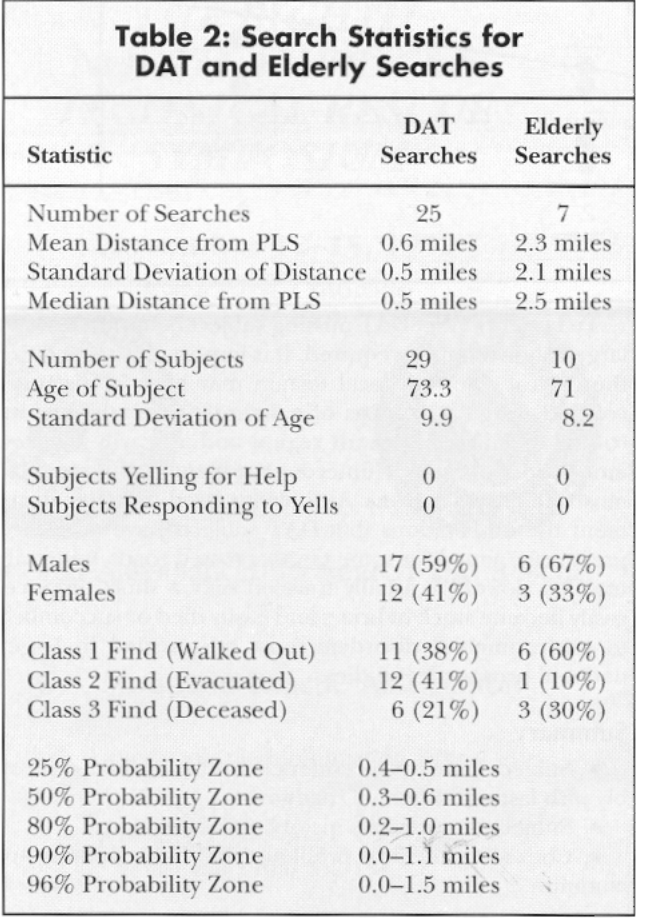
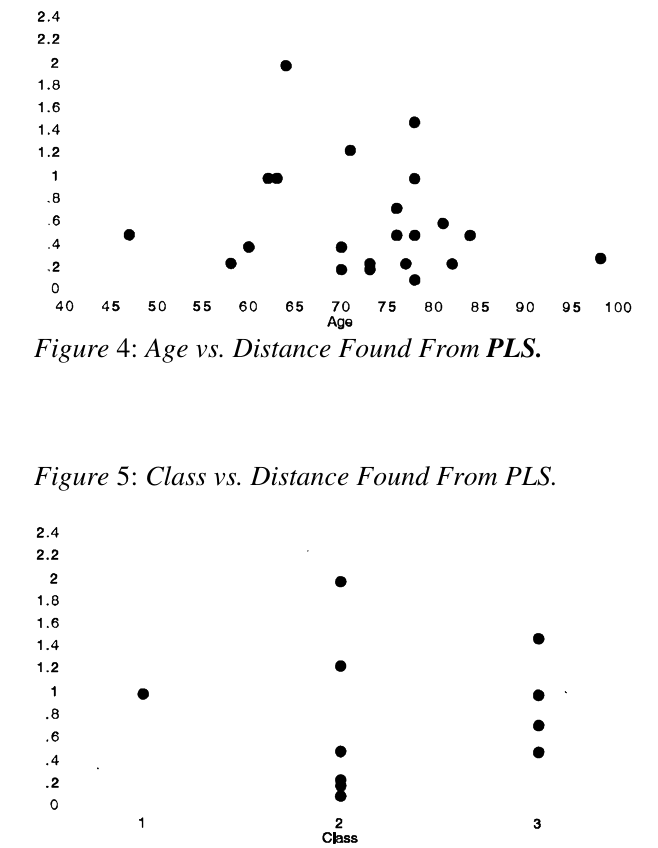

# Koester và Stooksbury 1992 · Người mắc Alzheimer đi lạc: hồ sơ hành vi và số liệu ở Virginia

## Tóm tắt một dòng
Nghiên cứu đầu tiên tách riêng người mắc Alzheimer khỏi nhóm người già trong số liệu tìm kiếm cứu nạn: 29 vụ trong 245 vụ của
Virginia (6/1986–6/1991), người đi lạc được tìm thấy trung vị 0,5 dặm từ điểm thấy cuối, không kêu cứu, ít để lại dấu vết, hay vượt
đường rồi kẹt ở suối hoặc bụi gai.

## Vì sao đọc
Là bản đầu của bộ số liệu mà [koester1998-adrd](koester1998-adrd.md) mở rộng; có bảng vùng xác suất 25–96 % theo khoảng cách và danh
sách kỹ thuật tìm kiếm đề xuất. Dùng cho tiên nghiệm vị trí người cần tìm ở pha 2 của J1 (chatlog mục 380).

## Bài toán và mô hình
- **[GĐ]** Hồi cứu trên hồ sơ của Virginia Department of Emergency Services (DES) từ nhiệm vụ VA001 (6/1986) tới VA234 (6/1991),
  245 vụ sau khi bỏ số trùng (tr. 2).
- **[GĐ]** Chỉ tính vụ có số nhiệm vụ của bang, tức là đã có lực lượng bang được điều đi; thêm 9 vụ ngoài khoảng thời gian cho phần
  dấu vết, vượt đường, kỹ thuật (tr. 2).
- **[GĐ]** Xếp loại "DAT" (mất trí kiểu Alzheimer) chỉ dựa vào lời người chăm sóc ghi ở mục thông tin khác của phiếu; không ghi thì
  xếp vào người già (trên 60 tuổi) hoặc nhóm khác (tr. 2).

## Định nghĩa và ký hiệu
| Ký hiệu | Nghĩa |
|---|---|
| DAT | Dementia of Alzheimer's Type: mất trí kiểu Alzheimer, chia nhẹ, vừa, nặng (tr. 1) |
| PLS | điểm thấy cuối (tr. 3) |
| class 1 / 2 / 3 | tự đi ra / phải sơ tán / tử vong (tr. 2) |
| probability zone | bán kính quanh PLS chứa một tỉ lệ số người tìm thấy (tr. 4, Bảng 2) |

## Kết quả chính
- **[KQ]** Khoảng cách tìm thấy (25 vụ có số): trung bình 0,6 dặm, trung vị 0,5 dặm, độ lệch chuẩn 0,5 dặm; người già không mất trí
  (7 vụ): trung bình 2,3 dặm, trung vị 2,5 dặm (tr. 3–4, Bảng 2).
- **[KQ]** Vùng xác suất của người DAT: 25 % trong 0,4–0,5 dặm, 50 % trong 0,3–0,6, 80 % trong 0,2–1,0, 90 % trong 0,0–1,1, 96 % trong
  0,0–1,5 dặm (tr. 4, Bảng 2).
- **[KQ]** Không có người DAT nào kêu cứu hay đáp lại tiếng gọi (0/29) (tr. 4, Bảng 2).
- **[KQ]** Khoảng cách không liên quan tới tuổi, nhưng tăng theo mức nặng của kết cục (class) (tr. 3, Hình 4–5).

## Thuật toán
- **[TT] Kỹ thuật tìm kiếm đề xuất** (tr. 5): đưa người lần dấu và chó lần dấu tới PLS và dọc đường sớm; chó đánh hơi và đội tìm
  nhanh vào suối, rãnh gần PLS nhất; lục soát kỹ nhà hoặc viện dưỡng lão và lặp lại mỗi vài giờ; tìm trong bụi gai; quét dải
  100 yard song song đường; tìm ở các nơi ở cũ và vùng giữa nơi ở cũ với PLS.

## Thực nghiệm và số liệu
- **[SỐ]** 29/245 vụ (12 %) là DAT, nhóm đông nhất; tỉ lệ DAT trong tổng số vụ tăng từ 3 % (1987) lên 16 % (1990) (tr. 2, Bảng 1).
- **[SỐ]** Kết cục: 38 % tự đi ra, 41 % phải sơ tán (hạ thân nhiệt 56 %, mất nước 44 %), 21 % tử vong (hạ thân nhiệt 4, đuối nước
  2, tim 1) (tr. 2–3).
- **[SỐ]** Nơi thấy cuối: nhà riêng 36 %, viện dưỡng lão 36 %, trên đường 20 %, nhà người thân 8 % (tr. 5, Bảng 3). Nơi tìm thấy:
  suối và rãnh 38 %, bụi gai 25 %, đồng trống 17 %, trên đường 12 %, trong nhà 8 % (tr. 5, Bảng 4).
- **[SỐ]** Ai tìm thấy: người không đi tìm 42 %, đội quét 25 %, đội tìm nhanh 13 %, chó đánh hơi 13 %, trực thăng 8 % (tr. 5, Bảng 5).
- **[SỐ]** Dấu vết vật chất chỉ có ở 3 vụ (14 %); 67 % đi qua đường, 14 % vào rừng sau khi đi trên đường, 19 % không qua đường nào
  (tr. 3).

## Hình tiêu biểu

*Đọc hình:* vùng 96 % chỉ 1,5 dặm (khoảng 2,4 km) quanh điểm thấy cuối, và không ai kêu cứu hay đáp lại.

*Đọc hình:* không có xu hướng theo tuổi; nhóm tử vong (class 3) nằm xa hơn nhóm tự đi ra.

## Trích nguyên văn
- **[TRÍCH]** "Subject will not cry out for help or respond to shouts." (tr. 5)
- **[TRÍCH]** "In most searches, the subject is found wandering by nonsearchers and not by search teams." (tr. 3)

## Liên hệ SigDrop
- **[NX] [ĐV]** Cùng ý với [koester1998-adrd](koester1998-adrd.md): tiên nghiệm vị trí cho pha 2 hẹp quanh điểm thấy cuối, có bảng vùng
  xác suất dùng được trực tiếp (25 % tới 96 %). Người đi lạc không đáp lại tiếng gọi, nên tìm bằng âm thanh hay nhờ chính người đó
  báo tin đều vô ích; camera nhận dạng thụ động là cách hợp lý.
- **[NX]** Nơi thấy cuối là nhà riêng hoặc viện dưỡng lão trong 72 % vụ, tức là điểm xuất phát thường biết trước; bài toán J1 có thể
  lấy đó làm tâm vùng truy vấn.

## Hạn chế và câu hỏi mở
- Mẫu nhỏ (29 vụ, 25 có khoảng cách), một bang, đa số nông thôn và rừng.
- Bài ghi khoảng cách "0–2 miles (0–1.2 km)" (tr. 3); 2 dặm là khoảng 3,2 km, nên số km có lẽ sai.
- Hình 1 (phân bố loại vụ) và Hình 3 (biểu đồ khoảng cách) không có trong bản PDF này (chỉ còn chú thích của Hình 2, 4, 5).
