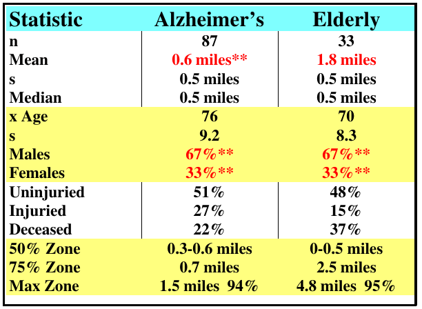
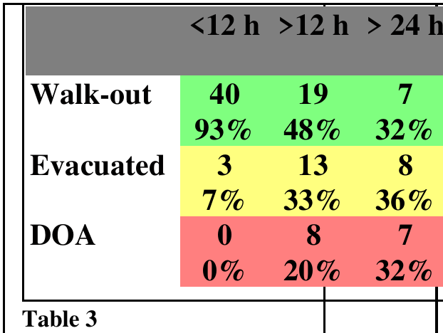
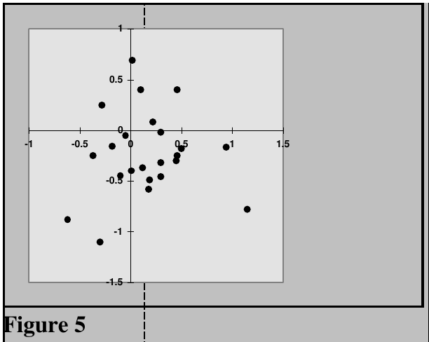

# Koester 1998 · Người mắc Alzheimer và chứng mất trí liên quan đi lạc: số liệu tìm kiếm cứu nạn ở Virginia

## Tóm tắt một dòng
Phân tích 87 vụ tìm người mắc Alzheimer và chứng mất trí liên quan (ADRD) trong 565 vụ tìm kiếm cứu nạn của bang Virginia
(6/1986–12/1996, thêm một năm theo dõi tiến cứu): người đi lạc thường được thấy cách điểm thấy cuối 0,8 km (trung vị), gần như
không ai sống sót nếu tìm sau hơn 24 giờ mà không được thấy sớm, và đa số được người không thuộc đội tìm kiếm phát hiện.

## Vì sao đọc
Là nguồn số liệu gốc về hành vi người mất trí đi lạc mà sách SAR dùng. Cho J1 thông tin trước về vị trí người cần tìm (khoảng
cách từ điểm thấy cuối, hướng đi, địa hình nơi thấy) và về giá của thời gian (tỉ lệ tử vong theo giờ), để dựng phân bố tiên
nghiệm cho pha 2 và để chọn cửa sổ truy vấn (CONTEXT mục 16–17, chatlog mục 380).

## Bài toán và mô hình
- **[GĐ]** Nguồn dữ liệu: hồ sơ của Virginia Department of Emergency Services (VDES), hơn 550 vụ từ 6/1986 tới 12/1996; chỉ tính
  vụ có số nhiệm vụ của bang, tức là sau khi cảnh sát địa phương đã tìm không thấy (tr. 5, 14).
- **[GĐ]** Khoảng cách từ điểm thấy cuối (PLS) tới chỗ tìm thấy là đường thẳng đo trên bản đồ địa hình USGS 7,5 phút, không theo
  đường đi thật (tr. 5–6).
- **[GĐ]** Hai pha: hồi cứu trên hồ sơ, và tiến cứu 6/1996–12/1997 do tác giả tới hiện trường hỏi người chăm sóc, chấm mức độ
  mất trí bằng thang DAD, SSI, sau đó MMSE (tr. 6–7).
- **[GĐ]** Người chăm sóc là nguồn tin duy nhất về người đi lạc; chẩn đoán mất trí trong pha hồi cứu dựa vào lời kể và hồ sơ y tế
  trong phiếu hỏi (tr. 7, 13–14).

## Định nghĩa và ký hiệu
| Ký hiệu | Nghĩa |
|---|---|
| ADRD | Alzheimer's Disease and Related Disorders: Alzheimer và các chứng mất trí khác (đa nhồi máu, Parkinson, Pick, Huntington...) (tr. 1) |
| critical wanderer | người mất trí tự ý rời người chăm sóc và không rõ đang ở đâu (tr. 1) |
| PLS / IPP | điểm thấy cuối / điểm lập kế hoạch ban đầu (tr. 8, 12) |
| zone 50 %, 75 %, max | bán kính chứa 50 %, 75 % và gần hết số người tìm thấy (tr. 9, Bảng 1) |
| travel-aid | đường, lối mòn hay địa vật giúp đi lại (tr. 12) |

## Kết quả chính
- **[KQ]** Khoảng cách tìm thấy từ PLS (59 vụ ADRD có số liệu): trung bình 0,9 km (0,6 dặm), trung vị 0,8 km (0,5 dặm), khoảng
  0–3,2 km; vùng 50 % là 0,3–0,6 dặm, 75 % là 0,7 dặm, 94 % là 1,5 dặm (tr. 8–9, Bảng 1).
- **[KQ]** Thời gian quyết định sống còn: tìm thấy trong 12 giờ thì 93 % tự đi ra, không ai chết; quá 24 giờ thì 32 % tự đi ra,
  32 % đã chết (tr. 9, Bảng 3). Chỉ một ca tử vong khi tìm thấy trong 24 giờ (tr. 11).
- **[KQ]** Thời gian từ lúc mất tới lúc báo đội cứu hộ của bang là 83,6 giờ trung bình ở vụ tử vong, 10,3 giờ ở vụ không bị thương;
  báo càng muộn thì tìm càng lâu (tr. 11, Hình 2).
- **[KQ]** Người đi lạc không kêu cứu và để lại rất ít dấu vết: 3 vụ có dấu vết vật chất trên 43, không vụ nào kêu cứu (tr. 4).
- **[KQ]** Hướng đi: 5/9 vụ có hướng đi xác định được tìm thấy trong ±30° quanh hướng đó (kiểm định Rayleigh p < 0,001)
  (tr. 12); 78 % tìm thấy ở phía nam IPP (χ² = 8,2, p < 0,01), không lệch đông tây (tr. 13, Hình 5).
- **[KQ]** Tuổi không dự báo được kết cục hay khoảng cách; mức độ mất trí (n = 6) chưa có tương quan có ý nghĩa (tr. 13).

## Thuật toán
- **[TT] Quy trình bốn bước định vùng tìm kiếm** (tr. 3): vùng lý thuyết theo quãng người đó đi được kể từ lúc thấy cuối (lớn nhanh
  theo thời gian nên ít dùng), rồi thu bằng thống kê khoảng cách theo loại người, rồi bỏ chỗ không đi được theo địa hình, rồi
  khoanh vùng khả năng cao nhất theo hồ sơ hành vi và điều tra.
- **[TT] Giả thuyết đường thẳng** (tr. 3–4): người mất trí đi gần như thẳng cho tới khi gặp vật cản (bụi gai, suối); có thể nhắm
  tới nơi ở cũ. Đội tìm kiếm California thấy hướng thấy cuối dự báo vị trí trong khoảng 10°, nhưng chưa có số liệu (tr. 4).

## Thực nghiệm và số liệu
- **[SỐ]** 87/565 vụ (15 %) là ADRD, loại đông thứ hai sau trẻ em (18 %) (tr. 8, Hình 1). ADRD chiếm khoảng 1 % dân số bang nhưng
  16 % số vụ tìm kiếm (tr. 14).
- **[SỐ]** Kết cục: 51 % không bị thương, 28 % phải sơ tán (hạ thân nhiệt 67 %, mất nước 33 %), 21 % tử vong; không ca nào có chấn
  thương (tr. 8). Người già không mất trí (n = 33): 48 % / 15 % / 37 % (tr. 8).
- **[SỐ]** Nơi thấy cuối: nhà riêng 37 %, viện dưỡng lão 31 %, trên đường 17 % (tr. 10, Bảng 4). Nơi tìm thấy: bụi gai 29 %, suối và
  rãnh 18 %, đồng trống 18 %, trong nhà 18 %, trên đường 7 % (tr. 10, Bảng 5).
- **[SỐ]** Ai tìm thấy: người không đi tìm 35 %, đội tìm nhanh 16 %, đội quét 15 %, trực thăng 15 %, chó đánh hơi 10 % (tr. 10,
  Bảng 6).
- **[SỐ]** Khoảng cách tới travel-aid gần nhất (23 vụ): trung vị 30 m, trung bình 91 m, khoảng 1–457 m; 25 % tìm thấy ngay trên
  travel-aid (tr. 12, Bảng 9).
- **[SỐ]** Giờ rời đi: rải đều trong khoảng 7 h tới 24 h, không vụ nào giữa 0 h 01 và 5 h 30 (tr. 10). 69 % số vụ trong mùa không
  sương giá (4–10), nhưng 31 % vụ của năm tháng lạnh chiếm 47 % số tử vong (p ≈ 0,05) (tr. 10–11).
- **[SỐ]** Nông thôn 67 %, đô thị 21 %, ven đô 12 %; không khác biệt về khoảng cách hay thời gian tìm, nhưng ở đô thị 25 % được tìm
  thấy nhờ điều tra (ở nông thôn 4 %) (tr. 11, Bảng 7).
- **[SỐ]** Pha tiến cứu: 5/6 người từng đi lạc trước đó (trung bình 2,8 lần); các lần trước đi xa 0–12 dặm, trung vị 0,2 dặm; có ca
  ngoại lai 12, 8 và 4 dặm (tr. 13–14).

## Hình tiêu biểu

*Đọc hình:* người ADRD có khoảng cách trung bình 0,6 dặm, vùng 94 % chỉ 1,5 dặm (khoảng 2,4 km), hẹp hơn hẳn người già không mất
trí (vùng 95 % tới 4,8 dặm).

*Đọc hình:* tỉ lệ tự đi ra giảm từ 93 % xuống 32 % và tử vong tăng từ 0 % lên 32 % khi thời gian tìm vượt 24 giờ.

*Đọc hình:* gần như mọi điểm nằm trong 1 dặm quanh IPP và lệch về phía nam (trục dọc âm).

## Trích nguyên văn
- **[TRÍCH]** "A critical window of 24 hours becomes apparent for survival." (tr. 15)
- **[TRÍCH]** "In most searches the patient is not found by search teams but found wandering by others." (tr. 9)

## Liên hệ SigDrop
- **[NX] [ĐV]** Tiên nghiệm vị trí cho pha 2 (CONTEXT mục 17, chatlog mục 380): với người mất trí, phân bố khoảng cách từ điểm thấy
  cuối hẹp (trung vị 0,8 km, 94 % trong khoảng 2,4 km), dồn về phía bụi gai, suối và sát đường (trung vị 30 m tới đường). Một mạng
  camera đô thị phủ bán kính 2–3 km quanh điểm thấy cuối là đủ cho phần lớn ca; trọng số theo khoảng cách có thể đưa vào điểm số ưu
  tiên của đội 2.
- **[NX] [ĐV]** Giá của thời gian: 24 giờ là ngưỡng sống còn, nên tổng thời gian pha 1 + pha 2 cỡ 15–20 phút của J1 rất nhỏ so với độ
  trễ báo tin thật (10–84 giờ). Lợi ích lớn nhất của mạng là rút ngắn khâu biết người mất và khoanh vùng, không phải vài phút của
  UAV. Đây là một lập luận nên có trong phần động cơ.
- **[NX] [ĐV]** 35 % ca được người qua đường phát hiện và người đi lạc không kêu cứu: mạng camera nhận dạng là cách tự động hoá
  "người qua đường thấy", hợp với hướng của J1. Ở đô thị 25 % ca giải quyết nhờ điều tra (tr. 11), gần với việc tra camera.
- **[NX]** Bài cho cửa sổ truy vấn mặc định 2 giờ của J1 (mục 345) một mốc: phần lớn người mất trí ở rất gần điểm thấy cuối, nên cửa
  sổ ngắn quanh lúc mất là đủ, nhưng độ trễ báo tin thật có thể hàng chục giờ, khi đó cửa sổ phải dài hơn.

## Hạn chế và câu hỏi mở
- Số liệu của một bang (Virginia), đa số nông thôn và vùng rừng; vụ đô thị chỉ 16, đội cứu hộ bang chỉ vào đô thị khi có công viên
  hay rừng lớn (tr. 15). Khó áp thẳng cho đô thị dày.
- Chỉ tính vụ đã qua tay cảnh sát địa phương, nên lệch về ca khó.
- Bài tự mâu thuẫn ở vài số: người già có khoảng cách trung bình 2,6 km (1,6 dặm) ở tr. 8 nhưng 1,8 dặm ở Bảng 1; topology ghi
  "Mountainous (n=7), Piedmont (n=24), or Mountainous (n=15)" (tr. 10), có lẽ một trong hai là tidewater.
- Pha tiến cứu quá nhỏ (n = 6 về mức độ mất trí) để kết luận.
