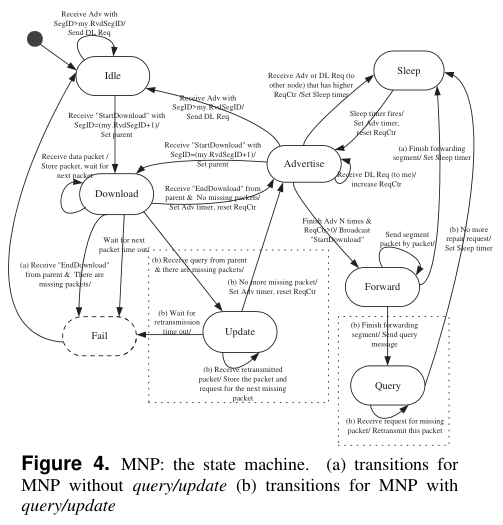

# Kulkarni, Wang 2005 · MNP: dịch vụ lập trình lại đa chặng cho mạng cảm biến

## Tóm tắt một dòng
MNP chọn người phát bằng cạnh tranh tham lam theo số yêu cầu khác nhau (ReqCtr) để mỗi vùng lân cận chỉ có một nguồn phát, pipeline theo đoạn, cho nút "ngủ" khi hàng xóm phát đoạn không cần — giảm ~38 % thời gian bật radio do nghe rỗi so với để radio luôn bật như Deluge.

## Vì sao đọc
Đối chứng với Deluge về cách giảm chi phí điều khiển và năng lượng trong phổ biến mặt đất; cơ chế "chọn người phát có
nhiều người cần nhất" gần với cách SigDrop chọn nút takeover/relay [B].

## Bài toán và mô hình
- **[GĐ]** Không giả định topo; nút đứng yên; mọi nút cần cùng một phiên bản; không cần vị trí hay trạng thái hàng xóm (tr. 2).
- **[GĐ]** Yêu cầu: tin cậy (đúng và đủ mọi nút), tự động, tiết kiệm năng lượng, ít bộ nhớ, nhanh (vài phút) (tr. 2).
- **[GĐ]** Nguồn tiêu hao chính là nghe rỗi (idle listening) (tr. 1).

## Định nghĩa và ký hiệu
| Ký hiệu | Nghĩa |
|---|---|
| ReqCtr | số người yêu cầu khác nhau mà một nguồn đã nhận (tr. 3) |
| advertisement, download request, StartDownload, EndDownload | các bản tin điều khiển |
| segment | đơn vị pipeline (2,8 KB trong thí nghiệm) |
| ART | active radio time, thời gian radio bật |

## Kết quả chính
- **[KQ] Chọn người phát** (tr. 3–4). Nguồn quảng bá có ReqCtr; người yêu cầu gửi download request dạng quảng bá kèm ReqCtr của
  nguồn — nút khác nghe được biết nguồn tiềm năng (xử lý hidden terminal). Nguồn nghe thấy nguồn khác có ReqCtr lớn hơn thì
  thôi và ngủ một khoảng ≈ thời gian truyền mã; hoà thì so ID nên không bế tắc. Sau N quảng bá liên tiếp có yêu cầu thì phát;
  không có yêu cầu thì giãn chu kỳ quảng bá theo hàm mũ.
- **[KQ]** Thực nghiệm cho thấy tại một thời điểm có nhiều nhất một người phát trong mỗi vùng lân cận (tr. 9–10, kết luận).
- **[KQ]** Không thấy hiện tượng "lan theo đường chéo chậm hơn theo cạnh" như Deluge (tr. 2).
- **[KQ]** Có thể chỉnh để xác suất làm người phát tỉ lệ với pin còn lại (tr. 1).

## Thuật toán
- **[TT] Máy trạng thái MNP** (Fig. 4, tr. 5). Idle → Download (nhận StartDownload từ cha) → Advertise (có mã) → Forward
  (thắng cạnh tranh) → Sleep; bản có query/update: sau khi phát đoạn, người phát hỏi gói thiếu và phát lại.

## Thực nghiệm và số liệu
- **[TS]** Mica-2/XSM 433 MHz, 128 KB ROM, 4 KB RAM; trong nhà 5 × 5 (32′ × 32′), ngoài trời 7 × 7 (48′ × 48′) và 5 × 10
  (72′ × 32′); TOSSIM cho mạng lớn; trạm gốc ở góc (tr. 5–6).
- **[SỐ]** Lưới 10 × 10 TOSSIM: thời gian hoàn tất tuyến tính theo kích thước chương trình (1–10 đoạn, 2,8–28,2 KB); ART ≈ 60 %
  thời gian hoàn tất (Fig. 10, tr. 8).
- **[SỐ]** Tắt radio khi không cần tiết kiệm ~38 % năng lượng nghe rỗi; ART trung bình 949 s (862 s không tính nghe rỗi ban đầu)
  (tr. 7–8).
- **[SỐ]** So Deluge: Deluge mất > 700 s cho 240 gói (5 KB) qua lưới 10 × 10 (theo [6]); MNP gửi gần 3 lần dữ liệu với thêm ~30 %
  thời gian (ART ~930 s); một cấu hình khác hoàn tất 577 s với ART 352 s (273 s) (tr. 9).

## Hình tiêu biểu

*Đọc hình:* mọi chuyển trạng thái quanh "Advertise" là cạnh tranh theo ReqCtr; thua thì sang Sleep.

## Trích nguyên văn
- **[TRÍCH]** "we propose a sender selection algorithm that attempts to guarantee that in a neighborhood there is at most one source transmitting the program at a time." (tr. 1)

## Liên hệ SigDrop
- **[NX] [B]** Chọn người phát theo số người cần (ReqCtr) là heuristic tham lam kiểu phủ tập: cùng tinh thần với việc chọn
  nút đã nhận đủ từ UAV làm nguồn cho phần còn lại của cell.
- **[NX] [C]** Chi phí điều khiển: mỗi vòng cạnh tranh tốn quảng bá + yêu cầu từ mọi người cần; với lịch biết trước (Manifest)
  phần cạnh tranh này có thể bỏ.
- **[NX]** Ngủ khi hàng xóm phát đoạn không cần là ý tưởng duty-cycle mà Deluge không có; liên quan nếu SigDrop tính năng lượng nút.

## Hạn chế và câu hỏi mở
- Đọc partial: bỏ chi tiết mục 3.2–3.5 và phần lớn thí nghiệm trong nhà/ngoài trời (tr. 4–9).
- So với Deluge dựa trên số liệu trích từ bài Deluge, không chạy cùng điều kiện.
- Trạm gốc luôn ở góc; không xét nguồn di động.
