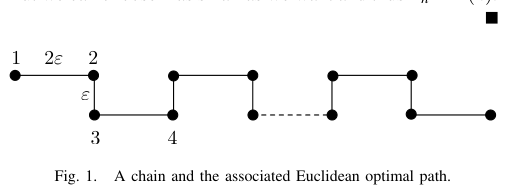
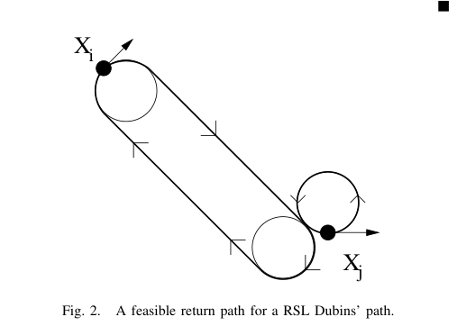

# Le Ny, Frazzoli, Feron 2007 · DTSP khi mật độ điểm cao (bản hội nghị)

## Tóm tắt một dòng
Bản hội nghị trước của Le Ny 2012: phác thảo chứng minh DTSP (tour và path) NP-khó từ phép quy Papadimitriou; mọi thuật toán theo thứ tự ETSP tối ưu có hệ số xấp xỉ Ω(n) khi điểm dày; thuật toán cố định hướng + ATSP cho hệ số O(min{(1 + ρ/ε) log n, (1 + ρ/ε)²}).

## Vì sao đọc
Trích kèm Le Ny 2012 cho bổ đề L1 (bản đầu tiên công bố chứng minh NP-khó). Đã có ghi chú chi tiết bản tạp chí:
`leny2012-dtsp.md`; ghi chú này chỉ ghi các điểm khác.

## Bài toán và mô hình
- **[GĐ]** Xe Dubins ẋ = v₀cos θ, ẏ = v₀sin θ, θ̇ = (v₀/ρ)u, |u| ≤ 1, v₀ = 1 (tr. 1).
- **[GĐ]** Không giả định khoảng cách tối thiểu giữa các điểm (khác các bài "mật độ thấp") (tr. 1).

## Định nghĩa và ký hiệu
| Ký hiệu | Nghĩa |
|---|---|
| ρ | bán kính quay tối thiểu |
| ε | khoảng cách Euclid nhỏ nhất giữa hai điểm |
| d_ij, d̂_ij | độ dài đường Dubins giữa hai cấu hình; sau khi nhiễu hướng |
| R_n | hệ số xấp xỉ của heuristic theo thứ tự ETSP |

## Kết quả chính
- **[KQ] Định lý 1** (tr. 2, nhắc lại Dubins). Đường tối ưu là CCC hoặc CSC hoặc đoạn con; đường CCC tối ưu có cung giữa dài hơn πρ;
  tìm trong 6 loại LSL, RSR, RSL, LSR, RLR, LRL.
- **[KQ] Định lý 2–3** (tr. 2–3). Heuristic theo thứ tự ETSP tối ưu: R_n = Ω(n), ví dụ chuỗi zig-zag khoảng 2ε, ε (Fig. 1). (Phát biểu
  định lý 2 không trích được chữ.)
- **[KQ] Định lý 4** (tr. 3). Tour-DTSP và path-DTSP NP-khó; chứng minh phác từ Exact Cover qua cấu trúc của Papadimitriou. Bài lưu ý
  chưa rõ DTSP có thuộc NP không (khó ngay cả với ETSP khi khoảng cách không nguyên) và việc tối ưu hướng là bài toán liên tục mà lý
  thuyết độ phức tạp rời rạc chưa nắm hết (tr. 3).
- **[KQ] Bổ đề 6** (tr. 4). Nhiễu hướng hai đầu một góc < δ thì độ dài Dubins tăng không quá hệ số 1 + 2ρ·max{(3|δ| + π|sin(δ/2)|)/ε_ij, …}
  (phần sau của biểu thức bị cắt trong chữ trích); Fig. 2 minh hoạ đường quay về cho đoạn RSL.
- **[KQ] Thuật toán ngẫu nhiên** (mục V, tr. 4–5). (1) cố định hướng mọi điểm = 0; (2) tính n(n − 1) khoảng cách Dubins; (3) đồ thị
  có hướng đầy đủ; (4) giải ATSP. Hệ số O(min{(1 + ρ/ε) log n, (1 + ρ/ε)²}).

## Thuật toán
- **[TT]** Như trên; bản tạp chí 2012 thêm rời rạc hoá K hướng qua GTSP → ATSP.

## Thực nghiệm và số liệu
Phần mô phỏng của bản hội nghị không đọc (xem số liệu ở bản 2012).

## Hình tiêu biểu

*Đọc hình:* đi theo thứ tự này, xe Dubins phải quay vòng sau mỗi đoạn ngắn — gốc của cận Ω(n).

*Đọc hình:* đổi hướng ở đầu đoạn tốn thêm tối đa một vòng nhỏ quanh hai đường tròn bán kính ρ.

## Trích nguyên văn
- **[TRÍCH]** "the most challenging problem is probably to devise good algorithms for the case where the points are densely packed." (tr. 6, kết luận)

## Liên hệ SigDrop
- **[NX] [L1]** Dẫn cùng bản 2012; bản 2007 nói rõ hơn lưu ý "chưa rõ thuộc NP" — nên phát biểu L1 là "NP-khó" chứ không phải "NP-đầy đủ".
- **[NX] [TOUR]** Cảnh báo điểm dày (ρ/ε lớn) áp dụng cho SigDrop vì ρ = 63,7 m cùng cỡ khoảng cách giữa các cell.

## Hạn chế và câu hỏi mở
- Đọc partial: bỏ chứng minh chi tiết Bổ đề 5–6 và phần phân tích thuật toán.
- Chỉ là phác thảo chứng minh; bản đầy đủ ở Le Ny 2012.
