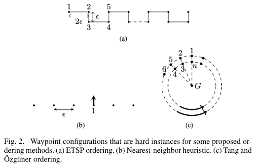
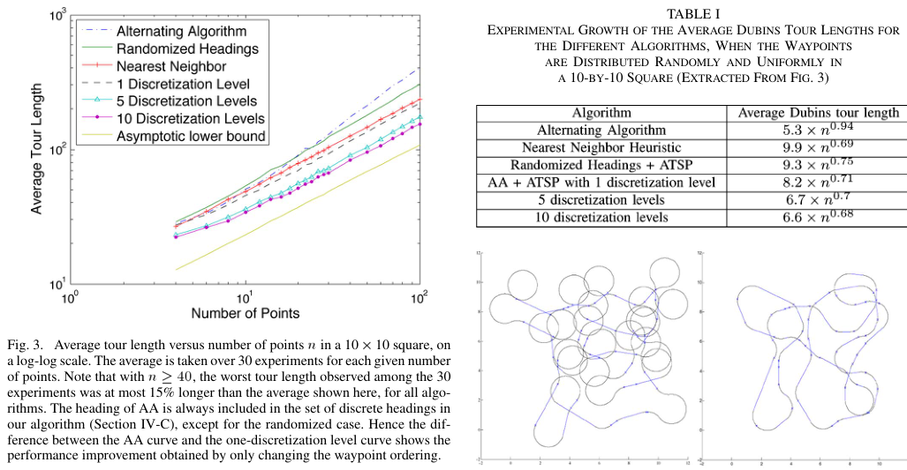

# Le Ny, Feron, Frazzoli 2012 · On the Dubins traveling salesman problem

## Tóm tắt một dòng
Chứng minh Dubins TSP (tour và path) NP-khó bằng phép quy từ TSP Euclid có phóng to; chỉ ra heuristic theo thứ tự Euclid kém tối ưu cỡ Ω(n); đề xuất thuật toán rời rạc hoá hướng qua GTSP → ATSP.

## Vì sao đọc
Đây là nguồn trích chính cho bổ đề L1 của SigDrop. Bài cũng cho cận "Dubins ≤ Euclid + hằng số" dùng để chặn độ dài tour
trong định lý A, và cảnh báo về heuristic giữ thứ tự Euclid khi điểm dày so với bán kính quay.

## Bài toán và mô hình
- **[GĐ]** Xe Dubins phẳng, cấu hình (x, y, θ); ẋ = v₀cos θ, ẏ = v₀sin θ, θ̇ = (v₀/ρ)u với u ∈ [−1, 1]; tốc độ chuẩn
  hoá v₀ = 1; không chướng ngại (tr. 2).
- **[GĐ]** DTSP: cho n điểm, tìm tour ngắn nhất đi qua mọi điểm mà xe Dubins bay được. Nghiệm gồm thứ tự thăm và hướng
  tại mỗi điểm (tr. 2).
- **[GĐ]** Bản quyết định: có tour Dubins độ dài ≤ L hay không (tr. 2).
- **[GĐ]** Xét trường hợp xấu nhất, không giả định phân bố điểm (khác các bài DTSP ngẫu nhiên) (tr. 1).

## Định nghĩa và ký hiệu
| Ký hiệu | Nghĩa |
|---|---|
| ρ | bán kính quay tối thiểu |
| E(X, X′) | khoảng cách Euclid giữa hai vị trí |
| D(q, q′) | độ dài đường Dubins ngắn nhất từ cấu hình q tới q′; không đối xứng |
| ε | khoảng cách Euclid nhỏ nhất giữa hai điểm của instance (ở Định lý 6) |
| ETSP(P), DTSP(P) | độ dài tour Euclid và tour Dubins tối ưu của instance P |
| direct path | đường Dubins từ X tới Y nằm trong giao hai đĩa bán kính ρ qua X, Y; ngắn hơn πρ khi và chỉ khi là direct path (tr. 3) |
| tour-TSP / path-TSP | có hay không yêu cầu quay về điểm xuất phát |

## Kết quả chính
- **[KQ] Định lý 1 (Dubins 1957)** (tr. 2). Đường ngắn nhất giữa hai cấu hình có dạng CCC hoặc CSC (hoặc đoạn con),
  tức là một trong 6 loại LSL, RSR, RSL, LSR, RLR, LRL; tính được trong thời gian hằng.
- **[KQ] Định lý 2** (tr. 2). Tour-DTSP và path-DTSP là NP-khó.
  *Ý chứng minh:* hệ quả của phép quy Papadimitriou từ Exact Cover sang ETSP. Điểm then chốt: khi Exact Cover không có
  nghiệm, instance ETSP có tour tối ưu ≥ L + δ với khe δ > 0 cố định (không chỉ > L). Theo Savla et al., tour Dubins tối
  ưu ≤ ETSP(P) + Cn. Phóng to mọi khoảng cách theo hệ số 2Cn/δ: có nghiệm thì tour Dubins ≤ 2CnL/δ + Cn; không có nghiệm
  thì ≥ 2CnL/δ + 2Cn. Vậy ngưỡng 2CnL/δ + Cn tách hai trường hợp.
  *Bài nhấn mạnh:* thêm ràng buộc độ cong có thể làm bài toán dễ đi (như bitonic TSP), nên kết quả không suy ra hiển
  nhiên từ độ khó của ETSP (tr. 2).
- **[KQ] Định lý 3** (tr. 3). Có họ instance Pₙ và hằng K > 0 sao cho mọi thuật toán đi theo thứ tự tour Euclid tối ưu
  không xấp xỉ DTSP(Pₙ) tốt hơn hệ số Kn. Điều này cũng đúng cho heuristic láng giềng gần nhất và thứ tự Tang–Özgüner.
  *Ý chứng minh:* các điểm xếp zig-zag với khoảng cách ε < ρ/√2 (Fig. 2a); theo thứ tự Euclid, cứ mỗi đường direct phải
  theo sau bởi một detour dài > πρ, nên độ dài ≥ (n − 1)(πρ + ε)/2; trong khi đi hết hàng trên, quay đầu (≤ 6πρ), đi hàng
  dưới chỉ tốn ≤ 2(n − 1)ε + 6πρ. Chọn ε ≈ 1/(n − 1) cho tỉ số Ω(n).
- **[KQ] Định lý 4** (tr. 4, lấy từ Savla et al. Định lý 3.4). Có hằng κ ∈ [2,657; 2,658] sao cho với mọi hai cấu hình,
  D(q, q′) ≤ E(X, X′) + κπρ. (Chữ trong PDF bị vỡ ký hiệu; dạng κπρ đối chiếu theo Isaacs 2011, công thức (11).)
- **[KQ] Hệ quả 5** (tr. 4). Đổi hướng tại hai đầu làm độ dài thay đổi không quá hệ số (1 + κπρ/E(X, X′)).
- **[KQ] Định lý 6** (tr. 4). Thuật toán K = 1 (cố định một hướng mỗi điểm rồi giải ATSP) cho tour trong hệ số
  min{(1 + κπρ/ε) log n, (3/2)(1 + κπρ/ε)²} so với tối ưu, thời gian O(n³).
- **[KQ]** Thuật toán vét mọi hoán vị kèm chọn hướng theo Lee et al. cho hệ số 5,03 nhưng thời gian Θ(n·n!); nhóm tác giả
  có thuật toán O(n²·2ⁿ) với hệ số O(log n) (tr. 4).
- **[KQ] Câu hỏi mở** (tr. 4): thuật toán xấp xỉ hiệu quả có hệ số không chứa số hạng ρ/ε.

## Thuật toán
- **[TT] Rời rạc hoá hướng** (tr. 3). Chọn trước K hướng ở mỗi điểm → đồ thị n cụm × K nút; cạnh là khoảng cách Dubins
  giữa cấu hình ở hai cụm khác nhau; tìm tour qua mỗi cụm đúng một nút là GTSP bất đối xứng; quy về ATSP trên nK nút
  (Noon–Bean); giải bằng LKH (Helsgaun) hoặc thuật toán log n của Frieze et al.
- **[TT] K = 1** (tr. 4). (1) Cố định hướng mỗi điểm (ví dụ 0, hoặc ngẫu nhiên đều); (2) tính n(n − 1) khoảng cách
  Dubins; (3) đồ thị đầy đủ có hướng thoả bất đẳng thức tam giác; (4) giải ATSP. Có thể lấy hướng từ một thuật toán khác
  (ví dụ Alternating Algorithm) ở bước 1; nếu giải ATSP tối ưu thì không bao giờ tệ hơn thuật toán đó.
- **[TT] Láng giềng gần nhất theo metric Dubins** (tr. 2): đi tới điểm chưa thăm gần nhất theo khoảng cách Dubins với
  hướng đến tối ưu; nối điểm cuối về cấu hình đầu. Với ETSP, láng giềng gần nhất đạt O(log n), với DTSP thì Ω(n).

## Thực nghiệm và số liệu
- **[TS]** Điểm phân bố đều trong hình vuông 10 × 10, ρ = 1; mọi tour TSP và ATSP giải bằng LKH; trung bình 30 lần cho mỗi
  n (Fig. 3, tr. 5).
- **[SỐ]** Với n ≥ 40, tour tệ nhất trong 30 lần dài hơn trung bình không quá 15 %, với mọi thuật toán (Fig. 3, tr. 5).
- **[SỐ]** Khi điểm thưa, Alternating Algorithm (AA) tương đương hoặc tốt hơn bản hướng ngẫu nhiên; khi điểm dày so với
  ρ, thuật toán rời rạc hoá hướng tốt hơn AA rõ rệt; chỉ cần đổi thứ tự (giữ hướng của AA) đã cải thiện đáng kể khi n tăng
  (Fig. 3, tr. 5).

## Hình tiêu biểu

*Đọc hình:* (a) là cấu trúc zig-zag khoảng cách ε dùng trong Định lý 3. Đi theo thứ tự Euclid buộc xe quay vòng sau mỗi
đoạn ngắn, trong khi tour tốt đi thẳng hết một hàng rồi quay đầu một lần.

*Đọc hình:* khi n nhỏ (điểm thưa) các đường gần nhau; khi n lớn (điểm dày so với ρ) các bản rời rạc hoá hướng tách xuống
dưới AA.

## Trích nguyên văn
- **[TRÍCH]** "This technical note provides a proof of the NP-hardness of the Dubins Traveling Salesman Problem, thereby justifying the focus on approximation algorithms." (tr. 5–6, phần kết luận)
- **[TRÍCH]** "adding the curvature constraint to the Euclidean TSP could well make the problem easier ... Hence, the statement does not follow trivially from the NP-hardness of the ETSP" (tr. 2)

## Liên hệ SigDrop
- **[NX] [L1]** Bổ đề L1 nên đi theo đúng khuôn của Định lý 2: dựng instance SigDrop từ instance DTSP (mỗi điểm thành một
  cụm một cell, không hợp tác mặt đất, Q = 1, kênh đĩa bán kính nhỏ), hoặc lặp lại lập luận phóng to từ Exact Cover.
  Bài chỉ chứng minh cho điểm; muốn nói bản có lân cận thì trích thêm Babel 2017 hoặc tự lập luận co vùng về điểm.
- **[NX] [A]** Định lý 4 cho chặn trên tường minh: mỗi chặng của tour Dubins dài hơn chặng Euclid không quá κπρ ≈ 8,35ρ.
  Với ρ = 63,7 m thì κπρ ≈ 532 m mỗi chặng. Dùng được để chặn T_tour của FC và của River trong định lý A.
- **[NX] [TOUR]** Bán kính cell R = 100 m so với ρ = 63,7 m nằm ở vùng "điểm dày" mà Định lý 3 và Fig. 3 cảnh báo. Không
  nên biện luận CHORD gần tối ưu chỉ vì nó theo thứ tự Euclid hay thứ tự cụm. Quy trình rời rạc hoá hướng + LKH ở đây
  là cách tính tour tham chiếu để đo khoảng cách tối ưu của CHORD và LM-Tour.

## Hạn chế và câu hỏi mở
- Bài không xét DTSP với lân cận, cũng không xét giới hạn quãng bay hay ràng buộc thời gian lưu lại (khác SigDrop và Zeng 2018).
- Không nói rõ NP-khó theo nghĩa mạnh hay yếu.
- Hệ số xấp xỉ đều chứa ρ/ε, rất xấu khi điểm dày; câu hỏi mở của bài (tr. 4) vẫn liên quan tới tour của SigDrop.
