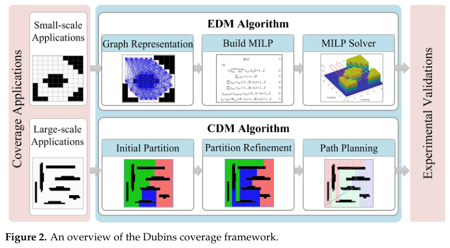

# Li et al. 2023 · Lập đường phủ cho nhiều robot Dubins: chính xác và heuristic

## Tóm tắt một dòng
Chia môi trường đã biết thành ô phủ; EDM giải chính xác bằng MILP (đồ thị điểm đầu–cuối của các dải phủ, cạnh là đường Dubins) cho đường phủ ngắn nhất ở cảnh nhỏ; CDM heuristic dùng mô hình "tín dụng" cân tải giữa robot và chia cây để giảm độ phức tạp ở cảnh lớn; thử trên mô hình UAV cánh bằng độ trung thực cao.

## Vì sao đọc
Chỉ để biết: cách mô hình hoá phủ vùng bằng đồ thị đầu–cuối dải + đường Dubins, chia việc cho nhiều UAV [TOUR].

## Bài toán và mô hình
- **[GĐ]** Môi trường biết trước (bản đồ đám mây điểm), phân thành ô; mỗi ô phủ bằng dải; robot Dubins; nhiều robot (tr. 1–5).

## Định nghĩa và ký hiệu
| Ký hiệu | Nghĩa |
|---|---|
| MCPP | multi-robot coverage path planning |
| EDM | Exact Dubins Multi-robot CPP (MILP) |
| CDM | Credit-based Dubins Multi-robot CPP (heuristic) |

## Kết quả chính
- **[KQ]** EDM cho thời gian phủ nhỏ nhất ở cảnh nhỏ; CDM cho thời gian phủ và thời gian tính ngắn hơn các heuristic khác (Milpflow, DCRC…) ở cảnh lớn (tr. 1, 17).

## Thuật toán
- **[TT]** EDM: đồ thị → MILP → bộ giải; CDM: chia ban đầu → tinh chỉnh chia (tín dụng, chia cây) → lập đường (Fig. 2).

## Thực nghiệm và số liệu
Không đọc (mức abstract); bốn bản đồ đám mây điểm, 2–3 robot (Fig. 9–12).

## Hình tiêu biểu

*Đọc hình:* chính xác (MILP) chỉ khả thi ở cảnh nhỏ; cảnh lớn cần chia vùng rồi lập đường từng phần.

## Trích nguyên văn
- **[TRÍCH]** "EDM provides the least coverage time in small scenes, and CDM produces a shorter coverage time and less computation time in large scenes." (tr. 1)

## Liên hệ SigDrop
- **[NX]** Ít liên quan trực tiếp: SigDrop không cần phủ kín vùng mà phục vụ các cell rời rạc; chỉ dùng nếu bàn chế độ quét luống trong cell.

## Hạn chế và câu hỏi mở
- Chỉ đọc abstract, mở đầu, kết luận.
