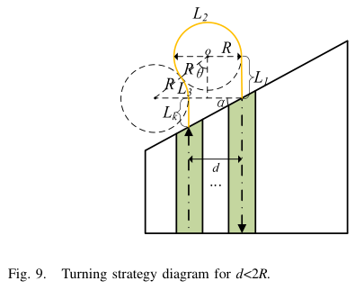

# Li et al. 2025 · Lập đường phủ cho UAV cánh bằng bằng chọn bước nhảy khi quay

## Tóm tắt một dòng
Phủ ruộng bằng các luống song song (boustrophedon) cho UAV cánh bằng; khi khoảng cách luống d khác 2R, chọn "bước nhảy" (bỏ qua bao nhiêu luống) ở mỗi lần quay theo ba chiến lược (d = 2R, d < 2R, d > 2R) để rút ngắn tổng đường quay; tối ưu thứ tự bằng pointer network + actor–critic (TSS), tốt hơn TBF và IBF.

## Vì sao đọc
Chỉ để biết: vấn đề "quay đầu tốn kém khi bán kính quay lớn so với khoảng luống" cũng xuất hiện khi UAV của SigDrop bay luống (swath) qua cell [TOUR].

## Bài toán và mô hình
- **[GĐ]** Vùng ruộng đa giác lồi, quét bằng các dải song song rộng w (bề rộng ảnh); UAV cánh bằng bán kính quay R (tr. 1–5).

## Định nghĩa và ký hiệu
| Ký hiệu | Nghĩa |
|---|---|
| R, w, d | bán kính quay, bề rộng dải, khoảng cách giữa hai dải nối nhau khi quay |
| λ | hệ số bước nhảy (span coefficient) |
| TBF, IBF | các thuật toán so sánh (boustrophedon truyền thống và cải tiến) |

## Kết quả chính
- **[KQ]** Ba chiến lược quay theo quan hệ d với 2R (Fig. 7, 9, 10, tr. 6). Khi R và w gần nhau, chọn λ để d ≈ 2R và mọi chiến lược cho độ dài gần như nhau;
  khi R ≫ w, mỗi lần quay có nhiều lựa chọn bước nhảy và tối ưu toàn cục mới có lợi (tr. 12).

## Thuật toán
- **[TT] TSS** (tóm tắt, tr. 1). Mô hình vùng → ba chiến lược quay → bài toán tổ hợp chọn thứ tự dải/bước nhảy giải bằng pointer network huấn luyện bằng actor–critic.

## Thực nghiệm và số liệu
Không đọc (mức abstract); kết luận nói TSS cho đường ngắn hơn TBF và IBF (tr. 12–13).

## Hình tiêu biểu

*Đọc hình:* khi hai dải kề nhau gần hơn 2R, quay trực tiếp phải đi vòng lớn; nhảy qua vài dải có thể rẻ hơn.

## Trích nguyên văn
- **[TRÍCH]** "due to its characteristic of being constrained by the turning radius, it causes the long turning path and much energy consumption." (tr. 1)

## Liên hệ SigDrop
- **[NX] [TOUR]** Nếu SigDrop dùng chế độ quét luống (SWATH) trong cell, khoảng luống ~ vài chục mét < 2ρ = 127 m: đúng trường hợp d < 2R; ý "nhảy luống"
  (bay luống không kề nhau) là cách rẻ để giảm chi phí quay.

## Hạn chế và câu hỏi mở
- Chỉ đọc abstract, mở đầu, kết luận; không kiểm số liệu.
