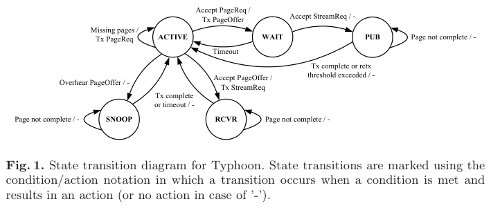
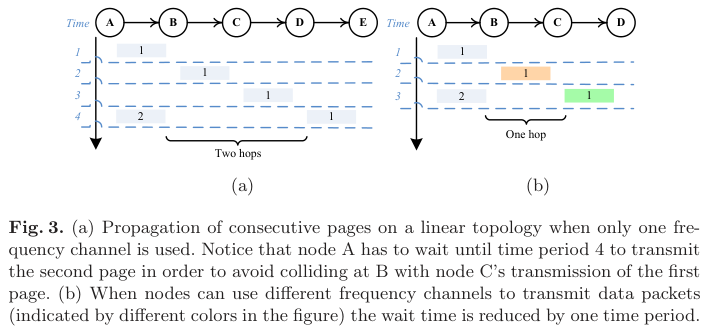
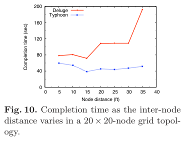

# Liang, Musăloiu-E., Terzis 2008 · Typhoon: phổ biến dữ liệu tin cậy trong WSN

## Tóm tắt một dòng
Typhoon phổ biến đối tượng lớn tới mọi nút bằng bắt tay yêu cầu trang, truyền unicast có ACK từng gói kèm nghe lén, ưu tiên nút xa nguồn chuyển tiếp và đổi kênh ngẫu nhiên cho từng lần truyền trang; nhanh hơn Deluge tới khoảng 3× ở mạng thưa và mất gói nhiều, đổi lại lưu lượng điều khiển và dữ liệu gấp khoảng 3×.

## Vì sao đọc
Bài cùng họ với Deluge (baseline của SigDrop) nhưng dùng đa kênh để tăng tái dùng không gian, đúng ý lưới 7 kênh của River; có mô hình thời gian hoàn thành trên tuyến thẳng và bảng tách lợi ích của đổi kênh, dùng cho cận [D] và so chi phí điều khiển [C].

## Bài toán và mô hình
- **[GĐ]** Đối tượng lớn 50–100 KB (không vừa RAM của mote) đưa tới mọi nút, tin cậy 100 %; đối tượng được nạp vào một nút nguồn bằng kênh ngoài (tr. 1, 4).
- **[GĐ]** Nghe rỗi là nguồn tiêu hao năng lượng chính, nên mục tiêu là rút ngắn thời gian hoàn thành; tác giả bác bỏ duty cycling cho bài toán này vì tăng thời gian ngừng mạng và độ phức tạp (tr. 1, 4).
- **[GĐ]** Đối tượng chia thành trang 1 KB, trang chia thành gói 28 B; nút tải trang theo thứ tự tăng dần để các nút cùng vùng quảng bá ở cùng trạng thái, dễ nghe lén chung (tr. 4–5).
- **[GĐ]** Siêu dữ liệu (ID, kích thước, phiên bản) phổ biến riêng bằng Trickle; dữ liệu do Typhoon chuyển rồi kết thúc (tr. 4–5).

## Định nghĩa và ký hiệu
| Ký hiệu | Nghĩa |
|---|---|
| network completion time | thời điểm nút cuối cùng nhận đủ đối tượng (tr. 3, 9) |
| PageReq, PageOffer, StreamReq | yêu cầu trang (quảng bá), đề nghị phục vụ (unicast), chấp nhận và bắt đầu truyền (unicast) (tr. 5–6) |
| ACTIVE, WAIT, PUB, RCVR, SNOOP | trạng thái nút: chờ trang, đã đề nghị, đang phát, đang nhận, đang nghe lén (Fig. 1, tr. 5) |
| [ta, tb], [tc, td], Ts | chu kỳ PageReq 400–500 ms; chờ trước PageOffer 0–10 ms (15–25 ms nếu vừa phát xong một trang); chờ StreamReq 20 ms (tr. 5–6) |
| Pt | thời gian yêu cầu và nhận một trang (tr. 13) |
| n, d | số trang của đối tượng, đường kính mạng (số chặng) (tr. 13) |

## Kết quả chính
- **[KQ]** Khoảng cách tối thiểu giữa hai phát đồng thời để tránh nhiễu là ba chặng (dẫn De Couto 2003); khi các lần truyền dữ liệu dùng kênh khác nhau, khoảng này giảm còn hai chặng trong nhiều trường hợp (tr. 2, Fig. 3 tr. 7–8).
- **[KQ] Mô hình thời gian hoàn thành trên tuyến thẳng thưa** (điều kiện lý tưởng, đồng bộ, không va chạm): T̂t = 2(n − 1)·Pt + d·Pt. Với bắt tay 3 bản tin × 1,68 ms cộng hai bộ hẹn giờ tối đa 25 ms, tổng 55,04 ms, và truyền trang 428 ms, Pt = 483,04 ms; mô hình là cận dưới của thời gian mô phỏng (Fig. 9) (tr. 13).
- **[KQ]** Thời gian hoàn thành tăng tuyến tính theo kích thước đối tượng, độ dốc của Deluge lớn hơn (Fig. 8, tr. 12); theo đường kính mạng, cả hai tăng chậm hơn số nút nhờ pipelining, Deluge tăng nhanh hơn (Fig. 7, tr. 11–12).
- **[KQ]** Năng lượng bám sát thời gian hoàn thành: cả hai giao thức phát dưới 7 % thời gian, phần còn lại là nghe rỗi (Fig. 5b, tr. 11).

## Thuật toán
- **[TT] Bắt tay yêu cầu trang** (Fig. 1, tr. 5–6):
  1. Nút ở ACTIVE quảng bá PageReq cho trang thấp nhất còn thiếu.
  2. Nút có trang đó chờ ngẫu nhiên trong [tc, td] rồi gửi PageOffer (unicast), chuyển sang WAIT.
  3. Người nhận chọn một nhà cung cấp bằng StreamReq; nhà cung cấp chuyển sang PUB và phát trang.
  4. Nút khác nghe được PageOffer cho trang mình thiếu thì chuyển sang SNOOP; nếu không nghe đủ cả trang thì bỏ cả trang.
- **[TT] Pipelining ưu tiên phía xa nguồn** (Fig. 2, tr. 6): nút vừa phát xong một trang dùng bộ hẹn giờ 15–25 ms, các nút khác 0–10 ms. Vì vậy B (vừa nhận trang n) đề nghị trang n cho C trước khi A kịp đề nghị trang n + 1 cho B; A nghe thấy đề nghị của B thì huỷ của mình.
- **[TT] Truyền tin cậy** (tr. 7): ACK từng gói (stop-and-wait ARQ), dùng ACK mềm của TinyOS 2 thay ACK phần cứng. Tắt ACK phần cứng thì CC2420 cũng tắt lọc địa chỉ, nên các nút khác nghe lén được gói unicast. Bên phát bỏ trang sau 5 lần truyền gói không thành.
- **[TT] Đổi kênh ngẫu nhiên** (tr. 8): bên phát đề xuất một trong 15 kênh trong PageOffer (kênh còn lại dành cho quảng bá); người nhận ACK và chuyển kênh, bên phát chuyển theo. Không có thoả thuận kênh tập trung, nên hai lần truyền gần nhau vẫn có thể trùng kênh; khi đó hết thời gian chờ và thử lại. Sau mỗi trang, nút quay về kênh mặc định để Trickle vẫn lan được siêu dữ liệu.

## Thực nghiệm và số liệu
- **[TS]** TOSSIM trên TinyOS 2, MAC CSMA chuẩn. Suy hao log-khoảng cách với n = 4 (Fig. 4: PRR khoảng 95 % ở 35 ft, khoảng 30 % ở 40 ft). Nhiễu dạng cụm lấy từ vết đo nhiều 802.11. Mỗi thí nghiệm chạy 5 lần. Deluge dùng tham số mặc định. Năng lượng ước tính từ thời gian phát (17,4 mA), nghe rỗi (19,7 mA) và nhận (21,7 mA, tự đo) trên Tmote Sky (tr. 9–10).
- **[SỐ]** Lưới 20 × 20 nút cách 10 ft, đối tượng 20 KB: Typhoon 54,30 s (yên tĩnh) và 73,37 s (mất gói dạng cụm); Deluge 80,79 s và 241,43 s. Typhoon chậm đi 48 %, Deluge gấp khoảng 3 lần (Bảng 1, tr. 14).
- **[SỐ]** Khi giãn khoảng cách nút trong lưới 20 × 20, Deluge chậm hơn 2 lần ở 35 ft, nơi PRR rơi vào "vùng xám"; Typhoon giữ khoảng 40–60 s (Fig. 10, tr. 13–14).
- **[SỐ]** Tách lợi ích (lưới 5 × 5 cách 20 ft, đối tượng 3 KB): cả đổi kênh và nghe lén 6,24 s; chỉ đổi kênh 8,79 s; chỉ nghe lén 945,80 s; không có cả hai 1016,43 s. Đổi kênh quyết định; nghe lén thêm khoảng 30 % khi có đổi kênh (Bảng 2, tr. 14–15).
- **[SỐ]** Chi phí: Typhoon sinh khoảng 3× bản tin yêu cầu và khoảng 3× gói dữ liệu so với Deluge, vì không có cơ chế nén yêu cầu; 47 % lần nghe lén thất bại và phải bỏ trang (Fig. 11, tr. 15).
- **[SỐ]** Testbed 22 mote trong toà nhà văn phòng, gần tuyến thẳng, đối tượng 20 KB: thời gian hoàn thành trung bình 75,15 s (Typhoon) so với 145,57 s (Deluge); nút phía bên kia đoạn liên kết yếu ở giữa là nhóm chậm (Fig. 13, tr. 16).
- **[SỐ]** Mã: 3806 B ROM và 112 B RAM thêm vào ứng dụng đã có Dissemination và Flash (tr. 16–17).

## Hình tiêu biểu

*Đọc hình:* mỗi trang đi qua bắt tay ba bản tin (PageReq → PageOffer → StreamReq) trước khi dữ liệu chảy. Nút nghe được PageOffer thì đi nhánh SNOOP.

*Đọc hình:* trên tuyến thẳng một kênh, A phải chờ tới chu kỳ 4 mới phát trang 2 (C đang phát trang 1 cách hai chặng). Khi mỗi lần truyền dùng kênh riêng, A phát trang 2 ở chu kỳ 3, khoảng cách tái dùng còn một chặng.

*Đọc hình:* Deluge xấu đi mạnh khi liên kết rơi vào vùng PRR trung gian (35 ft); Typhoon gần như không đổi.

## Trích nguyên văn
- **[TRÍCH]** "Typhoon is able to reduce dissemination time and energy consumption by up to three times compared to Deluge." (tr. 1)
- **[TRÍCH]** "if nodes switch frequency channels during data transfer it is possible to reduce the distance to two hops in many cases." (tr. 2)
- **[TRÍCH]** "Typhoon generates approximately three times more traffic than Deluge for both message types." (tr. 15)

## Liên hệ SigDrop
- **[NX] [D]** Mô hình T̂t = 2(n − 1)Pt + d·Pt là cận dưới lý tưởng của phổ biến dạng pipeline trên tuyến thẳng: số hạng 2(n − 1) đến từ khoảng tái dùng hai chặng khi có đổi kênh (ba chặng nếu một kênh). Cận min-cut của SigDrop có thể đặt cạnh mô hình này: lưới 7 kênh cố định của River (`--colours=7`: hai cell cùng kênh cách nhau 3 cell, cell kề luôn khác kênh) cho phép hai cell kề truyền cùng lúc, nên hệ số trước n có thể nhỏ hơn.
- **[NX] [C]** Typhoon chứng tỏ chi phí khám phá lúc chạy là đáng kể: mỗi trang cần bắt tay ba bản tin trên kênh chung, lưu lượng điều khiển gấp khoảng 3× Deluge, và 47 % lần nghe lén bị bỏ. Kế hoạch River chọn trước người phát, người nhận và kênh, nên bỏ được bắt tay và tranh chấp kênh. Đây là luận cứ định tính cho giá trị thông tin của kế hoạch.
- **[NX] [KÊNH] [ĐV]** Bảng 2 cho thấy đa kênh quyết định tốc độ phổ biến 802.15.4 (1016 s xuống 8,8 s). Có thể dẫn để biện minh lưới 7 kênh của River, và để nói rằng baseline Deluge một kênh trong ns-3 của ta là bản không đa kênh (khác Typhoon).
- **[NX] [ĐV]** Typhoon thuộc họ "ngẫu nhiên, tranh chấp", còn Sprinkler, Infuse, GARUDA thuộc họ "lập lịch trên MCDS" (tr. 3). SigDrop gần họ thứ hai hơn, nhưng lịch suy ra từ đường bay, không cần dựng MCDS.

## Hạn chế và câu hỏi mở
- Chỉ mô phỏng TOSSIM và một testbed nhỏ, gần tuyến thẳng; không có mạng nhiều nguồn hay nguồn di động (UAV).
- Đổi kênh ngẫu nhiên không bảo đảm tránh trùng kênh, và bài không phân tích xác suất trùng.
- Bài thừa nhận Typhoon tốn lưu lượng gấp khoảng 3× Deluge; năng lượng thấp hơn chỉ vì thời gian nghe rỗi ngắn hơn.
