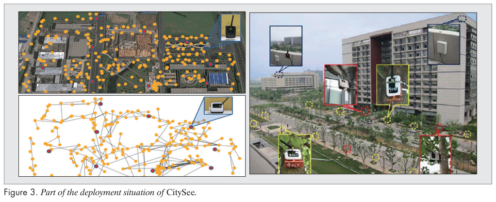
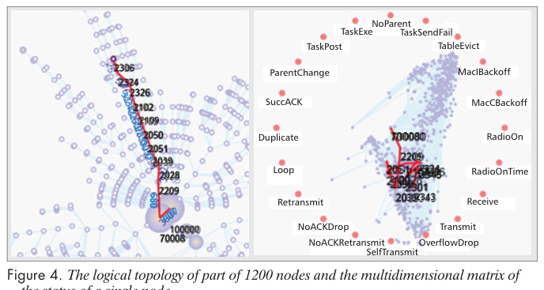

# Liu, Mao, He, Liu, Gong, Wang 2013 · CitySee: không chỉ là một mạng cảm biến

## Tóm tắt một dòng
Bài tổng quan giai đoạn 1 của CitySee ở Vô Tích: 1 196 node TelosB đo CO₂ và môi trường cùng 4 node mesh 802.11a, chạy liên tục từ 8/2011, thu gom CTP sâu tới 21 chặng, kèm bài học về triển khai, chẩn đoán và đẩy dữ liệu lên cloud.

## Vì sao đọc
Là triển khai WSN đô thị lớn nhất cùng nhóm GreenOrbs, có trong bảng mật độ CONTEXT J1 mục 8; ghi lại số node, độ sâu mạng và
vấn đề bảo trì thật để đối chiếu với kịch bản của SigDrop.

## Bài toán và mô hình
- **[GĐ]** Đo trực tiếp phát thải CO₂ của một vùng đô thị theo thời gian thực, dài hạn (tr. 1).
- **[GĐ]** Giai đoạn 1: 1 200 node (1 196 node cảm biến, 4 node mesh) ở khu đô thị Vô Tích, Trung Quốc; thu dữ liệu từ 8/2011 đến
  thời điểm viết 7/2013 (tr. 1).
- **[GĐ]** Vị trí node CO₂ và một số cảm biến môi trường do nhà môi trường học chỉ định trước; 100 node có cảm biến CO₂ không chuyển
  tiếp cho node khác vì tốn năng lượng; node relay được đặt thêm để nối mạng (tr. 3).
- **[GĐ]** Node cảm biến dựa trên TelosB (MSP430F1611, CC2420 802.15.4 2,4 GHz); node mesh dùng ARM7 và card 802.11a 5,8 GHz, cấp
  điện lưới, dây hoặc pin mặt trời (tr. 2).
- **[GĐ]** Phần mềm TinyOS 2.1.1: ước lượng link 4-bit, MAC Low Power Listening, thu gom CTP, phát tham số bằng Drip, đồng bộ FTSP;
  mỗi node lấy mẫu 10 phút một lần (tr. 2–3).

## Định nghĩa và ký hiệu
| Ký hiệu | Nghĩa |
|---|---|
| C1, C2, C3 | ba loại gói: dữ liệu cảm biến kèm path-ETX / bảng định tuyến và RSSI hàng xóm / bộ đếm chi tiết của node (tr. 3) |
| sensing IaaS, SaaS cloudlet | tầng mạng cảm biến và tầng cloud thu nhỏ cung cấp API dữ liệu (tr. 2, Fig. 1) |
| PAD | chẩn đoán thụ động theo xác suất, đánh dấu gói để suy nguyên nhân bất thường (tr. 5) |

## Kết quả chính
- **[KQ]** Bài toán đặt node relay để nối các node bắt buộc khi có vùng không đặt được node (toà nhà, hồ) được mô hình hoá là Group
  Steiner Tree with Holes hình học, có thuật toán xấp xỉ 2 (tr. 3; chi tiết ở Mao et al. INFOCOM 2012).
- **[KQ]** Quan sát link qua hai năm (tr. 5): link trung gian khó đoán nhất, một số link có chu kỳ rõ; vùng chuyển tiếp rộng hơn các
  thí nghiệm trước; suy giảm link ít tương quan với RSSI gần ngưỡng nhiễu; tỉ lệ link tốt, trung bình, xấu ổn định theo thời gian;
  link kém thường bị chọn sai do thuật toán định tuyến.

## Thuật toán
- **[TT] Đồng bộ lên cloud** (tr. 4). Đồng bộ delta theo timer thích nghi để tránh mỗi byte dữ liệu kéo theo hàng chục KB lưu lượng
  HTTP.
- Không có thuật toán mạng mới trong bài này; các phần chính trỏ sang bài khác của nhóm.

## Thực nghiệm và số liệu
- **[SỐ]** Đường dài nhất từ một node tới sink là 21 chặng (tr. 4).
- **[SỐ]** Hai tháng đầu thu 8 GB dữ liệu từ 1 200 node (tr. 4).
- **[SỐ]** Node gần sink thực thi tới 8 742 tác vụ trong 10 phút, khoảng 1/4 số node trung bình dưới 8; tải của node không chỉ do vị
  trí hay vai trò quyết định (tr. 4, Fig. 5).
- **[SỐ]** Hai pin chạy được hơn một năm; trong hai năm, phần lớn node cảm biến đã thay pin ít nhất một lần hoặc bị thay node (tr. 2, 4).
- **[SỐ]** Truy vấn dữ liệu 10 tháng của một node trên máy chủ ban đầu mất khoảng 15 s (tr. 4–5).
- Bài không ghi diện tích vùng triển khai hay khoảng cách giữa node.

## Hình tiêu biểu

*Đọc hình:* node bám theo đường, cây xanh và quanh toà nhà, dày không đều; node đỏ là các node bắt buộc, phần còn lại thêm vào để nối mạng.

*Đọc hình:* gói đi một chuỗi dài node relay về sink; mạng dạng cây sâu, tải dồn về gần gốc.

## Trích nguyên văn
- **[TRÍCH]** "The longest hop distance observed from a node to a sink node is 21 hops, which means that some packets are relayed at least 20 times before reaching a sink node." (tr. 4)
- **[TRÍCH]** "Due to the outdoor deployment environments, during the past two years most of the sensor nodes have either had their batteries changed one or more times or have been replaced." (tr. 2)

## Liên hệ SigDrop
- **[NX] [ĐV]** CONTEXT mục 8 ghi CitySee khoảng 1 200 node trên khoảng 100 km² (khoảng 12 node/km²) theo Mao et al. INFOCOM 2012. Bài
  IEEE Network này không ghi diện tích, nên con số 100 km² chưa kiểm được từ repo. Mạng sâu 21 chặng gợi ý vùng rộng, nhưng không đủ
  để suy ra diện tích.
- **[NX] [ĐV]** Hơn một năm mỗi bộ pin và việc thay pin hoặc node hàng loạt trong hai năm là số thật về chi phí bảo trì; dùng được cho
  câu hỏi f (số sự cố trong vòng đời mạng) ở CONTEXT mục 6.
- **[NX] [C]** Mạng sâu 21 chặng với CTP và tải dồn gần sink là kiểu mạng mà truy vấn từ trạm gốc qua mặt đất sẽ phải đi; đây là một
  số thật cho câu hỏi e (vì sao không phát truy vấn từ trạm qua mạng đa chặng).

## Hạn chế và câu hỏi mở
- Bài tạp chí dạng tổng quan 6 trang, ít số đo định lượng; chi tiết triển khai và diện tích nằm ở Mao et al. INFOCOM 2012
  ("CitySee: Urban CO2 Monitoring with Sensors"), repo chưa có bài này.
- Hình 5, 6 chỉ có trục và nhãn, không có giá trị để trích.
