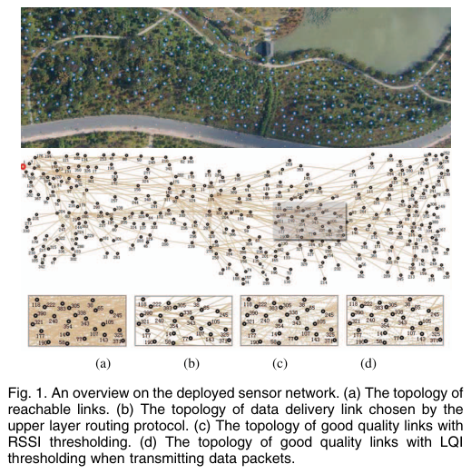
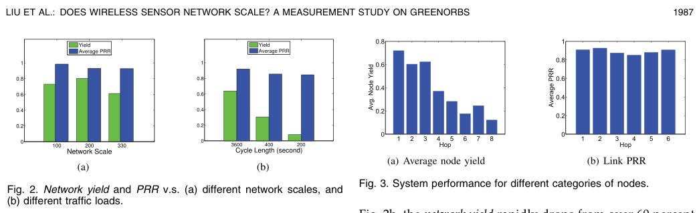
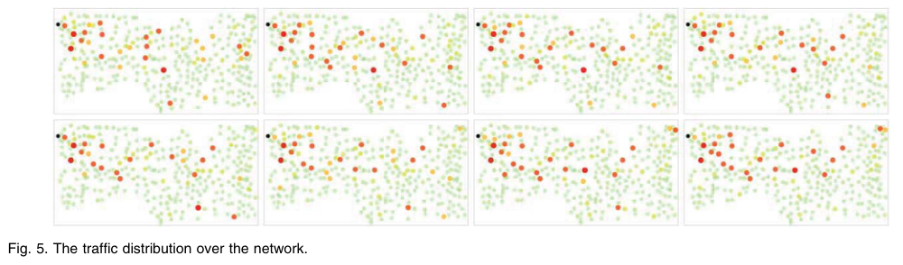

# Liu, He, Li, Wang, Liu, Li 2013 · Mạng cảm biến có mở rộng được không? Đo đạc trên GreenOrbs

## Tóm tắt một dòng
Đo một mạng TelosB thu gom đa chặng (CTP) tới 330 node trong rừng suốt 29 ngày: dưới 10 % node nghẽn gánh 80 % lưu lượng và gây 61 % số gói mất, link vật lý ổn định nhưng tải cao thì yield rơi từ hơn 60 % xuống dưới 10 %, còn bảng định tuyến cố định cho yield ngang CTP động.

## Vì sao đọc
Là triển khai WSN ngoài rừng lớn nhất có số đo xuyên tầng, dùng để đối chiếu quy mô và mật độ của kịch bản J1 (CONTEXT
mục 7–8), và để dẫn chứng rằng kênh mặt đất trong rừng đủ ổn định cho kế hoạch tĩnh như River [C].

## Bài toán và mô hình
- **[GĐ]** Mạng đồng nhất, phẳng (không phân cấp cluster head), một sink ở góc trên trái; luồng chính là thu gom đa chặng
  từ node thường về sink bằng CTP (tr. 2–3).
- **[GĐ]** Phần cứng TelosB: MSP430, CC2420, flash chương trình 48 KB, flash đo 1 MB, RAM 10 KB; phần mềm TinyOS 2.1 (tr. 3).
- **[GĐ]** Duty cycle đồng bộ: mỗi giờ mọi node cùng thức, cùng bật radio một khoảng như nhau rồi cùng ngủ; đồng bộ bằng
  FTSP. Cấu hình phát xuống bằng Drip dựa trên Trickle, khoảng Trickle tối đa 20 s (tr. 3).
- **[GĐ]** CTP được sửa cho bớt nhạy với link hỏng: chỉ cập nhật bảng định tuyến khi số lần phát lại vượt ngưỡng; giảm tần
  suất beacon của CTP và FTSP để bớt chi phí điều khiển (tr. 3).
- **[GĐ]** Node được đặt "đều trên thực địa" với ý định có cấu trúc mạng đều (tr. 8). Bài không ghi diện tích vùng triển
  khai, không ghi khoảng cách giữa node.

## Định nghĩa và ký hiệu
| Ký hiệu | Nghĩa |
|---|---|
| Yield_i | số gói sink nhận từ node i trong khoảng w chia số gói i đã gửi (tr. 4) |
| Yield | yield toàn mạng: tổng gói sink nhận chia tổng gói mọi node gửi trong w (tr. 4) |
| PRR | PRR hai chiều của link: số gói được ACK chia số gói đã gửi, tính cả phát lại (tr. 4) |
| PLR | 1 − PRR |
| PDR | tỉ lệ gói tới đích trên gói nguồn gửi; có phát lại nên PDR có thể cao hơn PRR của link (tr. 4) |
| D_sink, D_sniffer, D_log | dữ liệu về sink, dữ liệu sniffer nghe lén, nhật ký cục bộ 6 byte mỗi sự kiện (tr. 4) |

- **[ĐN]** Ba loại mất gói (tr. 5–6): transmit timeout (phát lại 30 lần không có ACK, do kênh xấu hoặc đụng độ), receive
  pool overflow (nhận được nhưng hàng đợi chuyển tiếp đầy, do nghẽn ở node nhận), send queue overflow (không đưa được gói
  vào hàng đợi).

## Kết quả chính
- **[KQ] Phỏng đoán 1** (tr. 8). Nút cổ chai của mạng lớn không chỉ ở "vùng nóng" quanh sink: một số node trung gian rải khắp
  mạng làm nghẽn cả mạng, và các chỉ số đang dùng (ETX, RSSI, LQI) không bắt được chúng.
- **[KQ] Phỏng đoán 2** (tr. 8). Phần lớn link trong mạng ổn định về mặt vật lý; biến động chủ yếu đến từ các thao tác đồng
  thời bên trong mạng (đụng độ, hidden terminal mà CSMA không phát hiện), ít đến từ môi trường.
- **[KQ] Phỏng đoán 3** (tr. 9). Môi trường ít biến động nhưng tác động lên cấu trúc mạng thì không đoán trước được; nên dùng
  cấu trúc định tuyến tĩnh, học sau khi triển khai và chỉ dựng lại khi có sự kiện lớn (thời tiết, địa hình, hỏng nhiều node).
- Ba phỏng đoán chỉ được kiểm "bước đầu" bằng các thí nghiệm ở mục 5–6, chưa có chứng minh.

## Thuật toán
- **[TT] Đo đạc bốn kênh** (tr. 2, 4). Gửi thống kê toàn mạng về sink (gói loại 41 định tuyến, 42 link, 45 thống kê node);
  đặt sniffer TelosB nối laptop sao cho vùng nghe phủ cả mạng; cho node phát beacon trạng thái khi được yêu cầu; ghi nhật
  ký cục bộ trên flash.
- **[TT] Định tuyến cố định** (tr. 9). Chạy CTP 120 phút, sau đó khoá bảng định tuyến thêm 120 phút, mỗi node chuyển tiếp cho
  một parent cố định.

## Thực nghiệm và số liệu
- **[TS]** Dữ liệu chính tháng 12/2009: 29 ngày liên tiếp, 2 540 000 gói, gói trung bình 100 byte (tr. 3, 5).
- **[TS]** Bảng 1 (tr. 4), 14 trace: quy mô 100 / 200 / 330 node; mức công suất CC2420 8, 15, 21, 31 (khoảng −15, −7, −4,
  0 dBm, tr. 7); tốc độ 3–108 gói/giờ mỗi node; thời lượng 1–300 giờ; trace 13–14 bật duty cycle 8 %.
- **[SỐ]** Tải thấp (3 gói/giờ): khi tăng từ 100 lên 200 rồi 330 node, yield và PRR trung bình không có xu hướng rõ (Fig. 2a,
  tr. 5); đọc trên hình yield khoảng 0,73 / 0,80 / 0,61 và PRR khoảng 0,98 / 0,93 / 0,93.
- **[SỐ]** 330 node, mỗi chu kỳ 3 gói, chu kỳ 3 600 → 400 → 200 s: yield rơi từ hơn 60 % xuống dưới 10 % (Fig. 2b, tr. 5),
  PRR trung bình chỉ giảm từ khoảng 0,92 xuống 0,85 (đọc trên hình).
- **[SỐ]** Thông lượng hữu ích cao nhất ở chu kỳ 400 s: 3 × 330 gói × 100 byte × 8 × 31 % / 400 s = 0,61 kbps, xa dưới
  mức CTP đạt được trong tài liệu (ít nhất 20 gói/s), nên sink chưa phải nút cổ chai (tr. 5).
- **[SỐ]** Yield theo số chặng tới sink giảm từ khoảng 0,72 (1 chặng) xuống khoảng 0,12 (8 chặng), trong khi PRR link theo
  chặng chỉ dao động 0,85–0,93 (Fig. 3, tr. 5). Mạng có tới 8 chặng.
- **[SỐ]** Trace 5: transmit timeout chiếm 61,08 % số gói mất, receive pool overflow 38,92 %, không có send queue overflow
  (tr. 6).
- **[SỐ]** Gần 90 % node có dưới 20 lần timeout, không node nào quá 50; hơn 95 % node không có lần overflow nào, toàn bộ
  overflow rơi vào dưới 5 % node (Fig. 4, tr. 6).
- **[SỐ]** Dưới 10 % node quan trọng gánh 80 % lưu lượng và gây 61,06 % số gói mất; tập node này khá ổn định qua tám giai
  đoạn liên tiếp, nằm rải khắp mạng, một số gần đường đi (Fig. 5, tr. 6).
- **[SỐ]** Hệ số tương quan Pearson giữa ETX và PDR hay trễ của đường đi phân bố gần như ngẫu nhiên trong [−1, 1] (Fig. 8,
  tr. 7). Node 225 sau khoảng 10 giờ bỏ mọi gói chuyển tiếp nhưng vẫn quảng bá ETX tốt và vẫn được chọn làm parent (Fig. 9,
  tr. 7–8).
- **[SỐ]** Cặp node riêng trong cùng khu rừng, cách 20 m và 50 m: RSSI ổn định, chỉ có gai ngắn (có thể do AP 802.11b);
  chỉ cấu hình 50 m và 20 Hz có RSSI quanh −90 dBm và mất gói thấy được, sát ngưỡng nhạy CC2420 −93 đến −87 dBm (Fig. 10,
  tr. 8).
- **[SỐ]** Khoá bảng định tuyến 120 phút: yield không khác rõ so với 120 phút chạy CTP (Fig. 11, tr. 9).

## Hình tiêu biểu

*Đọc hình:* node đặt khá đều trên một dải rừng giữa đường và hồ, nhưng topo link nghe được (a) dày hơn hẳn topo định
tuyến thật (b); lọc theo RSSI (c) hay LQI (d) lại cho topo khác nữa.

*Đọc hình:* PRR của link gần như không đổi theo quy mô, tải hay số chặng, còn yield rơi mạnh khi tải tăng và khi node ở
xa sink; mất gói tích luỹ qua nhiều chặng và nghẽn chứ không nằm ở chất lượng link.

*Đọc hình:* node đỏ tập trung gần sink nhưng cũng rải khắp mạng, và vị trí của chúng gần như giữ nguyên qua tám giai đoạn.

## Trích nguyên văn
- **[TRÍCH]** "the uniform sensor deployment does not yield a uniform networking overlay." (tr. 8)
- **[TRÍCH]** "the environment impacts are relatively stable, providing us adequate room in designing comparatively static while highly optimized routing protocols." (tr. 9)
- **[TRÍCH]** "less than 10 percent critical nodes commit 80 percent traffic load and thus 61.06 percent of the packet loss." (tr. 6)

## Liên hệ SigDrop
- **[NX] [C]** Phỏng đoán 2–3 và thí nghiệm khoá bảng định tuyến (Fig. 11) là bằng chứng thực địa cho giả định của River:
  kênh mặt đất trong rừng đủ ổn định để dùng kế hoạch lập trước (người phát, người nhận, kênh) thay cho khám phá lúc chạy.
  Có thể dẫn cùng Typhoon (`liang2008-typhoon`) khi biện minh chi phí khám phá.
- **[NX] [KÊNH]** Mất gói trong GreenOrbs chủ yếu do đụng độ và hidden terminal ở vùng tải cao, ít do suy hao biến động.
  Lưới 7 màu PECEE của River tránh hai cell kề phát cùng kênh, nên nhắm đúng nguồn mất gói này. Mô hình kênh ns-3 hiện
  không có hidden terminal giữa các cell cùng màu ở xa; nên ghi là giới hạn.
- **[NX] [D]** Ở GreenOrbs dưới 10 % node gánh 80 % tải. Trong River, cặp gateway giữa hai cell là chỗ dễ thành nút cổ chai
  tương tự; nên đo phân bố tải trên các gateway (liên quan bản River cân tải, commit df3792ba).
- **[NX] [ĐV]** Quy mô và mật độ cho CONTEXT J1 mục 8: bài chỉ nói "tới 330 node", không có diện tích hay khoảng cách node, nên
  không suy ra được mật độ từ bài này. Mạng sâu tới 8 chặng; từ ảnh Fig. 1 vùng là một dải rừng hẹp ven hồ, nhưng ảnh không
  có thước tỉ lệ.
- **[NX] [ĐV]** GreenOrbs cho thấy mạng phẳng hàng trăm node trên 802.15.4 chạy được nhiều tuần, nhưng tải 9 gói/giờ mỗi
  node (chu kỳ 400 s) đã làm yield rơi còn 31 %. Truy vấn của SigDrop là phát xuống một lần, khác hẳn thu gom liên tục,
  nên không dùng con số yield này để đoán hiệu năng River.

## Hạn chế và câu hỏi mở
- Phụ lục A–N (chi tiết node, lịch sử triển khai, thống kê theo tải, thí nghiệm công suất) nằm ở tài liệu bổ sung trực
  tuyến, không có trong PDF; các chỗ bài trỏ sang phụ lục chưa đọc được.
- Không có diện tích vùng, mật độ, khoảng cách node; bài sơ bộ INFOCOM 2011 cùng tên có thể có thêm, chưa kiểm.
- Ba phỏng đoán chỉ dựa trên một triển khai, một giao thức (CTP), một loại phần cứng; bài tự nói là kiểm "bước đầu".
- Nhiều số trong mục Thực nghiệm đọc từ biểu đồ cột, sai số cỡ ±0,02.
