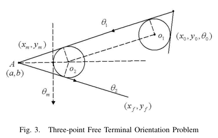

# Ma, Castañón 2006 · Lập kế hoạch cuộn cho Dubins TSP

## Tóm tắt một dòng
Mở rộng bài toán Dubins hai điểm sang hướng cuối tự do và bài toán ba điểm liên tiếp (hai điểm sau chưa biết hướng), dùng lời giải ba điểm theo kiểu cuộn (receding horizon) để nối đường qua dãy waypoint; khi chưa biết thứ tự thì lấy thứ tự ETSP gần đúng rồi chạy thuật toán cuộn — tốt hơn Alternating Algorithm và RAA.

## Vì sao đọc
Chỉ để biết: một heuristic loại (A) "thứ tự Euclid trước, hướng sau" cho DTSP; tác giả nêu hướng mở "tour thăm vùng thay vì điểm" — đúng bài toán của SigDrop [TOUR].

## Bài toán và mô hình
- **[GĐ]** Xe Dubins bán kính quay tối thiểu; dãy waypoint có thứ tự (hoặc chưa có thứ tự); tìm đường trơn ngắn nhất (tr. 1).

## Định nghĩa và ký hiệu
| Ký hiệu | Nghĩa |
|---|---|
| bài hai điểm hướng cuối tự do | đường ngắn nhất từ cấu hình tới điểm (hướng đến tự do) |
| bài ba điểm | qua điểm giữa (x_m, y_m) tới (x_f, y_f), hai hướng sau chưa biết (Fig. 3) |
| RHA, 2PA, AA, RAA | receding horizon, two-point, Alternating (Savla), Random Asymmetric (Le Ny) |

## Kết quả chính
- **[KQ]** Đặc trưng điều kiện cần cho tối ưu và lời giải cho bài hai điểm hướng cuối tự do và bài ba điểm (dạng LSLS, LSRS…, Fig. 4–5); thay CSCC bằng CSCS ngắn hơn (Fig. 2) (tr. 3–4).
- **[KQ]** Thuật toán cuộn: mở rộng đường từng waypoint dùng lời giải ba điểm (có biết vị trí điểm kế tiếp) (tr. 6).
- **[SỐ]** Thí nghiệm cho thấy RHA tốt hơn các phương án hai điểm, ba điểm khác và hơn RAA khi chưa biết thứ tự (Fig. 6–7, tr. 5–6; không đọc số cụ thể).

## Thuật toán
- **[TT] RHA** (tr. 5–6). Thứ tự (cho trước hoặc ETSP) → với mỗi bước, giải bài ba điểm (điểm hiện tại, kế tiếp, kế tiếp nữa), đi tới điểm kế, cuộn tiếp.

## Thực nghiệm và số liệu
Không đọc chi tiết (mức abstract).

## Hình tiêu biểu

*Đọc hình:* chọn hướng tại điểm giữa có tính đến điểm sau giúp tránh vòng quay thừa.

## Trích nguyên văn
- **[TRÍCH]** "An interesting extension of our results is to look for tours that visit areas instead of points." (tr. 6)

## Liên hệ SigDrop
- **[NX] [TOUR]** RHA là heuristic rẻ, chạy trực tuyến được; có thể làm baseline "theo thứ tự Euclid" khi so CHORD. Lưu ý cảnh báo Ω(n) của Le Ny 2007/2012 cho mọi heuristic theo thứ tự ETSP khi điểm dày.

## Hạn chế và câu hỏi mở
- Chỉ đọc abstract, mở đầu, kết luận và chú thích hình.
