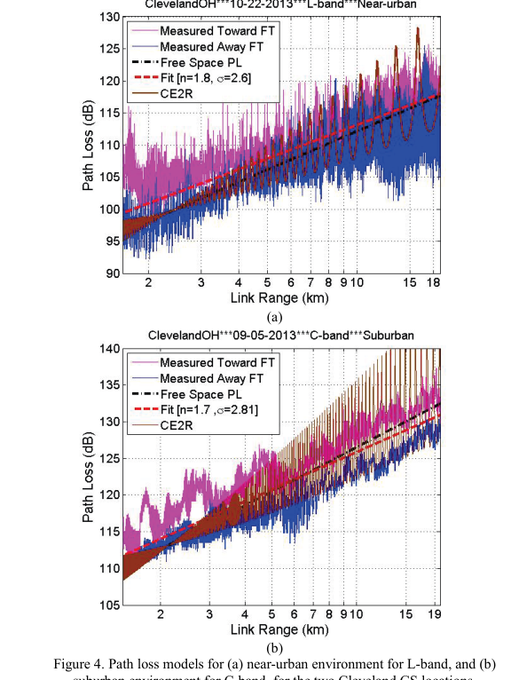
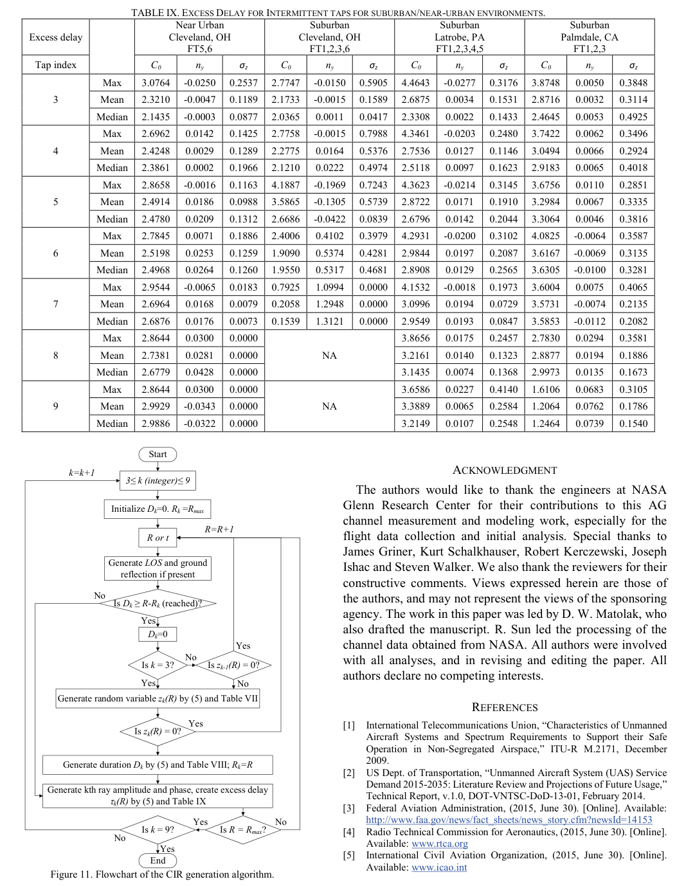

# Matolak, Sun 2017 · Kênh không–đất cho UAS, phần III: ngoại ô và cận đô thị

## Tóm tắt một dòng
Đo kênh A2G băng L (968 MHz) và C (5060 MHz) bằng máy bay S-3B ở 500–1000 m trên trạm mặt đất (anten 20 m) tại ngoại ô và cận đô thị: suy hao theo log-distance mũ 1,5–2,0, σ ≤ 3,2 dB, chênh 4,6 dB theo hướng bay; fading Rician K ≈ 12–14 dB (L), 27–29 dB (C); trễ RMS trung bình 10–60 ns, tối đa ~4 μs; mô hình TDL với tối đa 7 tia gián đoạn.

## Vì sao đọc
Cho tham số kênh A2G đo thực (mũ suy hao, độ lệch chuẩn shadowing, hệ số K Rician) để hiệu chỉnh mô hình kênh [KÊNH]
của SigDrop, và cho thấy kênh A2G có LoS mạnh nên fading nhỏ khác hẳn kênh mặt đất.

## Bài toán và mô hình
- **[GĐ]** Liên kết CNPC (điều khiển, không tải) băng L và C; máy phát ở trạm mặt đất (GS), máy thu trên máy bay; anten máy
  bay gắn bụng (tr. 1–2, 4).
- **[GĐ]** Gần như luôn có LoS giữa GS và máy bay trong mọi lần đo (tr. 4).
- **[GĐ]** Thông số mặt đất cho hệ số phản xạ: "average ground" ε_r = 15, σ = 0,005 S/m (Cleveland, Latrobe); "dry
  ground" ε_r = 5, σ = 0,001 S/m (Palmdale) (tr. 4).
- **[GĐ]** Độ dài dừng (stationarity distance) 15 m (trung vị từ bài phần II) dùng để ước lượng K và tương quan (tr. 7).

## Định nghĩa và ký hiệu
| Ký hiệu | Nghĩa |
|---|---|
| R, R_min, R_max | khoảng cách liên kết (km) và miền hợp lệ |
| A₀, n | suy hao tại R_min, mũ suy hao (log-distance) |
| X | biến Gauss trung bình 0, độ lệch σ_X (shadowing) |
| ζ, F | ζ = −1 bay về phía GS, +1 bay ra xa; F là hiệu chỉnh nhỏ theo hướng bay (do góc chúc ngóc) |
| CE2R, FE2R, B | mô hình hai tia mặt đất cong / phẳng; B là chênh trung bình đo – CE2R |
| ψ, ψ_min | góc sượt; ψ_min (milli-rad) = (2100/f_MHz)^{1/3} |
| a(R) | biến fading Rician năng lượng đơn vị |
| K, K₀, n_K | hệ số Rician; K(R) = K₀ + n_K(R − R_min) + Y, (3) |
| z_k, α_k, φ_k, τ_k, D_k | bật/tắt, biên độ, pha, trễ, thời gian sống của tia gián đoạn thứ k |

## Kết quả chính
- **[KQ] (1) Log-distance** (tr. 5). PL(R) = A₀ + 10n log₁₀(R/R_min) + X + ζF_A, R_min ≤ R ≤ R_max.
- **[KQ] (2) Hai tia** (tr. 5). PL(R) = FE2R(R) − 20 log[a(R)] khi góc sượt ngoài miền CE2R; = CE2R(R) + B + ζF − 20 log[a(R)]
  khi ψ_min < ψ < π/2 (điều kiện của nhánh đầu trích chữ không rõ). Với Cleveland ngoại ô/cận đô thị, vật cản dày làm mô hình
  hai tia không còn đúng — chỉ dùng log-distance (tr. 5).
- **[KQ] Bảng III** (tr. 5). Cận đô thị Cleveland: C-band A₀ = 110,4 dB, n = 2,0, σ_X = 3,2 dB, F = 2,3 dB, R 1,7–19 km;
  L-band 99,4 dB, n = 1,7, σ_X = 2,6 dB, F = 1,8 dB. Ngoại ô gộp (Palmdale, Latrobe, Cleveland): C-band 116,7 dB, n = 1,5,
  σ_X = 2,9 dB, F = 0; L-band 98,2 dB, n = 1,7, σ_X = 3,1 dB, F = 1,1 dB. Mũ < 2 là do giản đồ anten máy bay ở cự ly ngắn.
- **[KQ] Hướng bay** (tr. 10). Suy hao khác tới 4,6 dB giữa bay vào và bay ra vì góc ngóc mũi ảnh hưởng giản đồ anten.
- **[KQ] Bảng IV, RMS-DS băng C** (tr. 7). Trung bình 12,8 ns (cận đô thị Cleveland), 13,9 (Latrobe), 59,6 (Palmdale), 9,9
  (Cleveland ngoại ô); trung vị 9,6–11,0 ns; tối đa 217,5; 1190,8; 4242,9; 2029,5 ns.
- **[KQ] Bảng V, K Rician** (tr. 8). Trung vị: cận đô thị 27,4 dB (C), 12,0 dB (L); ngoại ô 27,5–29,6 dB (C), 13,2–14,7 dB (L);
  độ dốc theo R rất nhỏ (|n_K| ≤ 0,12 dB/km) nên dùng K ≈ K₀ + Y hoặc hằng số. K ở L lớn hơn? — không: K ở **C lớn hơn L**
  theo số liệu, nhưng chữ trong bài giải thích "larger K-factor in L-band ... longer wavelength" (tr. 8) mâu thuẫn với bảng
  **[NX]**.
- **[KQ] Tương quan** (tr. 8). Hai anten cùng băng cách 1,82 m tương quan cao (trung vị > 0,85); giữa hai băng gần như không
  tương quan.
- **[KQ] Thời gian sống tia gián đoạn** (tr. 9). Vật phản xạ phẳng dài L thấy được trên quãng d_v = 2L; tốc độ u → t_v = 2L/u;
  ví dụ L = 10 m, u = 100 m/s → 0,2 s.
- **[KQ] (4) TDL** (tr. 9). h(τ, t) = α_LOS δ(τ − τ₁) + α₂e^{−jφ₂}δ(τ − τ₂) + Σ_{k=3}^{9} z_k α_k e^{−jφ_k} δ(τ − τ_k); pha đều
  [0, 2π); công suất tương đối tia gián đoạn Gauss (dB): Latrobe (−30,3; 4,1), Palmdale (−23,3; 5,1), Cleveland ngoại ô
  (−26,3; 3,7), cận đô thị (−25,2; 4,3). Xác suất bật, trễ, thời gian sống theo log₁₀(y) = C₀ + n_y(R − R_min) + Z, (5),
  Bảng VII–IX.

## Thuật toán
- **[TT] Sinh CIR** (Fig. 11, tr. 10, 12). Lưu đồ tạo đáp ứng xung từ TDL: tính LoS và tia mặt đất bằng CE2R, rồi bật/tắt
  từng tia gián đoạn theo xác suất, độ dài, trễ, công suất từ các bảng.

## Thực nghiệm và số liệu
- **[TS]** Hơn 300 triệu PDP, 82 đường bay, 7 loại địa điểm (cả chiến dịch); phần III: Cleveland (cận đô thị và ngoại ô),
  Latrobe, Palmdale năm 2013 (Bảng I, tr. 2).
- **[TS]** Máy bay ở độ cao trên GS: 504–542 m (cận đô thị), ~600 m (Latrobe), 892–924 m (Palmdale), 484–518 m (Cleveland ngoại ô);
  tốc độ 74–101 m/s; cự ly 0,7–54 km; góc ngẩng cận đô thị 1,6–20,5° (C), tới 43,5° (L) (tr. 3–4).
- **[TS]** Máy dò DS-SS, chuỗi m 1023; C: 50 MHz, phân giải 20 ns; L: 5 MHz, 200 ns; công suất phát 10 W; anten GS cao 20 m,
  độ lợi 6 dB (C) và 5 dB (L); anten máy bay blade 5 dBi; ngưỡng 25 dB dưới đỉnh PDP (Bảng II, tr. 4).
- **[SỐ]** Tỉ lệ PDP có tia 3: 11,9 % (cận đô thị), 4,26 % (Cleveland ngoại ô), 53,3 % (Latrobe), 36,4 % (Palmdale); tia ≥ 4
  hiếm (< 4 %) (Bảng VI, tr. 11).

## Hình tiêu biểu

*Đọc hình:* đo bám sát đường không gian tự do; dao động hai tia mạnh ở CE2R nhưng dữ liệu ngoại ô không theo dao động này.

*Đọc hình:* các bước dùng bảng tham số để tạo kênh mô phỏng theo cự ly.

## Trích nguyên văn
- **[TRÍCH]** "A line of sight (LOS) was present between the GS and aircraft for essentially all our tests." (tr. 4)
- **[TRÍCH]** "These models should of course be used only for AG channels in environments comparable to those of the measurements, at altitudes not substantially lower than the altitudes of the measurements" (tr. 10)

## Liên hệ SigDrop
- **[NX] [KÊNH]** σ_X ≈ 2,6–3,2 dB và K ≈ 12–29 dB cho thấy khi có LoS thì shadowing và fading nhỏ; mất gói A2G chủ yếu do
  khoảng cách/góc ngẩng (che khuất) chứ không do fading. Có thể dẫn để biện minh mô hình đĩa + vùng chuyển tiếp hẹp.
- **[NX] [KÊNH]** Cảnh báo phạm vi: số đo ở 500–1000 m độ cao, cự ly km; UAV của SigDrop bay ~100 m, cự ly vài trăm m, băng
  2,4 GHz — không áp thẳng các hằng số; chỉ dùng làm mốc định tính và trích kèm Al-Hourani 2014 cho xác suất LoS.
- **[NX] [GIÓ]** Chênh 4,6 dB theo hướng bay (góc ngóc) là hiệu ứng tư thế máy bay lên kênh — liên quan tới lệch quỹ đạo
  và tư thế khi có gió.

## Hạn chế và câu hỏi mở
- Máy bay có người lái cỡ lớn, độ cao cao; không phải UAV nhỏ bay thấp.
- Phần Bảng IX và mô tả lưu đồ ở cuối (tr. 12–13) chỉ xem lướt.
- Chữ giải thích K ở tr. 8 mâu thuẫn với bảng (xem [NX] ở trên); cần kiểm lại nếu trích.
- Tác giả hẹn mô hình che khuất thân máy bay và mô hình hình học ở bài sau (tr. 10).
