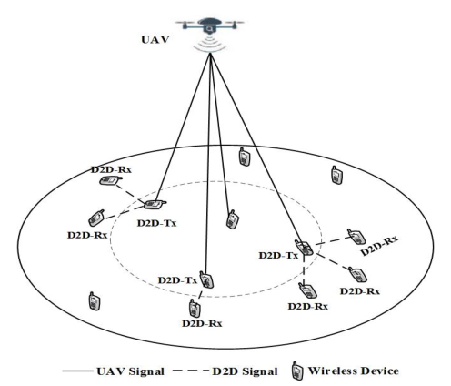

# Miao, Liao, Zhao 2020 · Thiết kế chung tốc độ và vùng phủ cho mạng UAV có D2D

## Tóm tắt một dòng
UAV treo ở tâm vùng (cao 100 m) phục vụ trực tiếp tối đa M người dùng; người dùng khác nhận lại qua D2D một chặng (≤ 10 m) từ người đã được UAV phục vụ (ràng buộc nhân quả thông tin); tối đa ω·tổng tốc độ + (1 − ω)·số người được phục vụ, bài nhị phân NP-khó được nới thành LP giải bằng CVX.

## Vì sao đọc
Là bài gần nhất trong thư mục với cấu trúc "UAV phát cho một tập nút, mặt đất chuyển tiếp tiếp" của SigDrop (nhưng chỉ một chặng D2D, UAV đứng yên)
— cần để định vị đóng góp [ĐV] và cho ràng buộc nhân quả thông tin [B].

## Bài toán và mô hình
- **[GĐ]** Vùng tròn (thực nghiệm: vuông 100 × 100 m), N người dùng phân bố đều; UAV đứng ở tâm độ cao H (tr. 2, 4).
- **[GĐ]** Kênh UAV–người dùng LoS chiếm ưu thế; thay fading bằng trung bình β = E[\|g\|²]; OFDMA nên không nhiễu giữa người dùng do UAV phục vụ (tr. 2).
- **[GĐ]** D2D chỉ lập khi khoảng cách ≤ d_D2D; liên kết mặt đất Rayleigh (tr. 2).
- **[GĐ]** Mỗi người nhận từ tối đa một nguồn (UAV hoặc một người do UAV phục vụ) (tr. 3).

## Định nghĩa và ký hiệu
| Ký hiệu | Nghĩa |
|---|---|
| i_n ∈ {0, 1} | người n được UAV phục vụ trực tiếp |
| j_nm ∈ {0, 1} | người n nhận qua D2D từ người m |
| M | số người tối đa UAV phục vụ trực tiếp |
| γ_n = p_UAV αβ/(σ²(H² + x_n² + y_n²)) | SNR từ UAV, (3) |
| R_n = log(1 + γ_n) | tốc độ, (4) |
| d_D2D | khoảng cách D2D tối đa |
| ω ∈ [0, 1] | trọng số giữa tổng tốc độ và số người được phục vụ |

## Kết quả chính
- **[KQ] Ràng buộc nhân quả thông tin (8)/(17)** (tr. 3). j_nm ≤ i_m: người m chỉ chuyển tiếp sau khi được UAV phục vụ.
- **[KQ] Bài toán (12)–(18)** (tr. 3). max ω Σ i_n R_n + (1 − ω) Σ N_n với Σ i_n ≤ M, i_n + Σ_m j_nm ≤ 1, j_nm = 0 nếu d_nm > d_D2D; NP-khó do biến nhị phân.
- **[KQ] Nới LP (20)–(27)** (tr. 3–4). Thay {0, 1} bằng [0, 1], được LP chuẩn, giải bằng CVX → lời giải dưới tối ưu (cách làm tròn không nêu rõ).

## Thuật toán
- **[TT]** Nới lỏng LP + CVX (tr. 4).

## Thực nghiệm và số liệu
- **[TS]** H = 100 m, p_UAV = 0,1 W, σ² = −100 dBm, α = −60 dB, β = 1, N = 100 người trong 100 × 100 m, M = 7, d_D2D = 10 m, ω ∈ {1/3, 2/3, 1} (Bảng II, tr. 4).
- **[SỐ]** ω = 1 chọn người gần UAV (kênh tốt); ω = 2/3 chọn người có nhiều hàng xóm D2D; số người qua D2D tăng rõ, tổng tốc độ chỉ giảm nhẹ (Fig. 3–6, tr. 4–5).
  Giá trị cụ thể trên đồ thị (Fig. 5: tới ~30 người qua D2D với M = 7) đọc từ hình, không có bảng.

## Hình tiêu biểu

*Đọc hình:* chỉ một chặng D2D; UAV đứng yên ở tâm.

## Trích nguyên văn
- **[TRÍCH]** "the D2D transmitter can transmit information to its corresponding D2D receivers only after it has been served by the UAV" (tr. 3)

## Liên hệ SigDrop
- **[NX] [ĐV]** Khác SigDrop: UAV đứng yên (không tour), D2D một chặng, mục tiêu là tốc độ/số người chứ không phải thời gian hoàn tất phát một
  khối dữ liệu chung; không có mã hoá. Đây là điểm để nói SigDrop mới ở "tour + hợp tác nhiều chặng + thời gian hoàn tất".
- **[NX] [B]** Ràng buộc nhân quả j_nm ≤ i_m là dạng đơn giản của điều kiện takeover: nút chỉ phát lại khi đã nhận đủ từ UAV.

## Hạn chế và câu hỏi mở
- Không nêu cách làm tròn lời giải LP về nhị phân; không so với tối ưu.
- Kênh chỉ trung bình (không fading nhỏ, không NLoS) — tác giả để cho sau (tr. 5).
