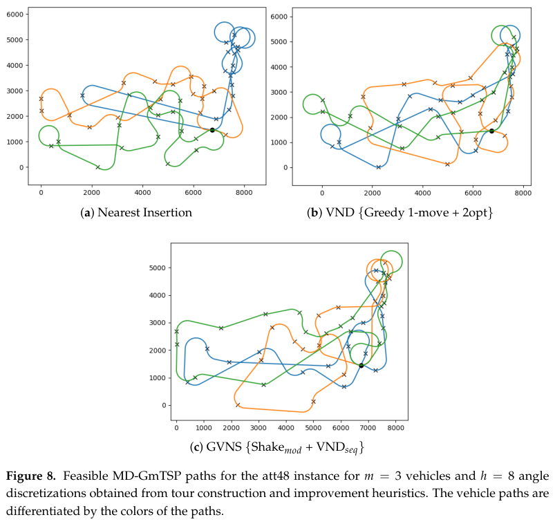

# Nayak, Rathinam 2023 · Heuristic và mô hình học cho Dubins mTSP dạng min–max

## Tóm tắt một dòng
MD-GmTSP: m xe Dubins, mỗi điểm chọn một trong h hướng rời rạc (one-in-a-set), tối thiểu độ dài tour dài nhất; MILP giải bằng CPLEX cho 16 instance TSPLIB (16–137 thành phố) nhưng không mở rộng được; heuristic chèn + VNS (GVNS tốt nhất) trong 600 s; GNN + học tăng cường tốt ở instance nhỏ, VNS tốt nhất ở instance lớn.

## Vì sao đọc
Chỉ để biết: dạng min–max (thời gian hoàn tất của đội) cho nhiều UAV Dubins — cần nếu SigDrop dùng nhiều UAV và tối thiểu thời điểm xong cuối cùng [TOUR].

## Bài toán và mô hình
- **[GĐ]** n điểm, m xe Dubins cùng kho; mỗi điểm thăm ít nhất một lần; hướng tại điểm chọn trong h giá trị; mục tiêu min max độ dài tour (tr. 1–3).

## Định nghĩa và ký hiệu
| Ký hiệu | Nghĩa |
|---|---|
| MD-GmTSP | MinMax Dubins generalized multiple TSP (one-in-a-set) |
| h | số hướng rời rạc mỗi điểm |
| VND, GVNS | variable neighborhood descent; general VNS |

## Kết quả chính
- **[SỐ]** Chèn gần nhất cho tour ban đầu thấp hơn chèn rẻ nhất trung bình 11,81 % (tr. 24).
- **[KQ]** Tổ hợp tốt nhất: chèn gần nhất + GVNS với các lân cận 2-opt, 3-opt, k-point, Or-opt, Shake, Shake_mod (tr. 24).
- **[KQ]** Học (GNN, S-sample batch RL) tốt ở instance nhỏ; VNS tốt nhất ở instance lớn (tr. 1).

## Thuật toán
- **[TT]** MILP (CPLEX) → heuristic chèn → VNS/GVNS 600 s → so với chính sách học bằng GNN (mục 3–5, chỉ đọc lướt).

## Thực nghiệm và số liệu
Không đọc chi tiết (mức abstract); TSPLIB sửa đổi, 16–137 thành phố, m = 3, h = 8 trong ví dụ hình.

## Hình tiêu biểu

*Đọc hình:* VNS cân lại độ dài giữa ba xe và gỡ bớt các vòng quay thừa của lời giải chèn.

## Trích nguyên văn
- **[TRÍCH]** "learning based approaches work well for smaller sized instances, while the VNS based heuristics find the best solutions for larger instances." (tr. 1)

## Liên hệ SigDrop
- **[NX] [TOUR]** Nếu chia cell cho nhiều UAV, mục tiêu nên là min–max (thời điểm xong cuối) như ở đây, khác Rathinam 2007 (tổng quãng đường).

## Hạn chế và câu hỏi mở
- Chỉ đọc abstract, mở đầu, kết luận và chú thích hình.
