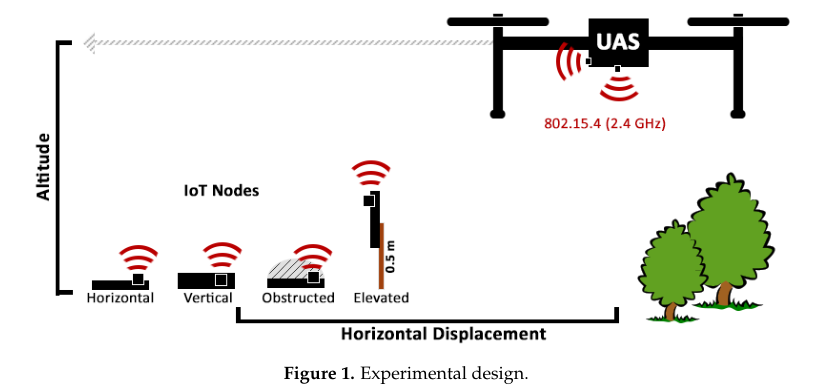
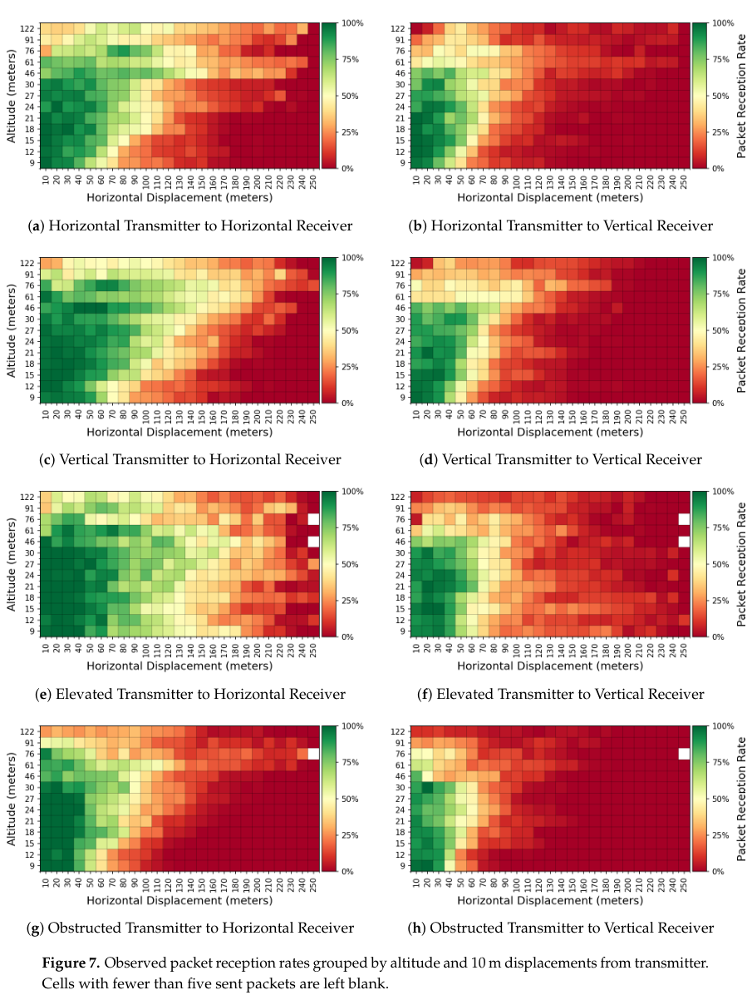
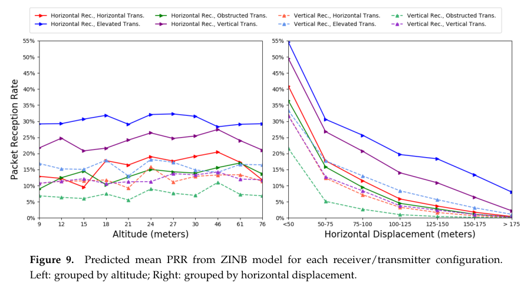

# Nekrasov, Allen, Artamonova, Belding 2019 · Tối ưu mạng 802.15.4 ngoài trời cho thu dữ liệu bằng UAV

## Tóm tắt một dòng
Đo thực 9 giờ bay (quadcopter, XBee3 802.15.4 2,4 GHz, 13 độ cao 9–122 m, cự ly ngang tới > 250 m): RSSI gần như không đổi theo cấu hình nhưng PRR thay đổi mạnh; PRR tốt nhất ở ~46 m, giảm ~5 %/25 m sau 50 m, gói xa nhất thu được ở 297 m dù hãng quảng cáo 1200 m.

## Vì sao đọc
Là số đo thực gần nhất với kịch bản SigDrop (UAV nói chuyện với nút 802.15.4 trên mặt đất ở 2,4 GHz, cự ly trăm mét):
dùng để hiệu chỉnh bán kính nghe, hình dạng đường PRR theo khoảng cách và để biện minh việc mô hình hoá bằng PRR thay
vì RSSI [KÊNH].

## Bài toán và mô hình
- **[GĐ]** Mạng IoT nông thôn dùng 802.15.4, thu dữ liệu chịu trễ (DTN) bằng UAV; chỉ số chính là PRR vì mỗi gói mất là năng
  lượng phí (tr. 1–2, 5).
- **[GĐ]** Bốn nút phát trên một đường thẳng cách ~11 m, bốn cấu hình: nằm ngang, dựng đứng, nâng 0,5 m trên cột, bị phủ
  1 quart mảnh vụn (tr. 3).
- **[GĐ]** UAV bay thẳng song song đường nút, tốc độ trung bình 2,2 m/s (điều khiển tay, có gió) (tr. 4).

## Định nghĩa và ký hiệu
| Ký hiệu | Nghĩa |
|---|---|
| PRR | số gói nhận / (thời gian trong vành × tốc độ phát), (1) |
| vành (sector) | vành tròn đồng tâm quanh nút: 10 m (bản đồ nhiệt), 25 m (mô hình) |
| GLM | mô hình tuyến tính tổng quát cho RSSI |
| ZINB | zero-inflated negative binomial cho số gói nhận (phần logistic "có nhận gì không" + phần NB "nhận bao nhiêu") |

## Kết quả chính
- **[KQ] RSSI kém phản ánh hiệu năng** (tr. 9, 12). RSSI chỉ có cho gói nhận được, nên trung bình gần như không đổi; nút bị
  phủ có RSSI trung bình cao hơn nút nâng nhưng giao ít hơn ~10 k gói. Dự đoán PRR từ RSSI (khi tính cả PRR = 0) cao hơn
  thực tế hơn 2 lần; mô hình ZINB theo biến cấu hình khớp tốt.
- **[KQ] Độ cao** (tr. 11, 13). PRR đỉnh ở 46 m với hầu hết cấu hình; độ cao thấp tốt ở cự ly ngang nhỏ, 46–76 m tốt hơn ở cự
  ly lớn (góc ngẩng lớn hơn, ít bị cỏ cây chắn).
- **[KQ] Cự ly ngang** (tr. 11). PRR giảm đơn điệu, gần 5 % mỗi 25 m sau 50 m (so với mức cơ sở).
- **[KQ] Hướng anten** (tr. 12, 13). Hướng anten bên phát gần như không ảnh hưởng; bên thu nằm ngang tốt hơn dựng đứng
  3–8 % PRR (RSSI khác ~3 dB). Nâng nút 0,5 m: +5 % PRR (chỉ với thu ngang); bị phủ: −2–4 %.
- **[KQ] Tầm thực** (tr. 13). Gói xa nhất ở khoảng cách 297 m (278 m ngang), trong khi XBee3 quảng cáo 1200 m ở 8 dBm, độ nhạy −103 dBm.

## Thuật toán
- **[TT] Phân loại nhị phân từ ZINB** (tr. 11). Ngưỡng PRR 40 % trên tập kiểm tra: đúng 86,9 %, specificity 86,2 %, recall 87,5 % (Fig. 8).

## Thực nghiệm và số liệu
- **[TS]** Coal Oil Point (đồng cỏ ven biển), tháng 3/2019; ba địa điểm: đường đất, cỏ cao ~1 m, đồi có rãnh; 3 lần lặp mỗi nơi,
  mỗi lần ~1 h chia đều 13 độ cao 9, 12, 15, 18, 21, 24, 27, 30, 46, 61, 76, 91, 122 m; cự ly ngang ≥ 250 m (tr. 3–4).
- **[TS]** Gói 23 byte mỗi 500 ms; DJI Matrice 100, hai XBee thu (ngang và đứng), Raspberry Pi, GPS 50 Hz; điều khiển ở 5,8 GHz (tr. 3–4).
- **[SỐ]** 121 503 gói nhận; 29 161 nhóm đo theo vành 10 m; ZINB dùng 7906 quan sát (vành 25 m), 59 % quan sát có ≥ 1 gói (tr. 5–6, 9–10).
- **[SỐ] Bảng 1** (tr. 7). Mức cơ sở (thu ngang, phát nâng, 46 m, cự ly 101–125 m, đường đất): RSSI −87,2 dBm, PRR 0,204.
  PRR theo cự ly: < 50 m 0,552; 50–75 m 0,312; 76–100 m 0,258; 126–150 m 0,198; 151–175 m 0,154; > 175 m 0,127.
  RSSI theo cự ly: −82,1 (< 50 m) tới −88,9 dBm (> 175 m) — chỉ ~1 dB mỗi 25 m.
- **[SỐ]** Độ cao ảnh hưởng RSSI tối đa 4 dB, không đơn điệu; < 1 dB mỗi 3 m (tr. 6).
- **[SỐ]** Tốc độ phát chậm: 1 gói/15 s chỉ thu trung bình 258 gói mỗi cặp; 1 gói/phút: 127 gói (tr. 14). Pin quadcopter ~20 phút,
  ở 2,2 m/s bay được 2,6 km (tr. 14).

## Hình tiêu biểu

*Đọc hình:* biến độ cao và cự ly ngang được quét có hệ thống cho từng cấu hình nút.

*Đọc hình:* vùng xanh (PRR cao) rộng tới ~100–150 m ở độ cao 30–76 m; nút bị phủ có vùng xanh hẹp ở độ cao thấp.

*Đọc hình:* theo độ cao gần như phẳng; theo cự ly giảm từ 30–55 % (< 50 m) về gần 0 sau 175 m.

## Trích nguyên văn
- **[TRÍCH]** "we only successfully captured packets at a maximum total distance of 297 m in our experiments." (tr. 13)
- **[TRÍCH]** "RSSI is a weak indicator of network performance for aerial data collection of an IoT network, as it poorly reflects high levels of packet loss." (tr. 15)

## Liên hệ SigDrop
- **[NX] [KÊNH]** Đường PRR theo cự ly (0,55 → 0,13 từ 50 m tới 175 m) là hình dạng "đĩa mềm" chứ không phải đĩa cứng; nên
  mô hình kênh của SigDrop có vùng chuyển tiếp và kiểm độ nhạy theo dạng này. Bán kính cell 100 m nằm trong vùng PRR
  ~0,25–0,3 với phần cứng XBee.
- **[NX] [KÊNH]** Kết luận "RSSI không dự đoán được mất gói" ủng hộ việc mô phỏng bằng xác suất nhận gói theo khoảng cách
  thay vì ngưỡng RSSI.
- **[NX] [TOUR]** Độ cao tối ưu ~46 m cho quadcopter; UAV cánh bằng của SigDrop bay ~100 m — số liệu ở 91–122 m vẫn có PRR
  khác 0 tới ~150 m ngang (Fig. 7).
- **[NX] [FC]** PRR trung bình thấp (0,1–0,5) cho thấy phải phát lặp hoặc mã fountain nhiều lần để mỗi nút đủ gói khi UAV bay ngang.

## Hạn chế và câu hỏi mở
- Chỉ một loại radio (XBee3 anten nhúng), một vùng đồng cỏ, tốc độ bay rất chậm 2,2 m/s (UAV cánh bằng ≥ 10 m/s, tr. 14).
- Chiều ngược lại (UAV phát xuống nút) không đo; SigDrop là UAV phát, cần cẩn trọng khi dùng đối xứng kênh.
- Tác giả để môi trường đô thị và anten ngoài cho công việc sau (tr. 15).
