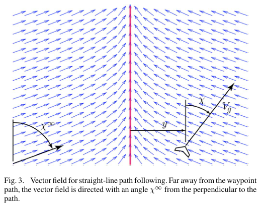
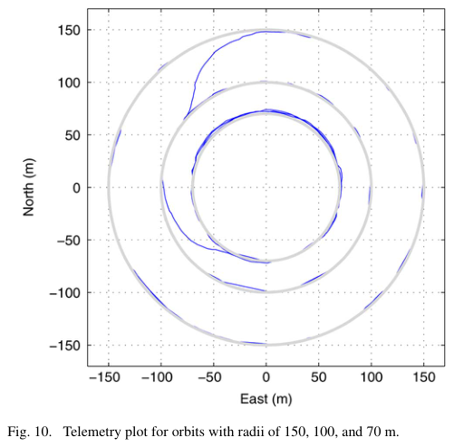
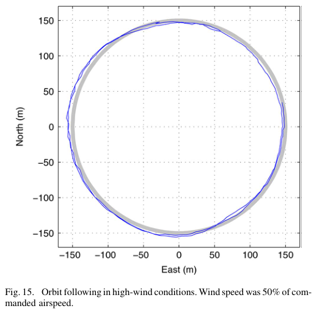

# Nelson, Barber, McLain, Beard 2007 · Bám đường bằng trường vector cho máy bay nhỏ

## Tóm tắt một dòng
Dựng trường hướng đi mong muốn quanh đường thẳng và quỹ đạo tròn, điều khiển theo hướng đi (course) đo bằng GPS nên sai số tiệm cận về 0 khi gió không đổi (chứng minh Lyapunov, có bản sliding mode); bay thử: sai số trung bình < 1 sải cánh cho đường thẳng/quỹ đạo tròn, < 3 sải cánh khi đổi hướng liên tục, kể cả gió 50 % tốc độ không khí.

## Vì sao đọc
Cho bậc độ lớn thực nghiệm của lệch quỹ đạo khi UAV cánh bằng bám tour có gió — số liệu nền để định lượng [GIÓ] trong SigDrop
(vùng nghe của cell bị lệch bao nhiêu mét so với tour lập kế hoạch).

## Bài toán và mô hình
- **[GĐ]** MAV cánh bằng sải 0,3–2 m, bán kính quay tối thiểu 10–50 m; gió thường 20–60 % tốc độ không khí (tr. 1).
- **[GĐ]** Bám đường (path following: ở trên đường) thay cho bám quỹ đạo theo thời gian (trajectory tracking) để tránh vấn đề điểm
  tham chiếu chạy trước/sau khi có gió (tr. 1).
- **[GĐ]** Động học viết theo tốc độ mặt đất V_g và hướng đi χ nên không phụ thuộc gió tường minh, (5)–(6) (tr. 2–3).
- **[GĐ]** Gió không đổi trong phân tích ổn định (tr. 1).

## Định nghĩa và ký hiệu
| Ký hiệu | Nghĩa |
|---|---|
| χ, χ_d | hướng đi mặt đất, hướng đi mong muốn từ trường vector |
| e_y (y) | khoảng cách ngang tới đường |
| χ^∞ | góc tiếp cận khi ở xa đường (≤ 90°) |
| k | hệ số độ dốc chuyển tiếp: k lớn chuyển gắt, nhỏ chuyển êm (Fig. 4) |
| d, r, γ | khoảng cách tới tâm quỹ đạo, bán kính quỹ đạo, góc vị trí (Fig. 6) |

## Kết quả chính
- **[KQ] Trường đường thẳng, (8)** (tr. 3). χ_d = −χ^∞·(2/π)·arctan(k·e_y) (dạng chuẩn của bài, ký hiệu dựng lại theo Fig. 3 [NX]);
  ở xa đường hướng vào với góc χ^∞, gần đường hướng song song.
- **[KQ] Định lý III.1–III.2** (tr. 3–5). Với χ^∞ ∈ (0, π/2] và luật điều khiển hướng đi (có thành phần sliding mode), e_y → 0 và
  χ → hướng đường tiệm cận khi gió không đổi (hàm Lyapunov dạng e_y²/2).
- **[KQ] Trường quỹ đạo tròn** (tr. 5–6, Fig. 6). Xa tâm (d ≫ r) hướng về tâm; gần quỹ đạo hướng tiếp tuyến; chứng minh tương tự.
- **[KQ]** Ghép đoạn thẳng và cung tròn để bám đường waypoint, có chế độ "độ dài đường bằng nhau" và cắt góc (Fig. 7, 12–13).

## Thuật toán
- **[TT]** Vòng ngoài sinh χ_d từ trường vector, vòng trong (autopilot Kestrel) điều khiển tư thế để đạt χ_d (tr. 2, 7–8).

## Thực nghiệm và số liệu
- **[TS]** Autopilot Kestrel (Rabbit 3400 29 MHz), cánh bay Zagi XS sải 1,2 m (chữ trích "2-m" bị cắt; Zagi XS sải ~1,2 m — cần đối chiếu),
  airspeed 13 m/s; ngày lặng gió 0,9 m/s (7 % airspeed); hai ngày gió 9 m/s và 6 m/s (tr. 8).
- **[SỐ]** Quỹ đạo tròn bán kính 150 m: sai số ngang trung bình 0,58 m (σ 0,42); 100 m: 0,65 m (σ 0,46); 70 m: 1,9 m (σ 1,1) (Fig. 10, tr. 9).
- **[SỐ]** Đường waypoint nhiều đổi hướng: sai số trung bình 3,6 m (σ 4,7 m); quãng bay thực ngắn hơn mong muốn 27 m (tr. 9).
- **[SỐ]** Gió mạnh: quỹ đạo tròn với gió 9 m/s cần airspeed 18 m/s (gió ≈ 50 % airspeed); đường thẳng với gió 6 m/s, airspeed 13 m/s; sai số
  lớn nhất ở đoạn quay xuôi gió (tr. 9–10, Fig. 15–16).

## Hình tiêu biểu

*Đọc hình:* mọi điểm trong mặt phẳng có một hướng đi mong muốn; UAV cứ theo trường thì hội tụ về đường.

*Đọc hình:* sai số dưới 1 m với quỹ đạo lớn; quỹ đạo gần bán kính quay tối thiểu (70 m) sai số tăng lên ~2 m.

*Đọc hình:* dù gió mạnh, đường bay vẫn nằm trong vài mét quanh quỹ đạo.

## Trích nguyên văn
- **[TRÍCH]** "following errors averaged less than one wingspan in steady straight-line or orbit paths and less than three wingspans for paths involving frequent transitions between straight-line and arc segments." (tr. 10–11)

## Liên hệ SigDrop
- **[NX] [GIÓ]** Với bộ bám đường tốt, lệch ngang chỉ vài mét — nhỏ so với bán kính cell 100 m; lệch đáng kể của SigDrop do gió nên đến
  từ thời gian (UAV tới trễ/sớm, xuôi/ngược gió) và từ đoạn quay, không phải lệch ngang khi bay thẳng. Có thể dẫn để giới hạn
  mô hình lệch quỹ đạo.
- **[NX] [TOUR]** Bám đường (không ràng buộc thời gian) phù hợp với SigDrop vì lịch phát có thể neo theo vị trí thay vì thời điểm.

## Hạn chế và câu hỏi mở
- Gió không đổi trong chứng minh; đo trên một loại máy bay nhỏ.
- Đọc partial: bỏ chứng minh sliding mode và chi tiết mục IV–V; ký hiệu toán phải dựng lại.
