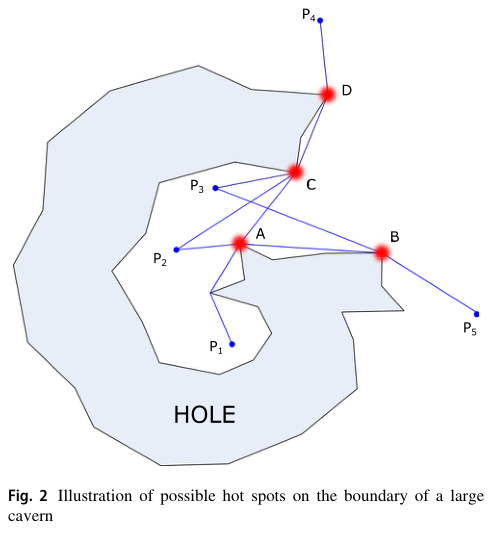
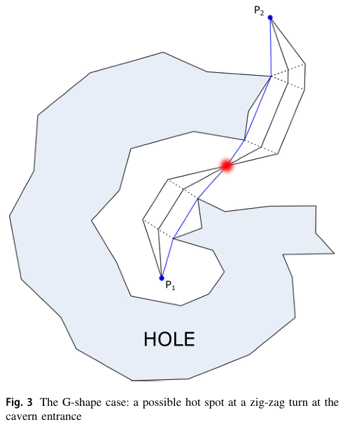
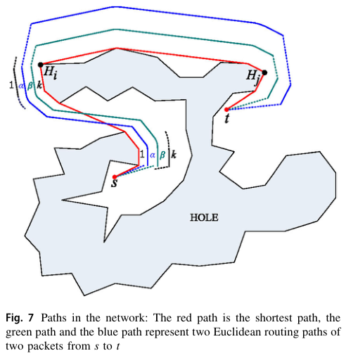
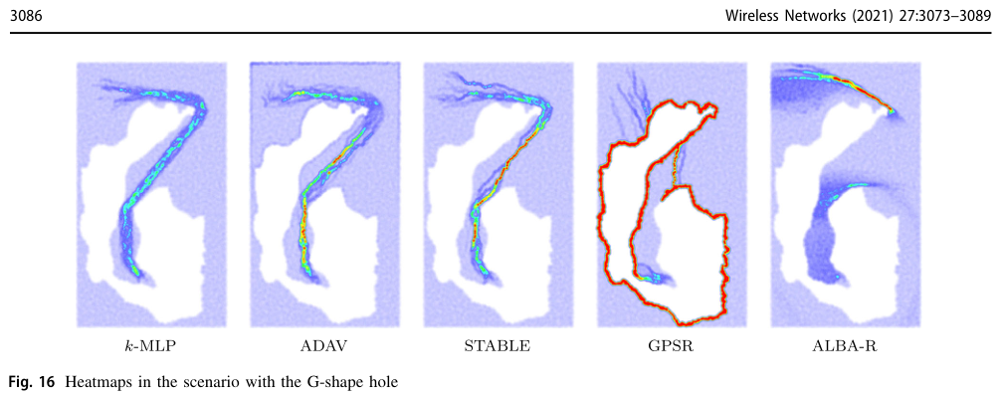

# Nguyen, Nguyen, Nguyen, Do, Chlamtac 2021 · Energy-efficient routing in the proximity of a complicated hole in WSN

## Tóm tắt một dòng
Định tuyến k-MLP: dựng k làn gần song song bám đường ngắn nhất quanh một lỗ mạng hình phức tạp (có hang, có khúc gấp), mỗi gói chọn ngẫu nhiên một làn; chứng minh độ dài đường ≤ (1 + ε) lần ngắn nhất và tăng thời gian sống của mạng so với GPSR, ALBA-R, ADAV, STABLE.

## Vì sao đọc
Người dùng đưa làm mẫu cách viết đặt vấn đề (chatlog mục 395). Nội dung gần phần mặt đất của SigDrop: lỗ mạng là hồ (như cell nước ở
Hoàng Mai), cân tải bằng nhiều đường song song gần giống cách River chia đoạn gói cho nhiều node trợ giúp.

## Bài toán và mô hình
- **[GĐ]** Node có radio giống nhau, tầm chuẩn hoá bằng 1; biết vị trí của mình (GPS), biết hàng xóm một chặng; nguồn biết vị trí đích
  (tr. 4).
- **[GĐ]** Năng lượng tính toán bỏ qua so với năng lượng phát gói (tr. 4).
- **[GĐ]** Để phân tích, mạng đủ dày để có node ở mọi chỗ trừ lỗ, nên đường greedy giữa s và t coi như đoạn thẳng Euclid; hai đường
  thẳng song song cách nhau 1 cho hai đường đi gần như không chung node (tr. 4–5, chú thích 1 tr. 5 nói giả định này lệch ở mật độ
  thật nhưng ảnh hưởng nhỏ).
- **[GĐ]** Bài toán: tìm đường từ s tới t quanh một lỗ lớn sao cho độ giãn (stretch) không quá 1 + ε và tải chia đều để tránh điểm
  nóng, nhất là khi s hoặc t nằm trong hang của lỗ (tr. 1–2). Bài không viết thành bài toán tối ưu có công thức.

## Định nghĩa và ký hiệu
| Ký hiệu | Nghĩa |
|---|---|
| H = H1…Hn | lỗ, đa giác có đỉnh là node biên, đánh số sao cho phần trong nằm bên phải (Định nghĩa 1, tr. 5) |
| γ_Hi | góc trong tại Hi; lồi nếu < 180° (tr. 5) |
| C = {Hk…Hl} | hang (cavern) giữa hai đỉnh liên tiếp của bao lồi; Hk, Hl là cổng; dC là độ sâu (Định nghĩa 3, tr. 5) |
| A(Hi, r) | cung tròn tâm Hi bán kính r; mức tiếp cận của Hi là r lớn nhất mà cung không cắt phần trong lỗ (tr. 5) |
| u(H) | góc của đường gấp khúc đơn điệu H, tổng các góc tại đỉnh (Định nghĩa 4, tr. 5–6) |
| F(H, d) | phép dịch: nối các cung tròn bán kính d quanh đỉnh và các đoạn song song cách d (Định nghĩa 5, tr. 6) |
| Lo, La, Li | đoạn ra khỏi hang, đoạn vòng quanh lỗ, đoạn vào hang của đường ngắn nhất (tr. 8) |
| kmax_o, kmax_a, kmax_i | số làn lớn nhất mỗi đoạn mà vẫn giữ stretch ≤ 1 + ε (tr. 8, Bảng 2) |
| BI | chỉ số cân tải (Σpᵢ)²/(M·Σpᵢ²), pᵢ là số gói node i gửi hoặc chuyển tiếp; 1/M ≤ BI ≤ 1 (tr. 2, tr. 13) |

- **[ĐN]** Đoạn HiHj dương nếu các đỉnh giữa nằm cùng một phía của nó; đường gấp khúc đơn điệu nếu mọi đoạn đều dương, ngược lại là
  xoắn (tr. 5).
- **[ĐN]** Thời gian sống của mạng: tới khi node đầu tiên hết pin (tr. 13).

## Kết quả chính
- **[KQ] Bổ đề 1** (tr. 10–11). L đơn điệu, L′ = F(L, d) thì |L′| = |L| + d·u(L).
- **[KQ] Bổ đề 2** (tr. 11–12). L gồm m đường đơn điệu L1…Lm, dịch với hệ số d1…dm thì |L′| ≤ |L| + 2Σdᵢu(Lᵢ) + (2m − 1)d,
  d = max dᵢ. *Ý chứng minh:* cộng Bổ đề 1 cho từng đoạn và bất đẳng thức tam giác cho các đoạn nối (9)–(13).
- **[KQ] Chọn số làn** (tr. 10). Từ (1) l′ₓ ≤ lₓ + kₓ(2u(Lₓ) + 2mₓ − 1), để stretch ≤ 1 + ε cần kₓ ≤ εlₓ/(2u(Lₓ) + 2mₓ − 1) (2);
  thêm điều kiện không cắt vào hang: kmax_o ≤ D(Cs)/2, kmax_i ≤ D(Ct)/2 (3)–(5). Với lỗ thường mₓ = 1 và u ≤ 2π nên
  kmax_a ≈ εl_a/(2(2π + 1)) (6)–(8).
- **[KQ] Định lý 1** (tr. 12). Mọi đường định tuyến Euclid của k-MLP có stretch ≤ 1 + ε. *Ý chứng minh:* áp Bổ đề 2 cho ba đoạn
  (14)–(16) rồi dùng kₓ ≤ kmaxₓ.
- **[NX]** Bổ đề 1 cho hệ số d·u(L), còn (11) trong chứng minh Bổ đề 2 dùng 2dᵢu(Lᵢ); bài không giải thích chỗ lệch hệ số 2.

## Thuật toán
- **[TT] Khởi tạo** (tr. 7–8). Node biên chạy gói gom biên kiểu GAR [38] vòng quanh lỗ để có đa giác biên; phát đa giác cho các node
  trong khoảng cách d quanh lỗ (không phát toàn mạng); mỗi đỉnh lồi trong hang tính mức tiếp cận và số làn k.
- **[TT] Định tuyến** (tr. 8–10). Xa lỗ thì greedy. Tới node biết lỗ (sub-source): (1) đường ngắn nhất gồm Lo, La, Li, dựng đồ thị
  nhìn thấy trên đỉnh biên trong hang rồi Dijkstra hoặc A*, O(m² log m) với m số đỉnh biên trong hang; (2) chọn ngẫu nhiên hệ số dịch
  ko, ka, ki sao cho ko/kmax_o = ka/kmax_a = ki/kmax_i để các làn không cắt nhau, đánh số làn theo phía của lỗ (quy tắc đánh số làn
  chống hội tụ ở khúc gấp); (3) ghi danh sách điểm neo vào đầu gói, chuyển greedy theo neo, chỉ chọn hàng xóm cách đường không quá
  δ (Algorithm 2).
- **[TT] Hang sâu** (tr. 9). s hoặc t ở sâu trong hang thì đi theo đường ngắn nhất tới s′, t′ (điểm đầu tiên có mức tiếp cận đủ lớn),
  chỉ phần s′–t′ được dịch làn.

## Thực nghiệm và số liệu
- **[TS]** Lưới 20 × 20 ô, mỗi ô một node ở vị trí ngẫu nhiên; bốn kịch bản: ba lỗ theo hồ thật (Lago do Arroz, Ozero Yaymyayarvi,
  Laguna Yanauyac) và lỗ hình chữ G (Boy Lake) có khúc gấp ở cửa hang (Fig. 12, tr. 12–13).
- **[TS]** Castalia 3.3; Bảng 3 (tr. 12): mô hình đĩa đơn vị, 500 s, tầm 40 m, CSMA, pin 18 J, CBR 4 KB/s, gói 256 B; 15 cặp liên lạc
  (lỗ 1–3), 10–30 cặp (lỗ G); ε = 0,3; khoảng tin cậy 95 % (tr. 13).
- **[SỐ]** Stretch trung bình của k-MLP, ADAV, STABLE 1,20–1,26; GPSR và ALBA-R lớn hơn 1,5–4 lần (Fig. 13c, tr. 13).
- **[SỐ]** Thời gian sống của k-MLP cao hơn ADAV, STABLE, GPSR, ALBA-R trung bình 16 %, 43 %, 160 %, 37 % (Fig. 13a, tr. 14).
- **[SỐ]** Lỗ G: thời gian sống gấp 1,7; 1,9; 2,5; 1,8 lần ADAV, STABLE, GPSR, ALBA-R; BI gấp 1,2; 2,2; 2,0 lần ADAV, STABLE, GPSR,
  thấp hơn ALBA-R (Fig. 14, tr. 14).
- **[SỐ]** Bảng 4 (tr. 13), ví dụ lỗ 1: thời gian sống 104,98 (k-MLP) / 85,87 / 61,24 / 38,54 / 83,26; lỗ G: 91,37 / 52,87 / 48,02 /
  35,91 / 48,73 (thứ tự k-MLP, ADAV, STABLE, GPSR, ALBA-R).

## Hình tiêu biểu

*Đọc hình:* các luồng P1→P4, P3→P5 và về sink P2 dồn qua cổng hang B, C và đỉnh lồi A, D, nên pin ở đó cạn trước và lỗ to ra.

*Đọc hình:* đường ngắn nhất từ P1 đổi từ vách phải sang vách trái của hang, các đường dịch đồng dạng của [9] gặp nhau ở chấm đỏ.

*Đọc hình:* nhờ quy tắc đánh số làn, làn trong ở vách này thành làn ngoài ở vách kia và các làn không cắt nhau ở khúc gấp.

*Đọc hình:* GPSR dồn tải lên biên lỗ (đỏ), STABLE hội tụ một điểm trong hang, k-MLP trải tải rộng nhất.

## Trích nguyên văn
- **[TRÍCH]** "Most existing hole-bypassing proposals that consider the load-balancing issues still could not solve the problem of
  traffic hotspots when either the senders or the recipients are in cavern-like regions." (tr. 1)
- **[TRÍCH]** "Source-destination pair s and t builds k almost-parallel lanes (a "strip" of width k, which is a small constant
  integer). Then, source node s randomly selects among these lanes to forward a packet, which disperses the traffic between s and t."
  (tr. 1)

## Liên hệ SigDrop
- **[NX] [KÊNH]** Hồ là lỗ của lưới cell ở bản đồ thật (CONTEXT mục 20); nếu đường mặt đất của River phải vòng quanh hồ lớn thì điểm
  nóng ở cổng hang là rủi ro tương tự Fig. 2. Ý dịch làn song song có thể dùng khi lập kế hoạch cân tải quanh cell nước.
- **[NX]** Cách viết đáng học: ví dụ thật (hồ Đại Lải, Boy Lake, Fig. 1) mở bài; khoảng trống nói đúng một trường hợp (s hoặc t trong
  hang); mỗi hướng cũ kèm cách nó hỏng, có hình minh hoạ chỗ hỏng (Fig. 2, Fig. 3); bảng tóm tắt kết quả đặt ngay sau phần đóng góp
  (Bảng 1); mục giả định tách riêng và nói rõ giả định nào chỉ dùng để phân tích.
- **[NX]** Tham số đánh đổi ε được biến thành bảo đảm (Định lý 1) và thành quy tắc chọn tham số thuật toán (kmax); SigDrop có thể
  làm tương tự với hạn T_fb hoặc số critical cell.

## Hạn chế và câu hỏi mở
- **[NX]** Không có phát biểu bài toán tối ưu; "cân tải" chỉ đo bằng BI và thời gian sống, không có mục tiêu hay ràng buộc viết ra.
- **[NX]** Bảng 1 ghi dòng "Regular hole scenarios" là trung bình nhiều kịch bản, nhưng số trùng đúng dòng lỗ 3 của Bảng 4, và cột
  ADAV của Bảng 1 (70,73) trùng cột ALBA-R của lỗ 3 (tr. 2, tr. 13).
- Mô hình đĩa đơn vị, mạng dày lý tưởng; không xét mất gói hay kênh thật; một lỗ tĩnh.
