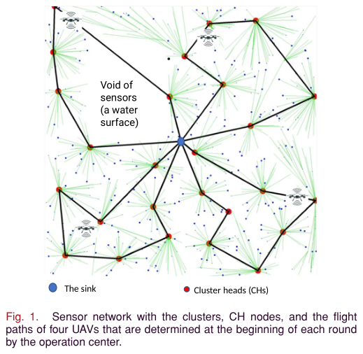
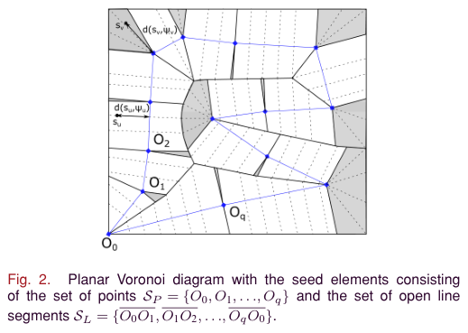
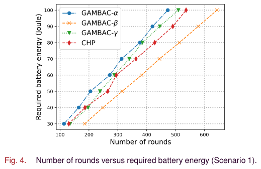

# Nguyen, Nguyen, Do, Rotter 2023 · Multi-UAV data gathering with balanced clustering (GAMBAC)

## Tóm tắt một dòng
Phân cụm WSN và lập tour cho M UAV có giới hạn quãng bay ℓmax; chặn dưới năng lượng node gửi về CH tỉ lệ S²/ℓmax, đạt gần khi các cụm cân năng lượng; ba heuristic GAMBAC tìm số cụm lớn nhất bằng chia đôi, so MILP ở 50 node và vượt CHP.

## Vì sao đọc
Người dùng đưa làm mẫu cách viết bài dạng tối ưu (chatlog mục 395). Bài có cấu trúc giống pha 0 của SigDrop: trạm trung tâm
chọn CH, giao node và lập quỹ đạo UAV trước mỗi vòng, rồi gửi kế hoạch xuống mạng.

## Bài toán và mô hình
- **[GĐ]** N cảm biến đo ẩm đất trong một vùng nông nghiệp; dữ liệu phải về trung tâm vận hành sau mỗi chu kỳ Tmax giây; trung
  tâm biết vị trí mọi node (tr. 2).
- **[GĐ]** Ba cách chuyển dữ liệu: (a) node gửi thẳng về trung tâm, (b) mạng ad hoc chuyển tiếp về trung tâm, (c) UAV kết hợp mạng
  ad hoc; (a) và (b) làm cạn pin node chuyển tiếp nhiều, nên bài chọn (c) (tr. 2).
- **[GĐ]** M UAV bay tốc độ không đổi v0 ở độ cao H, quãng bay tối đa ℓmax mỗi vòng; quỹ đạo là đường gấp khúc kín O0O1…OqO0 qua
  các CH, O0 là trạm (tr. 2–3).
- **[GĐ]** Mỗi vòng bốn bước: (1) trung tâm chọn CH, giao node cho CH, dựng cây chuyển tiếp (DFT) mỗi cụm, tính quỹ đạo thoả
  ℓmax; (2) phát thông tin CH và DFT xuống node; (3) UAV bay theo quỹ đạo; (4) node gửi dữ liệu và mức năng lượng theo DFT về CH,
  CH chờ UAV lơ lửng phía trên rồi gửi dữ liệu gộp (tr. 2–3).
- **[GĐ]** Mô hình năng lượng radio bậc nhất: nhận E_Rx = E_RX0 mỗi bit, phát E_Tx(i, j) = E_TX0 + ϑ·d²ᵢⱼ mỗi bit; phát lên UAV dùng
  d = H; năng lượng node i một vòng là (1), năng lượng dư cập nhật theo (2) (tr. 3).
- **[GĐ]** Mục tiêu nêu ở mở đầu: tối thiểu năng lượng node-tới-node (S2S) trong khi mỗi UAV không bay quá ℓmax mỗi vòng (tr. 1).
  Bài không viết bài toán tối ưu thành công thức (xem [NX] cuối ghi chú).

## Định nghĩa và ký hiệu
| Ký hiệu | Nghĩa |
|---|---|
| G = (V, Ξ) | đồ thị mạng; cạnh khi khoảng cách < tầm R (tr. 3) |
| C(G, K) = {V1…VK, H} | phân cụm: K tập rời và tập CH H = {ch1…chK} (Định nghĩa 1, tr. 3) |
| Tk | cây chuyển tiếp dữ liệu (DFT) của cụm k (Định nghĩa 2, tr. 3) |
| E⁰ᵢ, Eʳᵢ | năng lượng ban đầu, năng lượng đầu vòng r của node i (tr. 3) |
| bᵢ, B_{i,C} | bit của chính node i, bit node i chuyển tiếp cho con (tr. 3) |
| ϑ | hệ số mạch và anten trong E_Tx (tr. 3) |
| E_S2S | tổng năng lượng mọi node gửi dữ liệu về CH trong một vòng (tr. 3) |
| ϱ, S_total | mật độ node, diện tích vùng (tr. 3–4) |
| E_R | năng lượng nhận và phát một đơn vị dữ liệu qua tầm R; c = ϱE_R/R (tr. 3–4) |
| Θ | ϑR²/E_R; giả định Θ < 1/2 cho đa số module RF (tr. 8) |

- **[ĐN]** Triển khai đều (uniform): node giống nhau rải đều trong vùng (Định nghĩa 3, tr. 3).
- **[ĐN]** Triển khai từng mảng (plain): vùng chia nhiều mảng, mỗi mảng triển khai đều và mỗi node trong mảng thu cùng lượng dữ
  liệu (Định nghĩa 4, tr. 3).

## Kết quả chính
- **[KQ] Mệnh đề 1** (tr. 3–4). Mỗi vòng: (1) triển khai đều thì E_S2S > c·S²_total/ℓmax; (2) vùng gồm K mảng lồi Aᵢ diện tích Sᵢ,
  mỗi node trong Aᵢ thu ςᵢ dữ liệu, thì E_S2S > c·(Σ√ςᵢ·Sᵢ)²/ℓmax. Tổng năng lượng tiến tới chặn dưới nếu các cụm cân năng lượng.
  *Ý chứng minh* (phụ lục, tr. 7–10): chia mặt phẳng theo Voronoi của các điểm quay Oₜ và các đoạn OₜOₜ₊₁ của quỹ đạo (Fig. 2);
  node không thể gần CH hơn phần tử Voronoi chứa nó; cách gửi tiết kiệm nhất qua khoảng d là ⌈d/R⌉ chặng đều nhau (3).
  Bổ đề 1 (vùng của đoạn, chia chữ nhật, Fig. 8): E_{t,t+1} > (c/4)·S²_{t,t+1}/ℓ_{t,t+1}. Bổ đề 2 (vùng của điểm, chia hình quạt,
  Fig. 9): Eₜ > (4c/3)·S²ₜ/ℓₜ. Cộng lại và dùng Cauchy–Schwarz ra (23), rồi bỏ số hạng Σ(3/4)ℓₜ ≪ ℓmax ra (24) (tr. 10).
- **[NX]** Phần "tiến tới chặn dưới khi cụm cân bằng" chỉ suy từ điều kiện dấu bằng của Cauchy–Schwarz, bài không chứng minh
  riêng. Chặn dưới giảm theo 1/ℓmax: cho UAV bay xa hơn thì node tốn ít hơn, đúng với đánh đổi bài nêu ở mở đầu.

## Thuật toán
- **[TT] GAMBAC** (Algorithm 1, tr. 4). Chia đôi trên khoảng (low, high): mỗi bước chọn tập CH bằng SELECT_CHS(G, mid), lập M tour
  bằng MULTIPLETSP (dựa trên thuật toán TSP [22]); mọi tour ≤ ℓmax thì giữ nghiệm và tăng low, ngược lại hạ high; cuối cùng GROW dựng
  DFT cho tập CH tốt nhất.
- **[TT] GAMBAC-α** (Algorithm 2, tr. 4). Tìm K lớn nhất (khoảng (0, N)). SELECT_CHS-α chọn CH ngẫu nhiên với xác suất tỉ lệ năng lượng
  dư, mỗi cụm chứa tối đa W = (1 + ε)·tổng dữ liệu/K; thừa cụm thì bỏ các cụm nhỏ nhất và thử lại tối đa nth lần (tr. 4–5).
- **[TT] GROW** (Algorithm 3, tr. 5). Giống Dijkstra song song dựng Voronoi trên đồ thị: lần lượt thêm node gần rừng DFT nhất vào cây
  gần nó nhất, dừng một cây khi vượt hạn dữ liệu; ra các tập Voronoi ε-cân bằng.
- **[TT] GAMBAC-β** (Algorithm 4, tr. 5–6). Cân tỉ lệ tải trên năng lượng dư thay cho cân dữ liệu: hạn dữ liệu của CH u là
  p/100·năng lượng dư/(E_RX(1) + E_TX(1)); chọn node năng lượng dư lớn nhất làm CH; chia đôi tìm p nhỏ nhất mà M UAV vẫn bay đủ.
- **[TT] GAMBAC-γ** (Algorithm 5, tr. 5–6). Như β nhưng chọn CH ngẫu nhiên theo năng lượng dư như α.

## Thực nghiệm và số liệu
- **[TS]** MILP giải bằng CPLEX làm nghiệm tham chiếu, chỉ tới 50 node; bài ghi độ phức tạp MILP là O(N³) (tr. 6).
- **[TS]** Bảng I (tr. 6): Net1 50 node trong 250 × 250 m, 4 UAV; Net2 1 000 node trong 600 × 600 m, 4 UAV; E_elec = 50 nJ/bit,
  ε_fs = 10 pJ/bit/m², ε_mp = 0,0013 pJ/bit/m⁴.
- **[SỐ]** So MILP (Bảng II, tr. 6): 4 UAV, ℓmax = 200 m, 50 J mỗi node, 64 Kb mỗi vòng; sau 50 vòng node yếu nhất còn 78,35 %
  (MILP) và 69,65 % (GAMBAC-α); MILP mất 30 phút mỗi vòng, GAMBAC-α 0,35 s.
- **[TS]** So CHP [16] (heuristic tốt nhất trước đó, chọn tour theo bao lồi rồi luyện kim mô phỏng): vùng 3 000 × 3 000 m; kịch bản
  1 không lỗ, dữ liệu 8–64 kbit mỗi node; kịch bản 2 có một lỗ lớn, phía xa lỗ sát biên thu 52 Kb (tr. 6, Fig. 3).
- **[SỐ]** Để chạy 200 vòng, mỗi node cần pin 32 J (β), 40 J (γ), 41 J (CHP), 50 J (α) (Fig. 4, tr. 6).
- **[SỐ]** β có năng lượng dư đều nhất (σ nhỏ nhất ở vòng 464, kịch bản 1, Fig. 5; vòng 211, kịch bản 2, Fig. 7) (tr. 7).
- **[KQ]** CHP tốt ở vùng đơn giản, kém khi vùng có lỗ và dữ liệu phân bố không đều (tr. 7).

## Hình tiêu biểu

*Đọc hình:* trạm ở giữa, bốn tour kín đi qua các CH (chấm đỏ), node thường gửi về CH theo cây (vạch xanh); vùng trống là mặt nước.

*Đọc hình:* mỗi node thuộc vùng Voronoi của một điểm Oₜ (xám) hoặc một đoạn OₜOₜ₊₁; khoảng cách tới phần tử đó là chặn dưới của
khoảng cách tới CH.

*Đọc hình:* cùng một mức pin, GAMBAC-β (cam) chạy được nhiều vòng nhất; α kém CHP.

## Trích nguyên văn
- **[TRÍCH]** "A good UAV-assisted data-gathering scheme should achieve a trade-off between the flying distance of UAVs and the total
  energy consumption of sensor nodes." (tr. 1)
- **[TRÍCH]** "we are motivated by the quest for an efficient solution for minimizing the sensor-to-sensor energy expense while
  satisfying an upper limit on the travelling distance of each UAV per data collection round." (tr. 1)

## Liên hệ SigDrop
- **[NX] [L1]** Mạch "chặn dưới → điều kiện để đạt chặn → heuristic nhắm điều kiện đó" là khung tốt cho bài chọn critical cell và
  phần mặt đất: có cận (LP của luồng, cận một radio) thì nêu điều kiện đạt cận (tải các môi trường cân nhau) rồi lập kế hoạch cân tải.
- **[NX]** So heuristic với nghiệm đúng ở mạng nhỏ (MILP, 50 node) kèm thời gian giải là cách chứng minh chất lượng mà J1 nên làm cho
  pha 0, phần mặt đất (LP) và pha 2 (quy hoạch động khi ít cell nghi vấn).
- **[NX]** Mục III tả hoạt động một vòng thành các bước đánh số (ai tính gì, gửi gì, lúc nào); SigDrop nên tả pha 0, 1, 2 theo cách này
  trước khi viết công thức.
- **[NX]** Lập luận chọn cách (c) qua ba phương án (a), (b), (c) giống phần "vì sao cần UAV" của SigDrop (LoRa, flood mặt đất, UAV).

## Hạn chế và câu hỏi mở
- **[NX]** Không có phát biểu bài toán dạng công thức (biến, hàm mục tiêu, ràng buộc); MILP được nhắc nhưng không viết ra.
- **[NX]** Tên bài nói tối đa thời gian hoạt động, nhưng mục tiêu mỗi vòng là tối thiểu năng lượng S2S có ràng buộc ℓmax; "network
  lifetime" ở Fig. 6 không có định nghĩa riêng.
- **[NX]** Số liệu lệch nhau: Bảng I ghi Net2 trong 600 × 600 m, phần chữ ghi vùng 3 000 × 3 000 m (tr. 6); câu "Numerical results
  show…" lặp hai lần trong abstract (tr. 1); "MILP có độ phức tạp O(N³)" không đúng nghĩa thông thường của MILP.
- Chặn dưới chỉ cho triển khai đều hoặc từng mảng lồi; không xét kênh có mất gói.
